+++
title = "[译文] 内存优化数据系统中的访问路径选择：扫描还是探查？"
date = 2026-11-16T00:00:00+08:00
slug = "access-path-selection-scan-or-probe"
summary = "Access Path Selection in Main-Memory Optimized Data Systems 的中文译文。"
tags = ["查询优化", "内存数据库", "访问路径"]
categories = ["数据库系统", "计算机技术"]
draft = false
+++



原文：[Access Path Selection in Main-Memory Optimized Data Systems: Should I Scan or Should I Probe?](https://doi.org/10.1145/3035918.3064049)，Michael S. Kester、Manos Athanassoulis、Stratos Idreos，SIGMOD 2017。

原文版权声明：允许免费制作本作品全部或部分内容的数字或纸质副本，供个人或课堂使用，条件是副本不用于营利或商业利益，并在首页附上本声明及完整引文。须尊重本作品中不属于 ACM 的部分的版权。注明出处的摘要引用是允许的。其他形式的复制、再版、发布到服务器或向邮件列表再分发，须事先取得明确许可和／或支付费用；许可申请请联系 permissions@acm.org。SIGMOD ’17，2017 年 5 月 14—19 日，美国伊利诺伊州芝加哥。© 2017 ACM。ISBN 978-1-4503-4197-4/17/05，15.00 美元。DOI：10.1145/3035918.3064049。

## 摘要

列式数据分析引擎的出现推动了一系列针对扫描算子的优化。新的设计包括列组存储、向量化执行、共享扫描、直接处理压缩数据，以及使用 SIMD 和多核执行。更大的主存和更深的缓存层次提高了现代扫描的效率，促使我们重新审视访问路径选择问题。

本文比较现代顺序扫描和二级索引扫描。通过详细的分析建模和实验，我们表明，尽管扫描在比过去更多的场景中变得有用，但两种访问路径仍各有用途，因此面对变化的工作负载，要达到最佳性能仍需进行访问路径选择（APS）。我们展示如何进行访问路径选择。具体而言，与传统系统在扫描和二级索引之间的选择方式不同，我们发现，现代优化器除了考虑查询选择率、底层硬件和系统设计，还需要考虑查询并发度。我们进一步讨论将访问路径选择集成到现代分析型数据系统中的影响。理论和实验均表明，使用所提出的模型，系统能够快速选择访问路径，其性能优于依赖单一访问路径或传统访问路径模型的方案。我们概述了一种将 APS 集成到内存分析系统中的轻量级机制，它不会干扰低延迟查询。我们还使用 APS 模型解释硬件和工作负载的变化如何使顺序扫描与二级索引扫描之间的分界随历史演变，从而可以根据硬件进步对未来进行预测。

## 1. 引言

**访问路径选择。** 对过滤算子进行访问路径选择一直是数据库系统的关键组成部分 [70]。当查询的谓词针对聚簇索引时，使用该索引是显而易见的选择。同样，当查询谓词针对没有索引的属性时，只有顺序扫描这一条可用路径。更困难且更常见的情形是，查询谓词针对具有二级索引的列。此时，二级索引扫描可能比完整顺序扫描更好，也可能不是 [70]；对于这类情形，数据系统需要在优化期间依据运行时特征选择最佳访问方法。在基础数据上的顺序扫描和二级索引扫描之间进行选择，使系统能够在优化时考虑运行时特征。基础数据的顺序扫描读取每一个元组，而二级索引扫描只需访问一份更小且更有结构的辅助数据副本。二级索引通常采用 B+-Tree [30, 70] 的形式，在行式系统中被广泛用于访问目标数据，既避免读取不需要的值，也避免读取其相邻属性的开销。访问路径的选择通常基于一个选择率阈值，并结合底层硬件属性、系统设计参数和数据布局 [29, 32]；系统调优后，这个固定的阈值适用于所有查询。

**现代分析系统中的访问路径。** 过去二十年中，数据库系统大幅偏离传统行式系统的设计，转而采用列式存储（以及近来的列组存储）和针对主存高度优化的访问路径 [1]。在这类分析系统中，大量优化和技术使扫描极快，也让二级索引面临越来越大的压力。首先，列式或列组存储使系统只需处理回答给定查询所需的属性，避免不必要的读取，其效果与二级索引相似 [4, 19, 25, 33, 43, 56, 77]。其次，与每次处理一个元组不同，向量化执行将一块元组传递给每个算子。它通过在紧凑循环中处理每个块，减少解释逻辑的开销，从而提高效率 [16]。第三，当系统针对相同属性处理多个查询时，可以共享扫描 [7, 18, 27, 28, 34, 62, 63, 88]。对关系的每一个块，可以处理多个查询，与每次处理一个查询相比，这样更有利于利用磁盘、内存或缓存。共享扫描是访问方法日益重视缓存友好性的一个例子 [65, 87]。第四，现代分析系统通过独立压缩各列并直接处理压缩数据，比行存储更有效地利用压缩，从而降低数据在内存层次中移动的成本 [2, 12, 14, 15, 42, 77]。第五，将每个属性连续保存在稠密数组中，既支持紧凑的 for 循环求值 [51, 55, 86]，也适合单指令多数据（SIMD）处理 [60, 81, 84]。SIMD 可以并行处理多个连续元组，而多个核心则可以并行处理关系中不同的部分 [63, 80]。

使现代分析数据系统扫描高效的许多技术在过去的研究中已经得到探索，例如压缩 [31]、列式数据组织 [44]、内存系统 [24] 和扫描共享 [89]。但是，要充分发挥这些技术的潜力，需要一种从一开始就融合既有研究、并发展成为全新框架的系统设计 [1, 37, 49, 77, 85]。这些研究已广泛应用于业界，例如 HyPer [59]、DB2 [64] 和 dashDB [13]、SAP HANA [25]、Oracle 内存数据库 [48]、Vertica [49]、Vectorwise [85]、MemSQL [75] 和 SQL Server [50]。我们使用“现代分析系统”这一术语，而不是列存储，因为这些系统采用的技术远不止按列存储数据。

**主存中的访问路径决策。** 上述变化，加上大容量内存使许多场景下的热数据能够驻留内存，使人们开始质疑二级索引的必要性。传统行存储中二级索引的主要收益被认为是减少从磁盘移动数据；由于数据布局和大容量内存，这不再处于关键路径上。因此，许多现代分析系统至少在开发初期完全不提供二级索引，而是专注于使用单一访问路径最大化扫描性能，同时仍使用聚簇索引和 zone map 等数据跳过技术 [58]。此外，由于内存处理的响应时间通常很低，留给访问路径选择的时间有限；优化时间已经成为新的瓶颈 [21, 73]。

**待解决的问题。** 本文回答两个问题：（1）在现代分析系统中，二级索引是否仍有用武之地？如果有，（2）鉴于系统设计的进步，应如何进行访问路径选择？除了许多现代系统选择不提供二级索引之外，第一个问题之所以有趣，还因为扫描不断得到优化 [54, 55, 60]。共享扫描等功能越来越常见，读查询的并发度也在指数增长 [69]。当一次顺序扫描就能回答多个查询时，是否仍需要二级索引？许多查询的响应时间不到一秒，是否还有时间对访问路径作出有意义的决策？

**现代分析系统中的访问路径选择。** 我们从理论和实验两个方面表明，尽管扫描确实在比过去更多的情况下有用，二级索引对于低选择率查询仍然有用。[^selectivity] 我们证明，为了在现代系统中选择访问路径，优化器除了沿用传统方式考虑查询选择率和环境特征，还需要考虑查询并发度。任意时刻的并发查询数量至关重要，因为它影响能够共享一次列扫描或一次二级索引树遍历的查询数量。

[^selectivity]: 本文以 Pat Selinger 的论文 [70] 中“selectivity factor”的方式使用“选择率”一词，将其视为一个数值而非属性。因此，“高选择率”表示查询结果集包含许多符合条件的元组，“低选择率”则相反。

我们表明，访问路径选择不应再使用过去 35 年间一直采用的固定选择率阈值 [6, 21, 70]；相反，分界点会移动，主要取决于并发查询的数量及其总选择率。图 1 展示了我们访问路径选择方法的基本思想，以及它与历史方法的区别。传统做法是针对硬件调优系统，然后确定一个固定选择率点。预计返回的关系数据比例高于该点的查询均使用顺序扫描。我们针对现代分析系统提出的变化是：访问路径选择不应有固定的选择率点。盈亏平衡点是可变的；随着并发执行的查询增多，它对应的选择率降低。我们还发现，在某些情况下存在一个理论上的点，超过该点后共享扫描总是最佳选择，即图 1 的最右侧。当并发度超过一个阈值时，这个点会发生变化；该阈值取决于底层硬件、数据布局和物理设计决策。然而，受其他因素限制，例如写入结果时的数据访问可能导致 TLB miss，当前技术无法实现任意高的并发度。

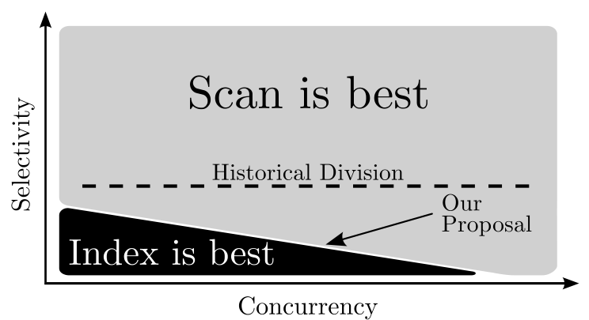

**图 1：** 现代数据分析系统中的访问路径选择除了考虑选择率、硬件特征和数据布局，还应考虑查询并发度。选择率阈值并非固定不变；相反，分界线倾斜，其位置取决于并发查询数量及其总选择率。

**系统集成。** 我们讨论如何将这种新的访问路径选择方式集成到现代分析系统中。优化器需要为硬件（CPU、缓存、内存延迟和带宽）和工作负载（选择率和查询并发度）建模，并持续监控后者。这使系统能够针对一组谓词作用于相同数据的查询，动态决定使用共享扫描还是共享二级索引扫描。系统还应根据所访问数据的底层布局动态调整，包括纯列式、用于混合存储的列组，甚至完整行。我们在原型系统 FastColumns 中结合这些技术，以展示访问路径选择对分析工作负载有益，而且即使对于亚秒级查询，也不会损害性能。

本文关注读取性能。面向分析的现代内存优化系统要么不支持更新、只支持追加，要么通过单独的 write-store（或某种 delta store）支持更新，先累积更新，再定期将其合并到针对读取优化的存储中 [35, 47, 49, 77]。我们的访问路径选择分析针对 read-store 中的分析查询。

**贡献。** 本文作出以下贡献：

- 提出一个扩展的访问路径代价模型，用于刻画支持共享访问的内存优化分析数据系统中 select 算子的性能（第 2 节）。
- 说明访问路径选择是必要的；即使采用快速扫描，经过调优的二级索引仍然有用（第 2 节）。
- 说明除了选择率和硬件特征，访问路径选择还需要动态考虑查询并发度（第 2 节）。
- 将访问路径选择集成到现代分析原型系统的优化器中，并表明尽管访问路径选择现在更复杂、必须考虑更多信息，仍能足够快地完成，甚至使亚秒级查询受益。
- 证明访问路径选择适用于多种工作负载，性能优于依赖单一访问路径或传统访问路径选择模型的方案（第 4 节）。
- 使用该模型展示在过去五十年里，随着数据布局和硬件属性的变化，决定何时使用索引的方式如何变化（第 5 节）。

## 2. 访问路径选择

本节提出一个用于内存优化分析数据系统的访问路径选择模型。我们首先介绍符号及其他基础知识（第 2.1 节），然后为顺序扫描建模（第 2.2 节）。与过去的建模方法 [16, 56] 类似，我们考虑底层硬件特征，以及提高扫描性能的多种技术，例如紧凑的 for 循环、使用多个核心和处理压缩数据。关键的是，与以往的方法 [6, 21, 70] 不同，我们还在模型中加入了同时处理多个查询的共享扫描。接下来，我们为经过内存优化的 B+-Tree 上的并发访问建模（第 2.3 节）。该模型支持从纯列式到纯行式的数据布局，以及介于两者之间的混合布局，并可选择使用基于值的压缩，即数值压缩或字典压缩。

我们使用这个模型建立访问路径选择策略，为给定的一批查询在顺序扫描和二级索引扫描之间进行选择（第 2.4 节）。我们表明，除了传统访问路径选择使用的选择率和硬件特征外，批次中的并发查询数量、批次的总选择率，以及各个查询对总选择率的贡献，也都至关重要。

本节的模型是第 3 节所述设计不可分割的一部分；第 3 节将讨论如何将访问路径选择集成到分析数据系统中。

### 2.1 模型基础

**Select 算子。** 我们研究 select 算子的性能。这类算子通常会在查询中滤除大部分数据，因此对估计查询计划的总代价很重要。我们保留 select 算子的标准接口：输入是一个列（对于纯列存储）或列组（对于混合存储或纯行存储）。select 算子的任务是根据一个谓词，即范围查询或点查询，生成所有符合条件的元组的列表。输出是一组 rowID，它们是定长稠密列中的偏移量。

**参数和符号。** 访问路径选择模型的参数涵盖：（i）查询工作负载；（ii）数据集和物理存储布局；（iii）底层硬件；以及（iv）索引和扫描设计。表 1 给出了这些参数及模型使用的符号。

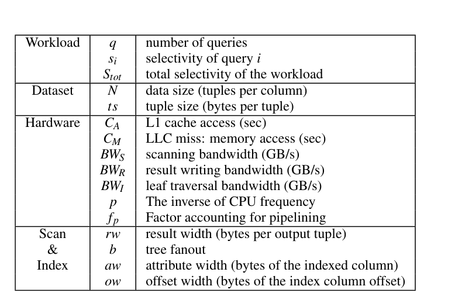

**表 1：** 用于为访问方法建模和进行访问路径选择的参数与符号。

**查询工作负载建模。** 查询工作负载由两个参数建模：并发查询数量和查询的选择率。我们用 \\(q\\) 表示查询数量，用 \\(s_i\\) 表示各查询的选择率，其中 \\(i=1,\ldots,q\\)。单个选择率 \\(s_i\\) 对应于根据谓词在查询 \\(i\\) 中符合条件的元组所占百分比。一个批次的总体结果集大小由 \\(q\\) 个选择率之和给出，称为总选择率，\\(S_{tot}=\sum_{i=1}^{q}s_i\\)。\\(S_{tot}\\) 可以超过 100%；例如，三个查询的选择率均为 40% 时，\\(S_{tot}\\) 为 120%。

**数据布局建模。** 接下来，我们通过考虑输入数据的形态和大小来为物理存储布局建模。顺序扫描和二级索引扫描都作用于单列或列组。我们用 \\(N\\) 表示关系的基数，即元组数量，用 \\(ts\\) 表示每个元组的宽度；元组可以由单个属性、一组属性或完整行组成。每个输出值的宽度记为 \\(rw\\)。为索引扫描建模还需要两个参数：索引属性的宽度 \\(aw\\) 和 rowID 的宽度 \\(ow\\)。

**硬件特征建模。** 模型中的另一个重要因素是底层硬件。我们关注内存优化系统，因此数据至少是经常使用的数据预计驻留在内存中，主要代价来自内存层次各级的访问。所有代价都以时间为单位衡量：访问可以是缓存访问（命中）\\(C_A\\)，也可以是末级缓存未命中并导致主存访问的 \\(C_M\\)；顺序读取内存中的数据则以内存带宽速度进行，以每秒字节数计。模型区分顺序扫描时的内存带宽 \\(BW_S\\)、将结果写入输出缓冲区时的带宽 \\(BW_R\\)，以及扫描树叶节点内容时的带宽 \\(BW_I\\)。

**其他扫描优化。** 单查询性能可通过 zone map 之类的数据跳过技术提高。分析系统通常使用 zone map，根据一组值的边界判断它们不可能满足给定查询，从而避免读取该组值。对于单个查询，只需按预期跳过的 zone 数量和每个 zone 中的条目数量，减少关系中的值数量即可为此建模。zone map 的一个缺点是，随着并发度增加，可以跳过的 zone 数量减少，因为要跳过某个 zone，组内所有查询都必须不需要它。

**压缩。** 数据可以被压缩，访问路径可以直接处理压缩数据。我们考虑保序字典压缩 [12, 81]：访问路径首先在字典中探查上下界值，然后直接对压缩数据求值谓词。我们对每一列使用一个字典，并将数据压缩到两个字节。当数据的值域很小，即不同值不超过 256 个时，还可以进一步压缩列。不过，在这种情况下也应考虑位图索引等其他访问路径。

**B+-Tree 调优。** 最后，内存中基于树的二级索引的性能深受树形状的影响。决定树形状的主要参数是扇出 \\(b\\)。它既影响内存效率，也影响遍历树索引时产生的随机访问次数。

### 2.2 内存共享扫描建模

从根本上说，顺序扫描是遍历输入数据数组，根据谓词比较找出符合条件的元组。扫描使用紧凑的 for 循环依次检查每个元组，如图 2(a) 所示。在现代数据系统中，每个属性都存储在由定长元素组成的稠密数组中；在混合存储中，较宽的数组包含相邻属性。对连续内存的这种遍历能实现高效求值，性能仅受内存带宽限制。

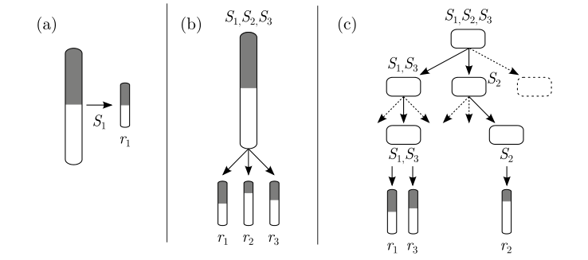

**图 2：** select 算子的顺序扫描和二级索引扫描访问模式。基本扫描（a）顺序遍历输入并对谓词求值，以找到符合条件的位置。共享扫描（b）只遍历关系一次。批量 B+-Tree 遍历（c）在每一层发出预取，但只预取需要的子节点。

**扫描的数据移动。** 在紧凑的 for 循环扫描中，底层数组的数据被顺序访问。给定内存带宽 \\(BW_S\\)，顺序扫描数据、即读取 \\(N\\) 个大小为 \\(ts\\) 的元组的代价 \\(TDS\\)，以秒计为：

$$TDS=\frac{N\cdot ts}{BW_S} \tag{1}$$

**谓词求值。** 谓词求值的 CPU 代价可能影响扫描性能。扫描需要对读到的每一个值计算谓词，即比较下界和上界。假设 \\(p\\) 是处理器时钟周期，\\(f_p\\) 是考虑指令流水线的常数因子，则谓词求值的 CPU 代价 \\(PE\\) 为：

$$PE=2\cdot f_p\cdot p\cdot N \tag{2}$$

我们假设充分利用 SIMD 和多核来优化每次顺序扫描的 CPU 代价。如果并发查询总数大于可用硬件线程数，则每个查询（select 算子）分配一个硬件线程；否则，将可用硬件线程分配给当前查询，每个查询可以使用多个线程。

取决于硬件特征，CPU 代价可能处于关键路径上。因此，每次扫描的数据消费代价等于 \\(TDS\\) 和 \\(PE\\) 的较大值。

当数据被压缩时，扫描会在字典中探查上下界值。如果一列使用多个字典编码，该过程就需要重复多次。一次字典探查的代价是两次缓存未命中；为简化起见，我们没有将其纳入模型，因为无论对扫描还是索引来说，实际中该代价比其余代价小好几个数量级。压缩值宽度的变化由参数 \\(ts\\) 表示。

**结果写入。** 扫描总代价的另一个重要部分是结果写入代价 \\(TDR\\)。输出整列需要写入 \\(N\\) 行，每行 \\(rw\\) 字节：

$$TDR=\frac{N\cdot rw}{BW_R} \tag{3}$$

为了避免在紧凑循环中可能代价高昂的分支预测错误，我们始终使用 predication 生成结果集 [5, 11]。由于写入的目标要么是已缓存的缓存行，要么是连续内存，因此写入也以内存带宽速度执行。

因此，单个查询 \\(i\\) 的扫描代价为：

$$SingleQueryCost=\max(TDS,PE)+s_i\cdot TDR \tag{4}$$

公式 4 由三个逻辑部分组成。第一是读取数据，其代价是元组数量、元组大小和内存带宽的函数；第二是对这些数据计算谓词的 CPU 代价，取决于 CPU 特征；第三是写回结果，即符合条件的元组 ID 的代价，它以内存带宽速度发生。模型进一步区分 \\(TDS\\) 和 \\(TDR\\)：根据数据的物理组织方式，扫描可能遍历一列或一组列；扫描结果也可以是单列或列组。

**共享扫描。** 现在我们将模型扩展到共享扫描，即 \\(q\\) 个查询共享一次对基础数据的扫描 [63, 88]。处理多个查询时，查询只需将数据沿内存层次向上移动一次，就能共享数据移动代价。然而，谓词求值代价现在随查询数量增加。由于数据移动是主要瓶颈之一，共享扫描至关重要。为了共享扫描，系统首先需要根据查询谓词所涉及的属性对查询分组。然后，依次针对批次中的每个查询，处理一小部分能够轻松放入硬件缓存的输入数据，如图 2(b) 所示。这样，目标数据在从处理器缓存驱逐之前可供多个查询使用，从而减轻内存带宽压力。每个查询使用单独的硬件线程，将工作分布到系统的各个核心。

当多个查询共享一次扫描时，读取数据的代价与单查询相同，这里假设全部 \\(q\\) 个查询同时开始。不过，现在必须考虑计算 \\(q\\) 个谓词所增加的 CPU 代价。对于结果写入，每个查询需要单独的结果集，因此生成查询结果集的代价是 \\(\sum_{i=1}^{q}s_i\cdot TDR=S_{tot}\cdot TDR\\)。

综合起来，内存中 \\(q\\) 个查询的共享扫描总代价为：

$$SharedScan=\max(TDS,q\cdot PE)+S_{tot}\cdot TDR \tag{5}$$

公式 5 同样由数据读取、谓词求值和结果写入三个逻辑部分组成，如图 3(a) 所示。读取基础数据的代价与公式 4 相同，但现在我们考虑了 \\(q\\) 次谓词求值及相应的结果集，即使用总结果大小 \\(S_{tot}\\) 代替单个查询的 \\(s_i\\)。

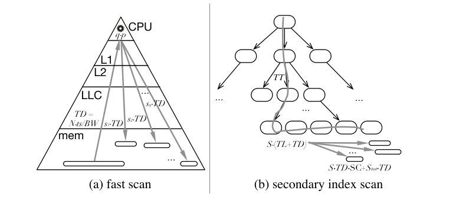

**图 3：** 访问路径操作示意。左侧（a）展示共享快速扫描的代价（公式 5）；右侧（b）展示内存优化二级索引扫描的代价（公式 13）。

### 2.3 内存二级 B+-Tree 建模

现在我们考察使用二级索引作为访问路径的可能性。我们使用 B+-Tree，并针对给定硬件和内存操作对其调优。换言之，在比较两种访问方法之前，我们对索引采用与扫描同等级别的先进优化。

我们从两个方面优化二级索引。首先，调整树的扇出，使其与底层硬件的内存延迟和带宽相匹配。其次，调整节点内搜索，即定位下一个要访问的子节点的过程，使其与扇出相匹配。

**使用二级索引执行 select。** 为了将 B+-Tree 用作二级索引，树在叶节点中存储索引属性的副本。叶节点还包含相应的 rowID，即索引值在基础数组中的位置。select 算子随后可以直接在树上运行，以与顺序扫描相同的方式输出结果位置，不过这些位置通常没有排序，后文将讨论这一点。

**二级索引扫描建模。** 内存 B+-Tree 探查包含多个步骤。首先遍历树，找到与所请求的值范围对应的第一个叶节点；其次遍历叶节点，读取索引数据；最后写入结果集。如果遵循索引生成的自然顺序，结果按索引属性排序。另一种选择是按 rowID 对数据排序，以提供与顺序扫描相同的结果。下面详细分析这些步骤并为其建模。

**树遍历。** 对扇出为 \\(b\\) 的 B+-Tree，从根节点遍历到第一个匹配叶节点的代价是元组数量 \\(N\\) 的函数，以秒计为：

$$TT=(1+\lceil\log_b(N)\rceil)\cdot\left(C_M+\frac{b\cdot C_A}{2}+\frac{b\cdot f_p\cdot p}{2}\right) \tag{6}$$

公式 6 假设从一个节点遍历到其子节点会产生一次随机内存访问，这种访问的次数取决于树高；同时假设对于每个内部节点，平均顺序读取一半的键，并对它们计算相应的搜索谓词，以找到目标子节点。

**叶节点遍历。** 利用查询 \\(i\\) 的选择率 \\(s_i\\)，可以近似计算系统为了收集符合条件的 rowID 必须遍历的叶节点数量。由于叶节点位于任意内存位置，每当需要访问新的叶节点时，即结果跨越多个叶节点时，都会发生一次缓存未命中。因此，给定树中叶节点的数量为 \\(N/b\\)，每个查询的叶节点遍历代价为：

$$s_i\cdot TL,\qquad TL=\frac{N\cdot C_M}{b} \tag{7}$$

**二级索引的数据遍历。** 不过，读取叶节点中的 rowID 可以建模为对值和 rowID 进行适当预取的顺序访问，其速度由遍历叶节点内容的带宽 \\(BW_I\\) 决定。因此，每个查询的代价取决于属性宽度 \\(aw\\) 和偏移量宽度 \\(ow\\)：

$$s_i\cdot TDI,\qquad TDI=\frac{N\cdot(aw+ow)}{BW_I} \tag{8}$$

当数据采用保序字典压缩时，索引遍历受益于每个节点可容纳更多键，树也可能因此变矮，减少缓存未命中。与扫描类似，其代价是对字典进行两次探查，取得查询上下界的编码。与扫描不同，对于二级索引，我们假设每列只有一个字典。

**结果写入。** 二级索引探查的总代价中，另一个重要部分是结果写入。与顺序扫描类似，结果写入增加的开销以秒计为 \\(RW=s_i\cdot N\cdot rw/BW_R\\)，实际上等于 \\(s_i\cdot TDR\\)。

**结果集排序。** 为了向下一个算子提供与扫描算子相同的结果，查询 \\(i\\) 的二级索引遍历需要按照 rowID 对输出排序。如果每次比较计入一次缓存访问，排序代价为：

$$SC_i=s_i\cdot N\cdot\log_2(s_i\cdot N)\cdot C_A \tag{9}$$

如果采用更高效、针对 SIMD 优化的排序算法，排序代价还可以进一步降低，参见附录 D。单独执行二级索引遍历时并不需要这种排序，但要提供能够与扫描直接比较的访问方法，就必须计入这项代价。这也取决于二级索引探查在查询计划中的位置。例如，在现代列存储中，元组重建是重要的代价组成部分，即根据对一个属性的选择来获取另一个属性或列；如果 select 算子的结果未经排序，元组重建算子将被迫以随机访问模式运行 [3, 38]。另一方面，完整的查询优化器可以选择使用按值排序的扫描输出，如果这对连接和聚合等后续算子有利。

综合以上各项，使用二级索引遍历执行单个查询的代价以秒计为：

$$SingleIndexProbe=TT+s_i\cdot(TL+TDI)+RW+SC_i \tag{10}$$

**并发索引访问。** 现在我们将分析扩展到 \\(q\\) 个查询同时希望在同一列或列组上执行 select 的情况。与顺序扫描的优化类似，多个查询也可以共享一次索引扫描。为了便于说明，分析假设全部 \\(q\\) 个查询同时到达。目标是利用现代多核处理器提供的并行性，并通过共享数据访问尽量减少数据移动。共享索引扫描首先根据可用硬件线程数 \\(t\\) 划分并发且重叠的查询，每个线程负责 \\(q/t\\) 个查询。虽然模型没有明确表示这一点，但当不同查询遍历树中重叠部分时，并发访问通常会在缓存中自然共享。因此，本节模型给出的是最坏情况分析。自然共享最常见于树的上层，所以树遍历代价主要由其他项决定。

在 \\(q\\) 个查询的共享索引扫描中，树总共被遍历 \\(q\\) 次。图 3(b) 展示了对应多个查询的共享索引扫描。每个查询都独立遍历树、相应叶节点和数据。其中一些访问可能由于前面的查询而命中缓存，但最坏情况下总是未命中。因此，访问叶节点和数据的总代价由总选择率 \\(S_{tot}\\) 给出。同样，结果写入代价取决于由 \\(S_{tot}\\) 给出的所选数据总量。最后，我们计入所有 \\(q\\) 个查询按 rowID 对结果排序的代价。将公式 9 所示的单独代价相加，得到 \\(\sum_{i=1}^{q}SC_i=\sum_{i=1}^{q}s_i\cdot N\cdot\log_2(s_i\cdot N)\cdot C_A\\)。

综合起来，内存中共享二级索引扫描的总代价如下：

$$ConcIndex=q\cdot TT+S_{tot}\cdot(TL+TDI)+S_{tot}\cdot TDR+\sum_{i=1}^{q}s_i\cdot N\cdot\log_2(s_i\cdot N)\cdot C_A \tag{11}$$

在附录 A 中，我们根据熵的定义进行分析，表明排序代价 \\(SC=\sum_{i=1}^{q}s_i\cdot N\cdot\log_2(s_i\cdot N)\\) 的最大值为：

$$MaxSC=S_{tot}\cdot N\cdot\log_2(S_{tot}\cdot N) \tag{12}$$

结合公式 11 和 12，并允许使用因子 \\(f_c\\) 修正排序代价估计，并发索引访问的最坏情况代价为：

$$ConcIndex=q\cdot TT+S_{tot}\cdot(TL+TDI)+S_{tot}\cdot TDR+SF\cdot C_A \tag{13}$$

其中：

$$SF=S_{tot}\cdot N\cdot\log_2(S_{tot}\cdot N) \tag{14}$$

公式 13 由五个逻辑部分组成：树遍历、叶节点遍历、数据读取、结果写入和结果排序。与公式 10 相比，并发索引访问可能多次遍历树，每个查询一次。最后，写入结果和对结果排序的工作量取决于各查询选择率之和。

### 2.4 评估访问路径选择

现在讨论访问路径选择。利用前面建立的模型，我们用公式 5 和 13 构造两种代价的比值，称为 APS（Access Path Selection），定义为 \\(APS=ConcIndex/SharedScan\\)。现代分析系统的优化器可以使用该模型确定采用哪条访问路径，详见第 3 节。当 \\(APS\geq 1\\) 时应使用扫描；当 \\(APS<1\\) 时，使用二级索引访问更有利。

本节接下来通过分析说明访问路径选择的直觉、观察结果和适用情形，提供证据说明现代分析系统确实有必要支持替代访问路径，以及这些选择与传统系统和优化器有何不同。本节的分析基于建模；第 4 节将给出详细实验分析，验证这些结果并提供更多认识。

**何时切换访问路径？** 为便于介绍 APS 比值，我们在 \\(SharedScan\\) 和 \\(ConcIndex\\) 的代价中使用公式 1、3、6、7、8 和 14 定义的四类量：树遍历代价 \\(TT\\)、叶节点遍历代价 \\(TL\\)、数据遍历代价 \\(TDS\\)、\\(TDR\\) 和 \\(TDI\\)，以及排序因子 \\(SF\\)。与树有关的代价 \\(TT\\) 和 \\(TL\\) 取决于关系大小、索引设计和硬件特征。数据遍历代价取决于数据大小和可持续读取带宽。最后，排序因子 \\(SF\\) 来自在将索引输出传递给下一个算子之前对其排序，以构造可以直接与扫描算子竞争的算子。根据公式 5 和 13，访问路径选择比值定义如下：

$$APS=\frac{q\cdot TT+S_{tot}(TL+TDI+TDR)+SF\cdot C_A}{\max(TDS,q\cdot PE)+S_{tot}\cdot TDR} \tag{15}$$

实际上，APS 是一个多元函数，取决于表 1 中列出的所有参数。但对于某个具体系统，硬件和物理布局决策已经确定。此外，运行时数据集大小也已知，因此运行时访问路径选择实际上是查询并发度 \\(q\\) 和总选择率 \\(S_{tot}\\) 的函数：\\(APS(q,S_{tot})\\)。

按照附录 B 中的推导，APS 比值可以改写为：

$$\begin{aligned}
APS(q,S_{tot})={}&\frac{q\cdot\frac{1+\lceil\log_b(N)\rceil}{N}\cdot\left(BW_S C_M+\frac{b BW_S C_A}{2}+\frac{b BW_S f_p p}{2}\right)}{\max(ts,2f_p p q BW_S)+S_{tot}rw\frac{BW_S}{BW_R}}\\\\
&+\frac{S_{tot}\left(\frac{BW_S C_M}{b}+(aw+ow)\frac{BW_S}{BW_I}+rw\frac{BW_S}{BW_R}\right)}{\max(ts,2f_p p q BW_S)+S_{tot}rw\frac{BW_S}{BW_R}}\\\\
&+\frac{S_{tot}\log_2(S_{tot}N)BW_S C_A}{\max(ts,2f_p p q BW_S)+S_{tot}rw\frac{BW_S}{BW_R}}.
\end{aligned} \tag{16}$$

**理解 APS 比值。** 公式 16 由两个不同部分组成。第一部分考虑查询并发度 \\(q\\)、数据集大小 \\(N\\)、索引分支因子 \\(b\\)，以及硬件权衡：带宽与末级缓存未命中、带宽与 L1 延迟之间的权衡。第二部分主要受谓词求值代价、总选择率 \\(S_{tot}\\) 和数据布局影响。

现在逐步考察分子和分母的两个部分。分子的第一部分受并发度影响；但由于存在 \\(\lceil\log_b(N)\rceil/N\\) 项，\\(q\\) 较低时其影响相当小。这意味着并发度较低时遍历索引的代价很小，随着并发度增加也只是略有增加。乘积 \\(BW_S C_M\\) 和 \\(b BW_S C_A\\) 取决于硬件特征，可以解释为：前者是在一次末级缓存未命中的延迟期间，能够从内存总线顺序读取的字节数；后者是在 \\(b\\) 次 L1 访问所需时间内，能够从内存总线顺序读取的字节数。通常，后者比前者约小一个数量级。同样，\\(b BW_S f_p p\\) 对应于搜索下一步应跟随哪个指针时执行 \\(b\\) 次比较的时间内，可以顺序读取的字节数。这三项从硬件角度将扫描与索引访问联系起来，更多细节见附录 B.1。

公式 16 分子的第二部分受到总选择率的显著影响。\\(BW_S C_M/b\\) 表示一次末级缓存未命中的时间内能够顺序读取多少索引节点，其余部分主要取决于索引和结果集的布局，以及扫描数据、遍历树和写入结果的相对性能。最后，只有分母中出现了元组大小 \\(ts\\)。这意味着较大的元组，例如采用行存储或列组存储时，会降低整个比值，表明索引更有用。此外，分母包含谓词求值的代价；当该代价大于数据移动代价时，扫描会更昂贵，随着并发度 \\(q\\) 增加就会出现这种情况。

当 \\(q\\) 较小时，分子的第二部分占主导，因此决定使用扫描还是索引的动态参数是总选择率 \\(S_{tot}\\)。另一方面，随着并发查询数量增加——这也是已观察到的工作负载趋势 [69]——公式 16 分子的第一部分和分母中的谓词求值部分占据主导，使查询并发度的重要性提高。从另一个角度理解公式 16 的访问路径选择模型，可以考虑数据集增大时的情况：\\(N\\) 越大，\\(q\\) 的影响越小；但观察到的工作负载和数据集趋势是 \\(q\\) 与 \\(N\\) 都会增长，因此并发度仍然是比较共享扫描和并发索引访问时的决定性因素之一。

**模型验证。** 我们使用四台机器上的实验数据验证模型的准确性。对于每组实验，我们采用多维无约束非线性最小化方法 Nelder-Mead 拟合模型。验证过程的更多细节见附录 C。

### 2.5 APS 模型分析

接下来进行详细分析，揭示访问路径选择的其他方面，并将结果归纳为若干观察。我们基于模型研究并发度、选择率、数据大小、元组大小和硬件特征变化时的多种情况。

工作负载、数据集、硬件和二级索引调优参数的设定基于我们的实验环境，见第 4 节。我们设置模型参数以匹配主要实验服务器：\\(C_M=180\\) ns、\\(C_A=2\\) ns、\\(BW_S=40\\) GB/s、\\(BW_I=20\\) GB/s、\\(BW_R=20\\) GB/s。我们将此硬件记为配置 HW1。我们还为另一种硬件配置 HW2 建模，其中 \\(C_M=100\\) ns，带宽为 \\(BW_S=160\\) GB/s、\\(BW_I=80\\) GB/s、\\(BW_R=80\\) GB/s。我们研究关系大小的影响，将 \\(N\\) 从 \\(10^4\\) 变化到 \\(10^{15}\\) 个元组；同时改变 \\(ts\\)，从一列时的 4 字节到十列时的 40 字节。我们还研究压缩，即考虑小于 4 字节的 \\(ts\\)，测试宽度最低为 2 字节。\\(rw\\)、\\(aw\\) 和 \\(ow\\) 均为 4 字节。我们将树的扇出设为 \\(b=21\\)，与在实验机器上寻找内存优化 B+-Tree 扇出的实验结果一致。

**解读模型图。** 结果见图 4 至图 10。每幅图从 90 度角展示 APS 比值的三维图，实际上给出了二维投影：颜色映射表示图中各点的值，等高线进一步帮助解释图表。在图 4 至图 7 中，横轴表示查询并发度 \\(q\\)，纵轴表示单个查询的平均选择率 \\(s_i\\)。图 8 至图 10 的横轴是关系大小 \\(N\\)，纵轴不变。APS 比值可以取从约 0 到远大于 1 的正值，但值得关注的范围接近 1，此处需要决定使用共享扫描还是并发二级索引访问。因此，每幅图对 \\(APS>3\\) 使用同一种颜色；颜色变化集中在值得关注的区间 \\([0,3]\\)。深蓝色区域的 APS 比值很低，表示使用二级索引将带来很大收益；浅蓝色区域表示二级索引可以加速 2 至 3 倍；青绿色区域表示索引和扫描的性能相近。黄色区域表示扫描快 1.5 至 2 倍，红色尤其是深红色区域表示共享扫描显然更优，性能差距超过 3 倍。

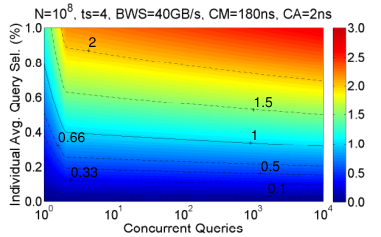

**图 4：** 访问路径选择至关重要，因为顺序扫描和索引扫描都可能是正确选择。决策取决于查询并发度。

我们从图 4 开始讨论。在这里，我们使用主要实验服务器的参数，针对纯列式布局比较扫描和二级索引。值得注意的是盈亏平衡点变化之快，以及作出错误决策带来的影响。为便于阅读，我们在 \\(APS=1\\) 处画实线，在 \\(APS=\{0.1,0.33,0.5,0.66,1,1.5,2,3\}\\) 处画虚线。当比值 \\(APS=0.66\\) 时，\\(ConcIndex/SharedScan=2/3\\)，因此 \\(SharedScan=1.5\cdot ConcIndex\\)。反之，当 \\(APS=1.5\\) 时，\\(ConcIndex/SharedScan=1.5\\)，因此 \\(ConcIndex=1.5\cdot SharedScan\\)。在这两种情况下，作出错误决策都会造成 50% 的性能损失。同样，对数值对 \\(\{0.5,2\}\\) 作出错误决策会慢 2 倍，例如错误选择索引对应各图深红色区域的 2 等高线；对 \\(\{0.33,3\}\\) 作出错误决策会慢 3 倍。

**观察 2.1。** 在现代内存优化分析数据系统中，共享扫描与共享索引扫描的性能存在一个盈亏平衡点；要在所有场景中最大化性能，需要进行访问路径选择。

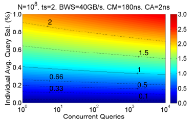

**图 5：** 使用压缩时（\\(ts=2\\)），仍然需要访问路径选择。分界点不同，但仍需作出选择。

图 4 中每条线的形状都取决于查询并发度。随着并发处理的查询增多，访问路径选择的分界点发生变化。换言之，访问路径选择不仅取决于选择率、硬件和数据布局，还取决于工作负载的并发度。随着并发度增加，二级索引适用的是批次中单个查询选择率更低的情况。另一方面，并发度非常高时，共享扫描更合适。实际上存在一个最大并发度，超过它之后扫描总是正确的选择；我们的实验表明，当前硬件无法达到这一点，但这种可能性仍然存在。压缩（图 5）也带来类似的行为。主要区别在于，即使并发度低至一个查询，扫描也略有优势，但仍然需要访问路径选择。

**观察 2.2。** 与传统查询优化决策不同，现代系统在顺序扫描和索引扫描之间作选择时，除了选择率还取决于并发度。

到目前为止，我们考虑的是每次存储一列的模型。然而，许多现代系统采用混合存储模型，以准确匹配工作负载和访问模式 [4, 19, 25, 33]。我们接下来通过改变元组大小继续分析，以此建模：（a）将数据存储为列组的混合系统；（b）数据压缩的影响，即使数据每次只按一列存储，压缩程度也可能不同，从而影响访问路径选择。

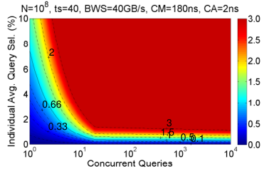

**图 6：** 从单列（图 4）转向列组时，支持两种访问路径并在其间作选择变得更加重要。

图 6 展示了另一种物理组织的影响：查询处理作用于包含十列的列组，\\(ts=40\\) 字节，而图 4 每次只处理一列。观察结果与之前的分析相似；不同之处在于，合适的区域同时向更高并发度和更低选择率移动，使访问路径选择更加关键。例如，在图 4 的单列存储中，最大选择率阈值为 0.4% 至 0.8%；现在单查询时这一阈值上升至 8%，但随着并发度增加逐渐降至 0.4%。总体而言，由于混合存储或压缩机会有限而导致元组较大时，索引更加有用；不过两条访问路径总是各有适用场景。

**观察 2.3。** 在支持列组的混合系统中，二级索引比在纯列存储中适用的情形更多，因为二级索引有助于避免更多不必要的数据在内存层次中移动。

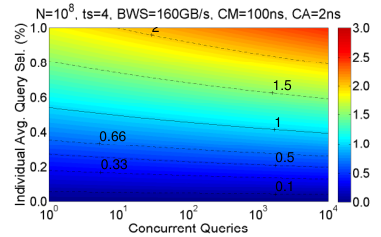

**图 7：** 在另一种硬件配置 HW2 中，延迟为 100 ns、带宽为 160 GB/s，访问路径选择至关重要。

图 7 重复图 4 的分析，但这次使用另一种硬件配置 HW2。改变缓存访问代价和主存访问代价，会改变从顺序扫描切换到二级索引扫描的分界点，使系统略微更适合使用二级索引。虽然实际分界点略有不同，但曲线形状和总体观察结果仍非常相似：所有系统都需要访问路径选择，并且并发度发挥重要作用。

**观察 2.4。** 虽然硬件特征会改变顺序扫描比二级索引扫描更合适的分界点，但所有系统都需要在运行时进行分析，以作出决策。

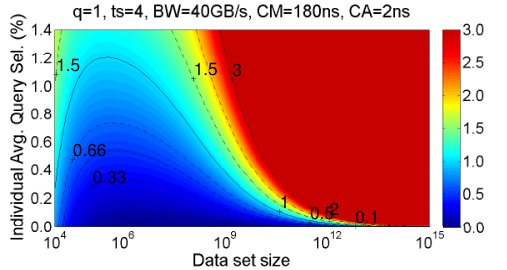

**图 8：** 为单个查询选择访问路径时，选择率降至 0.5% 至 1% 以下时索引更合适。

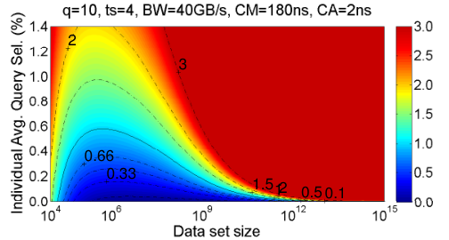

**图 9：** 随着并发度增加，索引更合适的情况对应于更低的查询选择率。

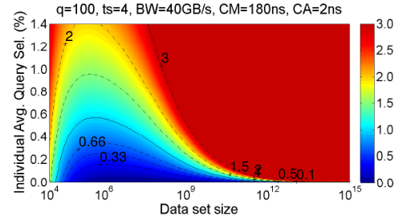

**图 10：** 即使并发度更高，访问路径选择仍有必要。

图 8 展示数据大小在 \\(10^4\\) 到 \\(10^{15}\\) 个元组之间变化时盈亏平衡点的变化。第一个观察是，排序开销使二级索引的用途减少，因为扫描在更低的选择率下就能超过二级索引。此外，我们仍能观察到查询并发度的影响。图 9 和图 10 表明，并发度较高时，存在一种较小的数据规模，即少于 \\(10^5\\) 个元组，在此规模下扫描总是更好。不过，我们无法无限制提高并发度。共享扫描可以处理几十或几百个查询，但当并发查询达到或超过 256 个时，L1 缓存和 TLB 等硬件资源会发生颠簸，性能下降。总体而言，对于 \\(10^4\\) 到 \\(10^{15}\\) 个元组的数据集，需要在共享顺序扫描和二级索引扫描之间作出决策，而决策点取决于查询并发度。

**观察 2.5。** 对更大的数据输入，访问路径选择变得更加关键，因为数据移动更昂贵，因而每次错误决策的代价也更高。

**综合分析。** 现代数据系统可以从多条访问路径中受益。在二级索引和扫描之间作出的决策取决于多个因素：查询选择率、硬件属性，包括缓存和内存延迟以及内存带宽，还有查询并发度。

## 3. 集成基于代价的 APS

我们已经证明，多条访问路径在现代系统中可能有用，也建立了一个用于动态选择访问路径的模型。接下来讨论如何将这项技术集成到现代内存优化分析系统中。我们使用存储和执行引擎 FastColumns 说明集成方式及其影响。FastColumns 包含前述全部数据布局和访问方法，包括单列、列组和完整元组等多种数据布局，以及二级树索引。

**新组件。** 为集成访问路径选择而引入的关键组件是新的基于代价的优化器，它实现上一节描述的模型，在运行时选择访问路径。调度器是另一个关键组件：它持续收集传入查询，并将引用相同数据的查询分批，准备交给优化器分析。其他几个现有组件必须收集正确的统计信息；多数系统很可能已经在收集这些统计信息。总体而言，将其集成到现代分析系统只需较小改动，无须大幅改变架构。图 11 直观展示了这一点：我们突出显示了需要作为优化器一部分的新 APS 模块；其余改动是确保系统具有正确的统计信息。

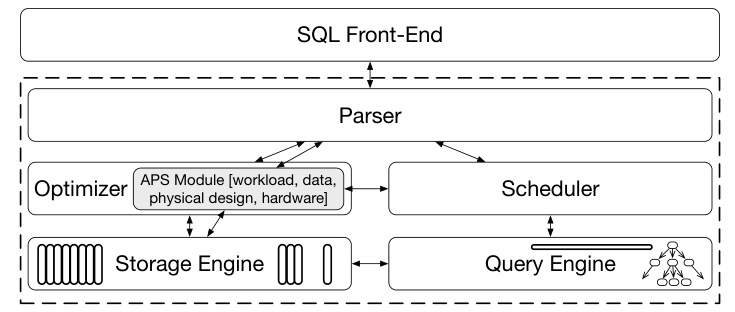

**图 11：** 集成基于代价的访问路径选择。

**持续收集数据。** 系统需要监控查询并发度、查询选择率和数据集属性，还必须考虑硬件特征；硬件特征在初始设置期间针对每台机器调优一次。优化器使用这些信息为 \\(q\\) 个并发查询选择访问路径。

为了获取所需信息，优化器同时与存储引擎和调度器通信。具体而言，数据属性，即大小和物理组织的信息，可以从存储引擎获得；查询并发度和选择率则为调度器所知，调度器从系统前端接收工作负载。其余硬件规格信息在系统于新机器上初始化时收集。这个过程可以自动化。我们使用 Intel 的 Memory Latency Checker 工具 [39]，记录系统各 NUMA 节点的内存延迟和带宽。

**选择访问路径。** 优化器还会进一步分析当前批次的查询及其引用的数据，确定访问路径选择所需的其他属性。这些属性包括待处理查询的数量、重叠范围的数量、总选择率，以及引用的数据大小和元组大小，即列组布局。每个批次的查询总选择率根据各查询的预期选择率估计。

利用前两段描述的数据，优化器可以在执行期间计算公式 15 的 APS 值，检查其是否小于 1（使用二级索引）或大于 1（使用顺序扫描），从而为一批查询选择访问路径。

**快速决策。** 在现代内存优化分析系统中，快速选择访问路径至关重要。原因是分析系统的响应时间通常很低，许多情况下不到一秒：一部分原因是先进的访问路径，另一部分原因是数据在许多情况下驻留内存。因此，现代分析系统中基于代价的优化器必须特别注意，确保优化时间不会成为总代价中的重要组成部分。我们的方案使数据收集和运行时计算的代价保持在较低水平。访问路径选择实际上只需少量指令，足以计算 APS 值即可。待处理查询数量及其选择率以类似其他统计信息的方式保存和维护：前者对每个属性维护一个简单计数，后者使用直方图等标准选择率估计技术。即使查询仅耗时几秒，也能非常快地计算 APS；在我们的测试机器上，决策耗时为微秒量级。

**错误传播。** 传统系统中选择错误访问路径及错误传播的问题已经得到广泛研究 [23]。本文提出的新访问路径选择范式考虑的信息比传统优化器多得多。然而，它不会使问题或解决方案变得更复杂，因为所有额外信息要么是优化器在运行时以精确方式获得的信息，如待处理查询数量和基于已有统计信息的查询总选择率；要么是在初始化时获得的信息，如静态且始终准确的硬件属性。

## 4. 实验分析

本节通过实验表明，将所有现代访问路径优化结合起来后，现代分析系统仍然需要访问路径选择。我们证明，与根据固定选择率阈值作出决策的现有系统不同，现代分析系统的优化器现在需要考虑访问相同属性的并发查询数量。我们还验证访问路径选择模型，表明它能够让优化器在多种场景下快速作出实时决策。

**硬件和操作系统规格。** 实验基础设施是一台拥有 4 个插槽的 NUMA 机器，每个插槽配备一颗 Intel Xeon E7-4820 v2 Ivy Bridge 处理器，运行频率为 2.0 GHz，具有 16 MB L3 缓存。每颗处理器有 8 个核心并支持超线程，总计 64 个硬件线程。机器配备 1 TB DDR3（1066 MHz）主存，均匀分配在各插槽之间；另有四块 300 GB、15000 RPM 的磁盘组成 RAID-5 阵列。我们运行 64 位 Debian 8.6“Jessie”，Linux 版本为 3.16.7。我们还使用 Amazon EC2 专用实例，在其他硬件上进行实验；详细信息见相应实验。

**实验方法。** 本节各实验使用均匀分布的 32 位整数构成的合成数据集。我们将数据大小从 1 亿个元组变化到 5 亿个元组。工作负载是一系列基于 select 的查询，选择率会变化，具体见各实验；我们报告每个 select 算子的测量执行时间。查询并发度从单个查询变化到 512 个查询。代价包含结果物化，二级索引扫描还包含按 rowID 排序。报告的每个数据点均为十次试验的算术平均值，标准差在 3% 以内。实验严格使用驻留主存的数据；必要时在测量前加载数据，不涉及磁盘 I/O。更快的数据读取有利于总是读取全部数据的扫描，也意味着必须快速完成访问路径选择。

**实现。** 所有实验都在第 3 节描述的 FastColumns 存储和执行引擎中进行。FastColumns 尚无 SQL 前端，因此所有实验均不计入 SQL 解析代价；所有查询都通过一种映射到查询逻辑计划的领域专用语言描述。

**没有始终最优的单一访问路径。** 我们首先比较使用 SIMD 和多个硬件线程的单次顺序扫描与多线程索引扫描的延迟，下一项实验再引入并发。这里的目标是说明，即使在充分调优的系统上执行单个查询，也需要访问路径选择。这适用于尚不支持共享扫描的现代分析系统。

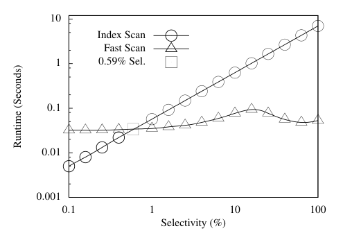

**图 12：** 即使 \\(q=1\\)，分析系统中的访问路径选择也存在交叉点。

图 12 展示了输入为 1 亿个元组时各访问方法的延迟，横轴上的查询选择率从 0% 变化到 100%。我们基于低选择率点的数据生成两条拟合线，以找出性能优势从一种访问方法转向另一种方法的分界点。虽然交叉点对应的百分比很低，性能差异却很显著。使用二级索引的查询可能比扫描快数倍；考虑数千个或更多查询的整个工作负载性能时，差异就很可观。图 12 中的结果大小达到数百万个键的量级。因此，当结果基数在 0 到 150 万个键之间，即输入 1 亿个值的 1.5% 以内时，二级索引有用。

**并发度的影响。** 现在我们在分析中引入并发。这意味着顺序扫描和二级索引扫描除其他优化之外，都可以使用共享执行分摊数据移动代价。本实验重复图 12 中的实验，区别是我们改变在相同数据上执行选择的并发查询数量，从 1 个变化到 512 个。

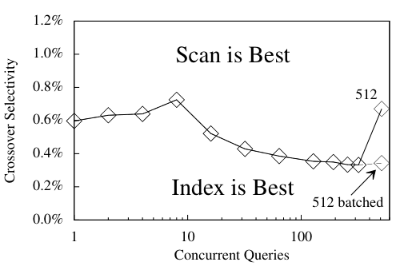

**图 13：** 并发查询数量是分析数据系统访问路径选择的关键因素。

图 13 展示了结果。图中每个点表示在横轴所示并发度下观察到的交叉点选择率；也就是说，每个点都来自一次图 12 那样的实验，只是并发度不同。因此，此图的读法与引言中的图 1 相同：任何由 \\(q\\) 个查询组成的批次，如果其总选择率高于图 13 中 \\(q\\) 对应的值，就应使用扫描；否则优化器应使用索引扫描。图 13 中并发度变化时，交叉点也随之移动。随着并发查询增多，扫描变得更有用，因为查询可以分摊读取整列的代价。索引扫描也受益于共享，但不如顺序扫描明显；与连续数组相比，遍历树的叶节点代价更高。尽管如此，交叉点最终会趋于平稳，也就是说访问路径选择总有用武之地。在第 2.4 节中，我们解释了共享只在写入代价尚未超过共享执行收益之前有效。图 13 最右侧可见这一点：尝试同时共享执行 512 个 select 时，共享扫描性能下降。不过，可以将这 512 个查询分成两批、每批 256 个来保持性能，即标记为“512-batch”的点。

**观察 4.1。** 并发度，即需要在相同数据上执行选择的活动查询数量，是影响访问路径选择的关键因素。

**数据集大小的影响。** 接下来研究的参数是数据大小。我们多次重复图 12 的实验，改变数据大小，并像图 13 一样为每次运行的数据大小绘制交叉点。

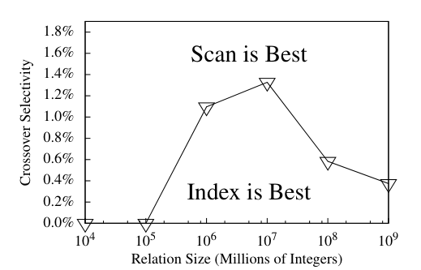

**图 14：** 交叉点也受数据集大小影响（\\(q=8\\)）。

结果见图 14。随着数据大小增加，交叉点实际上会上升到更高的选择率，达到最大值后再逐渐下降。

扫描输入列时，随着列的大小增加，代价线性增长，即 \\(O(N)\\)；代价与扫描必须检查的额外元组数量及结果集大小的相应增长成正比。对于二级索引扫描，有三个步骤。首先，随着输入列变大，树高按对数增长，即 \\(O(\log N)\\)。其次，给定范围内符合条件的元组数量线性增长，即 \\(O(N)\\)，它既影响遍历的叶节点数量，也影响结果集大小。第三，按照 rowID 对索引扫描结果排序的代价遵循 \\(O(N\log N)\\) 复杂度增长。

**观察 4.2。** 随着数据集大小增加，选择率交叉点达到最大值后逐渐下降。

**数据布局的影响。** 接下来的实验展示数据布局的影响，以及支持混合布局的分析系统也需要访问路径选择。我们重复图 12 的实验，但改变数据布局中组成列组的列数。实际上，我们测试纯列存储布局，以及列组逐渐变大的混合布局，最多 32 列。

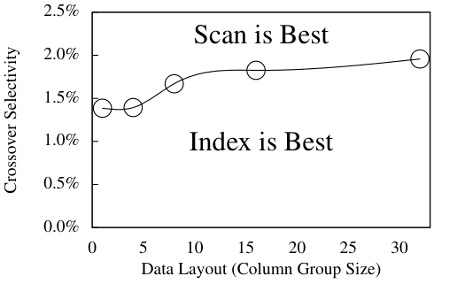

**图 15：** 带步幅访问的扫描效率较低，增加了索引扫描有利的机会。

图 15 展示了结果。它采用与图 13 和图 14 相同的绘图方式：每个点表示横轴对应数据布局的交叉点选择率。随着列组变大、向混合布局发展，二级索引扫描在越来越宽的选择率范围内有利。这是因为，与过去的行存储系统类似，二级索引使系统能够在更宽的列组上跳过更多数据；即使只扫描一列，也必须同时访问这些列组中的多列。

**观察 4.3。** 鉴于向混合布局发展的趋势，我们预计访问路径选择将变得越来越重要。

**硬件属性的影响。** 下一个实验说明，我们的访问路径选择模型也适用于内存带宽和缓存属性明显不同的硬件。我们重复图 12 的实验，但这次使用三个 Amazon EC2 实例：（1）通用实例 m4.4xlarge，具有 16 个虚拟核心（Intel Xeon E5-2676 v3）和 64 GB 内存；（2）计算型实例 c4.8xlarge，具有 36 个虚拟核心（Intel Xeon E5-2666 v3）和 60 GB 内存；（3）内存型实例 r3.8xlarge，具有 32 个虚拟核心（Intel Xeon E5-2670 v2）和 244 GB 内存。

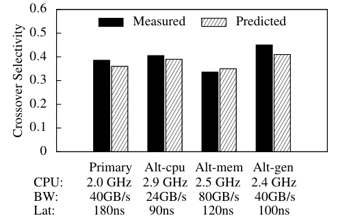

**图 16：** FastColumns 能够准确预测不同硬件配置下的交叉点。

图 16 展示了结果，图中绘出了访问路径选择的交叉点。主要观察是，四种不同硬件配置的访问方法之间都存在交叉点；无论硬件配置如何，要获得最佳性能总需要访问路径选择。此外，不同硬件实例的交叉点不同，这意味着为了有效选择访问路径，系统优化器应能够捕捉运行环境的属性。图 16 表明，我们的访问路径选择模型确实能够捕捉这些环境属性。APS 模型对应的柱形与实验测得的交叉点非常接近，说明模型可以准确预测所有硬件配置上应当切换访问路径的位置。

**观察 4.4。** 我们的优化器并非专门针对某一种硬件配置调优，而是通过分离出系统中对预测性能至关重要的部分，计算更合适的访问路径。

**压缩的影响。** 图 17 展示使用压缩时交叉点如何变化。实验设置与前面相同，唯一的区别是 16 位曲线对应于扫描压缩到 2 字节的列。这使扫描可以用相同的 SIMD 指令处理更多元组，但会略微增加写入结果的开销。总体而言，压缩并未改变主要结论，而是使交叉点稍微向有利于扫描的方向移动。

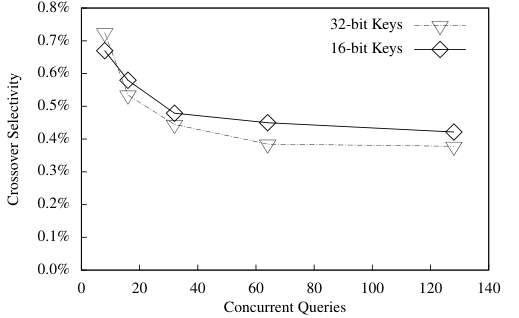

**图 17：** 直接处理压缩数据使扫描略占优势。

**观察 4.5。** 使用字典压缩使扫描略占优势，但两种访问路径仍然都有用。

**通过实验验证访问路径选择。** 到目前为止，我们分别研究了影响访问路径选择的参数，并表明应当考虑这些参数。在下一个实验中，我们在多种工作负载下测试基于代价的优化器，以证明它能够动态、有效地选择访问路径。

我们按如下方式设置实验：创建九种属性不同的工作负载，具体包括不同的选择率以及低、中、高三种并发度。低选择率是点查询，中选择率为关系的 0.5%，高选择率为 5%。对于并发度，低并发是单个查询，中并发为 64 个查询，高并发为 640 个查询。我们组合选择率和查询并发度的所有可能情况，得到九种工作负载。我们同时测试二级索引扫描和顺序扫描，并将其与优化器的预测进行比较；优化器评估每种访问方法并动态决定使用哪一种，而不是使用固定访问方法或不考虑并发度的现有策略。

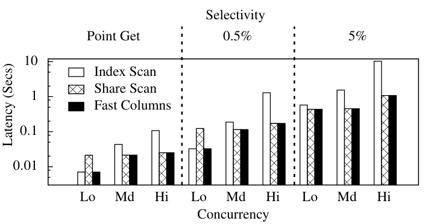

**图 18：** 工作负载特征会改变最佳数据访问路径，需要 APS 选择最快的路径。

图 18 展示了结果。没有任何一种单独的访问方法在所有工作负载中都是最佳选择；相反，每种方法只在部分情况下最优。另一方面，我们的 APS 模型通过在运行时动态选择正确的访问方法，始终能够达到最佳表现。例如，当单个查询涉及关系中少于 0.5% 的数据时，模型正确选择索引。随着并发度提高，共享扫描成为点查询的更佳选择，我们的方案也作出了正确选择。对于中等选择率且中等或高并发度，以及所有高选择率工作负载，FastColumns 也正确选择了共享扫描。为了正确选择访问路径，优化器同时考虑静态影响，例如末级缓存未命中代价和内存带宽，以及动态影响，例如执行中的查询数量和查询选择率。

**观察 4.6。** 考虑估计选择率、并发度、数据大小和硬件属性，就可以准确、动态地选择访问路径。

**TPC-H 与完整查询的合理性检查。** 我们将 FastColumns 与两个知名且成熟的开源实现 MonetDB 和 PostgreSQL 进行比较。MonetDB 针对内存性能进行了高度优化 [37]，包含紧凑 for 循环扫描、列式存储和多核优化，且函数调用开销几乎为零。由于 MonetDB 不使用共享扫描，我们在数据驻留主存的情况下使用单查询测试，但使用多个硬件线程。我们也纳入具有成熟 B+-Tree 设计的 Postgres。

实验在为 TPC-H 基准生成的数据上运行。我们以 scale factor 10 生成 `lineitem` 表，得到略少于 6000 万行。然后修改 TPC-H 查询 6，通过为 `l_shipdate` 谓词选择较大或较小的范围，形成高、低选择率两种工作负载。在“低选择率”运行中，应用 `l_shipdate` 谓词后约有 17.4 万行符合条件，占关系的 0.24%。在“高选择率”运行中，根据 `l_shipdate` 约有 15% 的关系数据符合条件。

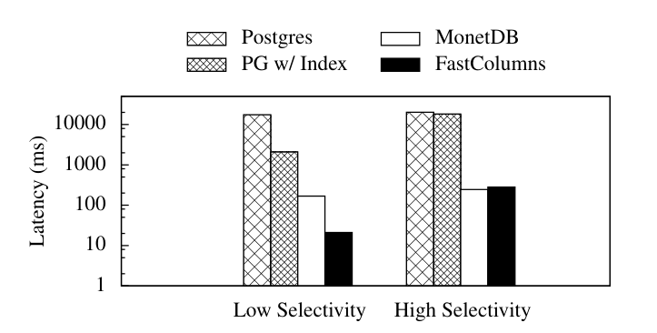

**图 19：** TPC-H scale factor 10：访问路径选择在多种工作负载中带来最佳性能。

图 19 展示了结果。当符合条件的数据超过 1.6% 时，FastColumns 选择扫描处理查询；低于该比例时则使用二级索引扫描。图 19 的第一个观察是，FastColumns 提供了经过内存优化的访问路径，因为其顺序扫描性能与 MonetDB 相当。这为我们的分析提供了良好的合理性检查。更关键的下一个观察是，当符合条件的元组数量很少时，FastColumns 通过访问路径选择和二级索引，而非依赖扫描，能够超过 MonetDB。这进一步支持这样的观点：对于此类工作负载，MonetDB 等现代分析系统和其他高度优化的系统应考虑二级索引和访问路径选择。

Postgres 的结果主要用于验证快速扫描已显著改变局面。即使没有二级索引，对于预计索引会有帮助的查询，MonetDB 的性能也超过 Postgres。

## 5. 经验与启示

本文的建模和性能分析为如何在当今分析系统中设计二级索引提供了若干启示。我们使用访问路径选择模型，计算多年硬件演进过程中的交叉点。表 2 展示了基于 HDD 的系统中，从 20 世纪 80 年代到 2010 年代访问路径选择交叉点的演变。我们根据过去设备报告的性能 [8]，使用不断降低的延迟和不断提高的磁盘带宽为硬盘演进建模。我们还假设数据大小，即元组数量，随时间大致呈指数增长。最后，我们使用 200 字节作为有代表性的元组大小，参考 TPC-H 中的数值；模型中索引的分支因子设为 250 [30]。

| 年份 | 1980（磁盘） | 1990（磁盘） | 2000（磁盘） | 2010（磁盘） | 2016（内存） | F1（内存） | F2（内存） |
| --- | ---: | ---: | ---: | ---: | ---: | ---: | ---: |
| CPU（GHz） | — | — | — | — | 2 | 4 | 4 |
| HDD 延迟（ms） | 10 | 8 | 2 | 2 | — | — | — |
| HDD 带宽（MB/s） | 40 | 100 | 500 | 500 | — | — | — |
| 内存延迟（ns） | — | — | — | — | 180 | 100 | 20 |
| 内存带宽（GB/s） | — | — | — | — | 40 | 160 | 80 |
| 元组数量 | \\(10^6\\) | \\(10^7\\) | \\(10^8\\) | \\(10^9\\) | \\(10^9\\) | \\(10^9\\) | \\(10^9\\) |
| 元组大小 | 200 | 200 | 200 | 4 | 4 | 4 | 4 |
| 分支因子 | 250 | 250 | 250 | 250 | 21 | 21 | 21 |
| 交叉点 | 12.4% | 6.2% | 5.0% | 0.1% | 0.6% | 0.3% | 0.5% |

**表 2：** 访问路径选择交叉点的演变。

表 2 的主要观察是，随着带宽提高，扫描在更多情况下有用，交叉点随之降低。表中 2010 年的交叉点对应基于磁盘的列存储；与行存储相比，使用磁盘二级索引的影响自然更小，因为扫描本来就可以只读取相关列。回顾第 2.4 节中的 \\(BW\cdot C_M\\) 项，它对应一次随机访问即树遍历期间读取的字节数。在内存系统中，使用表 2 的 2016 年列计算，该乘积约为 7200；而使用磁盘带宽和延迟时，按 2010 年列计算，相应乘积约为 \\(10^6\\)。模型预测两种情况下都存在交叉点；实际上，与驻留磁盘的索引和列相比，内存系统因为内存中的随机访问相对于可用带宽更高效，使天平重新偏向索引。我们还展示了两种潜在配置 F1 和 F2：F1 的硬件支持高得多的内存带宽，同时延迟适度下降；F2 的内存延迟大幅下降，同时带宽适度提高。尽管新硬件给索引带来压力，我们仍然需要访问路径选择。

在传统行存储中，静态考虑硬件配置后，固定选择率是用于选择访问路径的唯一运行时参数。预计返回数据少于该阈值的每个查询都使用二级索引，如果存在的话。随着有利于索引的选择率区间缩小，在查询执行期间准确考虑所有参数变得越来越重要：硬件、选择率、系统设计，以及现在的查询并发度。

现在归纳本研究的经验：

**经验 1。** 对于分析查询，即使数据驻留主存、消除了磁盘 I/O 瓶颈，仍有二级索引扫描优于顺序扫描的情况。

**经验 2。** 细粒度的访问路径决策除了选择率、硬件规格、系统设计和数据布局，还需要将查询并发度作为运行时参数考虑。

**经验 3。** 数据集大小可能起决定性作用。对于小数据集，扫描数据在所有情况下都优于二级索引；对于较大数据集，完整属性扫描变得昂贵，索引仍然有用。

**经验 4。** 虽然访问方法之间的交叉点比过去更低，它仍然对应不断增长的结果基数。例如，从 5 亿个整数中选择 0.6% 的查询有 300 万个符合条件的元组。

**经验 5。** 共享数据访问虽然可以最大限度减少重复读取，但也有将结果分发给各个消费者的开销。由于簿记和结果分发开销，结果共享只在一定批次大小以内高效。

**经验 6。** 对于列式存储系统，访问路径选择很重要；对于混合存储中更宽的元组，它变得更加重要。

**经验 7。** 随着缓存和内存延迟降低，或内存带宽降低，二级索引更有利；相反，较慢的缓存或内存以及较快的内存总线有利于扫描。因此，未来硬件代际如果改变这些硬件属性之间的平衡，也会相应影响访问路径选择。APS 模型捕捉了这些属性。

## 6. 相关工作

**访问路径选择。** 自数据库系统诞生之初，访问路径选择就是主要设计问题 [20, 70]。主要决策是使用顺序扫描还是二级索引扫描，依据是统计信息和给定的选择率阈值。该阈值是硬阈值，要么硬编码在系统中，要么在调优阶段确定 [29, 32]。近来的代价模型分析已经纳入硬件特征 [16, 56]。

本文遵循顺序扫描与二级索引扫描的基本访问路径选择原则，但针对的是现代内存优化分析系统，这类系统使用针对现代硬件和共享充分优化的访问方法。我们以前人的建模方法为基础，通过考虑查询并发度对其进行扩展。我们表明，除了像传统优化器一样考虑选择率、硬件特征和数据存储方式，包括列存储、混合存储或完整元组，还需要考虑查询并发度。

**现代优化器和设计工具。** 现代系统对各种决策使用基于代价的优化。例如，基于统计信息的代价优化用于 select 和连接的排序 [79]。此外，现代系统的离线物理设计使用基于代价的分析来决定存储布局 [67] 和列存储投影 [66] 等问题。

本文的工作与现代优化器执行的其他基于代价的决策互补。例如，依据预期选择率对连接和 select 排序，可以独立于所使用的访问路径选择方式运行。此外，我们的工作也与物理设计研究互补，因为我们提出了运行时访问路径选择方法，不依赖底层列或列组布局及全局物理设计。不过，与传统物理设计工具在离线分析期间使用优化器及其代价模型的方式类似 [22]，物理设计工具可以使用我们提出的 APS 模型决定是否创建二级索引。

**共享和多查询优化。** 多查询优化方法已经考虑了在多个查询之间共享工作的机会 [36, 68, 71, 72]，主要针对共享执行。近来的研究考虑了共享数据移动 [27, 28, 34, 41, 62, 63, 88]，甚至包括内存中的数据移动 [63]。我们的工作与共享执行和数据移动的研究相关，因为我们考虑依赖共享的访问路径。过去的工作主要集中于开发实现共享的新技术；本文则介绍如何在都使用共享的不同访问路径之间作出优化决策。

**延迟优化决策。** 过去的系统主要每次传递一个元组，而现代分析系统尝试了每次处理一个向量和每次处理一列。每次处理一列的一个附带效果是，物理算子的选择可以推迟到最后时刻，此时已经完全了解输入数据的基数及其他属性。例如，MonetDB 使用每次处理一列的方式，在完整掌握输入大小后决定连接算法及内外侧 [37]。这类方法在优化期间需要更少的决策点。类似地，Smooth Scan [17] 等思路只在行存储中得到研究，它们延迟访问路径决策或提供混合访问路径。

不过，我们仍然需要本文所描述的访问路径选择。例如，对于访问基础数据的 select 算子，如顺序扫描与二级索引扫描，无论数据流模式如何，都必须在开始之前作出选择。只要存在多条访问路径，就必须在读取数据之前作出选择。

## 7. 结论

本文表明，访问路径选择仍然必要，因为二级索引访问和顺序扫描访问都可能对分析有利。随着更多内存访问路径得到开发，访问路径建模和选择仍是现代分析数据系统中的关键挑战。

我们表明，与传统方法不同，访问路径选择不应只根据机器硬件和选择率使用固定分界点。相反，要为一批查询决定访问路径，系统应考虑两个动态参数：（1）批次中每个查询的选择率；（2）并发查询数量。最后，我们证明 APS 是一个轻量级过程，即使对于低延迟查询也不会对执行时间产生负面影响。

**致谢。** 感谢审稿人提供宝贵反馈。本研究得到美国国家科学基金会 IIS-1452595 项目的支持。

## 8. 参考文献

[1] D. J. Abadi, P. Boncz, S. Harizopoulos, S. Idreos, and S. Madden. The Design and Implementation of Modern Column-Oriented Database Systems. Found. Trends Databases, 5(3):197–280, 2013.

[2] D. J. Abadi, S. Madden, and M. Ferreira. Integrating Compression and Execution in Column-oriented Database Systems. In SIGMOD, 2006.

[3] D. J. Abadi, D. S. Myers, D. J. DeWitt, and S. R. Madden. Materialization Strategies in a Column-Oriented DBMS. In ICDE, 2007.

[4] I. Alagiannis, S. Idreos, and A. Ailamaki. H2O: A Hands-free Adaptive Store. In SIGMOD, 2014.

[5] J. R. Allen, K. Kennedy, C. Porterfield, and J. D. Warren. Conversion of Control Dependence to Data Dependence. In POPL, 1983.

[6] G. Antoshenkov. Dynamic Query Optimization in Rdb/VMS. In ICDE, 1993.

[7] S. Arumugam, A. Dobra, C. M. Jermaine, N. Pansare, and L. Perez. The DataPath System: A Data-centric Analytic Processing Engine for Large Data Warehouses. In SIGMOD, 2010.

[8] M. Athanassoulis. Solid-State Storage and Work Sharing for Efficient Scaleup Data Analytics. PhD thesis, Ecole Polytechnique Federale de Lausanne, 2014.

[9] M. Athanassoulis, M. S. Kester, L. M. Maas, R. Stoica, S. Idreos, A. Ailamaki, and M. Callaghan. Designing Access Methods: The RUM Conjecture. In EDBT, 2016.

[10] M. Athanassoulis, Z. Yan, and S. Idreos. UpBit: Scalable In-Memory Updatable Bitmap Indexing. In SIGMOD, 2016.

[11] D. I. August, W.-m. W. Hwu, and S. A. Mahlke. A Framework for Balancing Control Flow and Predication. In MICRO, 1997.

[12] R. Barber, P. Bendel, M. Czech, O. Draese, F. Ho, N. Hrle, S. Idreos, M.-S. Kim, O. Koeth, J.-G. Lee, T. T. Li, G. M. Lohman, K. Morfonios, R. Müller, K. Murthy, I. Pandis, L. Qiao, V. Raman, R. Sidle, K. Stolze, and S. Szabo. Business Analytics in (a) Blink. IEEE DEBULL, 35(1):9–14, 2012.

[13] R. Barber, G. Lohman, V. Raman, R. Sidle, S. Lightstone, and B. Schiefer. In-Memory BLU Acceleration in IBM’s DB2 and dashDB: Optimized for Modern Workloads and Hardware Architectures. In ICDE, 2015.

[14] C. Binnig, S. Hildenbrand, and F. Färber. Dictionary-based Order-preserving String Compression for Main Memory Column Stores. In SIGMOD, 2009.

[15] P. Boncz, M. Zukowski, and N. J. Nes. MonetDB/X100: Hyper-Pipelining Query Execution. In CIDR, 2005.

[16] P. A. Boncz, M. L. Kersten, and S. Manegold. Breaking the Memory Wall in MonetDB. CACM, 51(12):77–85, 2008.

[17] R. Borovica-Gajic, S. Idreos, A. Ailamaki, M. Zukowski, and C. Fraser. Smooth Scan: Statistics-Oblivious Access Paths. In ICDE, 2015.

[18] G. Candea, N. Polyzotis, and R. Vingralek. Predictable Performance and High Query Concurrency for Data Analytics. VLDBJ, 20(2):227–248, 2011.

[19] C. Chasseur and J. M. Patel. Design and Evaluation of Storage Organizations for Read-Optimized Main Memory Databases. PVLDB, 6(13):1474–1485, 2013.

[20] S. Chaudhuri. An Overview of Query Optimization in Relational Systems. In PODS, 1998.

[21] S. Chaudhuri. Query Optimizers: Time to Rethink the Contract? In SIGMOD, 2009.

[22] S. Chaudhuri and V. R. Narasayya. An Efficient Cost-Driven Index Selection Tool for Microsoft SQL Server. In VLDB, 1997.

[23] S. Christodoulakis. Implications of Certain Assumptions in Database Performance Evaluation. TODS, 9(2):163–186, 1984.

[24] D. J. DeWitt, R. H. Katz, F. Olken, L. D. Shapiro, M. Stonebraker, and D. A. Wood. Implementation Techniques for Main Memory Database Systems. In SIGMOD, 1984.

[25] F. Färber, N. May, W. Lehner, P. Große, I. Müller, H. Rauhe, and J. Dees. The SAP HANA Database – An Architecture Overview. IEEE DEBULL, 35(1):28–33, 2012.

[26] P. Francisco. The Netezza Data Appliance Architecture: A Platform for High Performance Data Warehousing and Analytics. IBM Redbooks, 2011.

[27] G. Giannikis, G. Alonso, and D. Kossmann. SharedDB: Killing One Thousand Queries with One Stone. PVLDB, 5(6):526–537, 2012.

[28] G. Giannikis, D. Makreshanski, G. Alonso, and D. Kossmann. Shared Workload Optimization. PVLDB, 7(6):429–440, 2014.

[29] G. Graefe. The Five-Minute Rule Twenty Years Later. In DAMON, 2007.

[30] G. Graefe. Modern B-Tree Techniques. Found. Trends Databases, 3(4):203–402, 2011.

[31] G. Graefe and L. D. Shapiro. Data Compression and Database Performance. In SAC, 1991.

[32] J. Gray and F. Putzolu. The 5 Minute Rule for Trading Memory for Disc Accesses and the 5 Byte Rule for Trading Memory for CPU Time. Tandem Computers - Technical Report, 1986.

[33] M. Grund, J. Krüger, H. Plattner, A. Zeier, P. Cudre-Mauroux, and S. Madden. HYRISE: A Main Memory Hybrid Storage Engine. PVLDB, 4(2):105–116, 2010.

[34] S. Harizopoulos, V. Shkapenyuk, and A. Ailamaki. QPipe: A Simultaneously Pipelined Relational Query Engine. In SIGMOD, 2005.

[35] S. Héman, M. Zukowski, and N. J. Nes. Positional Update Handling in Column Stores. In SIGMOD, 2010.

[36] M. Hong, M. Riedewald, C. Koch, J. Gehrke, and A. Demers. Rule-based Multi-Query Optimization. In EDBT, 2009.

[37] S. Idreos, F. Groffen, N. Nes, S. Manegold, K. S. Mullender, and M. L. Kersten. MonetDB: Two Decades of Research in Column-oriented Database Architectures. IEEE DEBULL, 35(1):40–45, 2012.

[38] S. Idreos, M. L. Kersten, and S. Manegold. Self-organizing Tuple Reconstruction in Column-Stores. In SIGMOD, 2009.

[39] Intel. Online reference. https://software.intel.com/en-us/articles/intelr-memory-latency-checker.

[40] T. Jäkel, H. Voigt, T. Kissinger, and W. Lehner. Pack Indexing for Time-Constrained In-Memory Query Processing. In BTW, 2013.

[41] R. Johnson, S. Harizopoulos, N. Hardavellas, K. Sabirli, I. Pandis, A. Ailamaki, N. G. Mancheril, and B. Falsafi. To Share or Not to Share? In VLDB, 2007.

[42] R. Johnson, V. Raman, R. Sidle, and G. Swart. Row-wise Parallel Predicate Evaluation. PVLDB, 1(1):622–634, 2008.

[43] A. Kemper and T. Neumann. HyPer: A Hybrid OLTP&OLAP Main Memory Database System Based on Virtual Memory Snapshots. In ICDE, 2011.

[44] S. Khoshafian, G. P. Copeland, T. Jagodis, H. Boral, and P. Valduriez. A Query Processing Strategy for the Decomposed Storage Model. In ICDE, 1987.

[45] C. Kim, J. Chhugani, N. Satish, E. Sedlar, A. D. Nguyen, T. Kaldewey, V. W. Lee, S. A. Brandt, and P. Dubey. FAST: Fast Architecture Sensitive Tree Search on Modern CPUs and GPUs. In SIGMOD, 2010.

[46] T. Kissinger, B. Schlegel, D. Habich, and W. Lehner. KISS-Tree: Smart Latch-Free In-Memory Indexing on Modern Architectures. In DAMON, 2012.

[47] J. Krüger, C. Kim, M. Grund, N. Satish, D. Schwalb, J. Chhugani, H. Plattner, P. Dubey, and A. Zeier. Fast Updates on Read-Optimized Databases Using Multi-Core CPUs. PVLDB, 5(1):61–72, 2011.

[48] T. Lahiri, S. Chavan, M. Colgan, D. Das, A. Ganesh, M. Gleeson, S. Hase, A. Holloway, J. Kamp, T.-H. Lee, J. Loaiza, N. Macnaughton, V. Marwah, N. Mukherjee, A. Mullick, S. Muthulingam, V. Raja, M. Roth, E. Soylemez, and M. Zait. Oracle Database In-Memory: A Dual Format In-Memory Database. In ICDE, 2015.

[49] A. Lamb, M. Fuller, and R. Varadarajan. The Vertica Analytic Database: C-Store 7 Years Later. PVLDB, 5(12):1790–1801, 2012.

[50] P.-A. Larson, E. N. Hanson, and M. Zwilling. Evolving the Architecture of SQL Server for Modern Hardware Trends. In ICDE, 2015.

[51] V. Leis, P. A. Boncz, A. Kemper, and T. Neumann. Morsel-driven Parallelism: A NUMA-aware Query Evaluation Framework for the Many-core Age. In SIGMOD, 2014.

[52] V. Leis, A. Kemper, and T. Neumann. The Adaptive Radix Tree: ARTful Indexing for Main-Memory Databases. In ICDE, 2013.

[53] J. J. Levandoski, D. B. Lomet, and S. Sengupta. The Bw-Tree: A B-tree for New Hardware Platforms. In ICDE, 2013.

[54] Y. Li, C. Chasseur, and J. M. Patel. A Padded Encoding Scheme to Accelerate Scans by Leveraging Skew. In SIGMOD, 2015.

[55] Y. Li and J. M. Patel. BitWeaving: Fast Scans for Main Memory Data Processing. In SIGMOD, 2013.

[56] S. Manegold, P. A. Boncz, and M. L. Kersten. Generic Database Cost Models for Hierarchical Memory Systems. In VLDB, 2002.

[57] Y. Mao, E. Kohler, and R. T. Morris. Cache Craftiness for Fast Multicore Key-value Storage. In EuroSys, 2012.

[58] G. Moerkotte. Small Materialized Aggregates: A Light Weight Index Structure for Data Warehousing. In VLDB, 1998.

[59] T. Neumann. Efficiently Compiling Efficient Query Plans for Modern Hardware. PVLDB, 4(9):539–550, 2011.

[60] O. Polychroniou, A. Raghavan, and K. A. Ross. Rethinking SIMD Vectorization for In-Memory Databases. In SIGMOD, 2015.

[61] O. Polychroniou and K. A. Ross. A Comprehensive Study of Main-memory Partitioning and its Application to Large-scale Comparison- and Radix-sort. In SIGMOD, 2014.

[62] I. Psaroudakis, M. Athanassoulis, and A. Ailamaki. Sharing Data and Work Across Concurrent Analytical Queries. PVLDB, 6(9):637–648, 2013.

[63] L. Qiao, V. Raman, F. Reiss, P. J. Haas, and G. M. Lohman. Main-memory Scan Sharing for Multi-core CPUs. PVLDB, 1(1):610–621, 2008.

[64] V. Raman, G. M. Lohman, T. Malkemus, R. Mueller, I. Pandis, B. Schiefer, D. Sharpe, R. Sidle, A. Storm, L. Zhang, G. Attaluri, R. Barber, N. Chainani, D. Kalmuk, V. KulandaiSamy, J. Leenstra, S. Lightstone, and S. Liu. DB2 with BLU Acceleration: So Much More Than Just a Column Store. PVLDB, 6(11):1080–1091, 2013.

[65] J. Rao and K. A. Ross. Making B+-trees Cache Conscious in Main Memory. In SIGMOD, 2000.

[66] A. Rasin and S. Zdonik. An Automatic Physical Design Tool for Clustered Column-stores. In EDBT, 2013.

[67] P. Rösch, L. Dannecker, F. Färber, and G. Hackenbroich. A Storage Advisor for Hybrid-Store Databases. PVLDB, 5(12):1748–1758, 2012.

[68] P. Roy, S. Seshadri, S. Sudarshan, and S. Bhobe. Efficient and Extensible Algorithms for Multi Query Optimization. SIGMOD Rec., 29(2):249–260, 2000.

[69] P. Russom. High-Performance Data Warehousing. TDWI Best Practices Report, 2012.

[70] P. G. Selinger, M. M. Astrahan, D. D. Chamberlin, R. A. Lorie, and T. G. Price. Access Path Selection in a Relational Database Management System. In SIGMOD, 1979.

[71] T. K. Sellis. Multiple-Query Optimization. TODS, 13(1):23–52, 1988.

[72] T. K. Sellis and S. Ghosh. On the Multiple-query Optimization Problem. TKDE, 2(2):262–266, 1990.

[73] R. Sen, J. Chen, and N. Jimsheleishvilli. Query Optimization Time: The New Bottleneck in Real-time Analytics. In IMDM, 2015.

[74] A. Shahvarani and H.-A. Jacobsen. A Hybrid B+-tree as Solution for In-Memory Indexing on CPU-GPU Heterogeneous Computing Platforms. In SIGMOD, 2016.

[75] N. Shamgunov. The MemSQL In-Memory Database System. In IMDM, 2014.

[76] L. Sidirourgos and M. L. Kersten. Column Imprints: A Secondary Index Structure. In SIGMOD, 2013.

[77] M. Stonebraker, D. J. Abadi, A. Batkin, X. Chen, M. Cherniack, M. Ferreira, E. Lau, A. Lin, S. R. Madden, E. J. O’Neil, P. E. O’Neil, A. Rasin, N. Tran, and S. Zdonik. C-Store: A Column-oriented DBMS. In VLDB, 2005.

[78] L. Sun, M. J. Franklin, S. Krishnan, and R. S. Xin. Fine-grained Partitioning for Aggressive Data Skipping. In SIGMOD, 2014.

[79] N. Tran, A. Lamb, L. Shrinivas, S. Bodagala, and J. Dave. The Vertica Query Optimizer: The Case for Specialized Query Optimizers. In ICDE, 2014.

[80] P. Unterbrunner, G. Giannikis, G. Alonso, D. Fauser, and D. Kossmann. Predictable Performance for Unpredictable Workloads. PVLDB, 2(1):706–717, 2009.

[81] T. Willhalm, N. Popovici, Y. Boshmaf, H. Plattner, A. Zeier, and J. Schaffner. SIMD-Scan: Ultra Fast in-Memory Table Scan using on-Chip Vector Processing Units. PVLDB, 2(1):385–394, 2009.

[82] R. S. Xin, J. Rosen, M. Zaharia, M. J. Franklin, S. Shenker, and I. Stoica. Shark: SQL and Rich Analytics at Scale. In SIGMOD, 2013.

[83] H. Zhang, D. G. Andersen, A. Pavlo, M. Kaminsky, L. Ma, and R. Shen. Reducing the Storage Overhead of Main-Memory OLTP Databases with Hybrid Indexes. In SIGMOD, 2016.

[84] J. Zhou and K. A. Ross. Implementing Database Operations Using SIMD Instructions. In SIGMOD, 2002.

[85] M. Zukowski and P. Boncz. Vectorwise: Beyond Column Stores. IEEE DEBULL, 35(1):21–27, 2012.

[86] M. Zukowski, P. A. Boncz, and S. Héman. MonetDB/X100 - A DBMS In The CPU Cache. IEEE DEBULL, 28(2):17–22, 2005.

[87] M. Zukowski, S. Héman, and P. A. Boncz. Architecture-conscious Hashing. In DAMON, 2006.

[88] M. Zukowski, S. Héman, N. J. Nes, and P. Boncz. Cooperative Scans: Dynamic Bandwidth Sharing in a DBMS. In VLDB, 2007.

[89] M. Zukowski, N. Nes, and P. A. Boncz. DSM vs. NSM: CPU Performance Tradeoffs in Block-oriented Query Processing. In DAMON, 2008.

## 附录 A. 排序代价的界

公式 11 的最后一项使得该公式无法针对总选择率 \\(S_{tot}\\) 求解。在这里，我们首先给出 \\(\sum_{i=1}^{q}N\cdot s_i\cdot\log_2(s_i\cdot N)\\) 的最大值和最小值的界，然后在分析中使用最坏情况。我们利用 \\(S_{tot}=\sum_{i=1}^{q}s_i\\)。先展开该项：

$$\begin{aligned}
\sum_{i=1}^{q}s_iN\log_2(s_iN)
&=S_{tot}N\sum_{i=1}^{q}\frac{s_iN}{S_{tot}N}\log_2\left(\frac{s_iN}{S_{tot}N}\cdot S_{tot}N\right)\\\\
&=S_{tot}N\sum_{i=1}^{q}\frac{s_iN}{S_{tot}N}\log_2\left(\frac{s_iN}{S_{tot}N}\right)
+S_{tot}N\sum_{i=1}^{q}\frac{s_iN}{S_{tot}N}\log_2(S_{tot}N)\\\\
&=S_{tot}N\sum_{i=1}^{q}\frac{s_i}{S_{tot}}\log_2\left(\frac{s_i}{S_{tot}}\right)
+\sum_{i=1}^{q}s_iN\log_2(S_{tot}N)\\\\
&=S_{tot}N\left(\sum_{i=1}^{q}\frac{s_i}{S_{tot}}\log_2\left(\frac{s_i}{S_{tot}}\right)+\log_2(S_{tot}N)\right).
\end{aligned} \tag{17}$$

给定 \\(S_{tot}\\)、\\(N\\) 和 \\(q\\)，公式 17 的量可能因 \\(s_i\\) 值的分布不同而取不同的值。我们将 \\(\sum_{i=1}^{q}(s_i/S_{tot})\log_2(s_i/S_{tot})\\) 识别为一个熵项 \\(E(s_1,s_2,\ldots,s_q)\\)，因为它具有熵函数的性质：（i）\\(\sum_{i=1}^{q}s_i/S_{tot}=1\\)；（ii）\\(s_i/S_{tot}\leq1\\)。因此，其最大值为 0；当所有 \\(s_i/S_{tot}\\) 相等时取得最小值。此时对所有 \\(i\\) 有 \\(s_i=S_{tot}/q\\)，进而得到：

$$\sum_{i=1}^{q}\frac{S_{tot}/q}{S_{tot}}\log_2\left(\frac{S_{tot}/q}{S_{tot}}\right)=\sum_{i=1}^{q}\frac1q\log_2\left(\frac1q\right)=\log_2\left(\frac1q\right). \tag{18}$$

结合公式 17 和 18，我们可以准确计算最大和最小排序代价。当除一个 \\(s_i\\) 等于 \\(S_{tot}\\) 外，其余所有 \\(s_i\\) 均为 0 时，熵项的最大值为 0；当所有 \\(s_i\\) 相等时，其最小值为 \\(\log_2(1/q)\\)。

最后得到：

$$MinSC=S_{tot}N\left(\log_2\left(\frac1q\right)+\log_2(S_{tot}N)\right) \tag{19}$$

$$MaxSC=S_{tot}N\log_2(S_{tot}N). \tag{20}$$

注意，也可以使用对数和不等式和对数函数的单调性计算这一量的最小值和最大值。但上述推导还解释了这些界在什么条件下取到。

## 附录 B. 改写 APS 比值

公式 15 可以根据表 1 给出的初始参数改写：

$$\begin{aligned}
APS={}&\frac{qTT+S_{tot}(TL+TDI+TDR)}{TDS+S_{tot}TDR}+\frac{S_{tot}\log_2(S_{tot}N)TDR}{TDS+S_{tot}TDR}\\\\
\Rightarrow APS={}&\frac{q\frac{1+\lceil\log_b(N)\rceil}{N}\left(BW_SC_M+\frac{bBW_SC_A}{2}+\frac{bBW_Sf_pp}{2}\right)}{\max(ts,2f_ppqBW_S)+S_{tot}rw\frac{BW_S}{BW_R}}\\\\
&+\frac{S_{tot}\left(\frac{BW_SC_M}{b}+(aw+ow)\frac{BW_S}{BW_I}+rw\frac{BW_S}{BW_R}\right)}{\max(ts,2f_ppqBW_S)+S_{tot}rw\frac{BW_S}{BW_R}}\\\\
&+\frac{S_{tot}\log_2(S_{tot}N)BW_SC_A}{\max(ts,2f_ppqBW_S)+S_{tot}rw\frac{BW_S}{BW_R}}.
\end{aligned} \tag{21}$$

公式 21 在模型实现中用于产生基于模型的分析。

### B.1 硬件与数据集因素

**因子 \\(BW_S\cdot C_M\\)。** 扫描带宽 \\(BW_S\\) 与缓存未命中延迟 \\(C_M\\) 的乘积，表示一次缓存未命中所需时间内以内存带宽速度扫描的字节数。比较索引和扫描性能时，这个因子至关重要。该乘积越大，扫描越有利，因为每次缓存未命中，即随机访问树节点，都对应于扫描更多数据。该乘积越小，索引越有利。

**因子 \\(BW_S\cdot C_A\\)。** 扫描带宽 \\(BW_S\\) 与缓存未命中延迟 \\(C_M\\) 的乘积，给出一次缓存访问所需时间内以内存带宽速度扫描的字节数。[^factor-ca] 此因子的影响小于 \\(BW_S\cdot C_M\\)，因为它通常小一到两个数量级；不过，尽管影响较小，它遵循相同趋势。

[^factor-ca]: 本段原文写的是“缓存未命中延迟 \\(C_M\\)”，但小标题与后文的一次缓存访问对应 \\(C_A\\)；此处保留原文表述。

**因子 \\(\max(ts,2f_ppqBW_S)\\)。** 比较元组大小 \\(ts\\) 与乘积 \\(2f_ppBW_S\\)，可以判断扫描受内存还是 CPU 限制。乘积 \\(2f_ppqBW_S\\) 考虑有效处理器速度，即处理器速度和流水线的影响，以及内存带宽，给出计算所有 \\(q\\) 个查询谓词所需的两条指令期间能够顺序扫描的字节数；这两条指令是针对每个查询范围的起点和终点进行的两次比较。如果该值小于元组大小 \\(ts\\)，则扫描受内存限制，否则受 CPU 限制。

## 附录 C. 模型验证

我们使用四台机器上的实验数据验证了模型的准确性。对于每组实验，我们采用多维无约束非线性最小化方法 Nelder-Mead 拟合模型。我们使用厂商公布的硬件特征，并加入常数因子；我们发现这些因子在不同实验中相同，从而验证了模型。

我们扩展了公式 5 和 13。在为扫描建模时，拟合结果表明需要一个常数因子来调整结果写入代价。公式中加入新参数 \\(\alpha\\)，如公式 22 所示。

$$SharedScan=\max(TDS,q\cdot PE)+\alpha\cdot S_{tot}\cdot TDR \tag{22}$$

拟合过程表明 \\(\alpha=8\\)，它解释了使用 SIMD 寄存器导致结果写入时的重叠。接下来，我们在索引代价公式中加入一个常数因子，以反映我们对最坏情况排序代价的悲观估计。加入新参数 \\(f_s\\) 后的新公式如公式 23 所示。[^fitting-factor]

$$ConcIndex=q\cdot TT+S_{tot}\cdot(TL+TDI)+S_{tot}\cdot TDR+f_c\cdot SF\cdot C_A \tag{23}$$

拟合过程表明 \\(f_c\\) 不是常数因子，而是 \\(N\\) 的函数，可以用下式拟合；相对于 \\(N\\)，它是次线性的，但增长快于对数：

$$f_c=f_s\cdot\frac{N^{\beta}-1}{\beta}. \tag{24}$$

能够准确描述索引行为的值为 \\(\beta=0.38\\) 和 \\(f_c=6\cdot10^{-6}\\)；我们发现，在同一系统上的不同实验中这些值是稳定的。[^fitting-factor]

[^fitting-factor]: 本段保留原文符号：公式 23 使用 \\(f_c\\)，文字称新参数为 \\(f_s\\)；公式 24 又将 \\(f_c\\) 定义为 \\(N\\) 的函数，但后文给出的数值写作 \\(f_c\\)。原文未解释这些记号之间的不一致。

### C.1 模型拟合

这里描述主要实验服务器的验证过程；该服务器的完整说明见第 4 节。图 20 展示了改变关系大小 \\(N\\)、平均查询选择率 \\(s_i\\) 和并发查询数量 \\(q\\) 等参数时，模型对主要实验服务器的拟合情况。前四幅图对应大小为 \\(N=5\\) 亿个元组的关系。每幅图的纵轴表示工作负载延迟，横轴表示并发查询数量 \\(q\\)。四幅图中每幅都有四条线：两条代表扫描延迟，分别为模型预测和实验测量；另两条代表索引扫描延迟。每幅图对应批次中每个查询的不同选择率：第一幅展示选择率为 0% 的查询性能，其余三幅分别为 0.1%、0.2% 和 1%。每幅图顶部的选择率旁列出了各访问路径的归一化最小二乘误差之和。

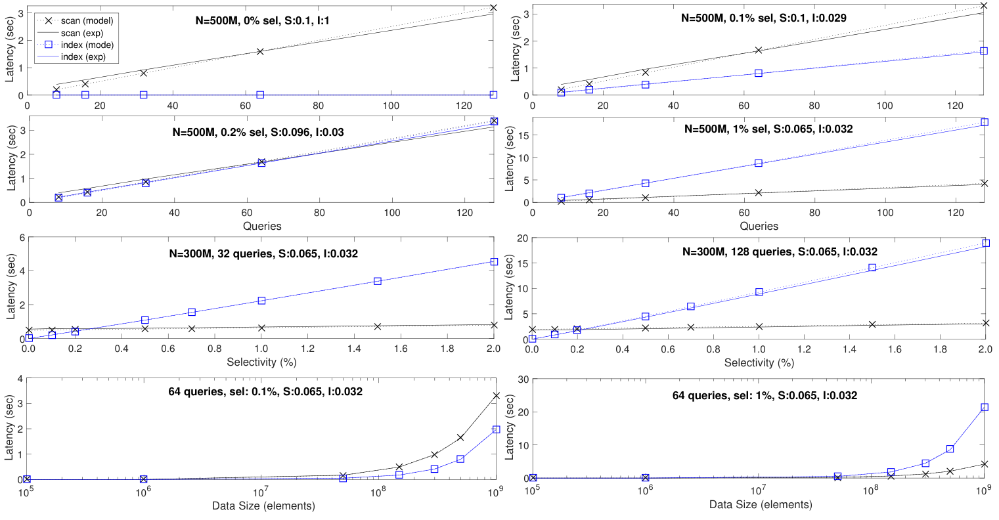

**图 20：** 通过拟合，模型能够近似反映共享顺序扫描和索引扫描的性能。

第三行的两幅图展示改变 \\(q\\) 个查询中每个查询的选择率，即横轴时，模型的准确性。纵轴仍表示工作负载延迟。最左侧的图对应 \\(q=32\\)，最右侧对应 \\(q=128\\)。最后，图 20 第四行的两幅图展示改变以元素数量表示的数据大小，即横轴时，模型的准确性。与前四幅图类似，每幅图顶部都注明了准确的实验设置以及各访问路径的归一化最小二乘误差之和。总体而言，拟合后的模型与实际查询延迟非常接近。

我们关注上述选择率、并发度和数据大小，因为这些是 APS 从小于 1 变为大于 1 的“有意思”的范围。此外，为了匹配实验设置，我们试验超过 8 个查询的并发度：我们始终充分利用实验机器上具有 8 个线程的一个插槽。因此，对于少于 8 个查询的工作负载，性能取决于算子内部并行性的效率，这是一个尚未解决的研究问题。最后，我们使用不同实验设置拟合模型，得到略有不同的拟合参数 \\(\alpha\\)、\\(\beta\\) 和 \\(f_c\\)，这表明通常需要为每个新环境训练模型。不过，每个系统的训练过程只需要少量实验，之后模型就能准确反映机器性能。

### C.2 带拟合参数的 APS 公式

APS 公式 21 现在变为：

$$\begin{aligned}
APS={}&\frac{q\frac{1+\lceil\log_b(N)\rceil}{N}\left(BW_SC_M+\frac{bBW_SC_A}{2}+\frac{bBW_Sf_pp}{2}\right)}{\max(ts,2f_ppqBW_S)+\alpha S_{tot}rw\frac{BW_S}{BW_R}}\\\\
&+\frac{S_{tot}\left(\frac{BW_SC_M}{b}+(aw+ow)\frac{BW_S}{BW_I}+rw\frac{BW_S}{BW_R}\right)}{\max(ts,2f_ppqBW_S)+\alpha S_{tot}rw\frac{BW_S}{BW_R}}\\\\
&+\frac{f_s\frac{N^{\beta}-1}{\beta}S_{tot}\log_2(S_{tot}N)BW_SC_A}{\max(ts,2f_ppqBW_S)+\alpha S_{tot}rw\frac{BW_S}{BW_R}}.
\end{aligned} \tag{25}$$

对于每个新系统，我们现在需要一个拟合过程，以确保模型准确反映执行环境。一旦完成该过程，就可以使用公式 25 进行访问路径选择。

## 附录 D. 降低排序代价

在排序步骤中谨慎使用 SIMD 指令 [61]，可以进一步降低二级索引扫描的排序代价，进而降低其总代价。

通过使用新排序算法的代价更新公式 14，模型可以调整为反映这类优化，排序代价为：

$$SF=\frac{S_{tot}N}{W}\cdot\log\left(\frac{S_{tot}N}{W}\right)+S_{tot}N\cdot\log(W), \tag{26}$$

其中 \\(W\\) 是 SIMD 寄存器宽度。

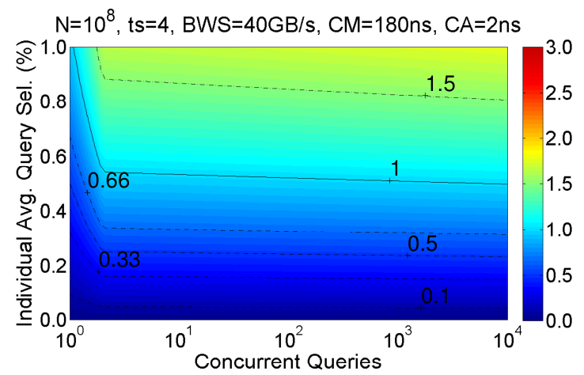

**图 21：** 利用 SIMD 的排序有利于索引。

这一变化有利于二级索引扫描，实际上会将交叉点推向更高的选择率。图 21 相当于 \\(W=4\\) 时的图 4。分析所得的观察保持不变；事实上，访问路径选择的必要性进一步增强，因为这项优化提高了索引性能，使访问路径选择的需求更加突出。

## 附录 E. 其他访问路径

**轻量级数据跳过。** 数据跳过是一种扫描优化，zone map [26, 64, 78, 82] 和 Column Imprints [76] 是典型例子。通过为列中的若干 zone 分别保留少量元数据，例如最小值和最大值，扫描只依据元数据就可以快速决定是否需要检查每个 zone。当数据经过聚簇或完全排序时，这类方法效果很好。

我们的工作针对完整二级索引，可以扩展为将数据跳过作为扫描优化建模，例如如果统计信息表明可以跳过多个 zone，就减少模型中的数据输入大小。不过，当列具有自然顺序时，例如订单日期，数据跳过的影响最大。这意味着对于 TPC-H 的 `lineitem` 这样的表，16 个属性中只有三四个能够从数据跳过中受益；在其他属性上执行选择则需要顺序扫描或二级索引扫描。

**其他索引结构。** 本文选择使用内存优化的 B+-Tree 为二级索引访问路径建模。这一决定是基于 B+-Tree 已在数据库系统中用于索引数十年，而且存在大量优化 [30]。这样，我们就可以尽可能在类似条件下，将访问路径选择的发现与传统系统进行比较。

除了内存优化 B+-Tree，还有若干针对现代硬件专门设计的索引结构可以用于研究访问路径选择 [10, 40, 45, 46, 52, 53, 57, 74, 83]。这样的分析与本文的主要观点正交：访问路径选择是必要的，而且存在一种动态定义二级索引扫描和顺序扫描之间盈亏平衡点的新方法。其中一些方法 [40, 46, 83] 还在读取性能、更新性能和内存利用率的权衡空间中考虑了内存占用 [9]。采用其他索引技术会改变平衡，使索引在更多情况下有利，但仍然需要访问路径选择。随着系统不断纳入根本性的新设计，这个问题应每隔几年重新审视。
