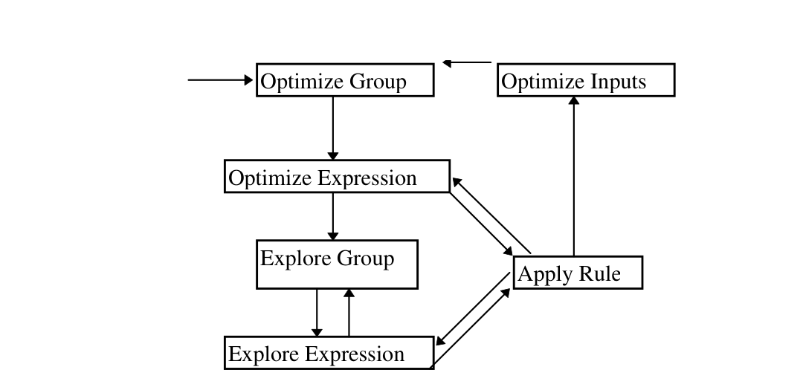

+++
featureImage = "img/covers/cascades-optimizer.webp"
title = "[译文] Cascades 查询优化框架"
date = 2026-11-15T00:00:00+08:00
slug = "cascades-query-optimization"
summary = "Goetz Graefe 的 Cascades 查询优化框架论文中文译文，涵盖搜索任务、数据抽象、规则及优化指导。"
description = "论文 The Cascades Framework for Query Optimization 的中文译文。"
tags = ["Cascades", "查询优化", "数据库"]
categories = ["数据库系统", "计算机技术"]
draft = false
+++

# Cascades 查询优化框架

原文：[The Cascades Framework for Query Optimization](https://15721.courses.cs.cmu.edu/spring2019/papers/22-optimizer1/graefe-ieee1995.pdf)，Goetz Graefe，IEEE Data Engineering Bulletin，1995。

译注：本文根据本地保存的论文 PDF 翻译。原文第 2 节提到附录中的伪代码，但该 PDF 在参考文献后结束，没有包含附录。

## 目录

- [摘要](#abstract)
- [1. 引言](#section-1)
- [2. 优化算法与任务](#section-2)
- [3. 数据抽象与用户接口](#section-3)
  - [3.1 运算符及其参数](#section-3-1)
  - [3.2 逻辑属性、物理属性和代价](#section-3-2)
  - [3.3 表达式树](#section-3-3)
  - [3.4 搜索指导](#section-3-4)
  - [3.5 模式记忆](#section-3-5)
  - [3.6 规则](#section-3-6)
- [4. 未来工作](#section-4)
- [5. 总结与结论](#section-5)
- [6. 致谢](#section-6)
- [7. 参考文献](#section-7)

## 摘要

本文描述一个新的可扩展查询优化框架，该框架解决了 EXODUS 和 Volcano 优化器生成器的许多不足。除了基于 EXODUS 和 Volcano 原型并对其加以扩展的可扩展性、动态规划和记忆化之外，这个新优化器还提供：（i）使用规则或函数操作运算符参数；（ii）既是逻辑运算符又是物理运算符的运算符，例如谓词；（iii）针对物化视图、特定于模式的规则；（iv）插入“强制器”（enforcer）或“胶合运算符”的规则；（v）特定于规则的指导，使规则能够分组；（vi）未来支持并行搜索、偏序代价度量和动态计划的基础设施；（vii）广泛的跟踪支持；以及（viii）充分利用 C++ 抽象机制的清晰接口和实现。我们描述并说明了针对每个问题所作的设计选择。本文描述的优化器系统已经可以运行，并将成为 Tandem 的 NonStop SQL 产品和 Microsoft 的 SQL Server 产品中新查询优化器的基础。

## 1. 引言

继 EXODUS 优化器生成器 [GrD87] 的经验之后，我们在 Volcano 项目中构建了一个新的优化器生成器 [GrM93]。EXODUS 工作的主要贡献包括：基于声明式规则生成代码的优化器生成器架构、逻辑代数和物理代数、将查询优化器划分为模块化组件，以及为数据库实现者（database implementor，DBI）需要提供的支持函数定义接口；而 Volcano 工作将改进的可扩展性与基于动态规划和记忆化的高效搜索引擎结合起来。通过在两个应用中使用 Volcano 优化器生成器——一个面向对象数据库系统 [BMG93] 和一个科学数据库系统原型 [WoG93]——我们发现了其设计中的若干缺陷。克服这些缺陷是 Cascades 项目开发的全新可扩展优化器的目标；该新项目将 Volcano 项目在可扩展查询优化、并行查询执行和物理数据库设计方面获得的许多经验应用于其中。与 Volcano 的设计和实现相比，新的 Cascades 优化器具有下列优点。总体而言，它们相对于我们早期的工作及其他相关工作，在功能、易用性和稳健性方面都有显著改进。

- 定义 DBI 与优化器之间接口的抽象接口类，并允许 DBI 定义子类层次结构。
- 将规则表示为对象。
- 支持特定于模式乃至特定于查询的规则。
- 只需要 DBI 提供最少支持的简单规则。
- 替代表达式由复杂表达式构成的规则。
- 将输入模式映射到 DBI 提供的函数的规则。
- 放置排序操作等属性强制器的规则。
- 可以同时是逻辑运算符和物理运算符的运算符，例如谓词。
- 匹配整棵子树的模式，例如谓词。
- 将优化任务表示为数据结构。
- 增量枚举等价逻辑表达式。
- 有指导的搜索或穷尽搜索。
- 根据潜力（promise）对候选操作排序。
- 特定于规则的指导。
- 增量改进估计的逻辑属性。

本文将讨论上述各点及其影响。尽管系统已经可以运行，我们尚未进行任何性能研究，系统也还没有经过充分调优。对 Cascades 优化器效率的详细分析和有针对性的改进留待未来工作。

## 2. 优化算法与任务

优化算法被分解为若干部分，我们称之为“任务”。尽管每个任务都很容易实现为过程，我们选择将任务实现为对象；除了其他方法外，这些对象还定义了一个 `perform` 方法。任务对象比过程调用灵活得多，尤其是在搜索算法和搜索控制方面。每个尚待完成的任务都有一个任务对象；所有这些任务对象都集中在一个任务结构中。目前，任务结构被实现为后进先出栈；不过，也很容易设想其他结构。特别是，任务对象可以在任何时候非常方便地重新排序，从而支持非常灵活的启发式指导机制。此外，我们计划用一个图来表示任务结构，以捕获任务之间的依赖关系或拓扑顺序，并支持高效的并行搜索（使用共享内存）。然而，为了尽快获得一个可运行的系统，当前实现仅限于 LIFO 栈，调度任务与调用函数非常相似，区别在于子任务完成后需要执行的任何工作都必须作为单独的任务进行调度。

图 1：优化任务。

图中文字：Optimize Group——优化组；Optimize Expression——优化表达式；Explore Group——探索组；Explore Expression——探索表达式；Apply Rule——应用规则；Optimize Inputs——优化输入。

图 1 展示了构成优化器搜索算法的任务。箭头表示哪种类型的任务调度（调用）哪种其他类型的任务；虚线箭头表示调用涉及输入，即子查询或子计划。附录中还给出了这些任务的简短伪代码。`optimize()` 过程首先将原始查询复制到内部 `memo` 结构中，然后通过一个优化任务触发整个优化过程；该任务优化与原始查询树根节点对应的等价类，进而触发对越来越小的子树的优化。

优化一个组或表达式的任务代表了 Volcano 优化器生成器中所谓的“优化目标”：它将一个组或表达式与代价上限以及所需和排除的物理属性结合起来。执行这样的任务会得到一个计划或失败。优化一个组意味着为组中的任意表达式寻找最佳计划，因此要对所有表达式应用规则；而优化一个表达式从单个表达式开始。前者通过对每个表达式调用后者来实现。后者产生传递性的规则应用，因此如果规则集是完备的，就能找到起始表达式所在组中的最佳计划。区分这两种任务纯粹出于实际考虑。一方面，必须有一个为组中任意表达式寻找最佳计划的任务，以便启动对整棵查询树或应用实现规则后的子树的优化；另一方面，必须有一个在应用变换规则后优化单个（新）表达式的任务。

优化组的任务还实现了动态规划和记忆化。在开始优化一个组的所有表达式之前，它会检查是否已经处理过相同的优化目标；如果处理过，就直接返回先前搜索得到的计划。复用以前推导出的计划是动态规划和记忆化的关键。探索一个组或表达式是一个全新概念，在 Volcano 优化器生成器中没有对应概念。在 Volcano 搜索策略中，第一个阶段应用所有变换规则，为一个查询及其所有子树创建所有可能的逻辑表达式。第二阶段执行真正的优化：在等价类和表达式构成的网络中遍历，应用实现规则得到计划，并确定最佳计划。

在 Cascades 优化器中，这种分为两个阶段的方式被取消了，因为推导所有表达式的所有逻辑等价形式并没有用，例如对谓词而言就是如此。只有在需要时才使用变换规则探索一个组，而且探索仅用于创建与给定模式匹配的所有组成员。因此，探索一个组或表达式（两者的区别与优化组和表达式的区别相对应）意味着推导与给定模式匹配的所有逻辑表达式。作为任务定义一部分的模式，是规则前件或“前置”模式的一棵子树。

与优化任务一样，探索任务也避免重复工作。在探索一个组的表达式之前，探索组的任务会检查是否已经针对该组探索过相同的模式。如果探索过，该任务立即终止，不再产生其他任务。因此，通过动态规划，即保留并复用之前搜索工作的结果，扩展逻辑表达式的总体工作量也得以减少。是否已经探索过某个模式的判断使用由 DBI 初始化和管理的“模式记忆”（pattern memory）。

为了使讨论更加具体，考虑一条连接结合律规则。在 Volcano 中，所有等价类在实际优化阶段开始前都被完全扩展，以包含所有等价逻辑表达式。因此，在优化阶段，当一个连接运算符与规则中上层的连接运算符匹配时，规则中下层连接对应的所有连接表达式都已经准备好，因此规则可以立即以所有可能的绑定方式应用。在 Cascades 中，这些表达式并不是立即可用的，必须在应用规则之前推导出来。探索任务提供这一功能；它们不像 Volcano 中那样在预优化阶段调用，而是针对特定组和特定模式按需调用。

人们可能会问，Volcano 技术与 Cascades 技术哪一种效率更高、效果更好。Volcano 技术在第一阶段穷尽地生成所有等价逻辑表达式。即使实际优化阶段使用贪心搜索算法，Volcano 中的第一阶段仍然必须是穷尽的。对于 Cascades 技术，这只是最坏情况。如果没有任何指导指出哪条规则可能产生与给定模式匹配的表达式，就无法避免穷举所有等价逻辑表达式。另一方面，如果存在某种指导，就可以避免部分工作，Cascades 的搜索策略似乎更优。但同一个组可能需要针对不同模式探索多次；如果发生这种情况，可能产生冗余的规则应用和推导。为了避免这一点，`memo` 结构中的每个表达式都包含一个位图，指示哪些变换规则已经应用于它，因此不应再次应用。因此，我们认为 Cascades 搜索策略效率更高，因为它仅针对真正有用的模式探索各组。在最坏情况下，即没有任何指导时，Cascades 搜索的效率将与 Volcano 搜索策略相当。

另一方面，如果这种指导不正确，就可能错误地剪枝搜索空间，Cascades 优化器的效果也可能受到影响。因此，确保这种指导正确非常重要。我们计划使用两种指导技术，但它们尚未实现。首先，通过检查整个规则集，特别是每条规则前件（“前置”模式）和后件（“后置”模式、替代项）的顶层运算符，我们可以确定一次规则应用能够将哪些运算符映射为哪些其他运算符。通过求取这种可达关系的传递闭包，我们可以将某些规则排除在考虑范围之外。注意，这个传递闭包可以在根据规则集生成优化器时计算，即只计算一次。其次，我们计划实现由 DBI 提供指导的机制。

应用规则会创建一个新表达式；注意，这个新表达式可以很复杂，例如在连接结合律规则中由多个运算符组成。该规则既可能是变换规则（创建新的逻辑表达式），也可能是实现规则（创建新的物理表达式或计划）。事实上，由于一个运算符可以同时是逻辑的和物理的，一条规则也可能同时是变换规则和实现规则。系统保证正确应用这样的规则，尽管我们预计这样的运算符和规则只是例外而非常态。

执行“应用规则”任务相当复杂，大致可以分为四个部分。首先，推导规则模式的所有绑定，并逐个遍历。其次，对于每个绑定，使用规则创建一个新表达式。注意，对于函数规则，每个绑定可能有多个新表达式。第三，将新表达式整合到 `memo` 结构中。在这一过程中，识别与 `memo` 中已有表达式完全相同的副本，并将其排除在进一步考虑之外。第四，以触发当前规则应用的相同目标和上下文，优化或探索每一个不是先前表达式副本的新表达式。下面依次讨论这四个部分。

由于每条规则的前件（“前置”模式）可能很复杂，Cascades 优化器使用一个复杂过程识别规则的所有可能绑定。这个过程是递归的，针对模式中的每个节点进行一次递归调用。其大部分复杂性都来自获取规则模式的所有可能绑定。实际上，该过程被实现为一个迭代器，每次调用都产生下一个可行绑定。迭代状态保存在 `BINDING` 类中，模式中的每个节点都有该类的一个实例。找到绑定后，它会被转换为由 `EXPR` 节点组成的树（注意，这个类属于 DBI 接口，而优化器的内部数据结构不属于该接口）。复制步骤会带来一定工作量，但它使优化器与可能针对该树调用的 DBI 方法隔离。对于每个绑定，调用规则的条件函数，然后将符合条件的绑定转换为规则的后件（“后置”模式、替代项）。对于某些规则，这很容易，完全由优化器完成。对于其他规则，DBI 指定一个函数来创建替代项，并反复调用该函数以创建尽可能多的替代项。换言之，该函数可以是一个迭代器，在连续调用中产生多个替代项。因此，只要可能，从 `memo` 中提取绑定的工作就会被用于多个变换。

随后，每个替代表达式都被整合到 `memo` 结构中。这一过程包括搜索和检测重复项，即在优化过程中先前已经推导出的表达式。该过程与 EXODUS 和 Volcano 优化器生成器中的重复表达式检测非常相似。它是一个递归过程，从替代项的叶节点开始，向上处理直到替代项的根；这些叶节点既可以是查询树或计划树的叶节点（即扫描），也可以是表示重写操作作用范围的叶运算符（如 DBI 接口部分所述）。这个方向是正确检测重复项所必需的。由于使用了以运算符及其输入所属组为键的哈希表，重复项搜索非常快。

最后，如果替代项的根是一个新表达式，就可以启动后续任务。如果替代项是作为探索的一部分创建的，则创建一个针对相同模式探索该替代项的任务。如果替代项是作为优化的一部分创建的，后续任务取决于规则是变换规则还是实现规则，即替代项的根运算符是逻辑运算符还是物理运算符。再次注意，一个运算符可以同时是逻辑的和物理的，因此一条规则可以同时是变换规则和实现规则。在这种情况下，会创建两种后续任务。对于逻辑根运算符，创建一个优化任务，以相同的优化目标优化该替代项。对于物理根运算符，调度一个新任务来优化运算符的输入并计算处理代价。“优化输入”任务与所有其他任务不同。其他所有任务调度后续任务后便消失，而这种第六类任务会多次变为活动状态。换句话说，它调度一个后续任务，等待其完成，恢复运行并调度下一个后续任务，依此类推。所有后续任务都属于同一类型，即针对合适的优化目标优化输入组。因此，与 Volcano 搜索策略一样，Cascades 搜索引擎保证只优化确实可能参与查询执行计划的子树和有用属性（interesting properties）。每优化完一个输入，优化输入任务就获取所推导出的最佳执行代价，并为优化下一个输入推导新的代价上限。因此，剪枝尽可能严格。

## 3. 数据抽象与用户接口

开发 Cascades 优化器系统需要快速交替地开展三项不同活动。首先，设计数据库实现者与优化器之间的接口时，必须着重提供精简、实用且清晰的抽象。其次，作为我们自己的 DBI 实现一个优化器原型，是一次尽可能有效地利用接口的实践。第三，高效搜索策略的设计与实现基于 EXODUS 和 Volcano 项目的经验，并结合了一个由学术界和工业界查询优化研究人员组成的研讨会以及该软件第一个用户组提出的要求。这三项活动各有不同的目标，需要不同的思维方式；在内部讨论中，我们不断在这些视角之间切换，以设计和开发一个真正可扩展且实用的工具。本节描述为数据库实现者与优化器之间的接口所作的数据结构设计决策。

EXODUS 和 Volcano 优化器生成器的用户非常明确地指出，这些系统的接口有改进空间。Volcano 优化器生成器用户的反馈与我们自己的分析 [BMG93] 一致；因此，我们重点关注：（i）为支持函数提供清晰的抽象，使优化器生成器能够根据规范创建它们；（ii）提供规则机制，使 DBI 可以选择使用规则或函数来操作运算符参数，例如谓词；以及（iii）在代码和书面文档中提供更简洁、更完整的接口规范。遵循这些指导原则，我们设计了以下接口。

构成 Cascades 优化器与 DBI 之间接口的每个类都被设计为子类层次结构的根。因此，创建其中一个类的新对象会与另一个类关联。例如，创建一个新的 `guidance` 结构与一个 `rule` 对象相关联。规则对象可以属于 DBI 定义的接口类 `RULE` 的某个子类，而新创建的指导结构可以属于 DBI 定义的接口类 `GUIDANCE` 的任何子类。优化器只依赖此接口中定义的方法；DBI 在定义子类时可以自由添加其他方法。

### 3.1 运算符及其参数

任何数据库查询优化器的核心都是查询语言和查询执行引擎所支持的运算符集合。注意，这两个集合不同；我们将它们称为逻辑运算符和物理运算符 [Gra93]。以前的可扩展优化器要求这两个集合互不相交，我们放弃了这一要求。Cascades 优化器接口中的 `OP-ARG` 类同时包含逻辑运算符和物理运算符。对于每个运算符，一个名为 `is-logical` 的方法指示它是否为逻辑运算符，另一个名为 `is-physical` 的方法指示它是否为物理运算符。实际上，一个运算符也可能既不是逻辑运算符也不是物理运算符；如果优化被组织成包含“非终结符”的扩展文法，如 Starburst 优化器 [Loh88]，这样的运算符可能很有用。另一方面，希望严格区分逻辑运算符和物理运算符的 DBI 也很容易做到，例如为 `is-logical` 和 `is-physical` 方法提供适当定义来定义子类，并将所有运算符定义为这两个类的子类。

运算符的定义包含其参数。因此，不需要也没有提供 EXODUS 和 Volcano 中那样的单独“参数传递”机制。不过请注意，有两个关键功能支持并鼓励将谓词等建模为逻辑代数和物理代数中的一等运算符；在我们使用 EXODUS 和 Volcano 框架构建的所有原型中，这些内容都被建模为运算符参数。首先，一个运算符可以同时是逻辑的和物理的，这对单记录谓词来说很自然；System R [SAC79] 将这种谓词称为 `sargable`。其次，特定的谓词变换，例如从复杂谓词中分离可以下推穿过连接的那些组成部分，最容易且最有效的实现方式是使用 DBI 函数，而不是使用由优化器搜索引擎解释的规则；这样的变换可以通过规则轻松实现：规则调用 DBI 提供的函数，将一个表达式映射到一个或多个替代表达式。因此，在 EXODUS 和 Volcano 工作因谓词操作非常繁琐而屡遭批评之后，Cascades 优化器提供了大幅改进的功能。

优化器的设计不对待优化的逻辑代数和物理代数作任何假设；因此，优化器中没有内置查询或计划运算符。不过，为了在规则中使用，有两个特殊运算符，称为 `LEAF-OP` 和 `TREE-OP`。叶运算符可以用作任何规则中的叶节点；匹配时，它可以匹配任意子树。在应用规则之前，从搜索记忆中提取一个与规则模式匹配的表达式；在规则模式具有叶节点的位置，提取出的表达式也具有叶运算符，这些叶运算符通过数组索引引用搜索记忆中的等价类。树运算符与叶运算符类似，区别是提取出的表达式包含一个完整表达式，不论其大小或复杂程度如何，一直到逻辑代数中的叶运算符。这个运算符与下文描述的函数规则一起使用时尤其有用。

除了 `is-logical` 和 `is-physical` 方法之外，所有运算符都必须提供一个 `opt-cutoff` 方法。给定优化任务中的一组候选操作，这个方法决定其中有多少会被继续执行，显然应当选择最有潜力的那些。默认情况下，所有可能的候选操作都会被执行，因为穷尽搜索保证能够找到最优计划。此外，还有一小组方法只需由那些被声明为逻辑运算符的运算符提供。为了进行模式匹配和查找重复表达式，需要匹配方法和哈希方法。用于查找和改进逻辑属性的方法用来确定初始属性集合，例如模式，并在找到备选表达式后改进该集合，例如获得关于选择率或输出大小的更多界限。最后，对于探索任务，运算符可能需要初始化一个模式记忆，并决定在探索任务中继续执行多少候选操作。

类似地，物理运算符也有一些方法。显然，需要一个方法确定运算符的物理输出属性，即表示形式的属性。此外，还有三个方法用于计算和检查代价。第一个计算算法的局部代价，完全不考虑其输入的代价。第二个将算法输入的代价和物理属性合并为整个子计划的代价。第三个在优化算法的两个输入之间检查代价上限是否尚未被超过，并计算用于优化下一个输入的新代价上限。最后，正如最后一个方法将表达式的代价上限映射为其某个输入的代价上限一样，还有一个名为 `input-reqd-prop` 的方法将表达式的优化目标映射为其某个输入的优化目标，即代价上限以及所需和排除的物理属性。下面讨论属性及其方法。

### 3.2 逻辑属性、物理属性和代价

预期执行代价的接口，即 `COST` 类，非常简单，因为代价实例由与其他类（例如运算符）关联的方法创建并返回。除了销毁和打印，代价唯一的方法是比较方法。类似地，逻辑属性封装类 `SYNTH-LOG-PROP` 的唯一方法是一个哈希函数，它使重复表达式的检索更快。由于连这个函数也不适用于物理表达式，物理属性的封装类 `SYNTH-PHYS-PROP` 根本没有方法。所需物理属性的类 `REQD-PHYS-PROP` 只关联一个方法，用于判断合成的物理属性实例是否涵盖所需物理属性。如果一组属性比另一组更具体，例如一组表示结果按属性 `A, B, C` 排序，而另一组只要求按 `A, B` 排序，则比较方法返回 `MORE`。该方法的默认实现返回 `UNDEFINED`。

### 3.3 表达式树

为了在 DBI 和优化器之间传递表达式，例如作为查询、计划或规则中的表达式，接口中还有另一种抽象数据类型，称为 `EXPR` 类。该类的每个实例都是树中的一个节点，由一个运算符以及指向输入节点的指针组成。显然，任何表达式节点的子节点数量必须等于该节点运算符的元数。除了构造、析构和打印方法外，表达式节点的方法还包括提取运算符或某个输入的方法，以及一个匹配方法；该方法递归遍历两棵表达式树，并对每个节点的运算符调用匹配方法。

### 3.4 搜索指导

除了模式、代价上限以及所需和排除的物理属性之外，规则应用还可以由 `GUIDANCE` 类实例表示的启发式信息控制。它的目的是将优化启发式信息从一次规则应用传递到下一次。注意，代价和属性与正在操作的表达式及其在执行查询计划时产生的中间结果有关；指导类则捕获关于搜索过程的知识和未来搜索活动的启发式信息。例如，某些规则，如交换律规则，只应应用一次；对于这些规则，DBI 接口提供了简单的指导结构和规则类，分别称为 `ONCE-GUIDANCE` 和 `ONCE-RULE`。

一些研究人员主张将查询优化器的规则集划分为可以一次调用一个的“模块”，例如 Mitchell 等人 [MDZ93]。指导结构可以很容易地支持这种设计：指导结构指出应选择哪个模块，每条规则在其 promise（或 condition）函数中检查这一指示，然后在为其新创建的表达式及其输入创建指导结构时生成适当的指示。

### 3.5 模式记忆

除了搜索指导之外，还可以使用模式记忆来限制探索工作。模式记忆的目的是防止对同一组进行不必要的探索，例如针对同一模式探索两次。每个组都关联一个模式记忆实例。在针对某个模式探索组之前，模式记忆可以将该模式加入自身，并被询问是否应当进行探索。在最简单的搜索中，针对任何模式的探索都通过穷尽应用变换规则来执行，模式记忆只需要包含一个布尔值，即记录该组此前是否已经被探索过。更复杂的模式记忆会存储每个模式。

显然，模式记忆与探索 promise 函数相互作用。对于总是允许穷尽搜索的最简单 promise 函数，上述简单模式记忆是合适的。由 DBI 来设计最适合待优化代数的模式记忆和 promise 函数。

除了检查给定模式是否已存在于记忆中，以及保存它以检测针对同一模式的第二次探索之外，模式记忆最复杂的方法是将两个模式记忆合并为一个。当发现两个等价表达式组实际上是同一个组时，需要这个方法；也就是说，当一个变换后的表达式已经出现在搜索记忆的另一个组中时，需要这个方法。

### 3.6 规则

除运算符之外，Cascades 优化器中另一类重要对象是规则。注意，规则是对象；因此，可以在运行时创建新规则，也可以打印规则，等等。其他基于规则的优化器，尤其是 EXODUS 和 Volcano 优化器生成器，将逻辑运算符和物理运算符以及（逻辑）变换规则和（物理）实现规则划分为互不相交的集合；而 Cascades 优化器不区分这些规则，只对新创建的表达式调用 `is-logical` 和 `is-physical` 方法。所有规则都是 `RULE` 类的实例，该类提供规则名称、前件（“前置”模式）和后件（替代项）。模式和替代项以表达式树表示，上文已经讨论过表达式树。

在最简单的情况下，规则不包含更多内容；只要找到模式，或者能够通过探索任务创建模式，就将替代表达式纳入搜索记忆。规则的模式和替代项都可以任意复杂。在 EXODUS 和 Volcano 优化器生成器中，实现规则的替代项不能由一个以上的实现运算符组成；在 Cascades 设计中，这一限制已被取消。剩下的限制是，除替代项的顶层运算符外，所有运算符都必须是逻辑运算符。例如，可以将一个（逻辑）连接运算符变换为一个（物理）嵌套循环运算符，并在其内侧输入上放置一个（逻辑）选择运算符，从而将选择谓词从连接算法中分离并下推到内侧输入树。

对于更复杂的规则，系统支持两类条件函数。它们不仅考虑规则，还考虑当前优化目标，即代价上限以及所需和排除的物理属性。首先，在探索开始之前，`promise` 函数告知优化器规则可能有多大用处。优化任务有一个 promise 函数，探索任务也有一个。对于没有指导的穷尽搜索，所有 promise 函数都应返回 1.0。值为 0 或更小会使优化器停止对当前规则和表达式的进一步工作。如果要求特定物理属性，默认 promise 函数返回 0；如果替代项是实现算法，则返回 2；其他情况返回 1。如果与运算符关联的 cutoff 方法选择穷尽搜索（见上文），promise 函数的返回值不会改变最终查询执行计划的质量，但可能影响找到计划的顺序、剪枝效果以及优化耗时。

由于 promise 函数在探索子组之前调用，即在与规则模式对应的完整表达式树被探索并从搜索记忆中提取之前调用，因此 `condition` 函数在探索完成、与规则中模式对应的完整运算符集合可用之后，检查规则是否真正适用。promise 函数返回表示潜力程度的实数，而 condition 函数返回布尔值，指示规则是否适用。

除了 promise 和 condition 函数外，规则还关联了一小组方法。当然，其中有构造、析构和打印方法，以及提取模式、替代项、规则名称和元数（模式中叶运算符的数量）的方法。`rule-type` 方法指示规则是简单规则（如目前所述）还是函数规则（稍后介绍）。`top-match` 方法判断搜索记忆中的运算符是否与规则模式的顶层运算符匹配；这是调用 promise 函数之前唯一的内置检查。`opt-cases` 方法指示物理表达式需要以不同物理属性优化多少次。除少数情况外，这个值都是 1；少数例外之一是具有两个等值条件的归并连接算法，例如 `R.A == S.A and R.B == S.B`，它应针对两种排序顺序进行优化，即按 `A, B` 排序和按 `B, A` 排序。默认情况下，该方法返回 1。其余方法都创建新的指导结构，以便在优化新创建的表达式及其输入时使用。优化和探索各有两个方法，新表达式及其输入也各有两个，分别称为 `opt-guidance`、`expl-guidance`、`input-opt-guidance` 和 `input-expl-guidance`。默认情况下，它们都返回 `NULL`，即没有特定指导。

如果规则的替代项仅由一个叶运算符组成，该规则就是归约规则。如果归约规则适用，搜索记忆中的两个组将被合并。另一方面，如果规则的模式仅由一个叶运算符组成，该规则就是始终适用的扩展规则。Cascades 优化器必须依靠 DBI 设计适当的 promise 和 condition 函数，以避免无用变换。尽管如此，有一类重要情况适合使用扩展规则，即插入强制满足或保证所需物理属性的物理运算符。这样的规则也可以称为强制器规则。考虑归并连接的输入，它们必须有序。强制器规则可以插入排序操作；规则的 promise 和 condition 函数必须只在需要排序顺序时允许应用该规则，而排序运算符的 `input-reqd-prop` 方法必须设置排除属性，以避免考虑将已经按所需顺序输出的计划作为排序运算符的输入。

在某些情况下，编写直接变换表达式的函数，比为相同变换设计和控制规则集更容易。例如，将复杂连接谓词分成分别适用于左输入、右输入和两个输入的子句，是一个确定性过程，最好由单个函数实现。对于这些情况，Cascades 优化器支持第二类规则，称为 `FUNCTION-RULE` 类。一旦提取出与规则模式对应的表达式，就反复调用一个迭代器方法来创建该表达式的所有替代项。注意，如果规则模式中使用了前述树运算符，提取出的表达式可以具有任意深度和复杂程度。因此，树运算符和函数规则使 DBI 能够编写几乎任何变换。在极端情况下，一组函数规则可以执行所有查询变换，尽管这会违背 Cascades 框架的一部分目的。

## 4. 未来工作

当然，要使 Cascades 优化器更加实用和完整，还有大量工作要做。首先，优化器尚未经历彻底的评估和调优阶段。其次，基于该框架构建更多优化器无疑会暴露许多目前尚不明显的弱点。第三，能够根据更高层次的数据模型和代数描述生成 Cascades 规范的一个或多个生成器将非常有用。第四，我们已经知道搜索策略及其实现有若干值得进行的改进。

Cascades 优化器被设计为具有合理的速度，尽管可扩展性是更重要的设计目标。将优化器框架与 DBI 对运算符、代价函数等的规范分离，带来了一些结果，包括大量使用虚方法、结构之间非常多的引用，以及非常频繁的对象分配和释放。尽管这些不可避免，但可能仍有改进空间，尤其是在愿意放弃那种强分离的情况下；正是这种分离使得修改 DBI 代码而不必重新编译 Cascades 代码成为可能。不过，在采取这种“去模块化”步骤之前，应当基于测量研究提出有力论据，证明这样做确实会提高优化器性能。

## 5. 总结与结论

除了比 EXODUS 和 Volcano 优化器生成器具有更好、更稳健的实现之外，Cascades 优化器还提供了若干优势，同时没有放弃这些早期原型探索过的模块化、可扩展性、动态规划和记忆化。首先，谓词和其他标量操作（item operations）可以方便地建模为查询代数和计划代数的一部分。运算符可以同时是逻辑的和物理的；因此，很容易指定既可能出现在优化器输入（查询）中，也可能出现在其输出（计划）中的运算符。函数规则和树运算符允许使用 DBI 提供的函数直接操作即使很复杂的标量操作树。其次，排序等强制器在各方面都是普通运算符；特别是，它们根据显式规则被插入计划中。在 Volcano 中，它们是不出现在任何规则中的特殊运算符。第三，探索（枚举等价逻辑表达式）和优化（将逻辑表达式映射为物理表达式）都可以由 DBI 指导和控制。结合工业部署所需的更稳健实现，我们认为 Cascades 优化器相较于早期的可扩展数据库查询优化器有了显著改进。

## 6. 致谢

Tandem 的查询处理团队通过促使我解决 EXODUS 和 Volcano 优化器生成器中尚未解决的难题，并寻找有效且实用的解决方案，给予了我很大帮助。在 Cascades 优化器的设计和开发过程中，David Maier 对各种想法提供了极好的交流与反馈。

## 7. 参考文献

[BMG93] J. A. Blakeley, W. J. McKenna, and G. Graefe, Experiences Building the Open OODB Query Optimizer, Proc. ACM SIGMOD Conf., Washington, DC, May 1993, 287.

[GrD87] G. Graefe and D. J. DeWitt, The EXODUS Optimizer Generator, Proc. ACM SIGMOD Conf., San Francisco, CA, May 1987, 160.

[Gra93] G. Graefe, Query Evaluation Techniques for Large Databases, ACM Computing Surveys 25, 2 (June 1993), 73–170.

[GrM93] G. Graefe and W. J. McKenna, The Volcano Optimizer Generator: Extensibility and Efficient Search, Proc. IEEE Int’l. Conf. on Data Eng., Vienna, Austria, April 1993, 209.

[Loh88] G. M. Lohman, Grammar-Like Functional Rules for Representing Query Optimization Alternatives, Proc. ACM SIGMOD Conf., Chicago, IL, June 1988, 18.

[MDZ93] G. Mitchell, U. Dayal, and S. B. Zdonik, Control of an Extensible Query Optimizer: A Planning-Based Approach, Proc. Int’l. Conf. on Very Large Data Bases, Dublin, Ireland, August 1993, 517.

[SAC79] P. G. Selinger, M. M. Astrahan, D. D. Chamberlin, R. A. Lorie, and T. G. Price, Access Path Selection in a Relational Database Management System, Proc. ACM SIGMOD Conf., Boston, MA, May–June 1979, 23.

[WoG93] R. H. Wolniewicz and G. Graefe, Algebraic Optimization of Computations over Scientific Databases, Proc. Int’l. Conf. on Very Large Data Bases, Dublin, Ireland, August 1993, 13.
