+++
title = "CMU 15-799 第 3 讲：IBM Starburst 查询优化器"
date = 2026-11-16T00:00:00+08:00
slug = "03-starburst"
aliases = ["/zh/posts/cmu-15799-03-starburst/"]
showTableOfContents = true
summary = "结合课程幻灯片和课堂讲稿，介绍 Starburst 的查询图模型、重写规则与执行计划枚举。"
tags = ["查询优化", "Starburst", "CMU 15-799"]
categories = ["数据库系统", "计算机技术"]
draft = false
+++

[观看课程视频：IBM Starburst](https://www.youtube.com/watch?v=iXMiG1vdnyc)

## 第 1 页：课程开场

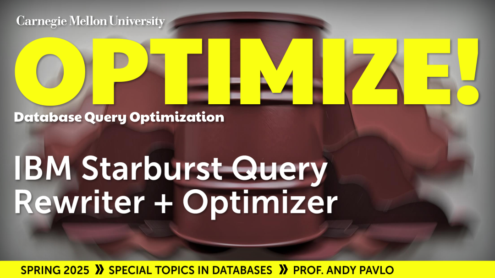

《Optimize！》：一段数据库查询优化之旅。本课程在卡内基梅隆大学现场录制，现场有听众。

正如我说过的，我们今天接着上节课结束时的内容。上次我讲了 IBM 的第一个查询优化器，现在我们要开始讲 IBM 的第二个查询优化器，也就是 Starburst 的优化器。大家又会看到，这些优化器变得越来越精密，也越来越复杂。我们向前跳了十年，来到 20 世纪 80 年代，仍然是在你们大多数人出生之前。不过，优化器开始能够做更多事情了。

不过，在开始之前，我想先讲一下大家发邮件指出的几个错误。我上节课犯的第一个错误是，我说 Charles Bachman 大概是第三、第四，或者第二、第三个获得图灵奖的人。

## 第 2 页：勘误

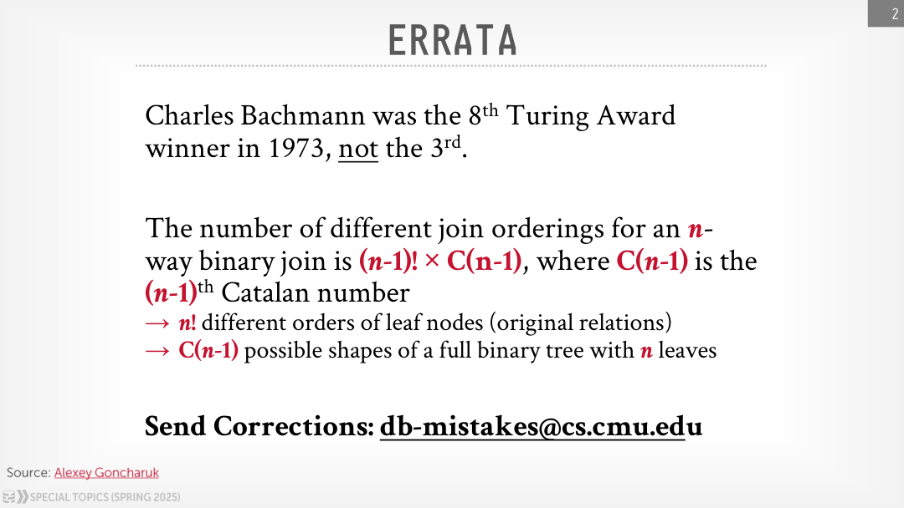

这是不对的。他实际上是第八位获奖者。图灵奖始于 1966 年，Bachman 在 1973 年获奖，所以他是第八位。有人知道第一位图灵奖得主是谁吗？Perlis。Perlis 来自哪里？CMU。他在这里读了本科，然后我想他是在 MIT 读的博士，之后回来当了教授。他在 1966 年获得了第一届图灵奖。

另外，德国人 Neumann 给我发了邮件，正确地指出我对可能的连接顺序数量的复杂度描述有误。我只说它是一个 Catalan 数，但实际上，假设一个查询中有 n 张表需要连接，如果只做二元连接，那要用 `(n−1)!`，然后这个 Catalan 数也是另一个非常大的阶乘。把两者相乘，就得到可能的连接顺序总数。再次强调，即使只做二元连接，也就是 dyadic joins，数量仍然非常庞大，因此我们实际上无法考虑所有可能的连接顺序。

如果我再犯错误，请发邮件到这个地址。不要发奇怪的东西；已经有人开始发奇怪的东西了，这不太好。

## 第 3 页：回顾 System R

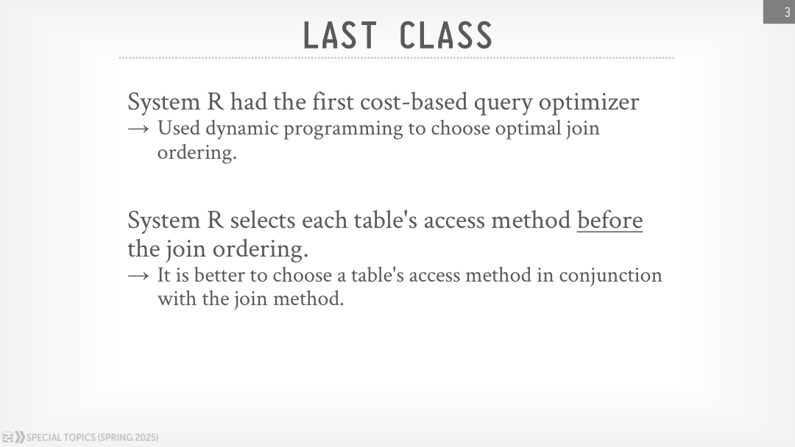

好的。正如我说的，上节课我们讨论了 System R，说它是第一个基于代价的查询优化器。我们讲了它如何使用动态规划，为查询选择最优的连接顺序。所谓最优顺序，是通过代价模型估计出来的；这个模型使用的统计信息，是通过检查表得到的。

需要指出的一个关键点，也是我们今天在 Starburst 以及以后其他查询优化器实现中会看到的不同之处，是 System R 算是第一个这样的系统，运行在很原始的硬件上。即便和 20 世纪 80 年代相比，那些硬件也非常原始。

它们为了简化问题所做的一件事，是先选择访问一张表所用的访问方法，然后再试着确定连接顺序。但大家从入门课中知道，最佳连接顺序往往会受到实际访问方法的影响。如果一张表上有索引，但你选择了顺序扫描，可能就不能使用那个索引来做嵌套循环连接。或者，如果你想做排序归并连接，但没有按排序后的顺序访问表，那你就不能使用归并连接操作符。

Starburst 论文会指出，我们在后来的优化器中也会看到，更好的做法，或者说正确的做法，是在选择连接方法的同时选择访问方法。这也为我们今天研究 Starburst 中的各种规则、了解如何做更复杂的事情打下基础。

## 第 4 页：20 世纪 80 年代末的数据库趋势

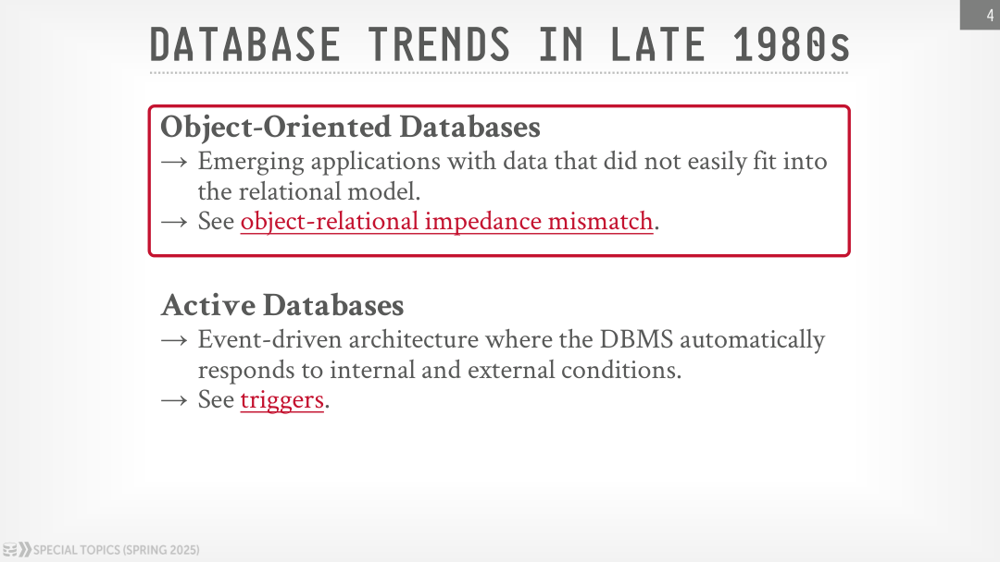

好，现在让我们回到过去，看看 20 世纪 80 年代中后期数据库领域发生了什么，以至于需要 Starburst 这样的系统。80 年代末有两个主要趋势：一个是面向对象数据库，另一个叫主动数据库。

面向对象数据库基本上就是，数据库实际存储的数据模型是对象，类似 Java、Python、C++ 中的对象，随你使用什么语言。其想法是，应用程序使用面向对象代码编写，因为那时这很流行。Smalltalk 出现了，那是热门的东西。C++ 出现得稍晚一些。面向对象是当时的一大潮流。

想法是，与其使用把一切组织成表和关系的关系数据库，你希望有一种系统能够原生存储程序的数据。你在应用代码里使用对象，然后只需调用类似 `save` 的函数，把对象取出来，以原来的形式直接放进数据库系统。这样，当你把状态重新取回应用代码时，就不需要跨许多不同的表做一大堆连接，而是直接取回那个对象，对吧？

当时建立了许多这样的数据库系统，部分原因是出现了新应用，它们不像 20 世纪 70 年代末、80 年代初，甚至整个 70 年代里关系数据库面对的传统商业应用。数据并不总是表格形式。

另一个趋势不像面向对象数据库那么广为人知，它就是所谓的主动数据库。基本想法是，数据库会像一个有生命的东西，可以对自身数据集内部的变化，或者外部发生的事情作出反应，还可以自动更新和修改自己的内容。

这基本上就是触发器。如果有人更新了这张表，就触发一个触发器，根据那个事件做一些事情。现在触发器很常见，但在 20 世纪 80 年代，这是一个新想法。

我们马上会看到，这与 Starburst 有一定关系，因为至少在它的初始版查询优化器里，他们会把所有东西都放进数据库系统。某种程度上，就像使用相同的规则进行查询优化一样，也可以用这些规则在数据上做触发器之类的事情。

但我们最关心的是面向对象数据库。当时人们认为它对关系数据库构成了真正的威胁。因为关系模型大致规定表里放的是标量类型，你不能有数组，也不能在数据里放嵌套对象。然后如果有人来说：“我有一种 SQL 标准或者你的关系数据库里没有的新数据类型”，你就得重写整个系统。而人们希望能够在应用代码里编写这些复杂类型，并让数据库系统原生存储它们。

人们认识到，我们希望能够轻松扩展数据库系统，以支持新应用、新东西，也让关系系统能够更好地与这些面向对象数据库竞争。因此，严格来说，在 Stonebraker 最初的论文里，Postgres 并不被称为关系数据库系统，而是对象关系数据库系统。它的意思就是：这是一个可以拥有可扩展类型、操作符和其他功能的关系模型。

大致在同一时期，回到查询优化器，我们之前讲过这段历史。

## 第 5 页：查询优化器的发展

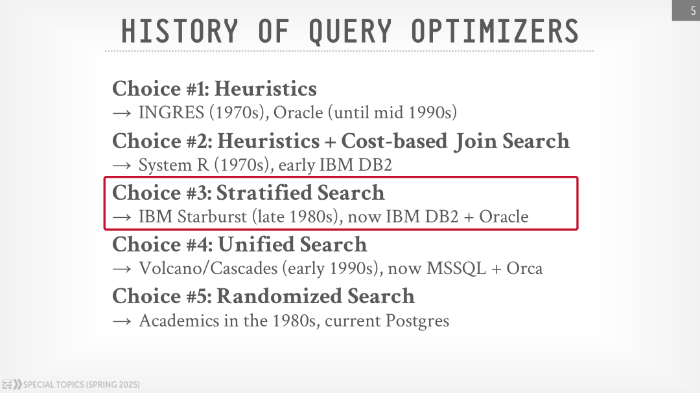

现在我们进入这个阶段：在建立了 System R、Ingres 和其他早期系统之后，人们认识到：“我想要一个可扩展的数据库系统。”在“对象关系”这个术语出现之前，人们就已经知道，希望能够扩展数据库系统而不必重写整个系统。

我总是举 Stonebraker 经常提到的一个例子。让 Postgres 具备可扩展性的动机之一是，他们销售 Ingres 时，Ingres 内置了一种数据类型——抱歉，是日期类型。它基于公历，也就是我们使用的日历。

但当他们尝试把数据库系统卖给银行时，银行说：“很好，我们需要一种日期类型来计算利息。但我们使用的是儒略历。”那是从 Julius Caesar 被刺杀或者出生——两者中的某一个——以来的天数，对吧？因为他们就是这样计算利息的，每个月总是按 30 天计算。

为了给数据库系统添加这种新日期类型，他们不得不对系统做大量修改。因此 Postgres 的设想是：有一个关系数据库核心，提供你所期望的基本功能，包括一些数据类型、操作符和函数。但如果有人想添加新功能，比如儒略历日期类型，就可以针对一个 API 实现它并将它链接进来，而不必重新编写整个系统。

作为这项工作的一部分，人们认识到，事情不只是添加新的日期类型，或者添加处理它们的新操作符。查询优化器也必须以某种方式知道加入了什么，这样才能选择最优计划。这推动了相关工作：人们想要一种方法，能够轻松向查询优化器添加新东西，而不必从头重写所有内容。这两类趋势可以归入我们称为优化器生成器的范畴。

## 第 6 页：优化器生成器在发展史中的位置

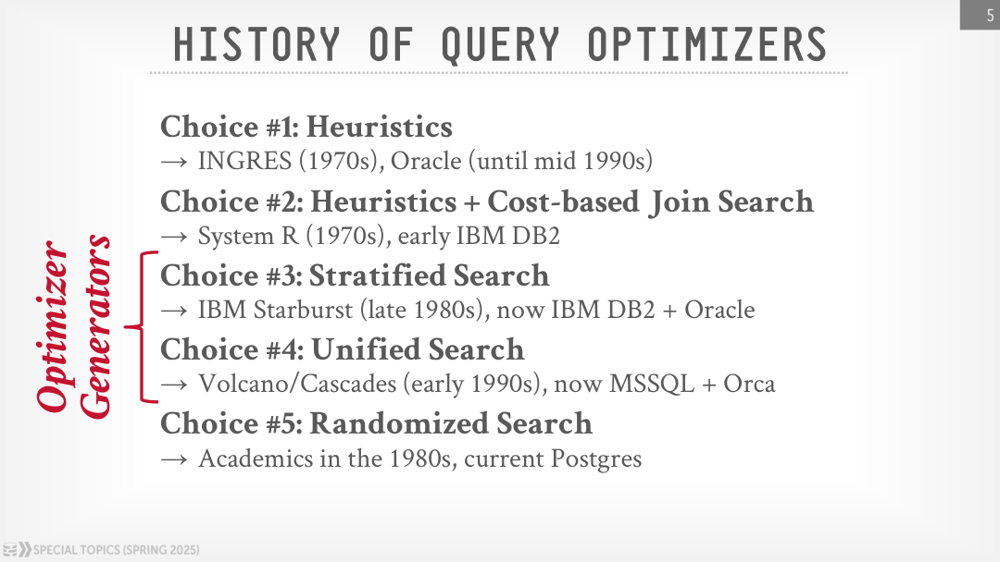

[这一页延续上一页的优化器发展史图示；相关讲解接续前后页面。]

## 第 7 页：什么是优化器生成器

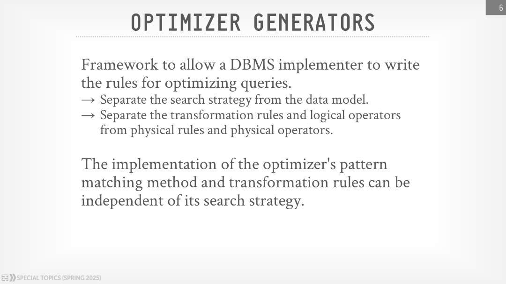

优化器生成器的想法是，不必把数据库系统可能做的每一件事情都硬编码进优化器，而是提供一个相对独立的框架，让你能够定义：在不同条件下、面对不同操作符和不同数据类型时，优化器应该做什么。接着，通过某种方式把你构造的优化规则编译进数据库系统，或者注入数据库系统，而不必重写所有内容。

我让大家读的 Starburst 论文并没有真正从优化器生成器的角度讨论它。下一讲要读的 Volcano 论文，当然还有再之后的 Cascades，则明显更侧重优化器生成器。但高层思路还是一样的：让人们可以给优化器或数据库系统添加新东西，并让优化器知道这些东西的存在，而不必重写整个系统。

今天在 Starburst 和下一周的优化器中，我们会看到一个很重要的方面：它们如何定义模式，以匹配查询计划的某些特征或部分，然后定义要对它进行什么变换、改变或修改。

其想法是，你可以把这些变换和模式匹配，与实际如何搜索最优查询计划分开。某个人只需要定义：“如果我看到这个，就做出这个改变。”至于搜索到底怎样执行，他不需要关心。清楚吗？优化器生成器被认为是构建这些系统的正确方式，后面我们还会看到更多例子。

对于 System R，所有逻辑都被硬编码在里面。我不认为它是用 C 写的，而是汇编。所有执行变换、进行搜索以及其他工作的逻辑都交织在一套代码里。而如果使用这种方法，你可以让一个团队构建所有优化规则，另一个团队专注于构建应用这些规则的搜索引擎。

## 第 8 页：分层搜索与统一搜索

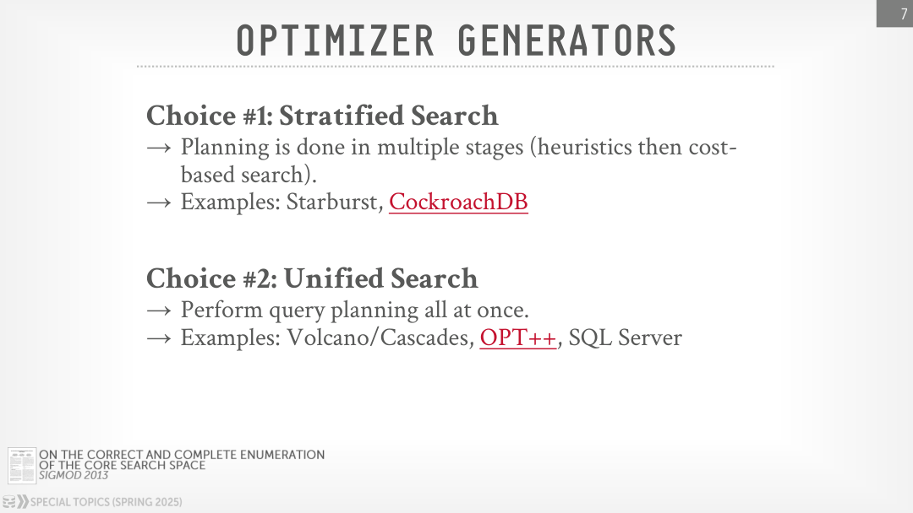

这又与统一搜索和分层搜索之间的区别有关。构建优化器的这两种方法，基本区别在于进行查询优化时，如何考虑什么时候应用哪些规则。

我们今天会在 Starburst 中看到分层搜索：查询优化分成多个阶段，一些变换发生在最开始，而且不需要代价模型。你只需检查查询计划是否长成某种样子；如果是，就知道可以进行这个改变。

另一种是 Volcano 和 Cascades 的统一方法：把所有变换和所有能做的事情放在一起，然后让搜索引擎设法解决。粗略地说，这也与自顶向下还是自底向上有关，但并非完全如此。正如我在第一讲说的，这些方法之间的界线非常、非常模糊。

今天大家会看到 Starburst 明确有一个重写的第一阶段，之后才进行基于代价的搜索。而统一搜索——至少 Cascades 一开始是这么说的——是一次统一的搜索，没有单独的阶段，所有事情一起解决。

但 SQL Server 的论文又讨论了分阶段进行的做法：只做某些变换；如果查询简单，就先做第一组变换；如果认为还需要更多工作，就再做另一组变换。

**Andy Pavlo：** 对，它是 Cascades，但它有一个单独的重写阶段。对。

好，这只是重复我刚才说的话。如果我能点对的话。

## 第 9 页：分层搜索

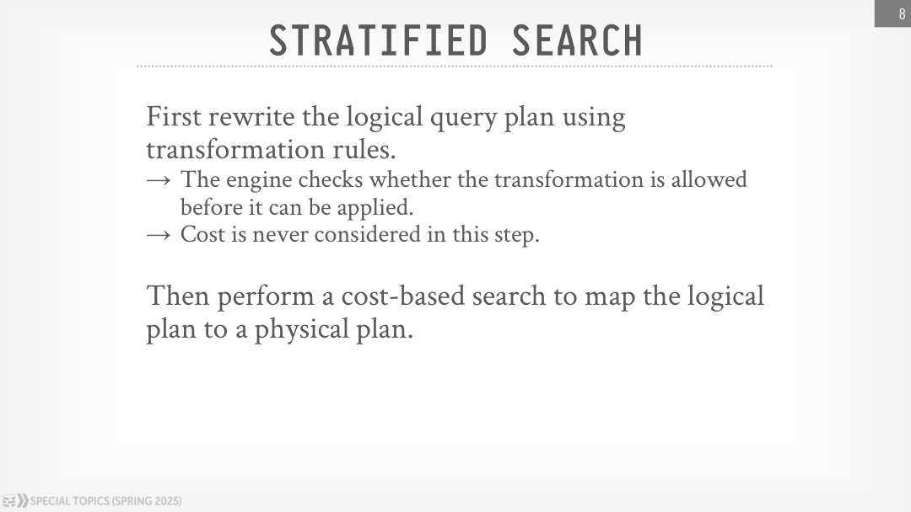

再说一次，分层搜索的思路是：有许多规则可以重写逻辑查询计划，我们只需要检查这条规则是否应该应用。如果规则实现正确——当然，我们假设它们是正确的，只有三个 bug，不过那与今天讨论的内容无关——那么，只要允许应用规则，结果就会是一个有效计划。

因此，如果从一个有效查询计划出发，某个规则根据条件被触发，那么完成变换之后的输出仍然有效。其想法是，逐步把查询计划推向更适合基于代价的搜索的方向。

今天在 Starburst 中还会看到这一点。有时候，查询到来时的写法——也就是 SQL 查询本身的写法——会让优化器不容易找出有哪些不同的可选执行计划。嵌套查询就是它们试图克服的主要问题。

如果不展开嵌套查询，它几乎就像一个过程式查询计划：你得先运行嵌套查询，然后运行外层查询。而如果能够展开它，用连接替换，那么就可以开始枚举各种连接，尝试不同顺序，以找到最佳计划。

## 第 10 页：统一搜索

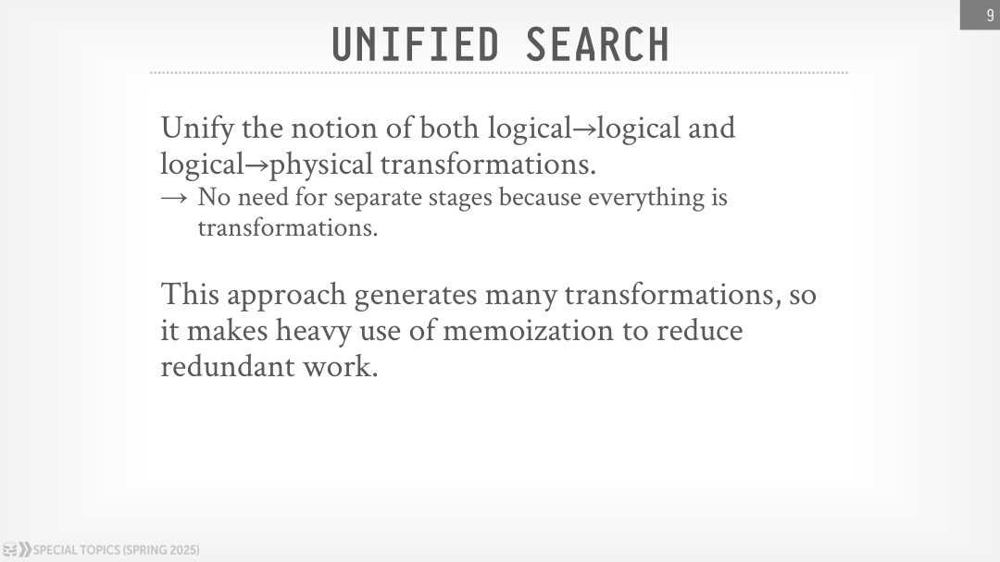

但关键是，在最初这个阶段，我们不需要代价模型。我们知道这里全是逻辑判断：规则是否匹配？如果匹配，就应用它。

至于统一搜索，我现在不想讲太多，因为下周整周都会讨论。但其想法是，你拥有所有变换规则，其中一些可能基于代价，有些可能不基于代价。你把它们统统放在一起，让搜索引擎决定以什么顺序执行、评估它们并应用变更。

这会非常重，比我们今天看到的重写过程更重。他们不想反反复复做冗余计算，所以会使用内部 memo 表，也就是内部状态，记录：“对于这个查询，我以前是否做过这个变换？”如果做过，就不再重复应用。统一搜索下周还会详细讲。

## 第 11 页：本讲内容

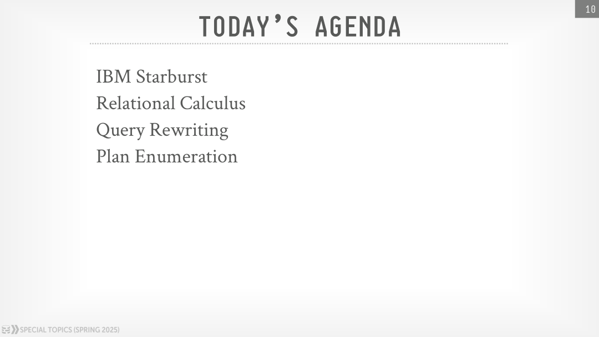

好，我想先简要介绍一下 Starburst 是什么，或者说曾经是什么。其实应该说“是什么”，因为它仍然存在，只是不再叫 Starburst 了。

我想用一两页解释什么是关系演算，因为 Starburst 在重写阶段就是用它来表示查询计划的。然后我们会讨论重写规则是什么样子，再讨论它们如何进行计划枚举。

## 第 12 页：IBM 数据库历史

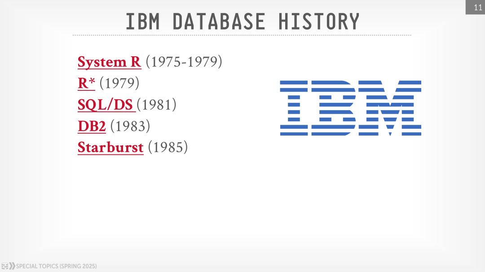

好了，对在座许多人来说，这些应该大多是重复的内容。不过 IBM 构建数据库系统已经有很长时间了。实际上我漏掉了 IMS，那是在 1968 年，应该放在这张图的上面。我很确定那是他们构建的第一个系统，至少是第一个数据库系统。

我们上节课讲过 System R。在 System R 之后还有另一个项目，叫 R*。这里有谁听说过 R*？它是 System R 的分布式版本，对吧？

Ingres 也有一个分布式版本叫 Muffin，我想其中某个部分代表 multi-user。有一次我问 Mike：“它到底是什么意思？”他说：“它是 Muffin，Ingres。”我们说：“好吧。”但论文里可没有这么写。

好了，System R——抱歉，System R 和 R* 都是 IBM 数据库研究组的研究项目。SQL/DS 是 IBM 推出的第一个商业关系数据库系统。这里有谁听说过 SQL/DS？它还存在。没人听说过，对吧？它包含 System R 的一些部分。

然后 IBM 在 1983 年推出的非常、非常重要的系统是 DB2。它用到了 System R 的一些部分，但系统中的很多部分都是从头重写的。

还有一个项目叫 Eagle，他们试图在 IMS 上面加一个关系数据库接口，而 IMS 不是关系数据库系统；显然这个项目失败了。IMS 仍然存在，我想现在它们支持 SQL 了，但在 80 年代，他们试图在它上面加 SQL，没有成功。

Starburst 是他们在 1985 年着手构建的另一个大项目。正如我上节课说的，我今天结束时还会再说一遍：Starburst 至今仍然存在，现在它位于 DB2 的 Linux、UNIX 和 Windows 版本中。不是大型机版本，它好像叫 LUW DB2 之类的。

## 第 13 页：Starburst 的目标

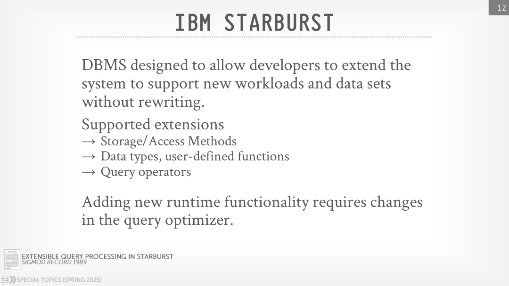

好。Starburst 是 IBM Research 在 R* 之后构建的一个重要项目。它们主要想实现的是让系统具有可扩展性，也就是能够添加新的工作负载、新的数据类型和新的操作符，而不必重写整个系统。

关键的一点又是我刚才说的：添加所有这些新功能当然很好，但如果查询优化器把它们看作不透明的盒子，或者一个黑盒，你就麻烦了。它不知道该怎么处理。

本学期后面讲 UDF，也就是用户定义函数时，我们会看到这个问题。现在多数系统遇到一个 UDF，会说：“我不知道里面是什么。我无法估计它的选择率、基数，甚至不知道它会做什么，因为我看不到它的内部。”Microsoft 有一种办法解决这个问题，我们有一个更好的版本；这学期后面会讲。

但同样的道理，如果你要添加这些东西，就必须告诉优化器：“这是我要添加的东西；就查询计划中你关心的那些属性而言，它会做这些事情。”这与 Postgres 的动机相同，不过我不认为 Postgres 像 Starburst 那样把这些东西与查询优化器集成起来。

## 第 14 页：Starburst 介绍视频

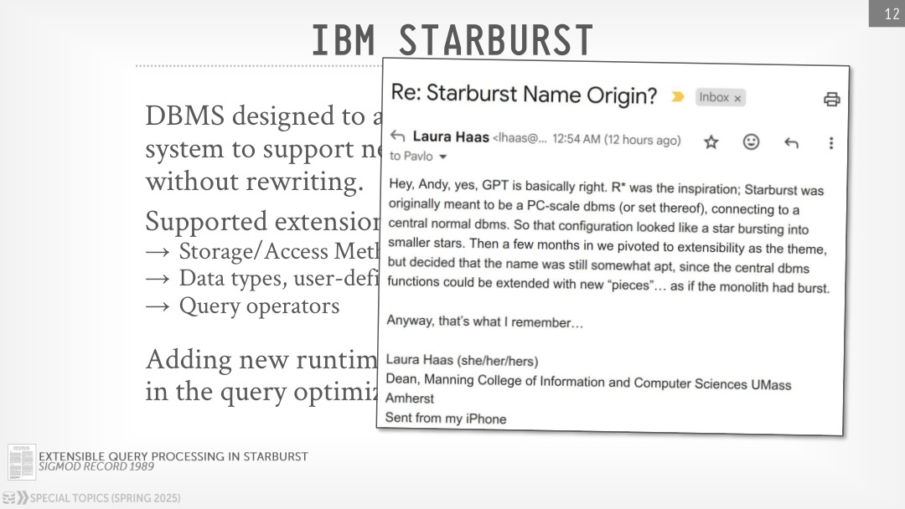

我实际上找到了一段 1990 年的 Starburst 宣传视频。我想播放一下。它开始时有一段奇怪、不祥的音乐，而且片头真的很长，所以我们会快进一大段。片头大约有一分钟，我心想：“我不能把这个都放出来。”

**视频旁白：** 信息。我们积累信息、分析信息，然后把它储存起来。每过去一年，就意味着有更多信息需要处理。我们通过数据库系统来访问这些爆炸式增长的知识。给定一个查询，数据库系统会筛选海量原始数据，以便为用户找出所请求的信息。

但新的信息未必总是适合当今系统能够使用的模型。对于这种信息爆炸，我们所知道的是……我们需要想办法使数据库系统更能适应新类型的数据。

**Andy Pavlo：** 她是大家所读论文的第一作者。

**视频介绍者：** 我们需要的解决方案既要能满足今天的需求，也要能满足明天的需求。这里是 Almaden 研究中心，Starburst 项目就是我们对这个问题的回答。Starburst 是一种可扩展数据库系统。也就是说，可以直接在 Starburst 中定义新类型的数据，以及检索这些类型数据的访问方法。对用户来说，这意味着向数据库添加新类型是完全不同的。

**Andy Pavlo：** 那个人负责查询优化。他是 Guy Lohman。

好，我们把这些快进掉，对吧？这个例子大致是说，你想找到 Santa Clara 的所有露营地，于是引入以前没有的一种新索引类型，必须向查询优化器说明如何使用它。你仍然用 SQL 编写所有内容。

**视频旁白：** 我们可以在 parks 表上定义两种不同的索引：一个索引指向所有有露营地的公园，另一个索引指向 Santa Clara 县的所有公园。查询优化器能够判断，与 Santa Clara 县公园的索引相比，有露营地的公园的索引会导致检查更多行。因此，优化器选择使用 Santa Clara 县公园的索引来访问数据并回答查询。

优化器是如何知道使用我们新的空间索引的策略，以及这种策略能够做什么的？Starburst 通过一组强大的优化规则指定这些信息。

**Andy Pavlo：** 对，这些就是规则。这些是 STAR。

**视频旁白：** 规则告诉优化器有哪些可用的执行策略，以及它们的代价。Starburst 基于规则的查询优化方法非常强大而灵活。

**Andy Pavlo：** 这些是 STAR，那些是 LOLEPOP。

**视频旁白：** 它可以应用于任何表。每条规则通过名称调用，使优化器能够迅速确定哪些规则适用。优化器只需要列出构造某个策略时使用的规则，就可以向用户解释它为什么选择该策略。

最棒的是，由于规则作为数据输入优化器，用户可以指示优化器改变旧策略或定义新策略，而不必修改优化器本身。Starburst 的可扩展性使我们能够支持新的应用，这些应用对新类型的数据和新操作有新的需求。实现可扩展性在技术上很有挑战，因为还需要保证良好的性能和数据完整性。基于规则的优化和恢复只是我们正在 Starburst 中研究的两个问题。

**Andy Pavlo：** 这位作者现在是 UMass Amherst 的院长——抱歉，是计算机科学学院的院长，对吧？名单上还有许多其他知名人物，发明 ARIES 的那个人也在名单上。

好，我想昨天是你提到的：“它叫 Starburst，是因为他们在展开 STAR。”对，他们要经过一大堆 STAR。没错。我的意思是，这听起来很合理，对吧？但当时你不知道 R*。所以我在想，这个名字是什么意思？于是我给作者发了邮件——她是 UMass 的院长。

昨晚她告诉我这个名字的来历。实际上我没问 ChatGPT，我用的是 Perplexity，它答对了。基本上，这个名字真正的意思是，他们原本想基于 R* 构建某个东西，后来转向了可扩展性，想法大概是把它的一部分炸开，于是就变成了 Starburst，对吧？

视频里说 STAR 里有代价。论文里没有提到这一点。我们一会儿会讲到。对，那里面有。

好，这是我给大家挑选的所有 Starburst 论文中最好的一篇。有一篇大概叫《A Star Is Born》之类的文章，你根本找不到。IBM 网站上列出了它，据说是对 Starburst 的概述，但我找不到。

而我发给大家的这一篇，是唯一一篇既涵盖重写又涵盖基于代价的优化的论文，所以我才让大家读它。还有其他论文只讲重写。然后我给另一位合作者发了邮件，就是那个穿绿衬衫、正在打字的人，他今天早上把他的幻灯片发给了我。我实际上用了其中的一部分，但他的幻灯片对 Starburst 的全部工作有比较完整的概述。

## 第 15 页：查询优化流程

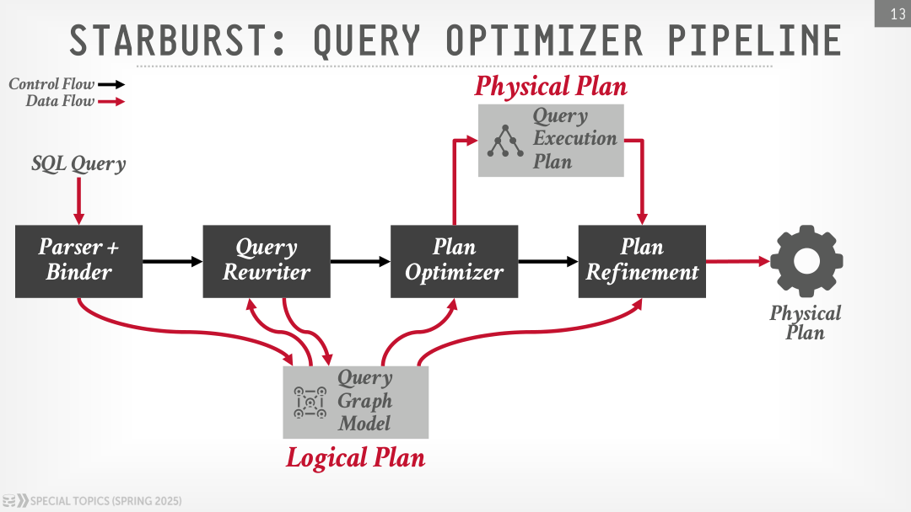

好，这里是处理流程。它看起来开始比我们看到的 System R 更先进，这是一个大致概览。我们仍然有解析器和绑定器，因为我们必须进行求值，确保名称或表确实能够与目录中的某个对象匹配。

但他们会把解析和验证之后得到的逻辑计划存到一种图模型中，叫作查询图模型（Query Graph Model）。我们一会儿会介绍它。你可以把查询图模型大致看成使用元组关系演算表示的查询计划的逻辑形式，我们再过几页会讲到。

这就是逻辑计划。接下来绑定器说：“好，我完成了。”然后通知查询重写器接手。重写器接收查询图模型，应用一系列我们接下来会讲的重写规则，得到经过改进的查询图模型版本。同样，这个第一阶段的输出始终是一个有效的查询计划，也就是一个有效的查询图模型；之后做的每次重写也都会产生有效的模型。

然后，控制器把它交给计划优化器。计划优化器接收它，应用其他重写规则——这些就是 STAR——来生成物理计划。还有一个额外的细化步骤，论文对它讲得不多。我们会在 Microsoft 的系统中看到这个步骤：有时，如果知道需要分布式执行，你先从一个单节点计划开始，然后细化步骤再把它拆开，做成多节点计划，对吧？

图里看起来只是处理一次，但实际上你会拿查询图模型，根据 STAR 和 LOLEPOP 生成许多不同的备选方案，然后计算代价，判断哪个最好。全部完成之后，就得到了一个真正可以执行的物理计划，好吗？我们主要会讨论这里和这里。

## 第 16 页：关系代数与关系演算

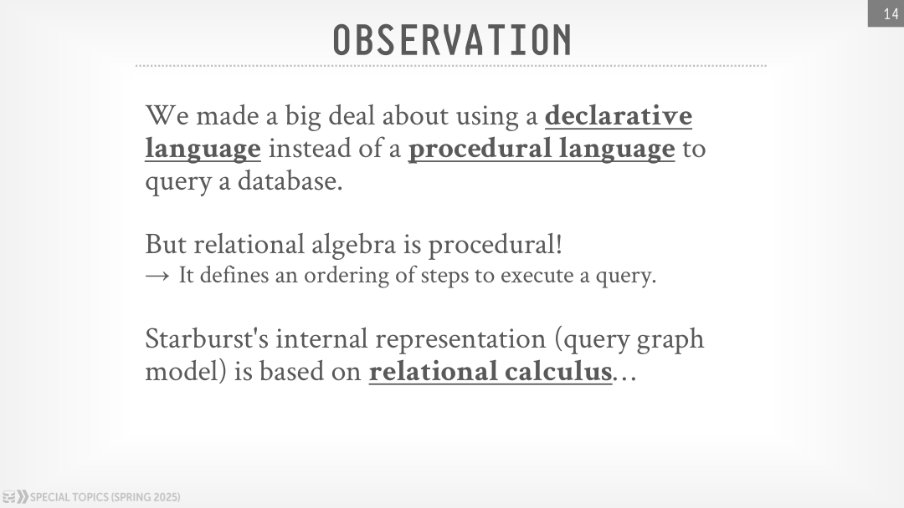

论文没有说这是什么，我们也得定义这是什么，还有上面的那个东西，好吗？

好，在讨论那些内容之前，我们必须解释关系演算是怎么回事，对吧？学期开始时，我非常、非常强调过这一点，在入门课上我也非常、非常强调过：查询数据库时，你总是希望使用声明式语言，而不是过程式语言，对吧？

我展示过一个例子，大意是：“这是根据 ChatGPT 得到的 CODASYL 的样子，这是 SQL 查询的样子。看看它好多少，对吧？”你肯定总是希望使用声明式语言。

但是，我们谈到查询计划时，总是说：“哦，这是 SQL 查询，看，我已经把它转换成关系代数了。”然后我可以把关系代数转换成逻辑查询计划。但关系代数是过程式的，对吧？它定义了应用各种操作的顺序。比如，我把表 A 和表 B 连接起来。

取决于我的关系代数里输入位于连接操作符的哪一侧，这会决定各种操作能够应用的顺序。同样，如果我想做谓词下推，就得把过滤操作符移到 SELECT 的内侧。

所以，Starburst 没有把查询计划表示为关系代数——再说一次，关系代数决定事情发生的顺序——而是进一步上升到更高层，用关系演算来表示。

我现在不再在入门课上讲关系演算，因为除非你做查询优化，否则其实不需要知道它。猜猜怎么着？你们正在做查询优化。不过它没那么难，好吗？

## 第 17 页：元组关系演算

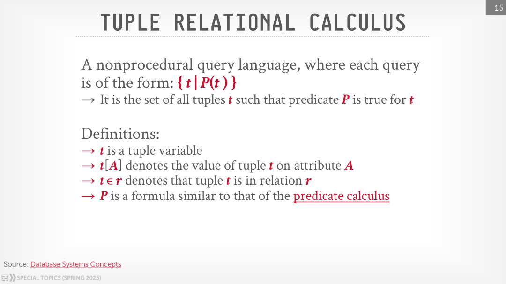

基本想法是，它是一种更高层的非过程式语言，演算基本上就是根据某个谓词构造元组。关系演算查询最基本的形式——这是最简化的版本——是找到某个元组 t，它来自作用于 t 的某个谓词 P。

再说一次，这就像一个限定条件：如果某个输入中的元组——我还没有定义这个输入——满足这个谓词，那么我就可以把它放进输出元组中。

所以 t 只是一个元组变量。如果你看到方括号，那是用来标识或者引用元组中的属性或列的。说一个元组属于关系 r，基本意思是它来自某个源关系。

P 则只是一个公式，类似于我们之前见过的东西，对吧？它基于谓词演算。就是我们之前讨论过的所有合取子句、析取子句，以及 WHERE 子句里的谓词。

还有域关系演算，基本上也是同一回事，只不过它不像这样先定义一个来自关系的元组 t，再显式地通过放入想要的属性来构造元组。在域关系演算中，基本上是直接定义：“这是我想要的属性。”它们基本相同，对我们来说没什么影响。

## 第 18 页：关系演算示例

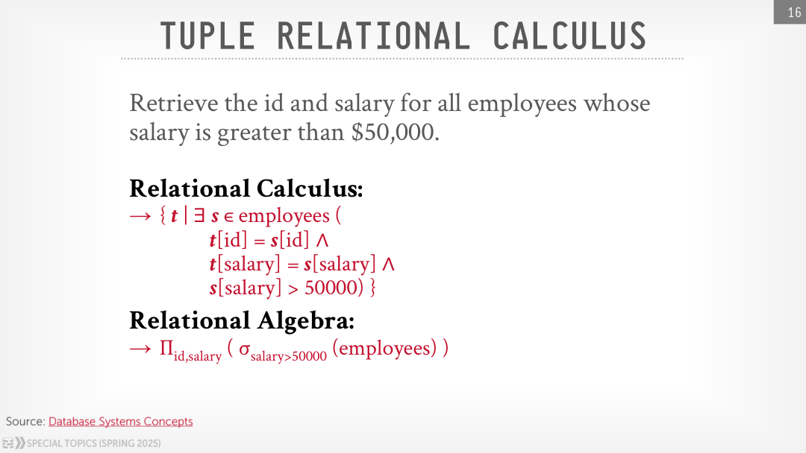

好，现在来看一个关系演算查询：从某个 employees 关系中，取得所有工资高于 50,000 美元的员工的 ID 和工资。

关系演算的写法基本上是：这里有我的元组 t，它将成为输出的一部分；然后是“存在”——也就是说，某个 employees 关系中存在一个元组 s。接着我定义自己关心的谓词——抱歉，是我关心的、想要填进 t 里的属性。

所以我说这里有某个 t，有一个 `id` 属性，而它来自 s 的 `id` 属性。同样，元组 t 中还有一个 `salary` 属性，它来自 s 的 `salary` 属性。然后我们还有合取子句，说工资要大于 50,000 美元。

因此，对于 employees 关系中的所有元组 s，只匹配 `salary` 属性大于 50,000 美元的那些。就是这样。

下面是等价的关系代数，这是其中一种写法。再说一次，这里要指出的是，我在这里有投影，然后有过滤。我可以把它们交换，比如先做投影，再做过滤，这仍然与它等价。但在关系演算中，里面这些子句的顺序并不重要，对吧？因为这是更高层的逻辑：它说的是，必须满足这些条件，查询才会输出一个元组。

有什么问题吗？有？存在。是存在量词。对。另一个是全称量词，就是倒过来的 A。你可以用它来表示嵌套查询、连接之类的东西。

就是这样。这就是你们本学期需要知道的全部关系演算内容。我相当确定，是吧？

## 第 19 页：查询图模型

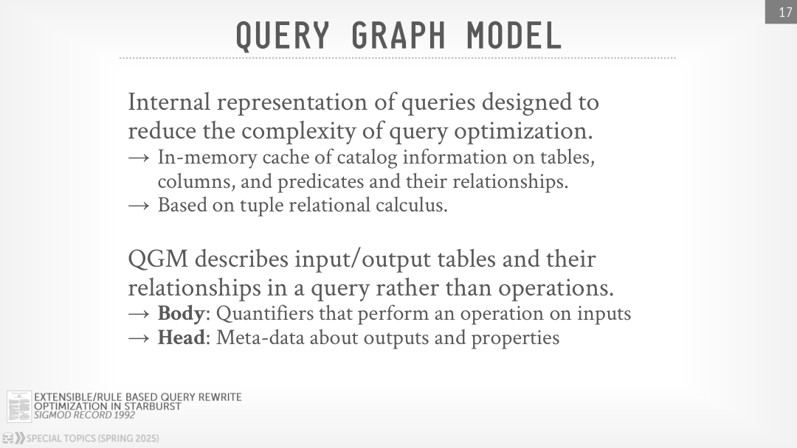

好了，我们能用它做什么？同样，如果我们想用某种抽象形式来表示查询，而不定义各项操作的应用顺序，我们就可以基于关系演算构建这种表示。

当然，我们并不想直接在这个表达式上做查询优化或重写，对吧？因为它太抽象了。我们需要一个更具体一点的东西，能够描述我们关心的数据的实际属性，然后允许我相应地操纵这些东西。

这就是他们在查询图模型中要做的事情。它是查询的一种内部表示，然后他们可以在图的结构上进行模式匹配，从而识别什么时候可以通过重写移动东西。

你可以开始把查询图模型想成一个关于查询内部内容的内存数据库。然后你可以在这个内存数据库里查找：“我有没有这个结构？我有没有看到这个模式？”如果有，就进行某个改变。这又呼应了我们一开始谈到的主动数据库。

查询图模型会描述查询中的输入表、输出表以及它们之间的关系。它们被放在盒子里进行组织。每个盒子会表示或包含一个 body，里面有对某些输入执行操作的所有量词。

回到我前面的关系演算，对吧？哎，抱歉。量词基本上就是这个，对吧？存在一个元组，使得……存在元组 t，使得存在一个元组 s，满足这些属性。body 就定义这部分。然后是 head：查询图模型中的所有这些盒子会用 head 来标识或记录查询盒子输出的元数据以及它的各种属性。

光这样空泛地说没什么意义，所以我们来看一个具体例子。

## 第 20 页：查询图示例

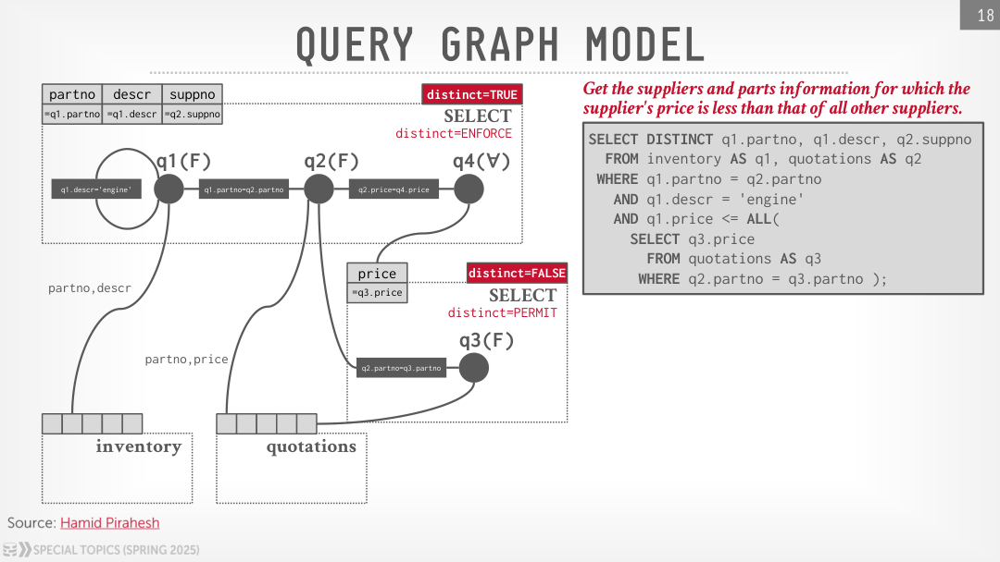

这个查询要取得供应商和零件的信息，条件是供应商的价格低于所有其他供应商。它是一个嵌套查询：外层查询对 inventory 和 quotations 表做连接，然后还有这个讨厌的、带有 `ALL` 谓词的嵌套查询，它会取得你要查找的零件的价格。

基本上，这里说的是：对于 inventory 中的任何零件，也就是 q1 的这个零件，如果那个价格低于所有其他价格，也就是说它是最低价格，那么谓词就满足。

查询图模型看起来是这样。我们会一点一点地看。

## 第 21 页：存储表

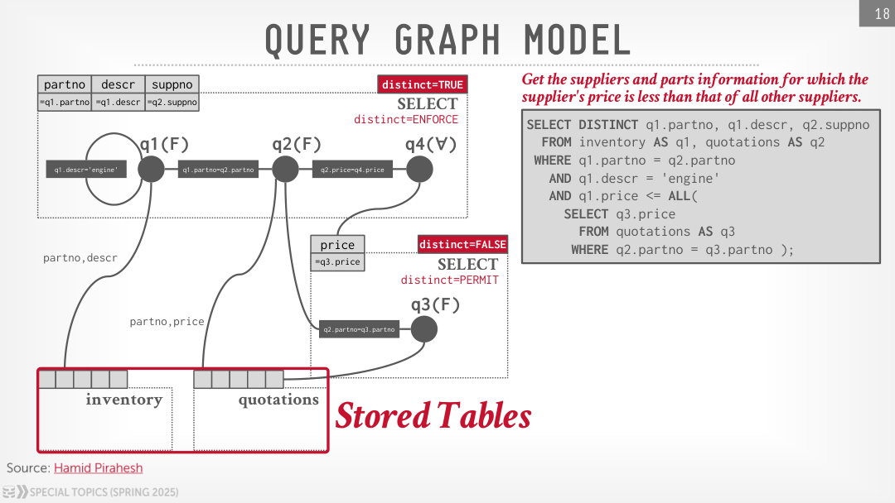

首先是存储表，也就是实际存在于数据库中的表，用户定义的表。它们被表示在下方，基本上只是空盒子：表名，加上从中输出的一些列，仅此而已。

不过你可以添加额外的属性，比如它是否已经按照聚簇顺序排序，对吧？也可以把这些信息放进去。

## 第 22 页：查询盒子

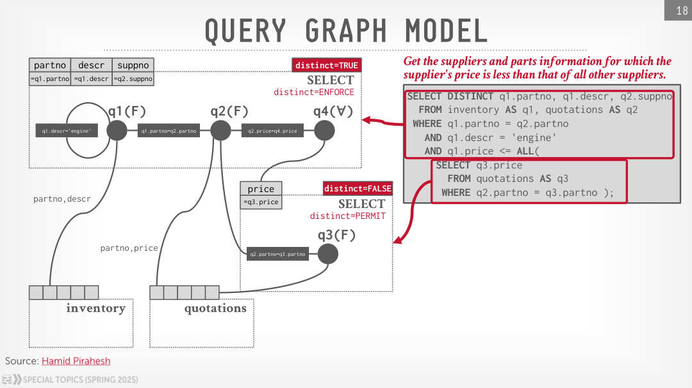

然后是这些查询盒子，它们对应查询计划中的两个查询。至少在一个新查询刚出现时的查询图模型初始形式或初始版本里，每个嵌套查询都会被当成一个单独的盒子，对吧？外层查询显然也被当成一个盒子。所以这里就是我们拥有的两个 SELECT 语句。

## 第 23 页：迭代器和量词

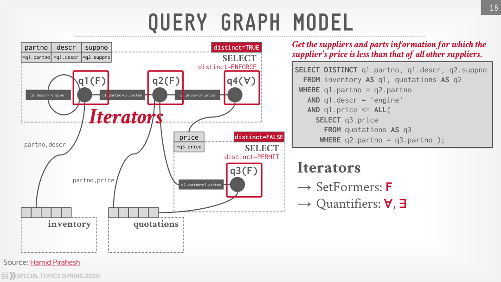

在这些盒子里，我们有这些顶点，它们基本上代表迭代器，也就是对输入的元组流执行某种操作的东西。迭代器有两种形式：集合构造器，也就是从基表创建新输出的东西；或者量词，它表示从另一个查询盒子派生出来的东西。

这里这个 SELECT 正在扫描 quotations 表，所以它是一个集合构造器。这里这两个分别查看 inventory 和 quotations，所以它们都是集合构造器。但这里的 q4 是从第二个盒子的输出派生出来的，所以它是一个量词。

有问题？你想得太超前了。没有，这里没有任何物化的概念。它只是说：“这是查询要怎样运作、以产生正确结果的逻辑。”我的意思是，答案是肯定的：等我们先把这些东西转换成 STAR，再转换到 LOLEPOP，那个时候就可以推理那些属性。对，但现在还不行。

## 第 24 页：限定条件

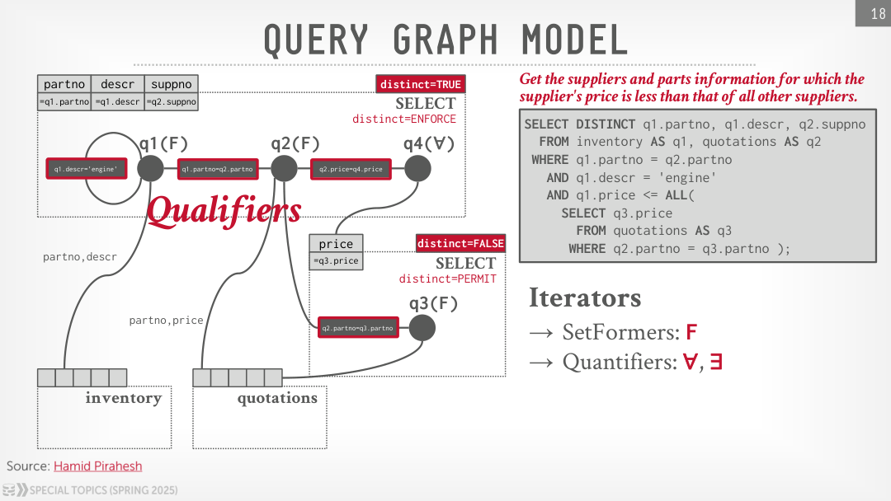

还有问题？他的问题是：“我能不能说出这些东西按什么顺序执行？”在这个层次上，不行。

对吧？什么都不能说。再说一次，关系演算中没有操作顺序的概念。它只是说：“如果我执行这个，我不知道怎样执行，但如果我执行它，我就会产生给定查询所要求的正确结果。”你可以这样想。

还有问题吗？好。接下来他们有这些限定条件。它们基本上类似于谓词，用这些位于节点之间边上的矩形来表示。

## 第 25 页：输出属性

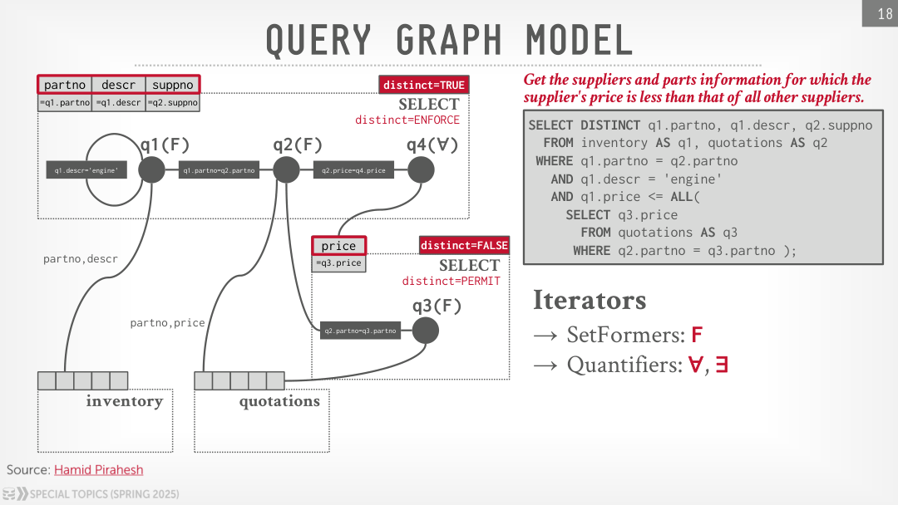

然后，对于每个盒子的输出，它会说：“这是从我这里输出的列，也就是属性的名称。”在下面则会有它来自哪里的信息。

所以这个盒子产生一个名叫 `price` 的属性，这里只是说这个价格来自 q3 读取或生成数据的那个地方；它会有一个 `price` 属性。你也可以在里面放数据类型。

## 第 26 页：去重性质

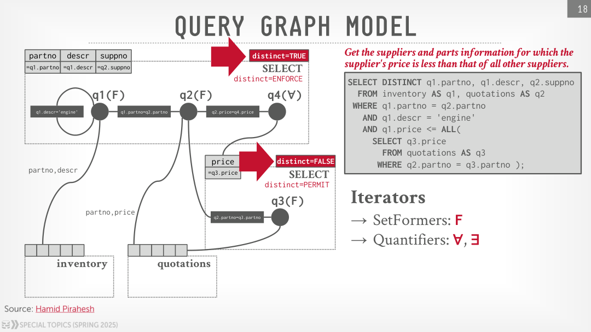

还有一点，我认为在我发给大家的那篇论文里不是很清楚。我想他们讨论了 head 里的这些 distinct 标记，但没有讨论 body 里实际上有什么，我们一会儿会遇到这个问题。

不过，他们还想记录一个盒子的输出是否会去重。这又与判断什么时候允许把盒子合并，以及是否保证唯一性等属性、从而确保结果正确有关。

在盒子里说“这里的输出是否去重，是还是不是”，这比较容易理解。但他们在这里还有内部的部分，对吧？所以 SELECT 说的是：“这是我实际做的操作。”这差不多相当于一个 LOLEPOP，实际上在这个层次是一个 STAR。

然后你还可以说，例如，我是否要强制保证东西不重复？或者我能否向所有读取我输出的东西提供一个提示：我的数据是否会去重？因为也许不是我的盒子负责强制去重，而是因为我读取的下层输入已经满足了这个性质。

这里说 `distinct=PERMIT`，意味着允许这个盒子产生重复。

## 第 27 页：PERMIT 与 ENFORCE

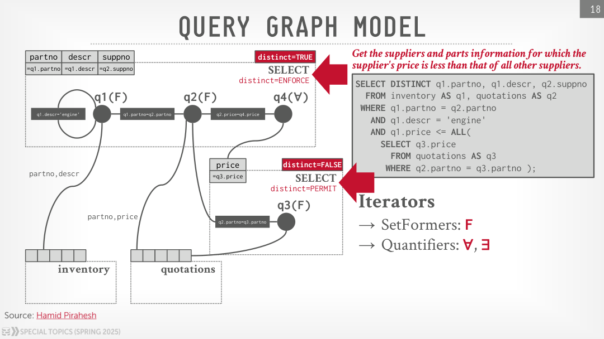

可能有重复，也可能没有，但这里没有做任何显式检查。而上面这里是 `distinct=ENFORCE`。这就是说，我们会做某种操作来保证：无论输入给这个盒子的是什么，对于 head 中定义为输出的那些属性，从这个盒子出来的东西都不会重复。清楚吗？好。

那么，有了查询图模型，实际上能用它做什么？正如我说的，任何查询产生的初始查询图都保证有效，因为它几乎是把 SQL 查询中的内容，按照查询图模型定义的方式逐字转换成关系演算。

但这个第一版本必须把所有嵌套查询拆开，使每个 SELECT 单独放在一个盒子里。接下来的挑战是，当我们开始做查询优化、应用基于代价的规则——第二阶段的改变或变换——时，如果嵌套查询被拆分到一堆盒子里，我们就得写能跨多个盒子查看的规则。这会变得非常棘手，因为你必须试着处理这些盒子的所有边界情况。而一个不太光彩的秘密，我先……

## 第 28 页：为什么要合并查询盒子

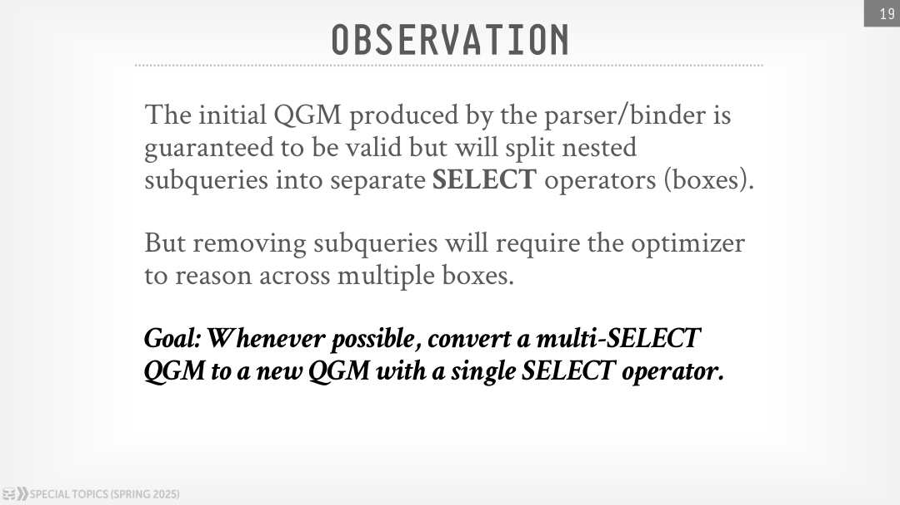

先提前透露一下我们以后会讲的内容：如果你们修过 721，就知道答案是，除了德国人，没有人能处理所有可能的嵌套查询。即使 DB2 也做不到。当然，他们在这篇论文里大肆宣扬自己有多厉害，但他们也不会把所有情况都处理正确。他们在其中一篇论文里批评 Oracle。他们比 Oracle 好，但不如 Microsoft；Microsoft 又不如德国人。我们之后也会讲到这个。

因为我们的论文，他们确保自己能够赶上德国人。我们有一个……以后会讲。

好，但我想说的基本意思是：他们想在进入基于计划的优化之前去掉所有嵌套查询。因此，他们要拿到一个查询图模型，找到有多个 SELECT 盒子的查询图模型，尝试把它们合并成一个 SELECT 盒子。这样你就可以只针对这个盒子进行推理，而不必查看其他盒子。

因为现在你可以在单个盒子内进行所有连接顺序相关的工作、枚举、谓词下推以及之前讨论的其他优化；它们不能跨多个盒子做这些事情。

## 第 29 页：查询重写器

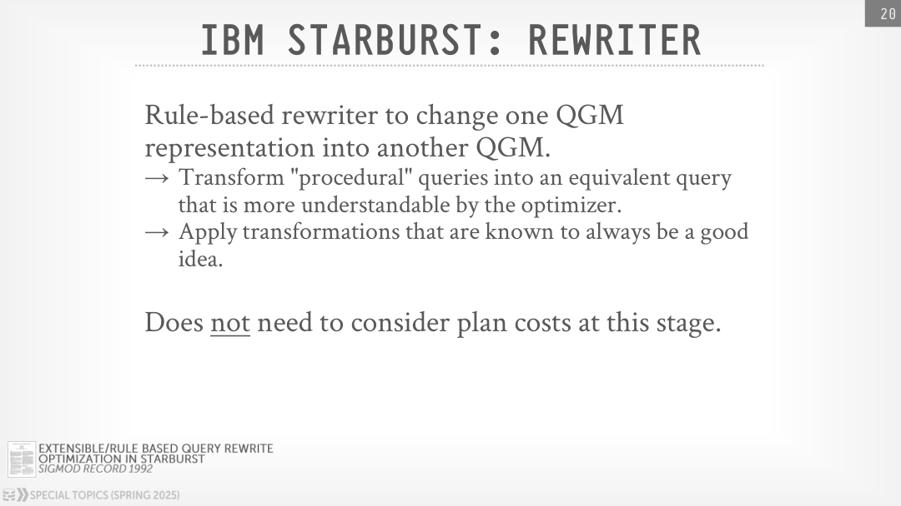

这就是重写器要做的事情。再说一次，分层搜索有多个阶段。这是生成查询图模型之后遇到的第一个阶段：应用启发式方法和规则，把查询图模型重写成另一个更适合我们之后会看到的基于代价的优化或动态规划的查询图模型。

正如我说过的，其想法是，如果出现的查询里面有一堆嵌套子查询，你希望能够把它们折叠起来。因为基于代价的优化器、基于代价的搜索优化器的搜索算法，无法跨多个盒子读取。于是，如果不做这种展开，最终得到的计划几乎会隐含地定义操作符必须应用的顺序。

所以他们的主要目标是重写查询，让它变成对基于代价的搜索更有利的形式。基本上是应用我们知道总是好主意的变换，完全不参考代价模型。因为查找相关信息、推导对查询计划行为的代价评估是有开销的。

## 第 30 页：重写规则

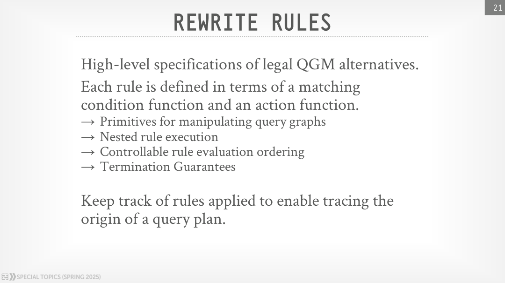

好，这很酷。这看起来是个好主意。那么这些规则实际上是什么样的？它们是高层规范，规定对于某个查询图模型，哪些查询图模型表示和备选形式是有效或合法的。

每条规则都是根据匹配条件定义的。比如，我的查询图模型中必须满足什么条件，才能应用某个动作函数，进而做出改变？

他们很重视这一点。有些论文里说得不清楚：它们会说：“哦，这是一种高层声明式语言。”但其他论文又说：“哦，它是用 C 写的。”后来他们又说：“哦，它是用 C++ 写的。”对吧？之后的 Volcano，特别是 Cascades，会特别强调提供一种 DSL，让你可以在里面定义这些规则，而不是用 C 或 C++ 之类的东西。

不过这样也不总是管用，因为有时你确实需要在较低层访问查询计划来做出修改。比如 Cockroach 也做了同样的事：他们尝试定义一种 DSL，但如果需要，可以退回到 Go。我们以后再考虑这个问题。不过要知道，就我所知，在它的初始版本中，所有东西都是 C 写的。

他们能做的一件很酷的事是记录重写阶段应用的所有重写规则。这样，比如作为数据库开发者，甚至作为最终用户，当你想查看“为什么我的数据库系统生成了这个查询计划”时，你就可以回头看：这些是应用过的所有规则，它们把我带到了这里这个重写后的形式。

那么，这对最终用户或应用开发者真的有用吗？可能没有，对吧？因为这会是一堆规则名称，我们一会儿就会看到。光看名称，他们不会知道这些东西是什么意思。但对于构建查询优化器的人，或者必须调试它的人，这肯定有助于理解优化器为什么作出某些选择。这样一来，它就不那么神秘了。

所以，他们会有用于操作的规则，也能在规则内部应用规则。他们还可以控制规则应用的顺序。你可以这样想：如果我知道某条规则通常无关紧要、不会产生很大影响，也许我会给它更低的优先级；而谓词下推或者展开嵌套这样的规则，你总是希望做，就可以给它更高的优先级。我们在 Cascades 里还会看到这一点，它们也有排序优先级的概念。

然后，他们必须保证规则最终会终止。我们之后会讲他们如何处理这个问题。基本上，他们设置一个限制：比如看实际经过了多长时间，我已经重写了多久？或者在其他情况下说，如果我应用 100 条变换规则，一旦做到 100 次，我就结束。

## 第 31 页：规则引擎

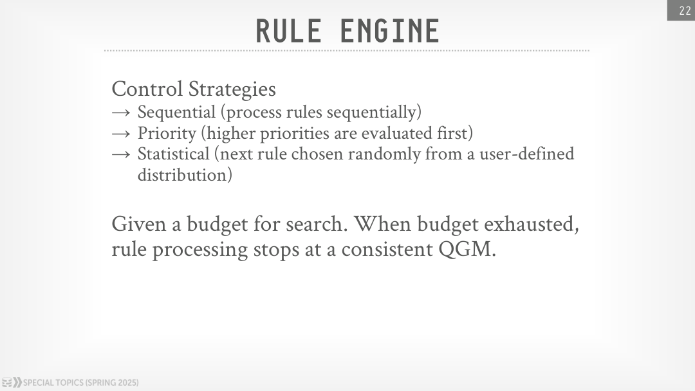

然后他们也有这个规则引擎。再说一次，其想法是你可以控制规则如何应用：它们是否按顺序处理？是否有优先级？他们还讨论过，你可以提供一个概率分布，这样当你掷硬币时，某一种规则类别被应用、而不是另一种类别被应用的概率是多少？我看不出这对任何人来说会有多可行，至少他们把这些功能暴露出来了。

再说一次，正如我所说，你会得到某种预算——抱歉，是系统会得到某种预算，规定它允许搜索多久，或者允许考虑、应用多少次变换或多少条规则。预算结束后，处理就会停止。

因为我们有这样的保证：重写阶段中，规则所做的任何变换，输入是有效的查询图模型，输出也必须是有效的查询图模型。这意味着我们可以在重写阶段的任何时刻终止，并且保证得到一个查询图模型，我们实际上可以把它转换并完整地运行，对吧？

我们在 Cascades 中做不到这一点，因为如果提前终止，而且实际上还没有到达搜索树的所有叶子，查询就还没有完全构成，对吧？同样，这里的问题稍微不同，因为他们在做的是特定的规则重写。但理解这一点很重要：查询出现之后，他们可以随时把这东西关掉，一切仍然能够正常工作。

## 第 32 页：SELECT 合并示例

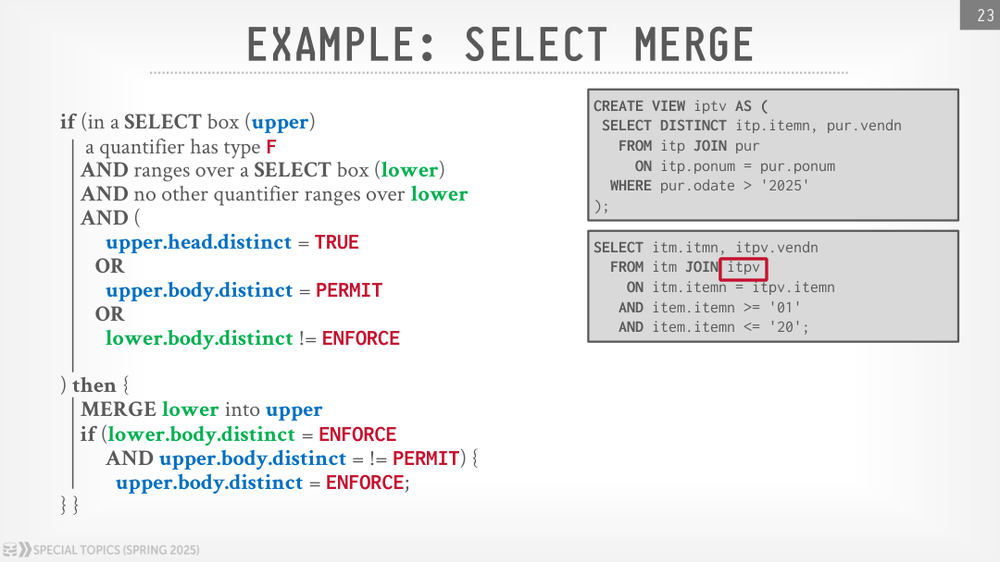

这里我不再展示他们如何操纵查询图模型，而是只用 SQL 来说明。假设我们这里有一个 SELECT 查询，它访问我们定义的某个视图。

你可以定义一个视图，像这样做一些查询，然后有一条查询对那个视图做连接，就好像它是一张真实的表一样。最简单的做法基本上是，在任何看到访问视图的地方，都把它当成一个宏，填入视图定义的实际内容。这样我们现在就陷入了这个嵌套查询。

## 第 33 页：检查合并条件

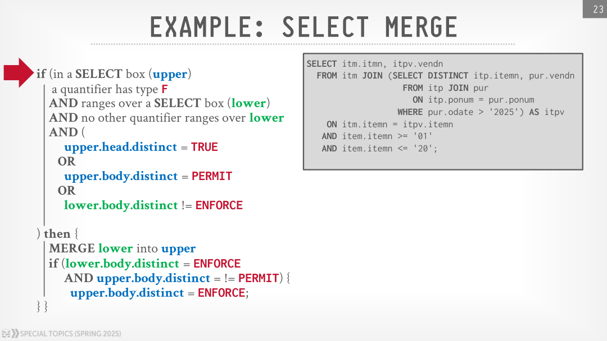

我们想弄清楚如何应用一条规则，使我们能够把外层 SELECT 查询的查询盒子和内层 SELECT 查询的查询盒子合并。这是一个规则实际可能是什么样的例子，基本上是伪代码。

它基本上说：如果我在一个 SELECT 盒子里——也就是说，我正在遍历图模型——那么把我所在的 SELECT 盒子定义为上层盒子。如果它有一个正在做集合构造的量词，意思是它正在读取基表；而我正在遍历某种内层查询——抱歉，我引用的查询、下层盒子中的表也在做……抱歉，它也是一个 SELECT，而且没有其他 SELECT 盒子访问下层盒子——我想这里有两个盒子，只有一条边进入下层盒子。

然后我进行这些额外检查，它们基于我之前说的那些属性：如果我的输出需要去重，或者我可以允许结果不去重，或者下面那个家伙不会强制保证去重。如果其中一个条件满足，我就知道可以把两个 SELECT 盒子合并，这样内层查询就和第一个查询在同一个层次、同一个查询盒子里被访问。

但接着还有一些额外逻辑。这是要应用的动作。你执行合并，把两个盒子合并，然后必须整理这些属性，知道：“好，如果下层告诉我它在强制去重，而我没有检查这一点，那我会确保自己强制去重，以便我的输出最终是去重的。”对吧？

我本应该展示重写后的查询。但基本上，你最终会得到一个使用连接的查询，而不是这里这个嵌套查询。

这相当复杂，对吧？你必须理清很多逻辑：某个东西在读取另一个东西，它们是否去重，访问的是派生表还是存储表，对吧？这大概是我能从论文中找到的最简单的例子，但显然还会变得复杂得多。

这也引出一个问题：认为不是 IBM 员工或者数据库系统构建者的人也能够扩展查询优化器，这种想法到底有多可行？Postgres 不允许你做这些事情。它有重写规则，但实际上只是把视图注入查询，并不会尝试做任何额外操作来进一步优化它。

所以这些重写规则大致会是这个样子；它们与我们真正进行基于代价的优化时将看到的 STAR、Glue 和 LOLEPOP 规则不同。再说一次，想法是从初始查询图模型开始，规则引擎查看哪条规则匹配。匹配时应用改变，再回去检查：现在我的新查询图模型已经被这条规则修改，我还需要应用其他规则吗？这样反复进行，直到时间耗尽或者没有更多规则可以应用。

## 第 34 页：计划优化

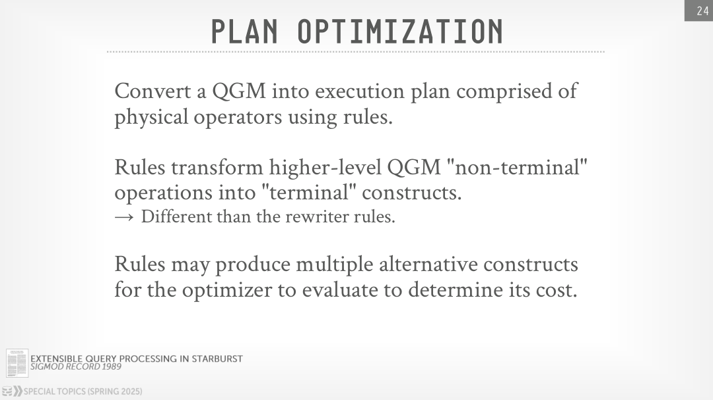

现在重写阶段结束了，我们有一个有效的查询图模型。现在我们确实需要把它转换成数据库系统能够执行的东西。

再说一次，查询图模型没有说明各种东西将按什么顺序应用。它是逻辑计划。它没有告诉你要使用哪种连接算法、使用哪些索引、使用哪些表。我们现在得把这些事情弄清楚。

所以现在他们会使用更多规则，把查询图模型里的高层构造或操作——他们称之为非终结操作，也就是高层的东西——转换成终结构造，也就是 LOLEPOP，它们定义了实际怎样执行查询计划。

这些规则有意思的地方是：它不像解析语法文件、试图解析 SQL 那样。解析 SQL 时，对于给定的 SQL 字符串，你试图找出其中精确、唯一的 token。但在这里，一条规则实际上可以产生多个输出，因为你可以选择多个备选方案。

比如我有一个东西表示访问这张表，而我可能有一大堆不同的访问方法，例如基于索引或顺序扫描等等。应用规则后，这些方案会展开出来，告诉我有哪些不同的选择可以使用。

所以，与 System R 大致上说“好，把我连接顺序里可能有的所有表给我，然后对于每一种情况逐一列出可能的连接顺序”不同，这里一切都基于这些规则。它以一种更智能的方式引导搜索，告诉我除了连接顺序之外，还有哪些对我来说合法的可能性。

## 第 35 页：计划规则语法

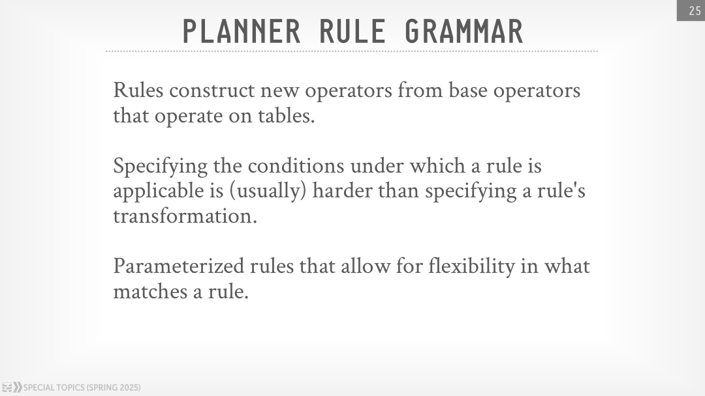

同样，语法文件基本上与我们之前看到的很相似：你有一些条件，检查它们是否得到满足；如果满足，就进行改变。

再说一次，这里的想法是，查询图模型可以被转换成 STAR，也就是高层概念。然后我们想把这些 STAR 转换成其他 STAR，后者又可以转换成其他 STAR，如此递归下去；或者最终我们会得到一个可以转换成 LOLEPOP 的 STAR。一旦查询计划完全由 LOLEPOP 组成，它就是可以在引擎中实际执行或解释的东西。

## 第 36 页：LOLEPOP

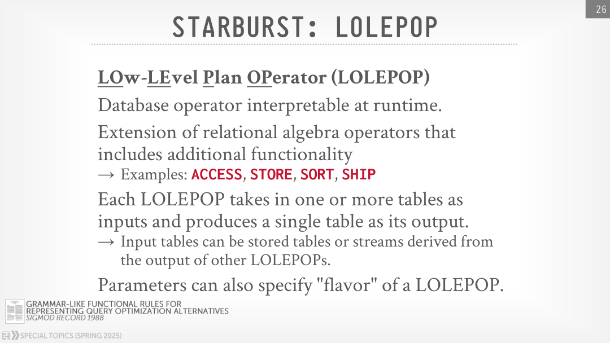

好，再说一次，LOLEPOP 是什么？LOLEPOP 就是一个我们真正可以执行的数据库操作符。它是关系代数的扩展，包含一些最初的关系代数——或者说原始关系代数——没有定义、但实际运行时需要的额外功能。

关系代数，至少它最初的定义，确实包含一个排序操作符。但显然我们需要排序，我们关心这个。关系代数没有一种操作符来……从某个位置访问表，对吧？我想你可以说 SELECT 操作符有点像这样，但它没有显式的操作来把某个东西存入操作符——抱歉，存入表。

ACCESS 基本上把存储表转换为流，STORE 则把流转换为存储表。如果你在做分布式系统，SHIP 基本上就是通过网络发送东西。所以，每个 LOLEPOP 接收一个或多个表作为输入，并且总是产生一张表作为输出。

这是一个有意思的限制，对吧？在某些情况下——这学期我们不会讲太多——在某些系统中，你实际上希望一个操作符产生多个输出。例如，如果你知道某个子查询或查询计划的一部分会被查询的其他部分使用，你可能希望一个操作符输出多个流。而他们不能处理这种情况。

LOLEPOP 会是某种高层的东西，比如——又不是高层——比如我想做连接、想排序、想发送。然后，比如对于如何做连接，他们不是用不同物理操作符来表示不同实现。你不会有一个哈希连接 LOLEPOP 或者一个排序归并连接 LOLEPOP；你有一个连接 LOLEPOP，然后传给它的输入参数指定这个 LOLEPOP 的所谓“口味”（flavor）。

因此，你会给连接 LOLEPOP 一个输入参数，说明“我要做哈希连接”或者“我要做排序归并连接”。这与我们之后在 Cascades 中看到的不同：在那里，他们会为不同的连接实现等提供显式的操作符。

对于 System R，再说一次，System R 只是保存：“这是我实际想在这些表上执行的操作符序列。”然后你对它们实际做的事情在某种程度上隐含在其中。意思是，比如你会说这个操作符做哈希连接，扫描某张表，再与另一张表做哈希连接。你会在某种程度上显式定义：“这是我想做的步骤。”这些 LOLEPOP 仍然比那更高层一些。

## 第 37 页：STAR

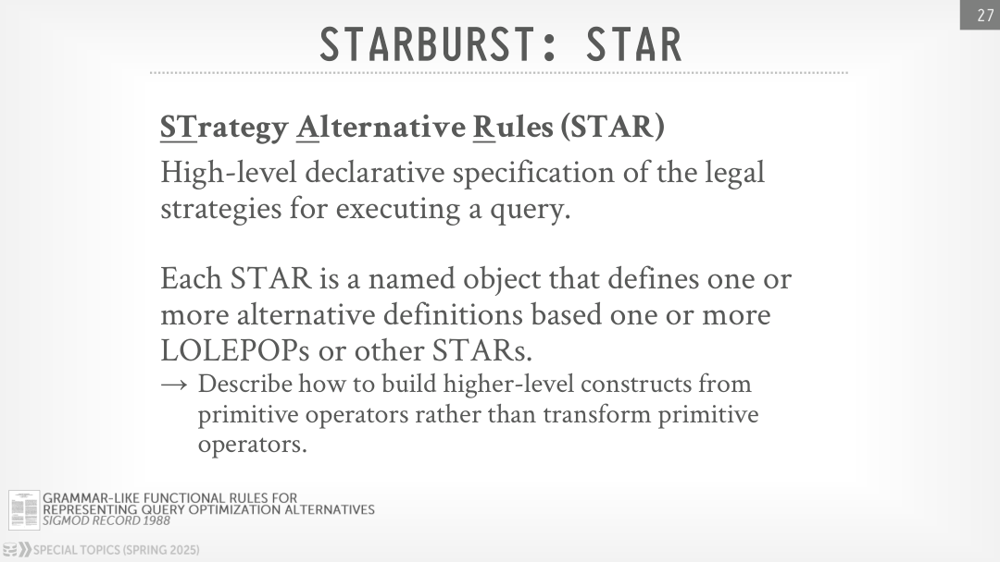

好，然后有这些叫作 STAR 的东西。同样，它们就是对我实际想做的高层操作的声明。然后会有一堆规则，允许我们把 STAR 重写成其他 STAR，或者重写成 STAR 和 LOLEPOP，最终收敛到一个——再说一次——完全由 LOLEPOP 组成的查询计划。

他们很强调一点：STAR 只是一个有名称的对象。我们在视频里看到过，他们说：“哦，这里是表扫描。”下面有类似括号的东西和一大堆备选方案。那些就是 STAR。你说表访问是一个 STAR，然后我可以把它重写成 B-tree 查找、R-tree 查找，或者特殊扫描 LOLEPOP。

再说一次，其想法是定义我们如何用这些基本操作构造高层构造，而不是从一个高层操作出发，把它像逻辑操作符一样显式转换成物理操作符；后面在 Cascades 和下一周的 Volcano 中我们会看到那种方式。

## 第 38 页：计划属性

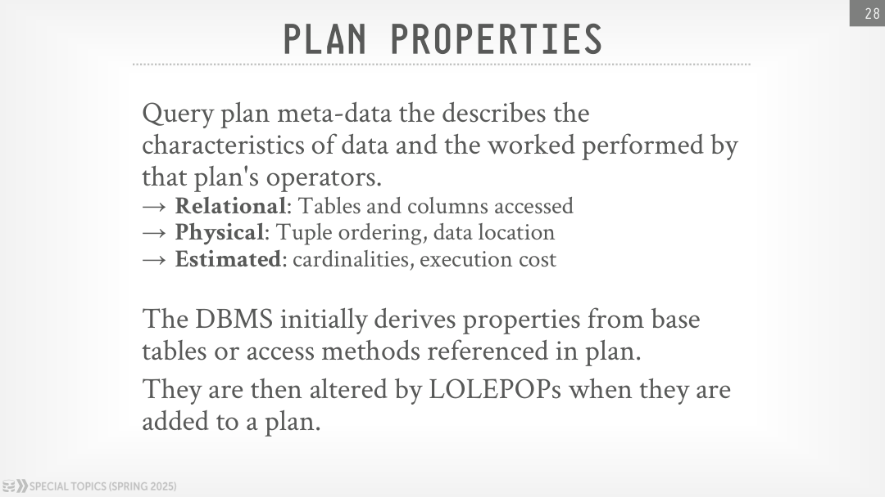

他们要做的另一件 System R 没做的事情，是在查询计划中引入显式属性的概念。我们已经在查询图模型里看到了这一点：他们记录东西是否去重。

但现在，在查询计划里，我们会记录一些东西，比如谓词或过滤操作的基数是多少。你实际上可以在查询计划本身里记录这些东西。这些值来自查询优化器的代价模型，因为它必须查看统计信息，猜测估计值是多少。但现在所有这些东西都会直接嵌入查询计划中。

还记得 System R 有有趣排序或有趣顺序（interesting sorts 或 interesting orders）的概念。那有点像旁边的一个东西，用来记录：“好吧，我想我确实需要关心排序顺序。”但它没有嵌入查询计划，而是旁边的一种辅助东西。

但现在，我们把属性作为查询计划中的一等实体引入。这样，当我们试图推理可以做哪些变换时，如果知道某个查询计划——抱歉，某个变换——会以某种方式影响排序属性，那我们就必须把它修补好。

## 第 39 页：Glue

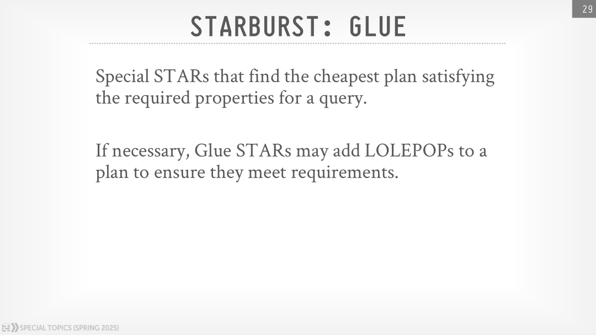

所以 Starburst 要做的是引入叫作 Glue 的东西。基本上，它们是加入的特殊 STAR，用来确保：“嘿，这个东西看起来和我期望的不一样。去修改查询计划，引入一个 LOLEPOP，以保证我关心的某个属性。”这有点像 System R 在做的修补工作。

但再说一次，他们用更系统的方式来做，而不是在接近末尾时临时打补丁。我一直提 Cascades，但 Cascades 的做法会不一样：我们会有 enforcer 规则，它们说：“如果这个变换违反了我关心的属性，你就不能做这个变换。”所以他们几乎已经到那一步了，但他们有 Glue 来修正这个问题，对吧？

这就是我刚才说的。这些是特殊 STAR，用来跟踪满足查询要求属性的最便宜计划。基本上，这是对 System R 所做工作的一个形式化定义。但然后他们回过头来检查：如果 Glue STAR 中定义的属性要求没有得到满足，那么我就把这个 Glue STAR 重写成一个 LOLEPOP，让它去排序，或者执行其他实际需要的操作。

或者，如果没有属性要求，或者我关心的属性实际上已经得到满足，那么 Glue 就会被重写成一个无操作，然后被丢弃。

回到这里。与 Cascades 或 Volcano 不同的另一个重要之处是，查询计划或计划树中某个操作符的执行代价，实际上也作为一个属性嵌入其中。我不是说这好还是不好。我只是说，这会与 Volcano 或 Cascades 的做法不同。

Cascades 会把代价放在旁边的这个东西上，比如：“到目前为止，我见过的最佳查询计划的代价是多少？”但它不会嵌入查询计划本身。他们会在 memo 表中记录这些东西。两种做法都有利弊。但这里还有一个很大的区别：执行代价也是一个属性。

因此，如果你现在想问：“这个查询计划的累计代价是多少？”那么，在你把 STAR 转换成 LOLEPOP 的过程中，它们各自都会有自己的代价；从一个操作符走到下一个操作符时，你可以把这些代价加起来。

这并不总能正确奏效，他们还要作出许多我们之前讨论过的假设。有时这些计算会偏差很大；几周之后讲代价估计时我们会讨论这个问题。

## 第 40 页：生成表访问方案

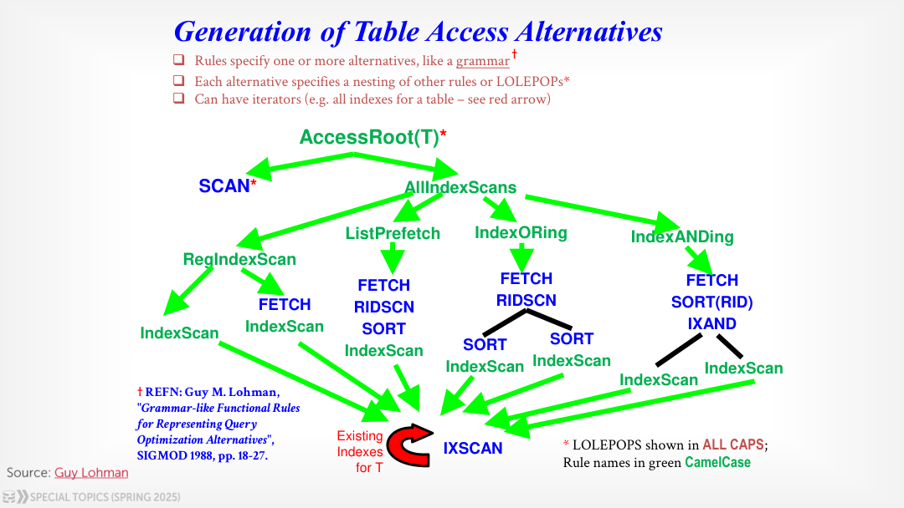

好，我原本想做一个应用这些 STAR 的例子。后来那个人——再说一次，那个名字叫 Guy 的人，他帮助构建了 Starburst 查询优化器——今天早上把他的幻灯片发给了我，那是他上周在 Microsoft 演讲时使用的。字体看起来很奇怪，但没关系，重要的是内容。

这是他的例子，展示在 DB2 中将 STAR 重写为 Glue 的变换过程，或者说查询优化过程是什么样子。它来自他在 1988 年写的这篇论文。

好，再说一次，规则可以像语法一样指定一堆备选方案，每个备选方案又可以指定其他规则或 LOLEPOP 的嵌套。所以你从很高的层次开始。绿色的是规则名称，也就是 STAR，对吧？

你会说：“好，我在表 T 上有一个访问根节点。我可以把它重写成一个扫描 LOLEPOP，也可以把它重写成另一个 STAR；那个 STAR 知道怎样访问这张表，但是通过某个索引来访问。”对吧？然后它可以进一步展开，说：“好，这是我访问索引的所有不同方式。”

我是否访问多个索引，然后把结果做 AND，或者做 OR，以及这些东西的不同版本？这些都是 DB2 特有的。但这些 STAR 中的每一个都可以转换成相应的 LOLEPOP，然后执行对应操作。于是这些又都可以转换到底层：要么我有需要的显式索引，要么我可以去创建想要的索引。

这里的想法是，比如这个，什么是简单的例子？我在扫描时对某些元组执行 FETCH；然后索引扫描 STAR 被重写成一个叫 FETCH 的 LOLEPOP，以及另一个叫索引扫描的 STAR。接着我必须应用规则，重写它，真正对我想要的具体索引执行索引扫描。

## 第 41 页：生成连接方案

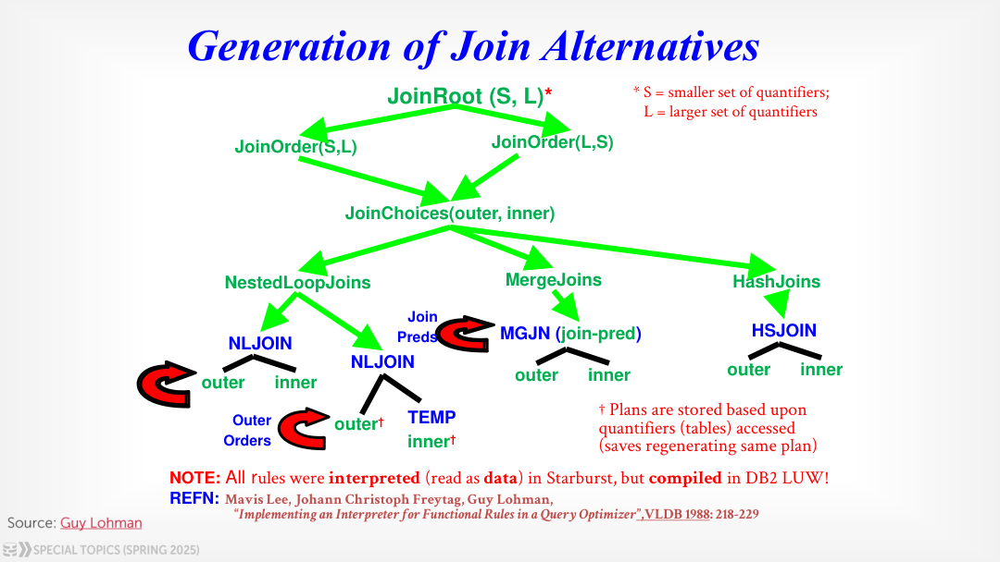

他们对连接顺序也做同样的事情。我不打算把这里所有动画都放一遍。但同样，在最顶端，你说：“我要连接两个关系，或者说表 S 和表 L。”对吧？基于某些量词。然后可以应用规则来交换连接顺序，对吧？接着我可以有不同的连接方式选择，再应用规则展开，把这个 `JoinChoices` STAR 重写成嵌套循环连接、归并连接或哈希连接。

然后对其中每个方案递归应用规则，逐步转换成实际物理执行查询计划的方式。所以再说一次，规则只是定义：如果我在查询计划树中看到这个模式，比如某个 STAR，那么就可以把它重写成一个 STAR，或者一组 STAR 和一些 LOLEPOP。我不认为会有从 LOLEPOP 到 LOLEPOP 的规则，我想没有。

他在这里写的这条注释，基本上就是我一开始说的：视频里展示说所有规则作为数据输入数据库，然后就像主动数据库一样，在数据库自身内部检查：“我的查询计划有没有匹配数据库中指定的规则？”他们后来去掉了这种方式，在真正投入生产时，基本上改成编译规则。

再说一次，我不知道它是 DSL，还是像其中一篇论文所说的那样是 C++。我认为是 C++。所以他们在过程式代码中定义这些规则，然后编译，再有某种规则引擎能够迅速应用它们，检查有没有匹配，以快速生成查询、进行重写。好。

## 第 42 页：何时停止搜索

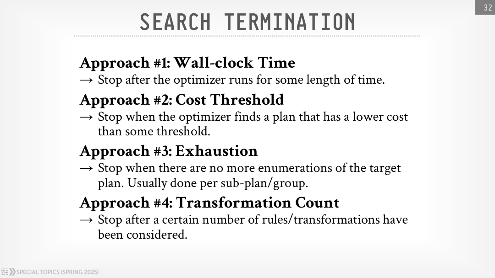

好，这会持续多久？正如之前说的，你可以查看实际经过了多长时间，对吧？在 Postgres 里，基本上就是这样运作的。你可以为查询优化器设置一个超时时间。时间到了之后，它会做最后的清理和细化，然后给你当时拥有的最佳查询计划。

你也可以设定一个代价阈值。在进行变换时，我会记录以前见过的最佳查询计划。如果我以某种方式知道上界或者我关心的目标，只要我的结果进入它的 10% 范围之内，或者我有一个查询计划，在最近 1,000 次迭代或所应用的变换中都没有看到任何改进，那就拿最后那个，因为我不太可能找到更新的了。

多数系统不会这么做。我不认为现实世界中有任何系统真正这样做过，不过有一些相关论文。还有一种情况是，如果你知道已经得到了所有可能的方案、已经查看了所有可能的东西，就停止。比如查询中只有两张表要连接，你可以很快探索完这两个选择。

最后一种是 DB2、或者说 Starburst 和 Microsoft 的做法：你只需说“我要应用一定数量的变换”，一旦达到那个限制，无论实际上花了多长时间，我就停止。

下周会详细讲，但 Microsoft 那些人说过——我以前从没想到过，但很有道理——之所以要采用这种方式，是因为无论系统实际负载如何，你至少能保证查询总能产生、找到那个最佳查询计划，无论系统有负载还是没有负载。

意思是，如果系统完全空闲，我做 1,000 次规则变换，就会找到某个查询计划。但如果系统负载很重，正在抖动、运行得很慢，尽管生成那个计划可能要花十倍的时间，它仍然会与系统没有负载时得到的是同一个查询计划。

有问题？所以这个说法是——而且是正确的——对，如果你用梯度下降来做这件事，虽然没人这么做，那你基本上会说：“一旦趋于平稳，我就停止。”对，但没人这么做。

有一篇我们不会讲的研究论文使用了模拟退火。一些系统可能尝试用神经网络来寻找更好的查询计划。没人使用这个。要么用第一种，要么用这一种，而商业系统使用这一种，因为它更好。

MySQL 试图——这有点相关——MySQL 会让你指定在查询计划中实际搜索多深。所以你可以指定、可以说你究竟想探索多少，然后我们说：“好，我已经做得够多了。”所以你可以一直深入到底，也可以只深入一部分，但我们不讲这个。

## 第 43 页：总结

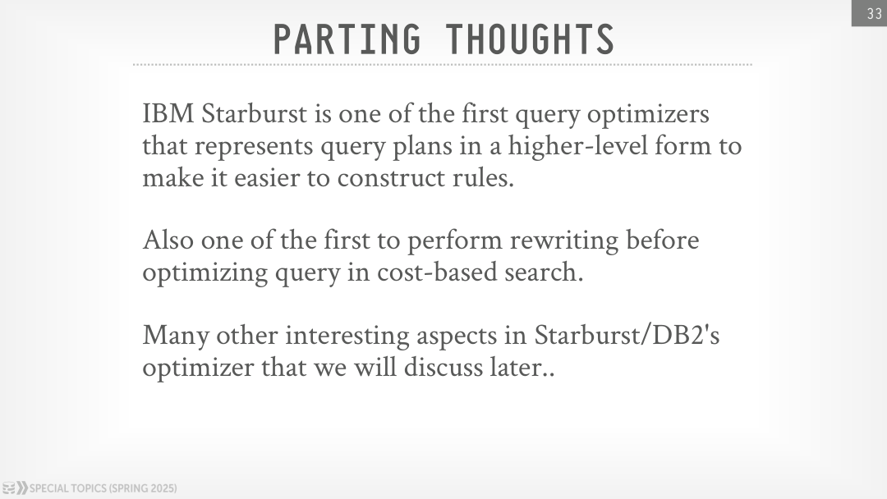

好，我们来结束。就我所知，Starburst 是最早以这种更高层形式，也就是元组关系演算，来表示查询计划的查询优化器之一。这样就可以有重写规则，只针对查询想做什么进行操作，而不是针对查询本身的操作顺序。

在进入一个规定“我要先做这个，然后做这个，再做这个”的查询计划之前，你希望操作一种更高层的东西，这样无论某些东西的确切形式如何，你都可以移动和操纵它们。

Starburst 和 DB2 优化器还有许多其他有意思的方面，我们之后会讨论。我们会看到一些方法：当查询真正运行时，它们能够接收反馈，观察到代价模型估计偏差很大，然后尝试利用观察到的实际行为来更新统计信息。之后我们也会阅读相关论文。

## 第 44 页：从研究原型到 DB2

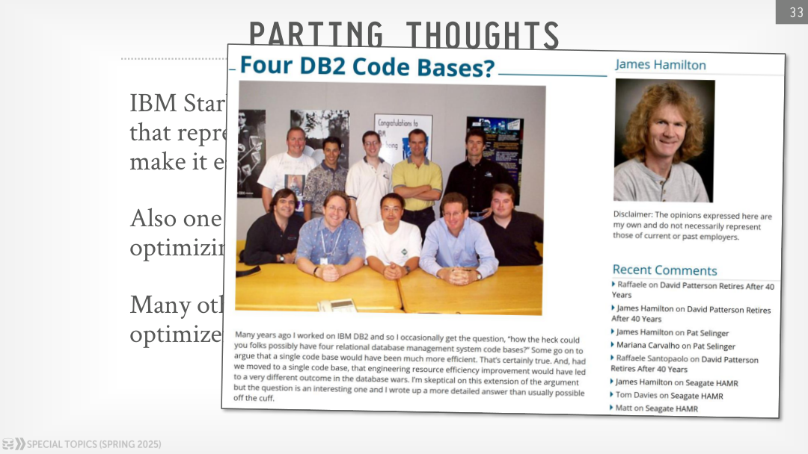

正如我上节课结束时说过的，有一篇很棒的博客文章，是 Amazon 的“数据中心之神”James Hamilton 写的，因为他以前在 DB2 工作过。那篇博客文章讨论了 Starburst 系统——我们一直在谈论它，刚才视频里也看到了——当时它只是一个研究原型。

IBM 尝试构建在他们的操作系统 OS/2 上运行的 DB2 版本时，性能非常糟糕。然后 IBM 研究团队让 Toronto 那个构建该 DB2 版本的团队真正使用了 Starburst。如今，Starburst 存在于 DB2 的 Linux、UNIX、Windows 版本中。James Hamilton 是负责移植的团队成员之一。

## 第 45 页：下一讲

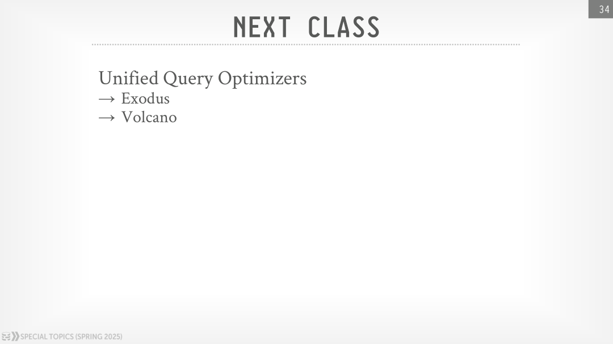

好，今天就到这里。下一讲我们要讨论这些统一查询优化器。再说一次，Starburst 是分层的。我们会讨论 EXODUS，也就是 Goetz Graefe 构建的第一个查询优化器生成器。不过 Volcano 更重要，Calcite 主要基于它。

所以我们会讨论这些早期生成器如何工作，然后再引出之后的 Cascades 工作；它在教材第二章中，我们会在周三讨论。
