+++
title = "CMU 15-799 第 4 讲：Volcano 查询优化器生成器"
date = 2026-11-17T00:00:00+08:00
slug = "04-volcano"
showTableOfContents = true
summary = "结合课程幻灯片和课堂讲稿，介绍 EXODUS 和 Volcano 查询优化器生成器。"
tags = ["查询优化", "Volcano", "EXODUS", "CMU 15-799"]
categories = ["数据库系统", "计算机技术"]
draft = false
+++

[观看课程视频：Volcano](https://www.youtube.com/watch?v=kguocoOxXKM)

## 第 1 页：课程开场

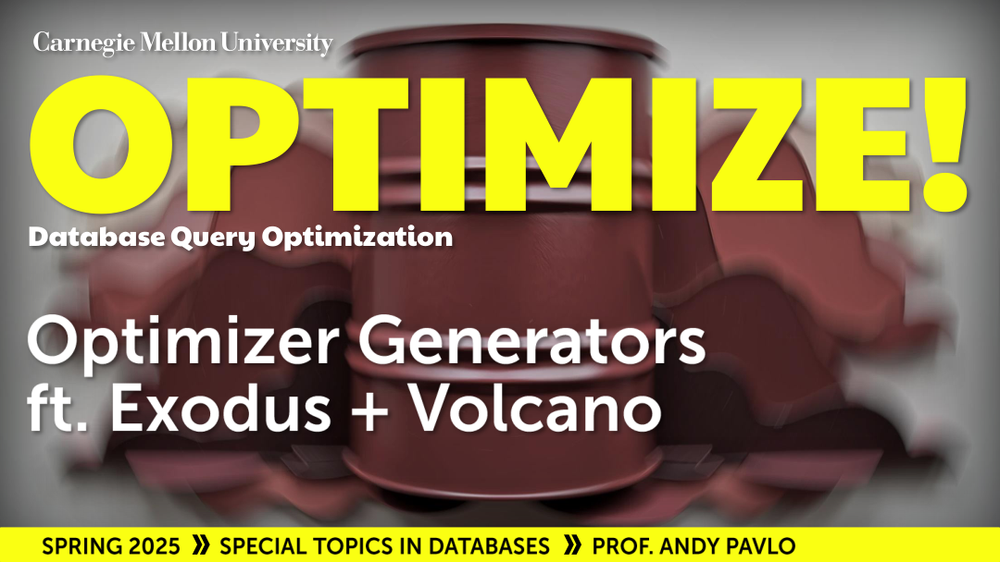

《Optimize！》：一段数据库查询优化之旅。本课程在卡内基梅隆大学现场录制，现场有听众。

是啊，没错。我最近收到通知，项目一已经发布了。今天早上我们对数据集做了一次快速更新。如果你们把目录重命名一下就好了，原来那里有个拼写错误。下次，也就是周三的课结束时，我会尽量讲一下项目一，简单介绍一下要求和要做的事情。不过，项目说明应该写得相当详细，大家应该能很快上手。你们要在 Gradescope 上提交作业。

另外，如果还没有填，请把你们的 GitHub 用户名填到我在 Piazza 上发布的那个表格里，也把 AWS 账户填进去。然后我们会把信息提交给亚马逊，让每个人获得 100 美元，用于你们所有的项目。好吗？

以前他们给你 100 美元，可以用两年。我想现在如果不用，六个月之后就会收回去。他们越来越精明了。关于项目一或者阅读摘要有什么问题吗？到目前为止，课程还有其他问题吗？

今天我们继续讨论查询优化器的基础和起源。具体来说，我们要看查询优化器生成器。它们有点像工具包，明确设计成不是一个完整的数据库系统，而是你可以根据目标系统来构建、配置和调整的东西。然后，你可以把它和你实际构建的任何数据库系统集成起来。

## 第 2 页：勘误

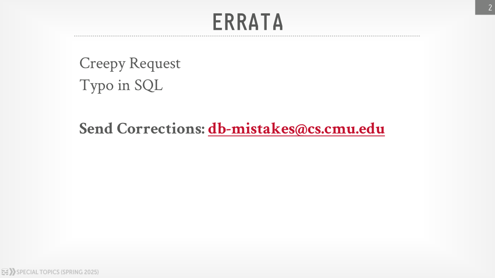

不过在此之前，我们先来看看几个更正。其实，第一个不太算更正。

## 第 3 页：奇怪的邮件

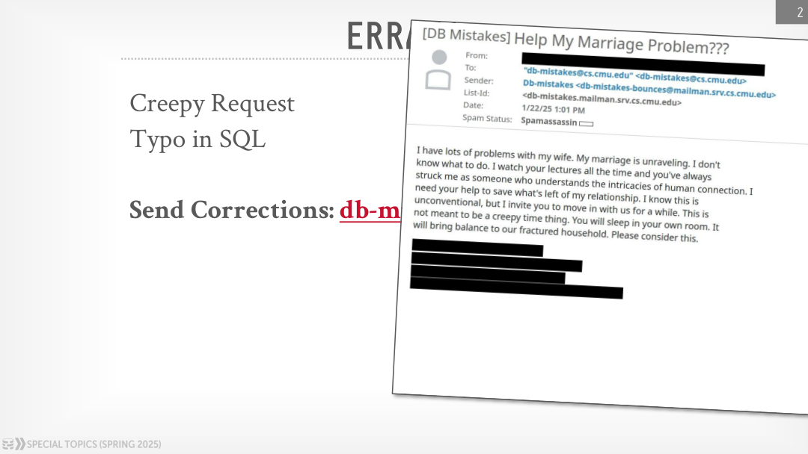

我上周收到某个人发来的一封令人毛骨悚然的邮件，说他们的婚姻快要破裂了，希望我搬过去跟他们一起住，而我不知怎么就能把事情解决。我他妈根本不知道这是谁。这太离奇了。我们不会这么做。

## 第 4 页：课件笔误

不过确实有人指出了一个错误。有人指出我上节课有一个笔误，特别是在这张展示 Starburst 查询图模型的幻灯片上。

## 第 5 页：查询图模型

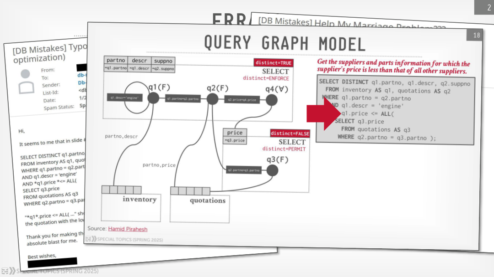

我写了 `Q1.price <= ALL`，实际上应该是 `Q2.price`，因为它是从这边下来的。总之，这是个小笔误，我们会在课件里修正。不过我确实收到过一些奇怪的邮件，刚才那封还是头一次。

## 第 6 页：回顾 Starburst

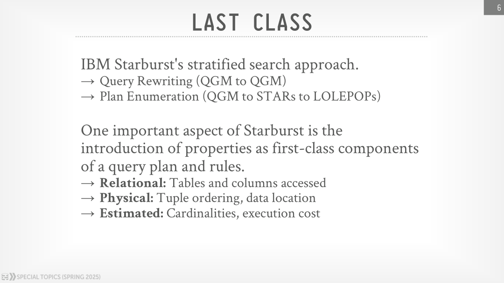

上节课我们讨论了 Starburst。具体来说，我们看了现在被称作分层搜索（stratified search）的方法，虽然论文里没有这么称呼它。它的意思是，查询优化器有两个不同的阶段。第一阶段是重写，把一个查询图模型转换为另一个查询图模型。这里应用转换或规则来优化查询时不需要代价模型，因为你确切地知道自己想做这个转换。

其中一个重要想法，是把可能位于不同查询框中的某些嵌套查询，放到同一个查询框里，比如放到查询图模型的根查询框中。这样就可以执行一系列连接，而不必担心对外层表中的每一个元组反复调用嵌套查询，做大量额外工作。不过，重写的关键是它完全基于启发式规则。

然后我们得到一种查询图模型形式或表示，可以进入计划枚举过程。在这个过程中，我们把 QGM 转换成 STAR，并用规则把一个 STAR 操作符转换为另一个 STAR 操作符，或者把 STAR 操作符转换为 LOLEPOP。他们不断应用这些规则，枚举查询计划中可能的所有选择。最终，要么时间用完，要么搜索已经穷尽，最后就得到一个实际可以执行的计划。

除了有这两个阶段之外，我们还要指出一个重要的地方。我们会看到 Volcano 没有这个阶段，它还专门指出 Starburst 的做法不是个好主意。我们会讲为什么。

他们引入了这样一个想法：属性成为查询计划和规则中的一等组成部分。规则可以知道一次转换是否会改变查询计划，使它无法满足查询计划上方某个操作所要求的属性。我们反复看到的例子是排序顺序。如果你知道某个操作符的输入要求数据有序，在 Starburst 中应用这些规则、转换数据时，如果转换违反了这个属性，或者不满足这个属性，那就是无效转换，不会执行。

再把它和早先的 System R 对比一下。System R 会跟踪它关心的顺序，然后照样执行查询优化过程，不会因为不同选择不满足排序属性，就把它们判定为无效或丢弃。之后它再回头说：好吧，如果目前见过的最佳计划不满足我需要的排序属性，那么在末尾加一个排序要花多少代价？这是否比另一个确实保持了该属性的计划更好？

现在我们要摆脱这些变通做法。EXODUS 还是会用一些变通办法，但 Volcano 会尝试把它当成一等属性，或者说把属性当成一等组成部分。

## 第 7 页：优化器生成器

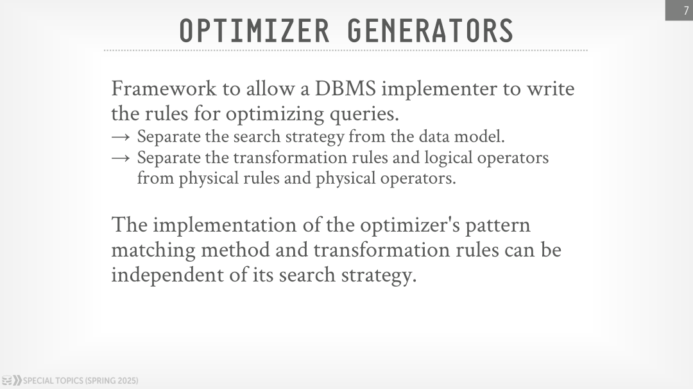

学期开始时我讲过这个，现在再提一次，因为今天所有内容都围绕它展开。查询优化器是数据库系统中非常难实现的一个部分，可能是你能实现的最难的东西。每次有人想构建一个新系统，如果都必须重新实现一遍查询优化器，那就提高了构建新数据库系统的门槛。

优化器生成器的想法是，把优化器的功能抽象出来，提供一个 API，让实现新数据系统的人能够为优化器生成器实现必要的输入。然后这个东西作为独立服务在旁边运行，可以和你现有的系统集成，这样你就不用重新发明轮子了。

Calcite 和 Orca 是独立的或模块化的查询优化器。从技术上说，它们不属于 Volcano 论文所定义的优化器生成器，因为论文里的做法是：你编写规则，我们把它们转换成过程代码，再为你编译，然后你把它链接进数据库系统。而对于那些系统，你只需要用 Java 实现它们的 API，然后编译。因为没有做源代码转换，它们是否属于同一种东西，这并不重要。

关键的想法是，你会有一个独立的东西，不管数据模型是什么，它都能为你的数据库系统生成一个经过优化的优化器。这是他们在这里要做的事情的核心。一个重要部分是将转换规则、逻辑操作符和物理操作符区分开来，让它们成为系统中相互独立的概念，而不是把所有东西都混在一起。我们在 Starburst 区分 STAR 和 LOLEPOP 的方式中已经看到了一点，今天在 EXODUS 和 Volcano 中还会再次看到。

另外，用来判断哪些规则可以应用于哪些操作符的机制，要独立于搜索策略。这样，如果有人想替换用来找出最佳查询计划的分支定界搜索，就不用重写所有东西。我们马上会看到，EXODUS 的第一个版本没有做到这一点，所以他们不得不把它全部丢掉。

## 第 8 页：今天的内容

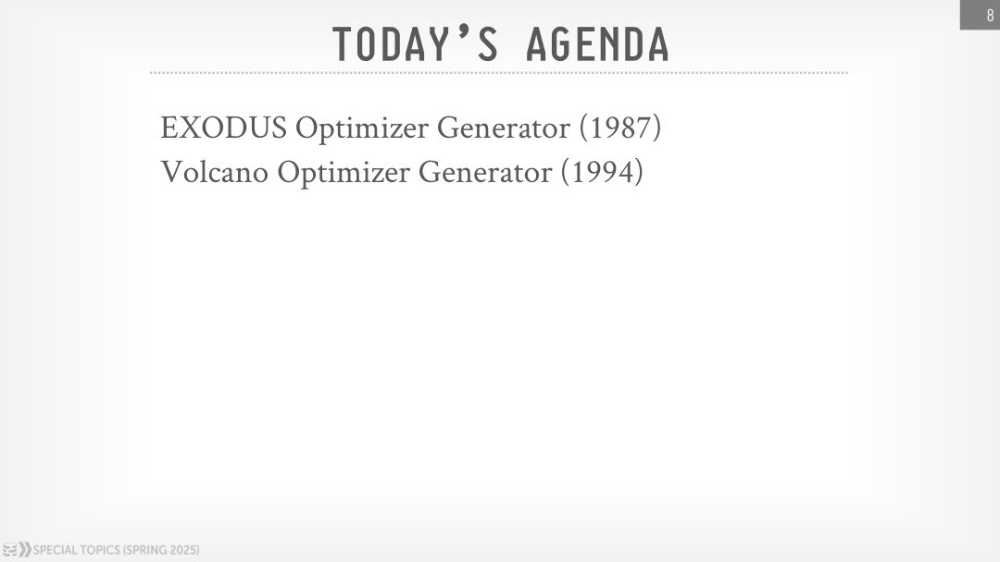

好，我们先讲 EXODUS，因为很多核心思想会沿用到 Volcano 中。我很喜欢你们读的那篇 Volcano 论文，因为作者讨论了他们自己之前的系统里犯过的所有错误，也拿它和 IBM 这样的其他系统进行比较和对照。对我来说，在 Goetz Graefe 写过的关于他的三个查询优化器——EXODUS、Volcano 和 Cascades——的所有论文中，Volcano 那篇是他写得最好的。

因为它又和 System R 论文一样，你可以拿着它实际重新实现其中很多部分，也许不是全部，但可以实现很多。

## 第 9 页：EXODUS 优化器

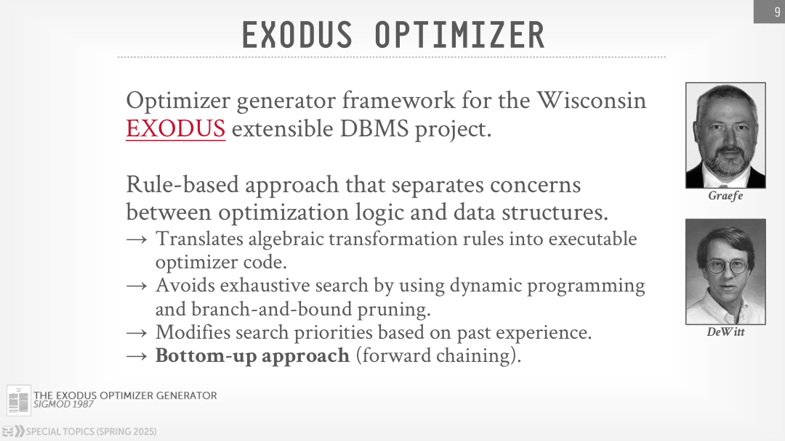

我之前，或者说刚才，已经说过了：Goetz Graefe 是一位非常著名的数据库研究者。他在 20 世纪 80 年代和 90 年代参与了三个查询优化器的工作。他推动优化器生成器这个想法将近十年，超过了十年，也为我们今天如何构建这些系统奠定了基础。

EXODUS 优化器是威斯康星大学构建的一个更大系统 EXODUS 的一部分。和 IBM 的 Starburst 类似，它是一个可扩展数据库系统项目。正如我说过的，这在 20 世纪 80 年代很热门，是为了回应当时出现的面向对象数据库。那些系统试图说：你知道，你想在应用代码中做的事情，比关系模型所能做到的更复杂，因此你需要一个面向对象数据库。

因此，这些工具包和可扩展系统实际上是要表明：不，你想对对象做的所有事情，都可以在关系数据库系统内部完成。而其中一个重要部分，就是必须提供一个可以扩展的查询优化器。

对于不知道的人，威斯康星大学通常是世界上一流的数据库研究大学之一。David DeWitt 是 Jignesh 的博士导师，显然，他也是 Graefe 的博士导师。你知道，他可能是世界上第二著名的数据库研究者，仅次于 Stonebraker。如果 DeWitt 看到了这段，他会生气，但他还没有获得图灵奖。

好了，EXODUS 的做法是把我们在查询优化器中实现的转换逻辑，与从解析器和绑定器出来的逻辑计划分开，然后生成一个实际可以运行的物理执行计划。我们也会把这些东西与内部用来维护它们的数据结构分开。

我们要像 System R 那样避免穷举搜索，但不是通过丢弃不想看的计划，比如 bushy join tree，而是使用动态方法和分支定界剪枝来判断：我们以前见过树中的这条路径吗？虽然 EXODUS 在这方面做得不够好，Volcano 会做得更好。并且，如果我沿着一棵树往下遍历，结果是不是无论如何都不会比目前见过的最佳查询计划更好？我们尽量避免这些不必要的计算。

EXODUS 有一个很酷的做法，Volcano 和 Cascades 都没有做，但我们会在本学期后面再次看到。我也会给大家看 EXODUS 做了什么：他们试图根据过去的经验，学习应用规则的顺序，以及一条规则可能对代价模型产生的影响。

意思是说，如果我针对一个查询运行查询优化器，看到某些规则带来了某些变化，可能是那些更快或更早带来好处的变化，如果我看到查询计划中有带来好处的规则转换，下次运行查询优化器时，我会尝试优先使用它们，因为我可能正在学到这些做法到底是不是好主意。请说？

**学生：** 我们是把它学到的东西放进一条规则中，还是它会自动学习？

**Andy Pavlo：** 他的问题是，他们是怎么做到的？我们马上就会看到。你实际上是在问，是不是会有一条规则说“去学习这个”？不是，这是搜索策略，是内部的东西，你不需要在查询计划中修改它，也不是额外的规则。就像你有一个代价函数，说这是执行这个查询操作符、这个物理操作符的代价。

我可以学习它实际上能给我带来多大的改善。这一切都在查询优化过程中完成，所以它不会去看我真正运行它之后是否产生了区别。本学期后面我们会看到他们确实尝试去学习这个：我在优化器处理查询计划时尝试了这条规则，得到了这个收益、这个预期收益。当我真正运行它时，是否真的得到了那个收益？有一个反馈环来判断这是不是好做法。

这里是在内部做这件事，系统本身是一个封闭系统。你没有真正运行查询，而是在问：如果按照我的目标函数、我的代价模型应用这个转换，我会得到收益吗？如果会，以后就尝试更早地做这件事。

然后，和 Starburst 及 System R 一样，他们采用自底向上的方法。另一种叫法是前向链推理（forward chaining），因为那是 20 世纪 80 年代。稍后我们会解释 Volcano 和 EXODUS 中前向链推理与后向链推理的区别。

## 第 10 页：EXODUS 的第一个实现

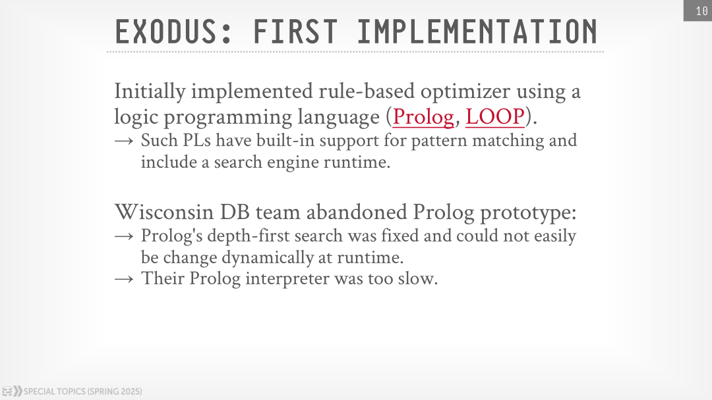

我真高兴你在这里。他们构建的第一个查询优化器，也就是 EXODUS 的一部分，在最初实现时就知道会使用规则。因为那是 20 世纪 80 年代，人们喜欢做实验，他们想干脆使用一种比较冷门的编程语言，它以逻辑编程为核心概念。然后只需要用这种语言定义所有规则，它自己的运行时就能自动完成模式匹配、规则实例化和应用，以及查询计划中各种所谓事实的展开。

他们觉得，好吧，现在是 80 年代，就这么做吧。所以他们选择了 Prolog。但他们后来把它全部扔掉，用 C 重写了所有东西。因为他们发现，这门语言的运行时内置了自己的深度优先搜索算法，你无法根据规则应用过程中的结果，在运行时真正改变和操纵它的行为。你告诉 Prolog：这是我拥有的所有规则。东西不会改变，开始吧。

此外，我想他们有自己的 Prolog 解释器实现。再说一次，那是 80 年代，还没有互联网，广泛可用的实现并不多。那个解释器对他们来说实在太慢了。所以他们扔掉了这个初版实现，转向 C。这里的教训是什么？不要使用冷门语言。什么？他们没有自己的语言，Prolog 和 LOOP 是之前就存在的东西。哦，我是说，对，做系统的人嘛，没关系，是吧？所以我会说……

理论上你可以把 Prolog 这种语言重新编译成像 C 这样有用的东西，但他们没有这么做。他们把所有东西都换成了 C。他们实际上还为系统实现发明了自己的编程语言 E，我想它是基于 C 的。LOOP，我想想 LOOP 是从哪里来的？是 Dennis Ritchie 吗？我在看着你，抱歉。我想 LOOP 可能是 Dennis Ritchie 实现的，就是发明 C 的那个人；或者他们在 E 中所做的事情基于 Dennis Ritchie 早期的语言，诸如此类。不管怎样，用 Prolog 做这件事是个坏主意。再说一次，那是 80 年代，人们做了很多实验性的事情。

有人知道 Postgres 最初是用什么编程语言写的吗？我以前在课上说过。Postgres 现在是用什么写的？C。它最初用什么写的？BASIC？不，BASIC 是六十年代的。我说的是八十年代初。Lisp，对吧？

那他们得做什么？他们得自己写一个转换器，也就是源代码转换器，把 Lisp 转换成 C，然后实际编译它，因为你需要一个能运行的系统。在 80 年代，人们做着各种疯狂的事情，他们试图构建可以直接在硬件上运行 Lisp 的 CPU。伯克利的人尝试了各种奇怪的东西。所以那是个错误。他们把所有 Lisp 的东西都拆掉，用 C 重写了所有东西。这就是我们今天拥有的代码库。

总之，我不是来批评 Prolog 的。还有 Datalog，我们这门课不会讲。对于数据库来说，它是一个更有用的 Prolog 版本，但大多数人不会写那种东西。

## 第 11 页：EXODUS 查询优化器流程

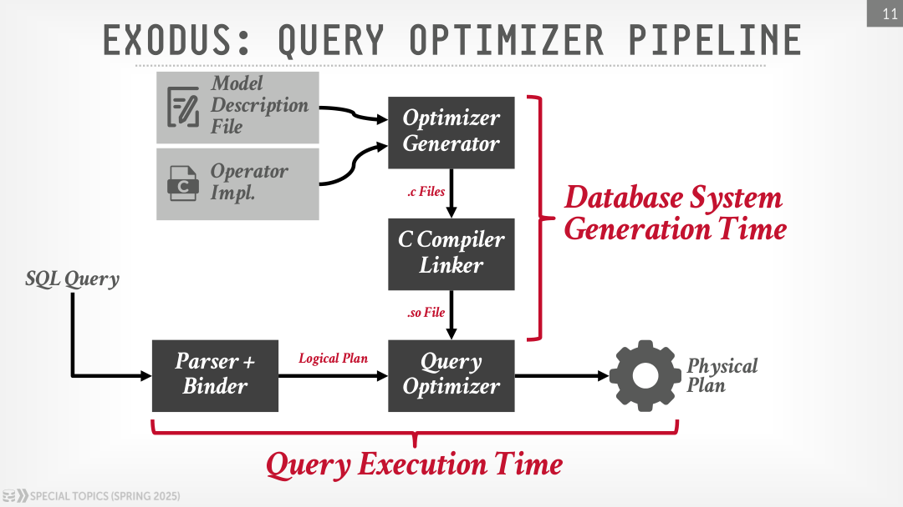

流程大概是这样的。你有一位数据库系统实现者，也就是想把 EXODUS 查询优化器或 Volcano 查询优化器集成到自己系统中的人。对于 EXODUS，他们必须提供一个模型描述文件，以及实现不同操作符的 C 函数，这些操作符就是你告诉优化器你的系统将支持的操作符。

我想它显然自带一些内置操作符，比如扫描、连接等等。但如果你想要基本关系代数结构或已有操作符之外的东西，也要提供它们。然后把这些输入优化器生成器，它会处理这些东西，输出一堆 C 代码，接着调用 GCC 或你喜欢的编译器、链接器。它会生成一个共享对象文件，你再把它链接进数据库系统。

他们把这个阶段称为数据库系统生成时。因此，这是构建数据库系统实际软件的编译过程的一部分。实际部署之后，SQL 查询到来，我们像之前一样通过解析器和绑定器处理它。这会生成一个逻辑计划，然后交给查询优化器。优化器完成我们现在要讲的所有事情，再输出一个物理计划。

因此，这里的想法是：不要从头写一个查询优化器，并把它深深植入或嵌入数据库系统；而是使用一个独立的共享对象，再把它链接进来。它提供所需的功能，从而避免每一个数据系统都必须重新实现自己的查询优化器。虽然这些东西写于 1987 年，但今天它基本上仍然成立，对吧？我说过，这个阶段就是查询执行时。

Calcite 和 Orca 试图提供类似的东西，但完整使用 Calcite 的系统非常少，而使用 Orca 的人基本上就是编写 Orca 的人。所以它实际上没有得到非常广泛的采用。

## 第 12 页：模型描述文件

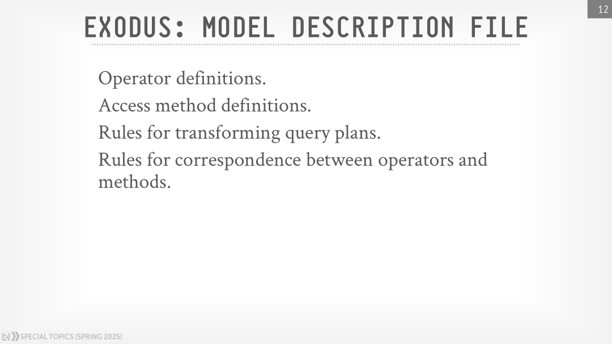

好，那么模型描述文件里有什么？首先是操作符定义。你必须告诉它参数数量、正在使用的操作符名称，以及你要求该操作符处理数据时具有的其他属性和期望。

然后是访问方法定义，比如有哪些索引可用，输出的数据是否有序。接下来是转换查询计划的规则，以及把操作符映射到上面定义的访问方法的其他规则，说明哪些操作符可以访问哪些方法。

这些元数据以结构化形式告诉优化器：你提供的 C 代码实现需要什么参数、参数的数据类型是什么，等等。想一想，这是 Python、Java 或其他编程语言的注解出现之前的事情。现在我们要谈谈规则会提供什么。

## 第 13 页：EXODUS 的规则

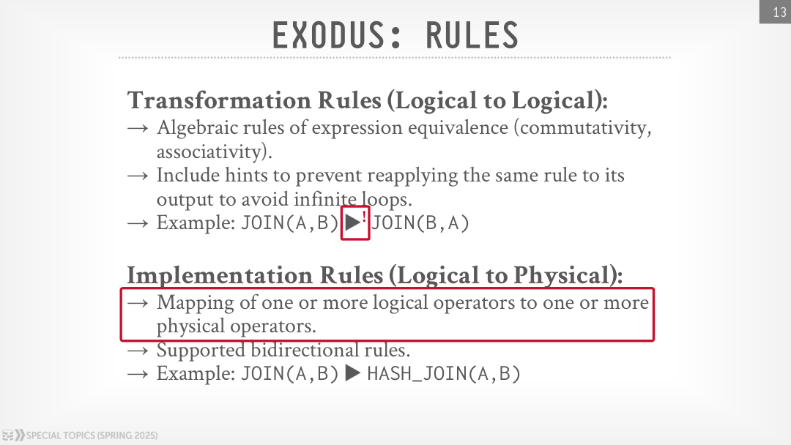

他们明确区分转换规则和实现规则。你可以再把它放到 Starburst 的背景下思考：STAR 实际上是一种更高层次的操作符类别，负责某种更高层的功能。然后有规则可以把那个 STAR 转换成另一个 STAR，或者把一个 STAR 转换成一个 LOLEPOP 和其他若干 STAR。但他们总是把这些统称为规则或转换规则。EXODUS 和 Volcano 会区分转换规则和实现规则。

我还应该说，论文有时可能相当令人困惑。我们周三要读的下一章 Cascades 教材会把这些东西整理得更清楚一点。我没有要求你们读最初那篇 Cascades 论文，部分原因是他们会说：我要做一个转换，但那个转换基于实现规则，然后还有我们马上要讲的表达式。很难说清楚。

他们在查询优化器的概念中使用的术语，很多都被赋予了多种含义，数量一多就可能相当混乱。所以，即使你读论文时看到“应用这条实现规则时，它会进行一次转换”，这也不同于他们所说的转换规则。

转换规则把一个逻辑操作符映射到另一个逻辑操作符。模型描述文件中的转换定义还会包含一些提示，用来警告这个东西是否可能陷入无限循环。这里的感叹号想表达的是：如果我使用交换律，把连接顺序从 AB 改为 BA，我不希望再应用同一条规则，从 BA 变回 AB。因此这里有一个小标志，表示应用这条规则后，不要尝试在刚刚生成的输出上再次应用它。

实现规则则是把一个或多个逻辑操作符映射为一个或多个物理操作符。这是 EXODUS 和 Volcano 的一个关键区别，也更接近 Starburst 的做法。我认为 Starburst 在某些方面比这更复杂。

他们在 EXODUS 中实际上建议工程师或真正构建系统的实现者：如果你知道某些规则总是连续执行，就手动把它们组合起来。例如，如果你总是知道自己要把一个过滤操作移到连接下面，然后紧接着做另一个转换，因为这就是你想要的计划，那么他们会说，不要把它们实现为独立的规则，而要在代码中把它们合并为一条规则。

这样搜索过程会更高效，因为它不必花时间应用一条规则，然后查表看看接下来要应用哪条规则，再去应用它。Volcano 不会这么做。Volcano 会说，最好让系统自己学会这些东西应该依次组合，而不要试图把它们合并，因为那只会增加实现的复杂度，让你更难理解对优化器所做的改变。

Starburst 也声称他们想要这样，希望所有规则相互独立，但它比 Volcano 要做的事情稍微复杂一些。他们还支持双向规则，也就是说，你可以进行从逻辑到物理的转换，也可能反过来从物理回到逻辑。Volcano 不会这么做，对吧？

## 第 14 页：EXODUS 搜索算法

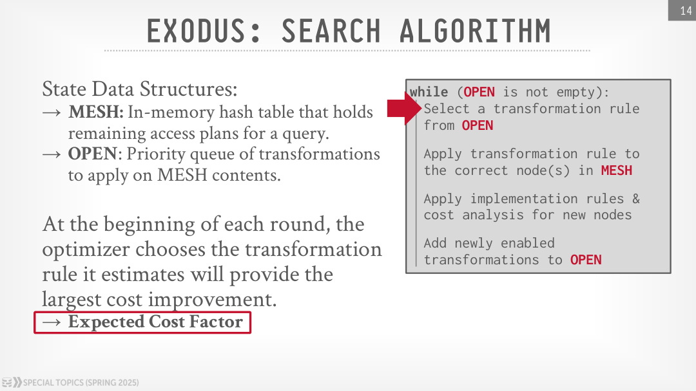

好，EXODUS 的搜索算法相当直接。他们需要确定下一条要应用的规则，这基本上是在重新实现 Prolog 中用来决定下一条规则的运行时。他们维护一个名为 OPEN 的优先队列。这个名称来自 20 世纪 80 年代人工智能领域的某个术语，所以才这样称呼它。OPEN 中放着接下来可以应用的所有转换。

这实际上是一个引用列表，指向存在于 MESH 中的转换。MESH 只是一个内存中的哈希表，跟踪已经应用的所有转换。抱歉，它跟踪的是已经处理过的所有逻辑和物理操作符，而转换规则基本上引用这些操作符。系统在 MESH 中查找这些引用，然后进行转换；如果它们不存在，就继续应用转换。

因此，这是一个非常简单的循环。只要还有转换要执行，就从队列中选择第一个，对 MESH 中存在的东西应用转换规则。完成转换后，再对第二步生成的所有逻辑操作符应用实现规则。现在你会立即把它们转换成物理操作符，并做代价分析，找出实际最值得继续探索的选择。

也就是说，他们在逻辑转换之后立即积极地考虑和评估所有物理操作符。Volcano 也会做一点这样的事情，Cascades 则不会。Cascades 会在遍历过程中积极应用转换或把东西转为物理操作符，而不是马上把搜索空间全部展开。

不过，他们要做的一件关键事情也很有意思：在每轮开始时，拿出一条转换规则，尝试估计执行这个转换能得到多大的改善，然后根据哪条规则能带来最大的收益，给它们排优先级。他们把它称为预期代价因子（expected cost factor）。OPEN 已经是一个优先队列，另有某个东西跟踪你想要应用规则的优先级。然后，当我执行转换时，我希望能够查看这些转换并弄清楚……

## 第 15 页：预期代价因子

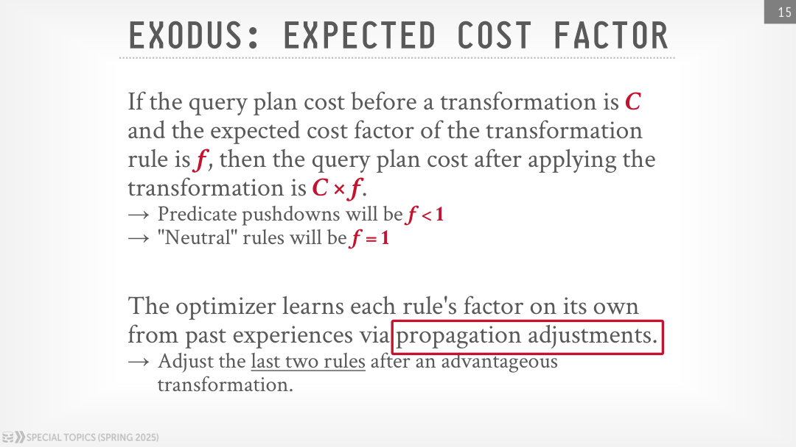

优先队列的顺序基于预期代价因子。它会说：这是我认为能给整个查询计划的代价带来最大收益的东西，先应用它。可以这样理解：如果我的查询计划目前的总代价是某个值 C，那么转换的预期代价因子 f 就表示，将这个转换应用到查询计划后，它会怎样影响代价。

如果 f 小于 1，你就知道，或者说你认为，它会带来更大的收益。而且它越接近 0 越好，对吧？对于中性规则，比如，我是说连接交换律不一定是中性规则，但可能有别的规则是中性的。也许投影操作在你的数据库系统里没有那么重要，而你做了一次投影下推，这就可能被认为是一条中性规则。

因此，他们不会总是去问代价模型：这个转换会给我带来什么收益？而是尝试学习这个收益会是多少，并应用他们称为传播调整（propagation adjustment）的东西。这里的想法还是，我想跟踪最近 n 次应用这条转换规则时实际得到了什么收益。

他们有很多不同的公式和计算方法，对吧？一种方法可以是取最近 K 次转换或尝试，也就是应用这条转换规则的最近 K 次结果的滑动平均值。也可以计算所有记录，但这样就开始跟踪所有历史了。在 20 世纪 80 年代，那会非常昂贵。

## 第 16 页：学习代价因子

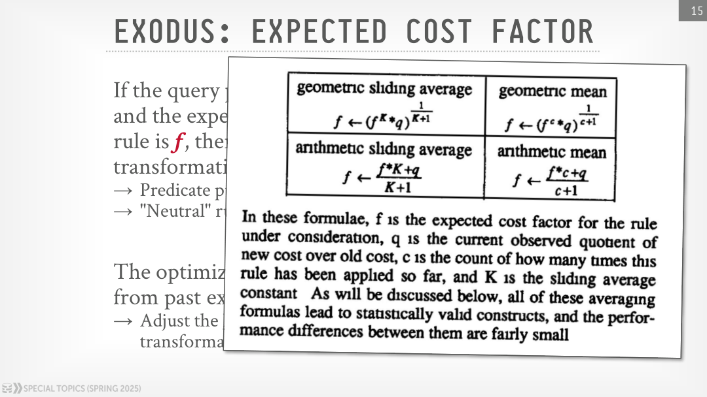

他们基本上说，这实际上没有太大区别。但他们认为这是个好主意：跟踪并学习我应用这个转换时得到多大收益，以后这可以指导我们判断是否有必要再次应用同样的东西。

他们没有详细说明如何考虑这些问题：如果数据变化了，如何让这个结果失效？如果查询的参数变化了，又该如何处理？当然，你可以想象，如果应用这些转换时只关注单个查询，那么我刚才说的那些就不再是问题。因为我正在为这一个查询做计划，重新规划这个转换，它实际带来了多少收益？但如果你想在更长时间内跨多个查询做这件事，问题就来了。

请说？你是什么意思？所以这个问题是在这个上下文里问的？对，再说一次，我们不是在讨论真正运行查询。他们没有这么做。他们只是说，这是我认为会得到多少收益的一个预期，但此时我只有一堆逻辑操作符。所以我想，如果我把它转换成哈希连接，就会得到这个收益，于是我估计这个提升会是多少。等我真正做完转换，再运行真正的代价模型，它会告诉我得到多少收益。

所以这是对代价的近似，对它的代价的近似，因为逻辑操作符没有代价。据我所知，他们把范围限定在单个查询的上下文里，使这件事能够运作，但你可以想象把它扩展到多个查询。正如我之前说的，这完全发生在查询优化器内部，与我应用这个改变是否真的让查询运行得更快没有关系，对吧？

因为这实际上很难做到。假如我应用了某个改变，得到了一些收益，但最后的查询计划甚至不包含那个改变，现在我就无法实际运行查询并得到关于它的反馈。

他们还提到，应用一个改变并得到传播调整时，你不只是把它应用到刚才使用的转换规则上，而是同时应用到那一条和前一条规则。因为有可能第一次转换实际上让情况变得更糟，但它为第二次转换创造了条件，然后你走出了搜索过程中的低谷，情况变得好得多。

所以他们硬编码为把传播调整应用到最近两条规则。应该是三条吗？应该是四条吗？我不知道，他们没有说。这看起来有点像变通办法。方向是对的，但我不认为这是处理这个问题的正确方式。

不过，他们在 20 世纪 80 年代就考虑“能不能从过去的经验中学习”这个想法，还是很好的。而现在，有了强化学习和其他东西，人们已经把这类事情视为理所当然。

## 第 17 页：对 EXODUS 的观察

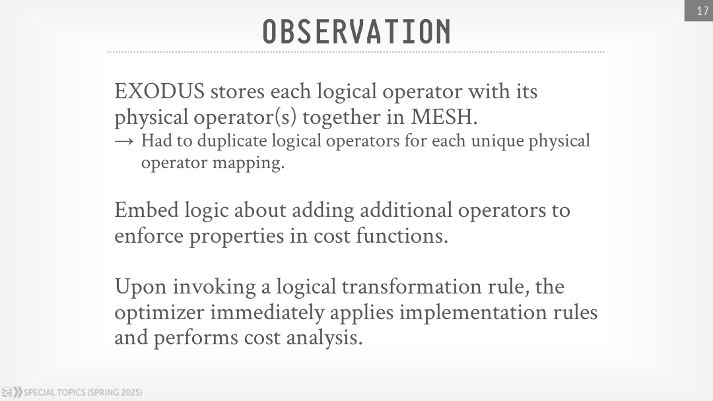

好，EXODUS 的一个主要缺陷在于，它在 MESH 哈希表中表示通过转换规则生成的所有现有操作符时，组织方式是：用于查找的条目或键，是逻辑操作符和通过实现规则转换得到的物理操作符的组合。

这意味着，如果我有一个逻辑操作符，可以转换成排序归并连接，而同一个逻辑操作符也可以转换成哈希连接，那么我的 MESH 哈希表中就会有两个不同的条目分别表示它们。清楚吗？因为 Volcano 会采用不同的做法，Cascades 当然也会有很大的不同。

这基本上意味着，MESH 哈希表中会出现许多重复的逻辑操作符，因为他们无法让一个逻辑操作符关联到多个物理操作符。关于何时添加额外操作符来要求某些属性的所有逻辑，都必须放进代价函数中。

所以你可以有这样一个概念：操作符期望输入数据以某种方式到达。但如果你想推动查询计划确保这些条件得到满足或强制执行，那么那个逻辑必须存在于代价模型本身之中。正如我说的，EXODUS 一旦应用逻辑转换规则，就立即应用所有实现规则，基本上把搜索空间展开了，尽管实现规则做出的一些转换实际上可能不是好主意。

他们还讨论了其他事情，我想是在 Volcano 论文或者 EXODUS 论文里。他们说，因为那又是 80 年代，他们想使用 A* 搜索算法，如果你们熟悉的话。但他们无法以 A* 算法需要的方式计算实现规则的预期收益，也就是可能得到的改善。因为这些值不能来回振荡，必须是一个清晰的阶跃函数。

## 第 18 页：Volcano 优化器

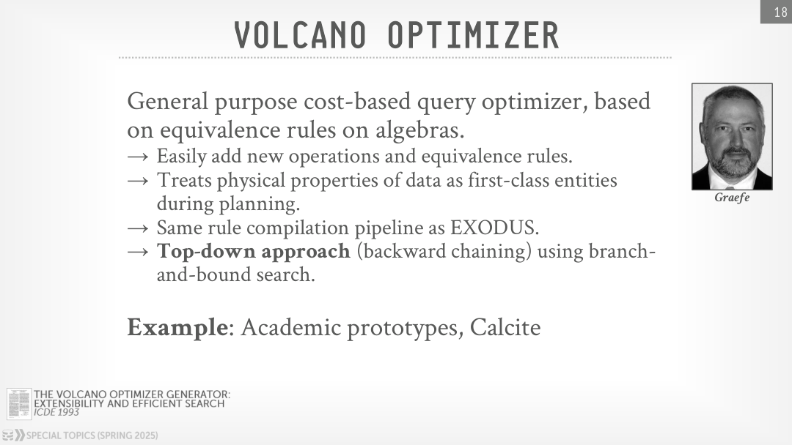

这就把我们带到了 Volcano。Goetz Graefe 从威斯康星毕业，然后我想他曾经是科罗拉多大学的教授，后来又成为波特兰州立大学的教授。我不知道那里发生了什么细节。

不过，他确实推动了优化器生成器这个想法好几年，这是真正开创性的工作。Volcano 项目和 EXODUS 类似，也是一个可扩展的数据库系统工具包。我们在入门课上讨论 exchange 操作符和并行算法时，有时会把它称为 Volcano 方法。那些东西都来自他构建这个查询优化器的同一个项目。

和 EXODUS 一样，它原本就是一个可扩展系统，你可以添加新的操作以及相应的等价规则。同样，我们会尝试在规划过程中把数据的属性当作一等实体来处理。他们会比 EXODUS 做得稍好一些，但我们下节课会看到，Cascades 才正确地做到了这一点，处理了所有边界情况。

他们也会使用我们在 EXODUS 中看到的同一个规则编译流程。你使用较高层的元数据定义这些规则，还需要提供你试图添加的不同操作或操作符的 C 实现。然后系统会为你把它们编译成一个共享对象，再由你链接进数据库系统。

和 EXODUS 及 Starburst 不同的是，这是第一个使用自顶向下搜索生成查询计划的例子，也就是基于分支定界搜索的后向链推理。他们还要尝试做一件 EXODUS 做不到的重要事情：生成所有这些不同的排列，或者说应用规则、开始进行改变，然后不必一遍又一遍重复和重新访问相同的东西。因为 EXODUS 维护的数据结构的方式不允许他们跟踪这些事情。

它从来没有……原始源代码从未在学术界以外使用过。我想 EXODUS 在 20 世纪 90 年代被用于德州仪器的一个面向对象数据库原型。但除此之外，我不认为它有什么后续。另外，至少 Calcite 在论文中声称自己的实现基于这个系统。

## 第 19 页：Volcano 的设计目标

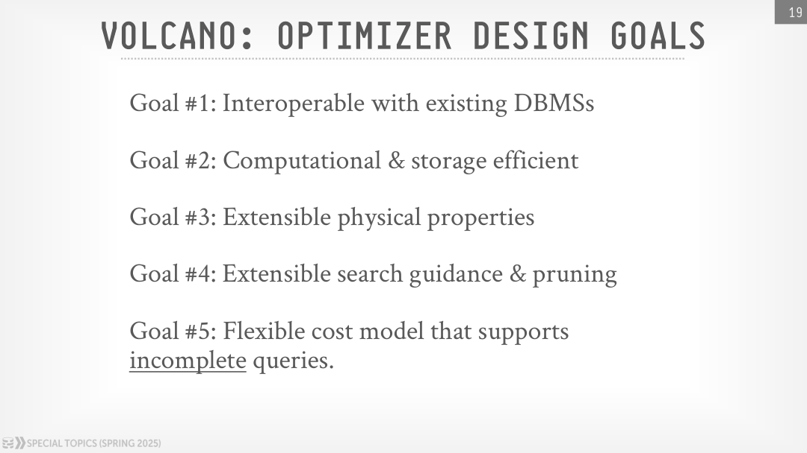

看看他们在 Volcano 中试图实现哪些 EXODUS 做不到的事情，很有意思，对吧？我还要说，如果你听说过“第二系统综合征”这个词，它基本上来自 IBM。第二系统综合征是说，假设你参与了一个构建新系统的项目，然后说：好，我们来构建下一个系统，重新写一遍。

当你构建第二个系统时，你试图纠正第一个系统做错的所有事情。但接着你又说，既然我已经在写这个系统了，就让我再加上这个功能、那个功能，再做这个疯狂的东西，对吧？你开始在第二个系统中加入一堆新东西，结果第二个系统最终一直没能建成。

我得称赞他。Volcano 是他的第二个系统，他完成了它。他遵循自己的目标，实际实现得也相当不错。和之前一样，他们希望与现有数据库系统互操作。他们希望在计算和存储方面比 EXODUS 更高效，因此不能让 MESH 表因为存放以前见过的所有可能东西而爆炸，也不想必须提前生成这些东西。

他们希望物理属性可以扩展，不止支持排序和压缩。你希望能够更容易地指定这些东西，并把它们作为一等属性来支持。他们希望允许你重写搜索过程，并决定遍历时如何剪枝。我不认为那一点后来真的……

我不认为他们后来超出了自己实现的深度优先搜索算法。论文提到了它，说将来如果能够做到这一点会很好。

我们现在不会过多讨论这个，因为本学期后面会讲。但他们希望代价模型能够支持所谓的参数化查询：在这种查询计划里，你可能并不知道谓词或 WHERE 子句中使用的所有常量值。比如 `SELECT * FROM table WHERE id = 123`。如果把它声明为预处理语句，就会写成 `SELECT * FROM table WHERE id = ?` 或者使用 `$1`。

想法是，在运行时，应用实际调用查询时，会把它作为预处理语句调用，然后传入参数的值。理想情况下，一收到“准备这个语句”的指令，你就能够生成查询计划；之后在运行时填入那个值，而不必再运行一遍整个优化器。

论文没有过多说明他们如何支持这一点。如果查询计划的结构可能随着传入的参数值发生很大变化，想要适应这种情况其实一直都非常有挑战性。我们会花整整一天讨论如何处理它。这又是另一个很大的挑战。我想他们有保留占位符的基本能力，你实现代价模型时可以说：我不知道这个值是什么，所以让我选最坏值或者平均值。他们做的就是这些。

## 第 20 页：Volcano 概览

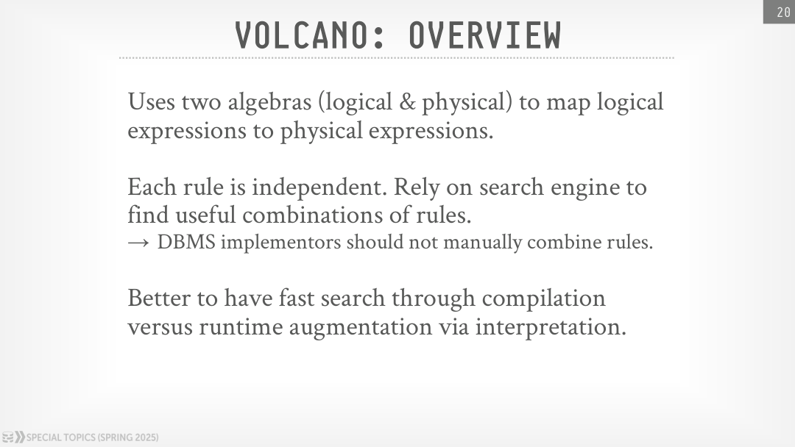

好，在实际实现中，他们引入了这样一个想法：有两套不同的代数，一套用于逻辑代数、逻辑表达式，另一套用于物理表达式。这又回到了我之前说的：在这篇论文中，他们让一堆术语带有非常明确的含义，而 Cascades 还会更糟。

他们基本上引入了表达式这个术语，开始不断使用它。好吧，他们没有定义它。那么它究竟是什么意思？我会在下一页展示。它基本上就是我们在 Starburst 的 QGM，也就是查询图模型中看到的那些查询框，表示一个完整的 SELECT 操作，以及其中的 FROM 子句等等。

所有规则都相互独立。和 EXODUS 不同，EXODUS 会说，如果你知道这些规则应该依次应用，就在实现中把它们组合起来。Volcano 则建议你不要那么做，而是让查询优化器或搜索引擎自己发现这些规则应该依次应用，而不必由你手动强制执行。你仍然可以这么做，至少我认为可以，也许模式匹配不支持。

最好让优化器自动学会这一点，因为当你说“让我们把这两条规则合并”时，对数据做出的任何假设，将来都可能被打破或者不再成立。所以，如果你让这些规则保持为小的原子单元，我们就可以把这些东西组合起来。

他们还讨论了内部的一个争论：是否应该继续采用 EXODUS 的做法，在设置阶段或者系统生成时，把所有规则编译成 C 代码和机器代码，因为这样搜索运行得更快；还是使用解释器。Starburst 一开始采用的就是解释方式，这样你可以在查询优化器运行时动态改变它的行为，而不必重新编译并链接所有东西。这种灵活性很好。

我想当时他们说，至少在 EXODUS 论文中，唯一这样做的系统是 Starburst，而 Starburst 使用解释执行。所以在 Volcano 论文中，他们说：好，现在看到 Starburst 使用解释方式，而我们在 EXODUS 中使用编译方式，我们认为更快的搜索更好，因此他们继续采用编译方法。

在 Postgres 中，你可以安装新规则，只需要把它们插入系统目录表，比如 `pg_rules` 之类的东西。系统知道如何在运行时进行查找。但他们并不是像 Volcano 那样试图进行完整的查询优化。

## 第 21 页：表达式

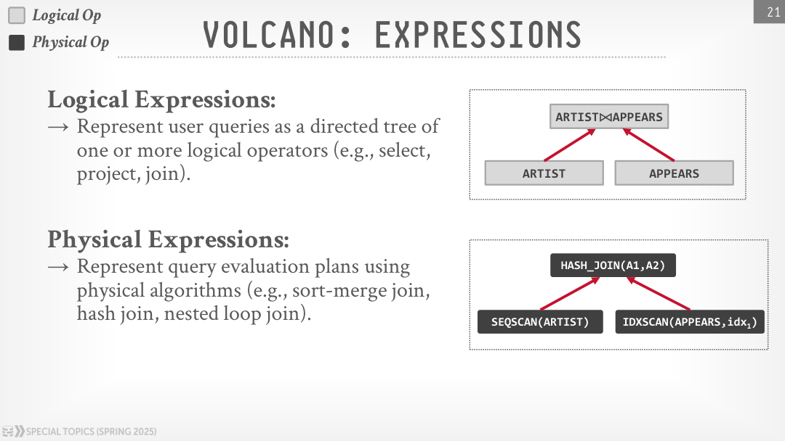

什么是表达式？再说一次，这是他们用来定义你在查询优化器中试图推理的某个有范围的查询的术语。对于逻辑表达式，它只是用户请求的查询的一种表示，由逻辑操作符及其之间的依赖关系定义。

物理表达式也是一样：它是查询计划的一种表示，但使用的是物理操作符。再说一次，假设你的数据库系统知道如何读取它们，你可以拿着这个查询计划实际运行。

还有一个关键点要指出：所有这些早期查询优化器都假设自己操作的是树。我们以后会从德国人那里看到，你实际上想使用 DAG，也就是有向无环图。你可能希望一个操作符有两个父节点，而在所有这些树结构中，它总是只有一个父节点。

想这么做的原因是，如果你想物化中间结果，比如 CTE 或嵌套查询，查询计划的不同部分可能都需要使用那些数据。你可以像 Postgres 一样取巧：基本上有一个引用，说我知道我的输入是在查询计划另一处定义的这个子查询。但当你要做更复杂的转换时，虽然他们在这里没有做，我们以后会从德国人那里看到，你希望使用 DAG 来表示这些东西。现在这只是个题外话。

## 第 22 页：操作符定义

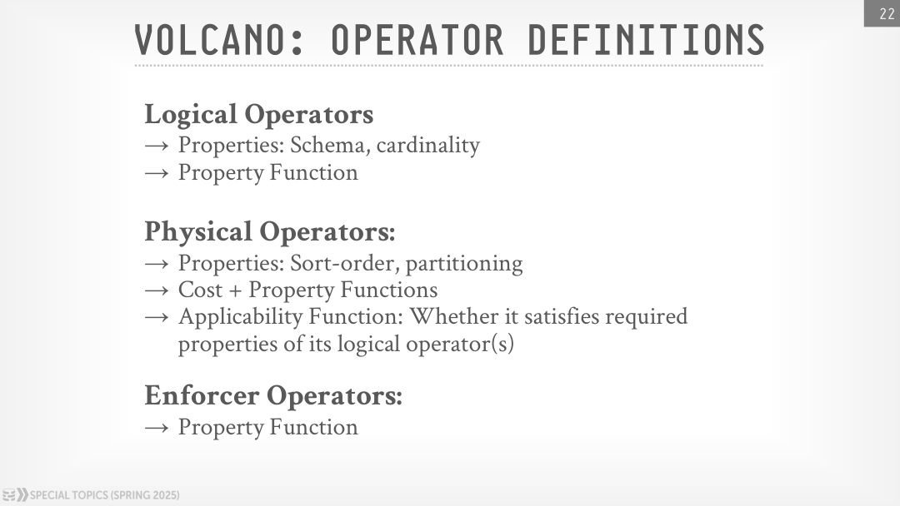

这些听起来肯定开始和我们之前看到的东西差不多了。你有逻辑操作符，它们有不同的属性：模式、基数，以及一个属性函数，用来判断这个东西是否提供某个属性。

物理操作符也是一样，它们有自己的属性，还有一个代价函数。现在你可以说，如果我在查询计划中运行这个物理操作符，预期代价是多少。而逻辑操作符没有代价。扫描的代价是多少？这取决于我做的是顺序扫描还是索引扫描，你不能在那里确定。

然后还有一个适用性函数，用来判断这个物理操作符是否提供或满足它所来源的逻辑操作符定义的物理属性。现在他们还要引入 enforcer 操作符，它们像是虚拟的或占位的操作符，并不真正对应我们实际执行的东西。

## 第 23 页：Enforcer 操作符

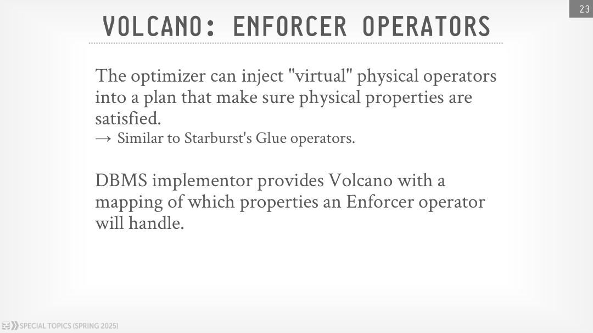

它只是在查询计划中设置一个屏障，说我们需要沿查询树的这一部分向上传递的数据提供某些我们关心的属性，比如排序顺序。再说一次，它们是同样的东西，基本上等同于 Starburst 中的 glue 操作符。

这只是在我检查查询计划时跟踪的一种方式：沿数据流，或者说沿树中的边向上传递的数据，是否具有我需要的形式？如果你要把 Volcano 和自己的数据库系统集成，就必须提供我的 enforcer 是什么，以及它们将处理哪些属性。我想，如果你只是说我需要一个能保证这些属性的 enforcer，他们就会为你合成相应的代码。

Enforcer 实际上什么也不做。它不接收任何数据，只是在那里作为占位符，表示我需要数据具有这种形式。

## 第 24 页：Volcano 的规则

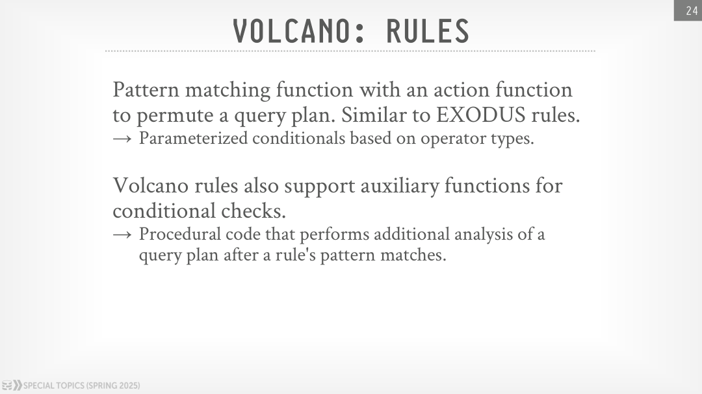

Volcano 的规则基本上和 EXODUS 一样。你有一个匹配函数，用来查看查询计划的形式。如果匹配该函数，就触发一个动作函数来执行转换。

为了不必为逻辑计划或物理计划的所有可能组合分别定义规则，你可以用这些匹配函数进行参数化。例如，我有一个连接，对吧？我在做哈希连接，下面可能有一个扫描操作符。我不关心它是索引扫描还是顺序扫描，对吧？你不需要为这些东西的所有可能组合定义不同规则。

他们还有一种东西叫辅助函数，或者支持函数。我的理解是，在对查询计划的形式或结构完成基本模式匹配后，如果你还想进行额外检查，比如想检查操作符本身内部的更多信息，就可以附加这些支持函数，让它们在模式匹配之后触发。

因此，模式匹配应该是在这种高级方言中完成，虽然我不认为论文有说明，是在这种领域特定语言中。但如果有些东西是你确实想通过过程代码显式检查的，那么你就提供这个额外的函数。

## 第 25 页：代价函数

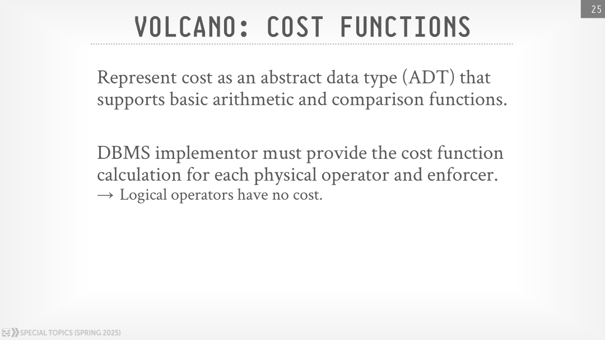

代价函数在实现中也被抽象出来。再说一次，这是作为数据系统实现者的你必须提供的东西。想象一个面向对象的模型：你会有一个表示代价的抽象类，然后如果你重载或覆盖它，就必须提供加号、等号、小于、大于等操作符。

系统内部没有关于代价究竟是什么的概念。它不是基于 Volcano 所了解的 CPU 或其他任何东西。这是你必须提供的。同样，它不使用我们在 EXODUS 中看到的预期代价因子或传播调整。他们完全放弃了它。我想论文甚至没有提到它。

## 第 26 页：Volcano 的搜索引擎

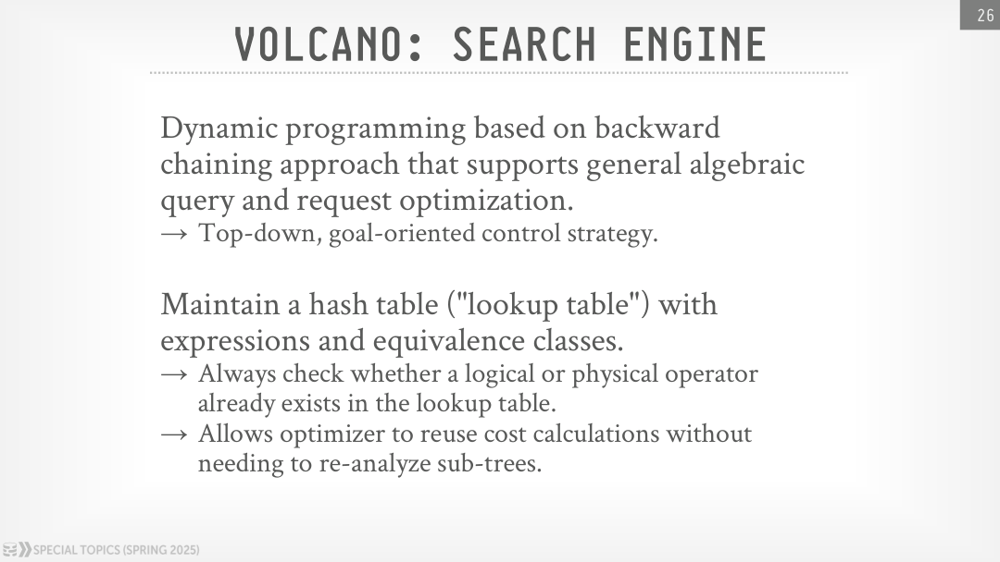

好，那么搜索算法是什么？规则的设置基本相同。属性比 EXODUS 中稍微复杂一些，而且现在我们有明确的 enforcer 操作符，可以保证数据以我们想要的形式向上传递。

我要使用的搜索是一种自顶向下、进行后向链推理的方法。可以把它理解为目标导向的搜索：我从想要的答案开始，也就是查询本身的最终结果，然后向下遍历，开始填入能够让我到达那个结果的物理操作符。

就像之前 EXODUS 使用哈希表来跟踪应用这些规则时生成的操作符一样，他们也有相同的东西。他们没有给它一个明确的名称，我想论文中的某个地方把它叫作 lookup table。在 Cascades 的工作中，你会看到它被称为 memo 表，但基本上采用的是同一个想法。Cascades 中的 memo 表比这个更加复杂。

现在，在搜索算法的每一轮中，当我位于查询计划树中的某个位置、检查一个逻辑操作符时，我会去看：如果我应用一个转换，这个转换的结果是否已经存在于 lookup table 中？如果是，我就不想再次应用它；如果不是，我就应用它并把结果填进去。这样下次尝试再次应用时，就不会一遍又一遍浪费计算周期做同样的事情。

这让我们能够复用已经生成的代价计算结果。在单个查询的上下文中，因为数据没有发生变化，也不是跨越很长时间，我们可以复用已经做出的任何计算，而不必重新分析往下的不同子树。EXODUS 则做不到这一点。

## 第 27 页：前向链与后向链

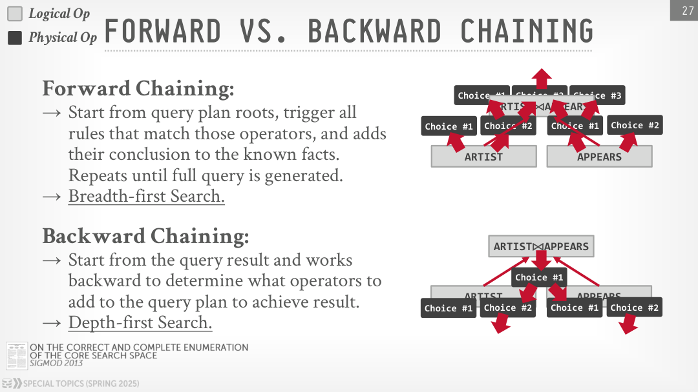

再来看看自顶向下和自底向上，或者前向链推理和后向链推理。从高层次来说，这两组术语基本上是一样的。为了说明清楚，后向链基本上是从根开始。实际上它是用逻辑定义的：这是我拥有的事实，我要扫描 `artist` 表，我要扫描 `appears` 表。然后，对于这些基本操作或基本访问方法，这是我可以应用的规则，用来生成不同的选择。

在每一层，我找出哪个是最好的，把它们保留下来，然后向上遍历，查看接下来的所有规则，依此类推。最后我的目标在顶部。我们之前在 System R 中也看到过这个。

而在后向链中，想法仍然是从根开始。我希望答案是一个查询的输出，这个查询把 `artist` 与 `appears` 连接起来。所以我先向下一层。假设一开始我只有一个选择：通过对这个逻辑操作符做一次新的转换，我可以生成一个物理操作符。

然后在那个物理操作符的分支中，我可以继续往下，说：好，访问 `artist` 的最佳方式是什么？再沿另一边往下，找到访问 `appears` 的最佳方式。现在我有了一个可以实际执行的完整查询计划。而且有一堆东西我可能根本不需要考虑。和前向链相比，我可以更快得到初始查询计划。它不一定更好，但我肯定能更快得到初始计划。

请说？问题是，目标是不是更快得到计划？不一定，要看情况，对吧？如果查询很简单，你可能可以更快找到它。但这个东西也会很快把它处理完，对吧？Volcano 的特点是……和 EXODUS 对比，它只会探索实际能够对表达式产生贡献的计划部分中的子查询。

比如，如果它能决定……我知道 Cascades 是怎样的，也知道 Volcano 是怎样的，但界线有点模糊，所以我可能说的是 Cascades 中的东西，而不是这个系统。不过先听我说。想法是，我在向下探索时查看自己的选择，可以给它们设定优先级，说这个选择可能更好，让我只检查这个，甚至不去管另一个。这有点像我们在 EXODUS 中看到的预期代价调整或优先级调整。

我想这实际上是在 Cascades 中，不是在这个系统中。我描述的是 Cascades，对。所以忽略我刚才说的，下节课再讲。在这里，Volcano 必须探索所有这些。对，Volcano 没有这种引导，谢谢。它们有三个，很难记清楚。

## 第 28 页：Volcano 搜索示例

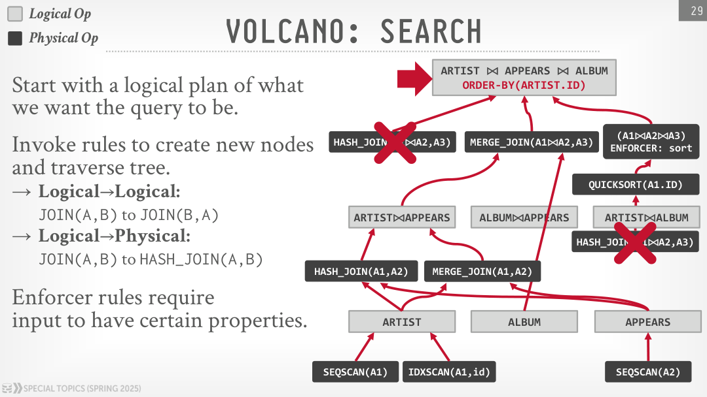

好，我们快速看看这个 Volcano 例子。谢谢。我们从最开始的地方出发。假设还是之前那个查询：我们想找出所有出现在 Mushu 致敬专辑上的艺人，然后按艺人 ID 排序。这里红色的小部分是我们需要强制满足的属性。

从这里开始，我们应用各种可用规则，让搜索树向下展开，开始填入实际需要的部分。一个简单的转换也可以是这样，虽然它来自逻辑查询计划：我们知道需要以某种方式连接前两张表，然后再把第三张表连接进来。

再说一次，因为这是 PowerPoint，我没有展示所有可能的组合。你可以想象，所有不同的逻辑连接顺序，以及物理连接顺序，都会出现在这里。我从最上面开始，说：好，我想在下面生成一个物理操作符，给我 `artist JOIN appears JOIN album` 所需的输出。这个输出必须按艺人 ID 排序。

所以我会应用所有能把这个三表连接转换成连接实现的逻辑到物理转换。我可以对 A1、A2 的连接结果与 A3 做哈希连接，也可以做排序归并连接，或者引入一个 enforcer 操作符。它只是说，我还不知道你将如何做连接，但我保证从我这里出来的数据会按你要求的方式排序。

好，那么我们可以丢弃这个哈希连接。实际上你甚至不会为此生成物理操作符，因为它会违反这里的排序顺序。也许我只是想展示这个选择存在。但你甚至不会展开它，因为系统会说：它没有按我需要的排序顺序提供数据，所以不用费心做它。于是我们忽略哈希连接。

但在这里我取了个巧。它不只是归并连接，而是排序归并连接，排序内置于连接操作符中。这会保证我的输出。至于这个 enforcer，我不知道它下面实际是什么，但我知道它会保证数据已排序。

请说？你说这个 `artist.id`？上面的这个？那是什么？这里没有 SQL 查询，不过我上节课展示过。它是一个 SELECT 查询，其 ORDER BY 子句是 `artist.id`。再说一次，这是在 PowerPoint 里做的，但绑定器会知道你引用了某一列，并能够把它映射到对应的东西。我这里有 A1、A2、A3，也就是 `artist`、`album`、`appears` 之类。

从顶部来看，我知道我希望数据按照向上输入的某张表中的某一列排序。这非常不完整，这是 PowerPoint。对，对，对，是 PowerPoint 动画。它们不是……对，还有更多规则。对。抱歉，你的问题是什么？像这里这个？对，所以它也许应该用不同的颜色，也许红色之类。它不是一个物理操作符，因为它实际上什么也不做。

它是一个占位符，表示我在沿树向下遍历时，目前还不知道如何从下面获取数据，但我保证数据会排好序。它表达的只有这些。不，不，请说。再说一遍？它既不是物理操作符，也不是逻辑操作符。再说一次，把它想成红色的，对吧？它既没有实现连接，也没有表示连接，因为我们要处理的连接是根部的这个。

它只是说，你从我这里得到的数据将是 A1、A2、A3 的连接结果，而且会排好序。但我不知道在物理上究竟如何实现这两个步骤。所以，这些只是占位符，你实际上不会在系统中实现它。“检查数据是否真的排好序”是什么意思？那会浪费资源。你应该直接排序，或者确保给你数据的操作符输出的是有序数据。

好，我们要进行深度优先搜索。假设我们沿这边向下，到达排序归并连接。我们需要弄清楚：好，我正在对 A1、A2 的某个连接结果执行排序归并连接，不管它们最终的结果是什么，再把它和 A3 连接。好，那我如何把这两个输入送到排序归并连接操作符中？

我会把它连接到这里的逻辑操作符。这里有 `artist` 与 `appears` 的连接，它作为 A1、A2 的连接输入。A1、A2 只是别名。然后这里是对 `album` 的逻辑扫描或访问方法，这是连接的另一侧。再说一次，这些是逻辑操作符。我没有说明实际怎样生成它们，只是在说数据会输入，并提供这个逻辑结构、逻辑结果。

我做同样的事情。现在我在做深度优先搜索，跳到 `artist` 和 `appears`。再说一次，现在需要像之前一样，应用一条实现规则，把 `artist` 和 `appears` 的连接转换为不同的可能组合：哈希连接或归并连接。我也可以应用逻辑转换，把它变成 `appears` 连接 `artist`，然后沿那边得到更多逻辑操作符。但我们保持简单。

现在我又有两个选择：做哈希连接或归并连接。我向下看这里。同样，现在我要连接的是：我有一个对 A1、A2 做哈希连接的物理操作符，也就是 `artist` 和 `appears`。逻辑操作符之间现在有一个连接，表示你会从这两张表中得到想要的数据。我没有告诉你实际如何访问它们，但这里指出了在查询计划中去哪里获取它们。

接下来做同样的事情：向下遍历到 `artist`，应用实现规则，转换成我拥有的不同访问方法选择。我可以做顺序扫描或索引扫描。先走到这里的第一个，得到一个代价；再到这里的索引扫描，现在又得到一个代价。如果我愿意，此时可以决定这两种选择中哪一种对查询计划的当前位置最好。

现在我还没有这个查询的完整代价，但至少在这个分支中，我从排序归并连接走到哈希连接，再走到顺序扫描或索引扫描，我知道查询树这一侧的代价。我向上回到 `artist`，再向上回到哈希连接。现在我需要去另一侧，也就是连接 A2 的地方，对吧？

我刚才可能说错了。我们还没有这里的代价，因为必须到下面弄清楚如何访问 `appears`。假设它只有一个选择：顺序扫描。那个操作有一个代价。现在回到这里，我们就可以计算整个哈希连接的代价了，因为我们知道如何访问 `artist`，也知道如何访问 `appears`。现在我们得到了查询计划中这个位置及其下方所有东西的累计代价。

然后我们要回到连接的逻辑操作符，走到归并连接，做同样的事情。但此时归并连接算法访问的显然是与哈希连接相同的表，因为它们都来自同一个逻辑操作符。因此，我不需要再沿查询计划，抱歉，沿树的下半部分向下走，因为我已经知道访问 `artist` 和访问 `appears` 各自的最低代价。

因此我可以完全跳过那次遍历。我会在他们维护的哈希表，也就是 lookup table 中找到代价，然后复用它。接下来我回到树的根，再走向另一侧，开始看 enforcer。

再说一次，enforcer 只是在查询计划中放一个占位符，说我会提供你想要的结果，也就是与我相连的逻辑操作符所定义的结果，并保证它具有你关心的属性。这里我们关心的是排序顺序。好，那么为了确保数据按你想要的顺序排列，我能做的第一件事是根据艺人 ID，也就是 `A1.id`，做一次快速排序。

然后向下遍历，说：好，我仍然需要连接 A1、A2、A3，所以现在可以为此生成一个哈希连接，和这边的那些类似。但到了这里，我甚至可能不需要向下查看。因为我知道目前见过的、按照这个连接定义来连接 A1 和 A2 的最低代价是多少。它会有一个代价，也就是我在下面选择的所有物理操作符的累计代价。

因此，当我遍历这棵树时，我知道自己正在尝试满足 A1、A2 的连接。到达这个位置时，我可以计算这个哈希连接的代价，甚至不必定义 A1、A2、A3 的访问方法的代价。也就是说，我没有说明究竟如何获得数据来执行哈希连接。但如果我发现要计算这个哈希连接，在这里可以复用已有结果——嗯，那个之前已经被剪掉了。

不过到了这里，我不需要向下展开，因为我可以说：如果这个快速排序的代价如此高，以至于远远超过排序归并连接，那么我就可以完全剪掉这个分支，不需要向下遍历和检查它。

请说？他的问题是，在这个系统中，查询计划的总代价是到该分支根部某条路径上代价的总和。在 EXODUS 中，你有总代价，也就是下方所有东西的总和，大致类似。但我又加入了另一个因子，对吧？你可以更多地把它看作一个提示：如果我应用这条转换规则，是否会变得更好？然后他们有一种方法来调整这个权重产生的影响有多明显、多大。

**学生：** 在 EXODUS 的代价模型中，各项代价相加，其中一些项会乘以一个因子吗？

**Andy Pavlo：** 问题是，在 EXODUS 中，总代价通过把各项加起来计算，但有时候会用那个因子来调整？对。他们用这种方式确定优先级。Volcano 没有这个，Cascades 会有。

对，他说得对。他说的是，在这个 enforcer 之后，我展示了一条向下的路径，经过快速排序和哈希连接。但这个东西是否也能满足要求？对，我只是没有画出那条边。

因为它在 lookup table 中，我会这么做，说：好，我需要确保输出的东西能够保证数据有序。哦，我有一条转换规则或实现规则，也可以把那个 enforcer 转换为排序归并连接。但接着我查看 lookup table，发现自己已经做过了，就不需要重复那次搜索。

他的问题是，这里没有理由一定要做深度优先搜索，也可以做广度优先搜索吗？可以。问题是你会向宽处展开，这基本上就是 EXODUS 做的事情：它向宽处展开，然后树的较高层有一堆已经展开的东西，于是 lookup table 膨胀了。再说一次，那是 20 世纪 90 年代，现在我有很多内存。但到了那个位置，我无法剪掉任何东西，因为我还没有代价。

我可以根据属性剪枝，但必须到达底部，弄清最低层的物理操作符是什么，然后得到分支的累计代价。之后我才能开始进行分支定界剪枝。

至于混合自底向上的想法……不，我认为 Goetz Graefe 的意思更像是，你可以不枚举所有可能的连接顺序，而是通过德国人的超图方法把它作为一个单独的阶段来做。这有点奇怪，我还没有完全想清楚该怎么做。但我认为那就是你会采用的方式。例如，你可以说，我不打算展开，也不应用交换律来重新排列这些东西。

这在某种程度上违背了 Volcano 论文，或者我想 Starburst 论文也提到的：你希望结合正在使用的排序算法选择访问方法。那么你是否不做下面这个步骤？我认为你必须做。对，我还没有完全想清楚那条评论。

背景是，发明 Volcano 这些东西的人在 2018 年 SIGMOD 获得一个大奖时，在演讲中说：是啊，Cascades 实际上有点复杂。如果让我重新来一遍，我会先做 Cascades，然后做德国人的连接算法。那个连接搜索算法我们以后会讲，虽然 Goetz 自己也是德国人。所以他显然没有把它称为德国人的算法，你们明白我的意思吧？对，我们以后可以再把这个问题弄清楚。

## 第 29 页：优化器性能

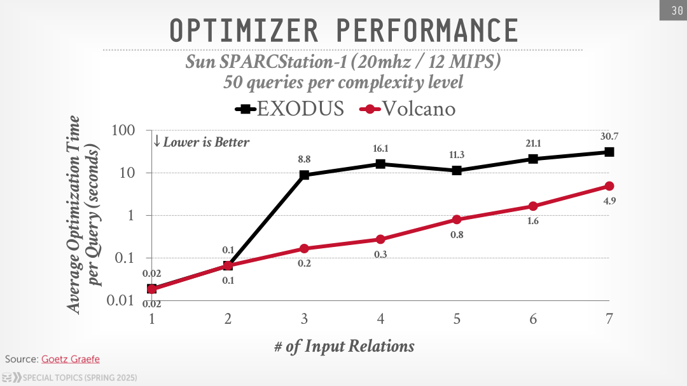

好，这是本学期第四讲了，我们甚至还没有看过一张图。这篇论文里有一张我们确实可以使用的图。你们想想看，整个学期读的所有论文中，我们会反复看到这种情况：它们不会和其他查询优化器进行比较。当然，在 80 年代和 90 年代，也没有一大堆现成的查询优化器可供使用。

对整个系统做基准测试没有意义。拿一个查询，在 20 世纪 90 年代的某个版本 Postgres 和某个版本 Oracle 上运行，因为它们是完全不同的代码库，引擎也完全不同。然后，要比较完全不同环境下的查询计划就相当棘手。

因此你不会看到这些查询优化器之间有很多不同的对比。你会看到德国人的论文，他们会和自己系统中以前的算法版本或实现进行比较。还有一篇会查看一系列不同数据库系统的基数估计，展示它们偏差有多大。在那篇里，你确实可以对它们进行比较。

之后我们讲 UDF 内联时——我跳得太远了——也会查看不同的数据系统，看看它们的优化器有多好。但通常你不会看到这样的图。而且除了 Join Order Benchmark 以外，并没有标准的基准测试；它在 90 年代还不存在。实际上并没有标准基准能说明我的查询优化器有多好，因为涉及的因素实在太多。

他们将 EXODUS 查询优化器和新构建的 Volcano 进行比较。他们在 20 世纪 90 年代一台老旧的 Sun 机器上运行测试。基本上，他们通过类似模糊测试的方式，改变查询中要连接的表的数量。这里每个类别有 50 个查询，他们测量查询优化器为每个给定查询生成它认为最优的计划需要多久。

可以看到，当输入关系数量非常少时，即使在这台旧机器上，也能在不到一秒内生成一个好的连接顺序。但当数量从二增加到三时，EXODUS 的耗时急剧膨胀，因为它必须在 MESH 表中一次又一次表示相同的逻辑操作符。搜索变得难以承受。

在 EXODUS 的情况下，抱歉，在 Volcano 的情况下，它在这里大致随输入关系数量线性增长，尽管这里是对数刻度。这不是一张好图，因为他们在论文中提到，EXODUS 的行为非常非常不稳定。有些查询显然超时了，因此这里只报告了实际完成的查询的运行时间。他们没有说失败的查询占多大比例，是 50 个里面 1 个还是 49 个，没有说明。

但这是我们第一次看到关于查询优化器实际表现如何的测量。这里的大幅跃升是因为 MESH 表不得不反复重新分析子计划，因为他们无法跟踪：哦，我以前已经见过这个东西。Volcano 则可以。所以他们批评了自己之前的论文。这是好的工作，我喜欢这样。

## 第 30 页：Volcano 与 Starburst

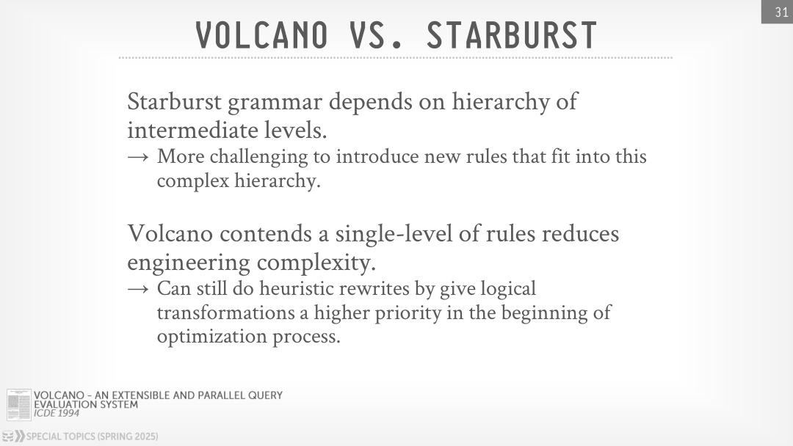

他们还批评了 Starburst。他们提出的是定性论点，对我来说，其中一些是有道理的，我也有共鸣。但正如我说的，当我们开始看 Cascades 时，尤其是在 Microsoft 的实现中，界线会有些模糊。它们会有所谓的重写阶段，在那里不使用代价模型就应用规则，把查询转换成实际需要的形式。

但至少在 Cascades 中，你只有两套代数：逻辑操作符代数和物理操作符代数。而在 Starburst 中，你有查询图模型，然后把它转换成完全不同的 STAR、LOLEPOP 结构。在 Cascades 和 Volcano 中，一切都处在那两种形式、两类表达式的上下文之中。

所以他们认为，Starburst 在进行代价空间搜索时实现规则重写的方式太复杂，因为有这样一层层的层级：逻辑操作符可能转换成更多逻辑操作符的组合，再转换成物理操作符。如果有人想引入新操作符或新数据模型，就必须弄清楚如何让它适配 Starburst 已有的东西。

他们指的基本上就是我之前展示的这张图：你有某种访问路径，然后通过所有这些层级向下到达访问方法。如果你要添加一种新的索引类型，也许这里如何处理太显而易见了。

## 第 31 页：规则层级

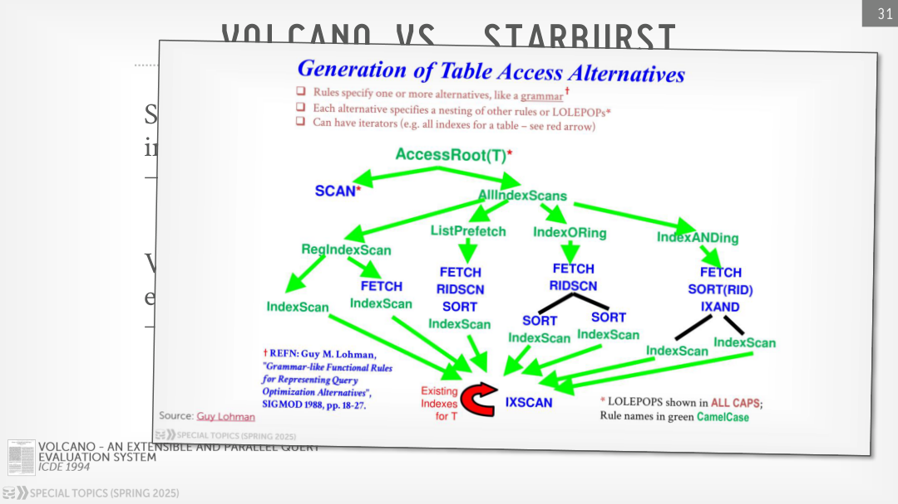

如果你必须实现某种位于索引扫描和其他你想做的事情之间的东西，他们认为，实际实现它会相当困难。当然，我们没有看过 DB2 中的 Starburst 源代码，所以不知道这是否属实。

因此他们声称，如果只有单层规则，也就是转换规则和实现规则，那么其他人就容易得多，可以推理怎样添加自己需要的东西，以扩展查询优化器。

我们会在 Microsoft 的例子中看到，你仍然可以像 Starburst 一样，在不使用代价模型的情况下进行重写：只要给这些规则更高的优先级，先在优化过程开始时运行它们，然后改变系统或优化器所处的阶段，再考虑其他规则。Microsoft 就是这么做的。

## 第 32 页：Volcano 的优缺点

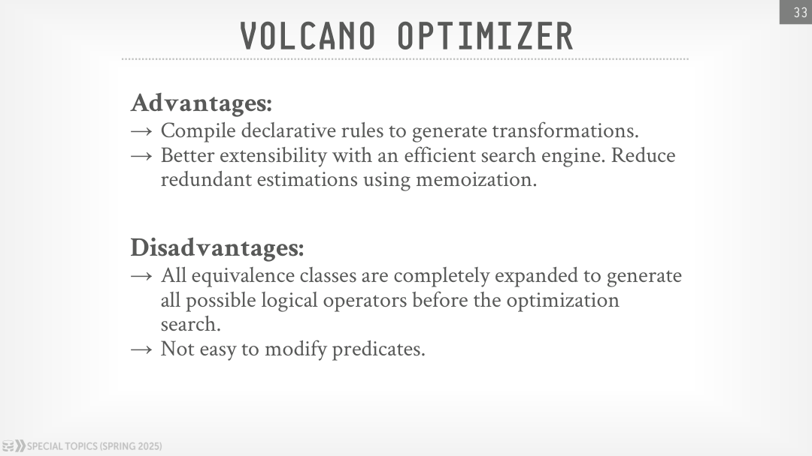

这只是对我刚才所说内容的总结。如果你想创建优化器，编译规则是个好主意。然后你可以通过编译实现更好的扩展性，因为现在你不必担心解释执行会让事情变慢。

尽管他们没有明确把它称为记忆化，我们会在 Cascades 中更多地看到这个，但其想法是跟踪之前应用过哪些规则以及它们的代价，从而进行必要的剪枝，避免不必要的计算。

再说一次，他们将面临的主要挑战是，在实际搜索之前必须展开所有东西。这是 Cascades 将会解决的问题。

## 第 33 页：最后的思考

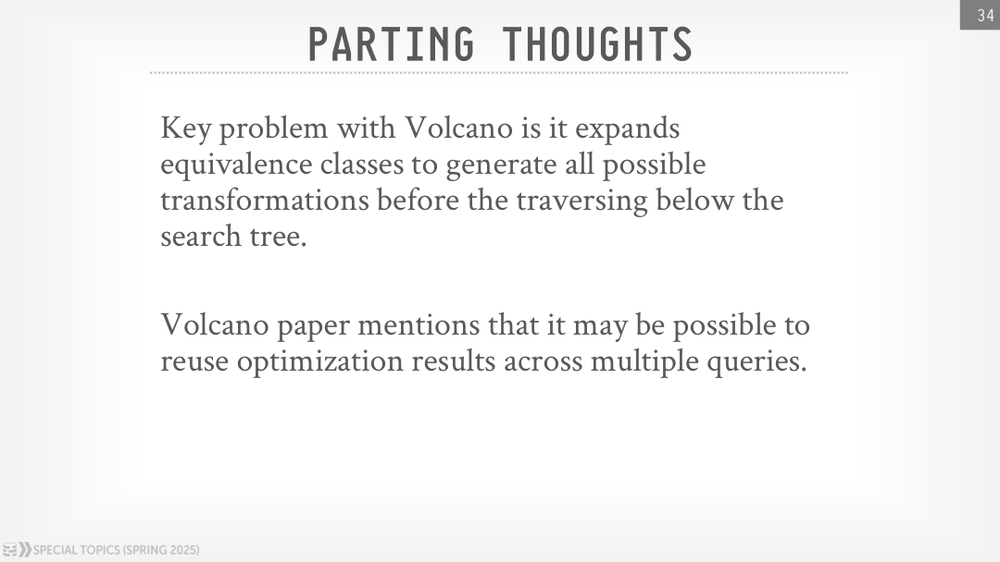

好，这基本上就是我刚才说的。如果你提前展开所有等价类，那会很糟糕。我们在 EXODUS 中看到，他们试图从过去的行为中学习，以调整搜索过程和优先级，优先执行你认为会带来更大收益的转换。如果结果不理想，就给它们较低的优先级，这样你就不会再次应用它们。

Volcano 没有这么做。但论文里有一小段说，如果不必针对每一个查询、每一次都重新初始化哈希表，也就是 lookup table，那会很好。理想情况下，你希望在同一个查询的不同调用之间，保留一些关于已应用于查询计划的转换的状态。这样你就可以跳过一直遍历到底部的完整过程，只需要查找 lookup table，就能提前找到一个好的查询计划。

正如我说过的，这样做非常复杂，尤其当你的数据不断变化时。你们读的论文会说，哦，表里有一千个元组。现在这显然不算什么，但在当时已经很多了。

## 第 34 页：跨查询复用

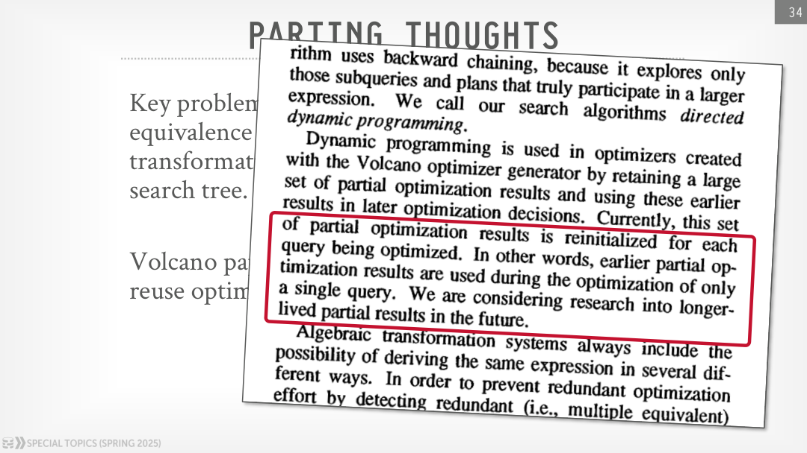

所以他们说，我们正在考虑未来研究生命周期更长的部分结果。Volcano 从来没有做到这一点，Cascades 也没有。我想 Microsoft 不会这么做，我们稍后会读一篇关于计划拼接（plan stitching）的论文。这里已经为一些将来才会出现的东西埋下了种子，而那些论文是在你们出生之后写的。在 90 年代，他们只是说：嘿，如果能这样做就好了。

请说？我想我说的不是谓词，而是转换规则。因为它是编译的，你必须做出修改，重新编译整个东西，然后再把它注入回来。他们还提到了 Postgres：在 Postgres 中，你可以在运行时加入规则来增强优化器，而不必重新编译所有东西。Starburst 也声称可以做到这一点。行为，系统的行为。

对，那是一个笔误。谢谢。

## 第 35 页：下节课

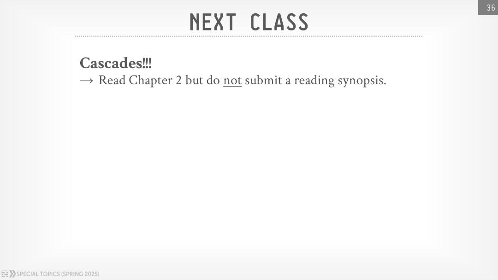

好，下节课要讲 Cascades，不需要提交阅读摘要。我宁愿你们把时间花在阅读那一章上。我在想应该是什么程度。我是说，他们会讲搜索算法所具有的函数。但现在你们已经有了理解 EXODUS 和 Volcano 工作方式的背景，就能够开始更清楚地理解 Cascades 实际上想为你们做什么。

所以再说一次，不用写摘要。我宁愿你们花时间读它，并更清楚地理解它，好吗？
