+++
title = "CMU 15-799 第 5 讲：Cascades 查询优化器"
date = 2026-11-18T00:00:00+08:00
slug = "05-cascades"
showTableOfContents = true
summary = "结合课程幻灯片和课堂讲稿，介绍 Cascades 查询优化框架。"
tags = ["查询优化", "Cascades", "CMU 15-799"]
categories = ["数据库系统", "计算机技术"]
draft = false
+++

[观看课程视频：Cascades](https://www.youtube.com/watch?v=bjOIbEg0Stc)

## 第 1 页：课程开场

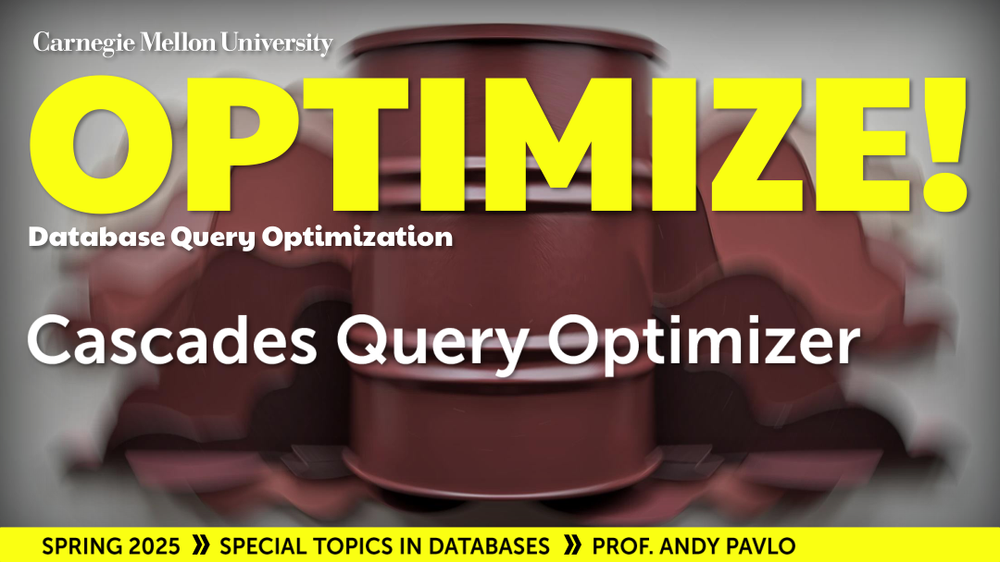

《Optimize！》：一段数据库查询优化之旅。本课程在卡内基梅隆大学现场录制，现场有听众。

我们将继续阅读 Graefe 的查询优化器系列。这将是他在 90 年代开发的最后一个，叫作 Cascades 查询优化器。我想它还是诞生在你们出生之前。我们正慢慢接近 21 世纪。不过这个真的很好，就像我课前说的，我让你们读书里这一章，部分原因是，在这本书出现之前，其实没有一份完整的资料描述 Cascades 到底是什么，以及实际上该如何实现它。ORCA 的论文里有一些片段，你们之后会读到。

微软有些人曾经在我们这里和其他地方做过报告，介绍它的做法，但直到这本书出现，才真正有了描述如何实现它的资料，我觉得这非常棒。

## 第 2 页：Volcano 勘误

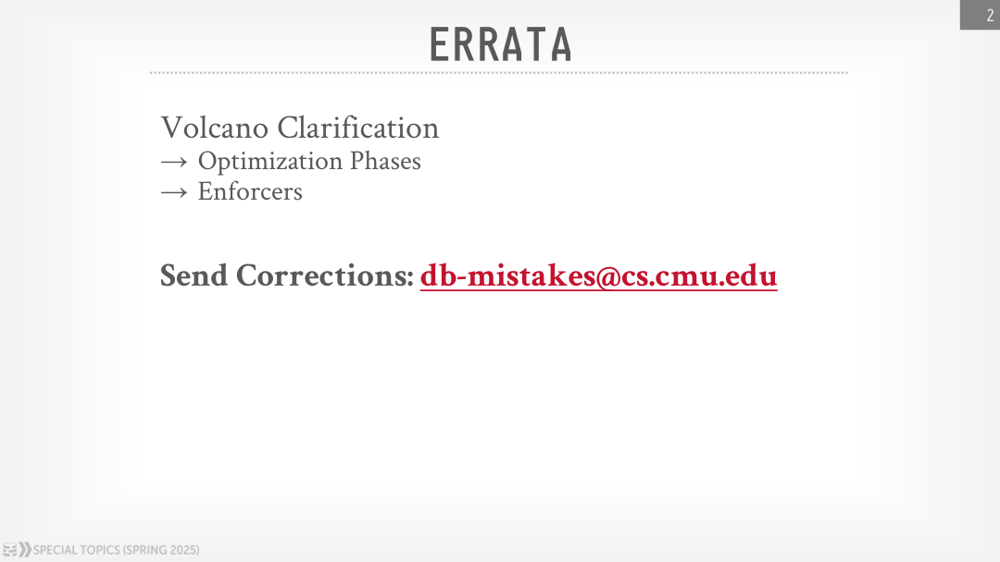

好，在讲这个之前，我想先做几个简短的澄清。一位同学发邮件说，对 Volcano 中我们如何实现属性强制可能有一点疑惑。另外，我还想强调另一件事：上节课我提到了 Volcano 的优化阶段，但没有把它们明确区分开来。

正如他上节课提到的，Volcano 是 Cascades 的前身，Cascades 有点像 Cascades 的面向对象版本，抱歉，是 Volcano 的面向对象版本。所以理解 Volcano 在做什么很重要，这有助于我们理解他们在设计 Cascades 时作出的决定。

## 第 3 页：Volcano 的生成阶段

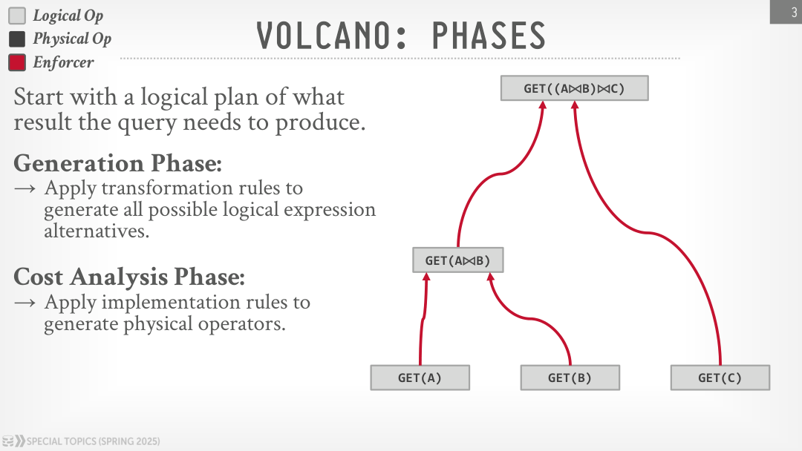

在 Volcano 中，尽管它被认为是一个统一的查询优化框架，进行逻辑转换和物理转换时仍然有不同的阶段。第一阶段叫作生成阶段，他们仍然做自顶向下的搜索，但基本上是在向下遍历时，探索并展开每个逻辑表达式可能有的全部逻辑表达式。也就是说，沿着树往下走时，对正在看的逻辑表达式或操作符应用所有能用的逻辑规则，然后继续往下走。因此，它相当于穷举展开查询计划所有可能的逻辑表达式。

假设一开始有一个类似的查询，要连接 A、B、C。为简单起见，我就说这里是 A 连接 B，再和 C 连接。沿着这里往下遍历，会有一条规则说：好，我知道需要连接 A 和 B。如果走到这里，要怎样把 A 和 B 的值、A 和 B 的数据送到查询中的这个连接里？所以向下遍历时，现在会展开这些组成部分。然后还可以做更多逻辑上的顺序调整，比如交换这里 A 和 B 的顺序，不过我们先不管这个。

## 第 4 页：交换连接顺序

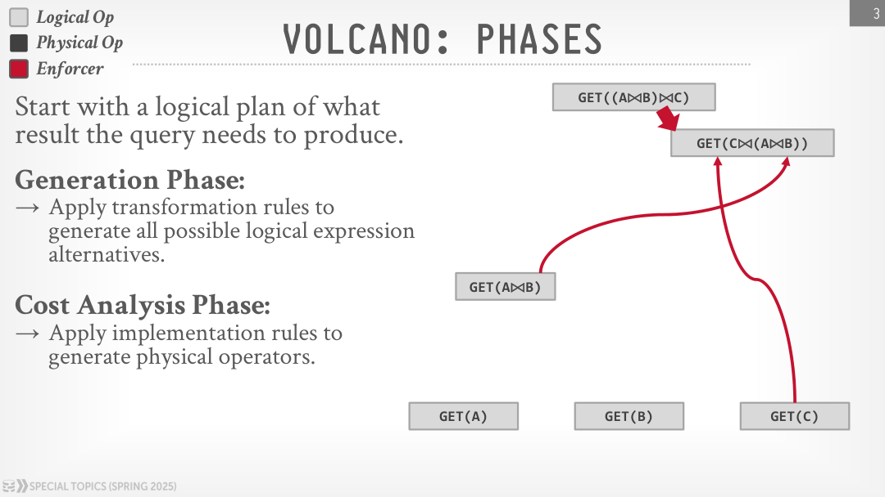

假设现在有另一条转换规则，交换连接的顺序，使 C 与 A、B 连接的输出进行连接。只是交换顺序，这是可以做到的，因为连接具有交换性。

现在再做同样的事情。向下遍历这棵树，一边向下走，一边展开所有可能的逻辑表达式变体。但是他们有一张哈希表，Cascades 将要使用的 memo 表的早期版本，用它来记录之前见过哪些逻辑表达式。这里我们见过获取 A 和 B 的连接结果这个表达式，所以知道不需要再往下遍历它下面的任何东西，因为我们已经在那里找过了。对吧？所以这里不需要继续往下。

## 第 5 页：展开逻辑表达式

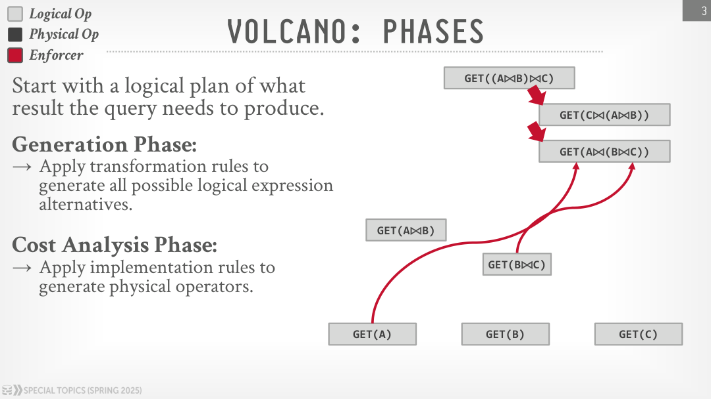

然后，同样在这一层，我展开这些不同的选择，需要这个连接的不同变体。因为这是 PowerPoint，我没法把所有东西都展示出来。但我一直反复应用相同的规则，在这一层得到更多逻辑表达式，对吧？

## 第 6 页：更多逻辑表达式

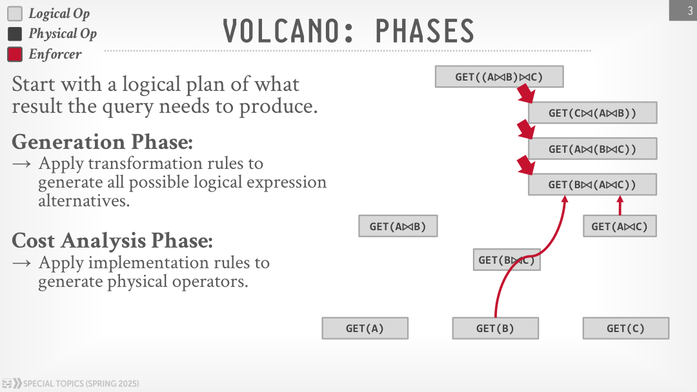

## 第 7 页：Volcano 的代价分析阶段

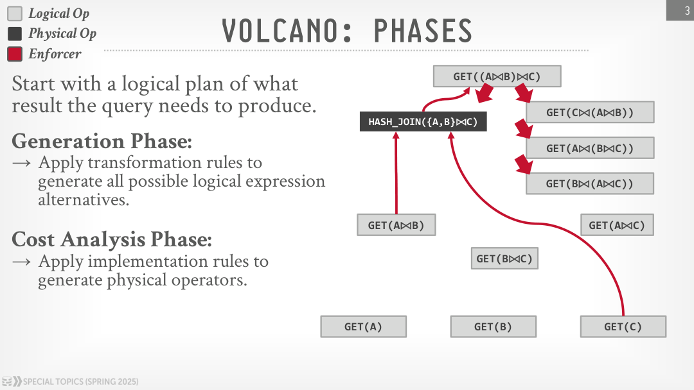

一旦所有可能的逻辑规则都已应用，我就进入第二阶段，他们称之为代价分析阶段。现在我再次进行自顶向下的搜索，不过我会尝试为树的每一层选择实现逻辑操作符的最佳物理操作符。

简单起见，我就从这一边往下走。我说：好，我知道需要连接 A 和 B，还需要将 A 和 B 的输出与 C 连接，那就为此使用哈希连接。

## 第 8 页：选择连接实现

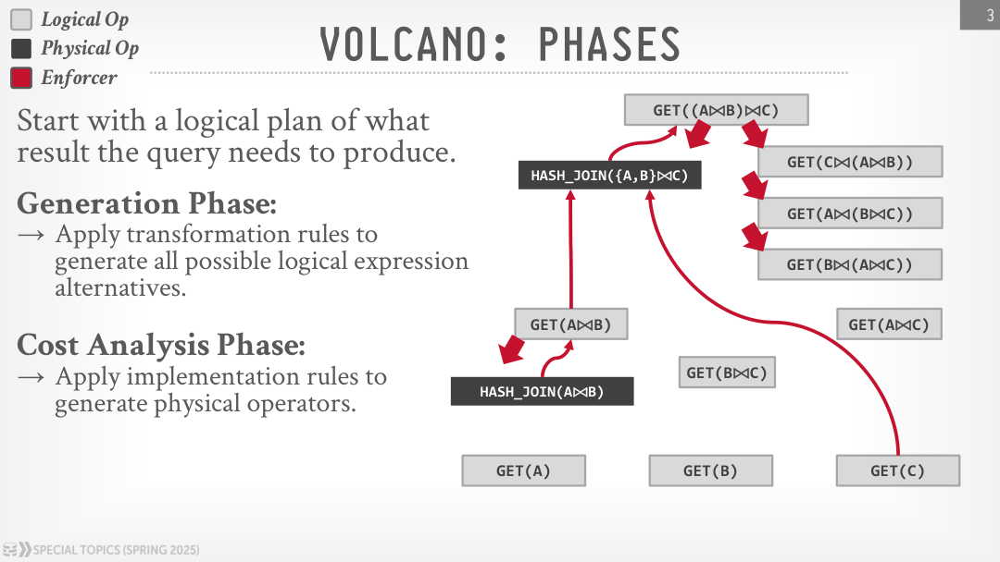

现在我知道必须从下面的 A、B 连接和表 C 获取数据。所以沿着这些逻辑操作符往下，应用规则，把获取 A、B 连接结果的逻辑操作转换成 A 和 B 的哈希连接。

## 第 9 页：查找输入

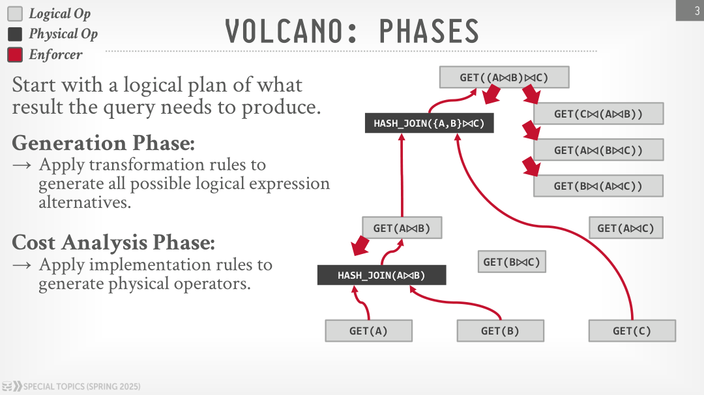

接下来同样继续往下，找到访问这张表所需的访问方法。我没有画出向下的箭头；这些箭头表示我正在这里应用一个转换。

## 第 10 页：访问表 A

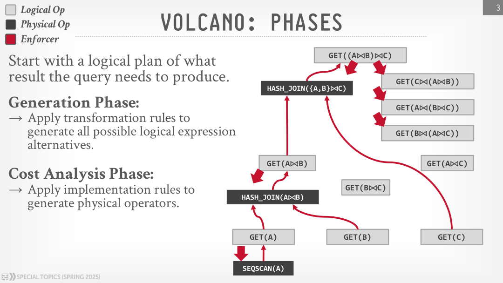

## 第 11 页：访问表 B

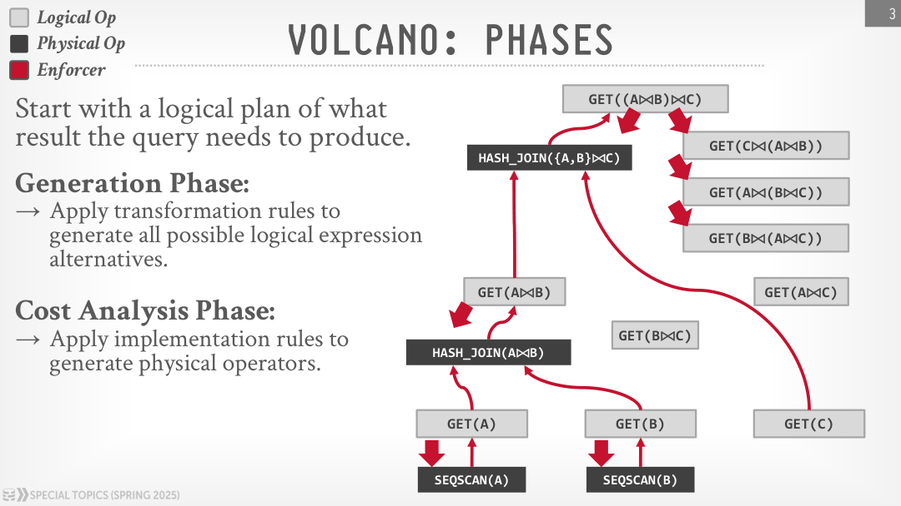

## 第 12 页：访问表 C

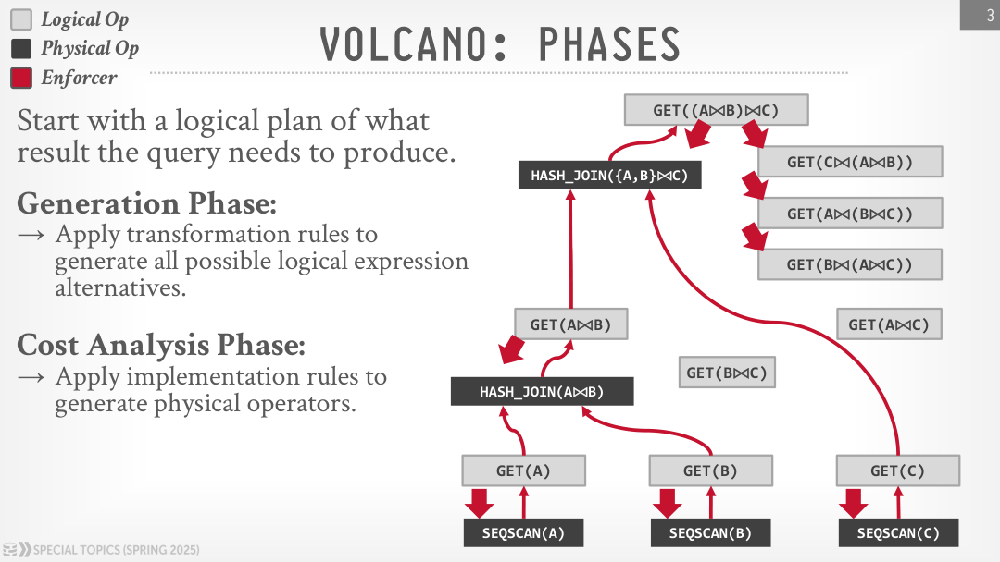

同样，我需要知道怎样访问 C。假设只有一种选择：顺序扫描。那么就向下遍历并进行这个操作。

再说一次，Volcano 的关键想法是，在第一阶段展开所有可能的逻辑表达式，然后回过头来确定实现这些逻辑表达式、这些逻辑操作符的最低代价。在 Cascades 中，他们不会这么做。他们只会按需展开，或者说应用规则来展开给定操作符、给定表达式的其他可能逻辑表达式；这个过程由规则及决定规则应用顺序的 promise 控制。

你可以把它想成有点像分层搜索，但它不像 Starburst 那样做从一种形式到另一种形式的重写。Starburst 把一个查询图模型重写成另一个查询图模型，但不会回过头来保留原来的那个。这里则是预先展开所有可能的选择，然后在第二阶段遍历它们，实际计算代价。所以它是统一的，因为这是一个应用所有这些规则进行转换的单一框架，只是运行在两种不同的模式、两个不同的阶段中。

## 第 13 页：Volcano 的属性强制器

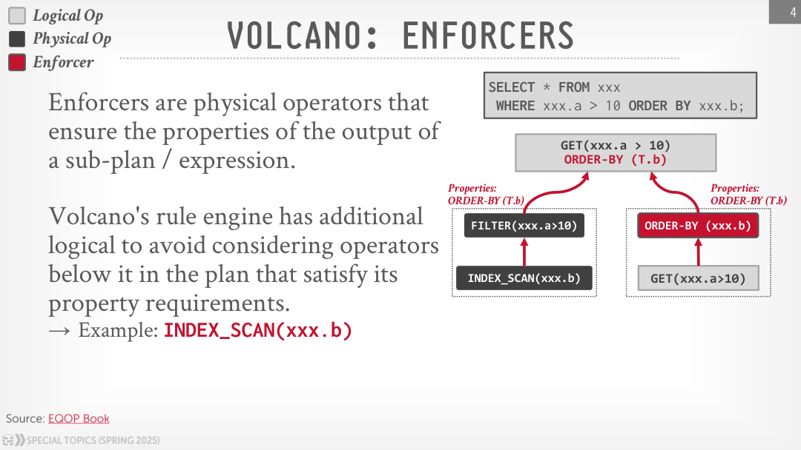

接下来我想澄清 Volcano 中强制器（enforcer）如何工作。在 Volcano 中，强制器实际上是放入查询计划的虚拟物理操作符，用来保证从该强制器输出的结果满足查询计划所要求的属性。排序顺序是这里最明显的例子。

假设我们有一个例子，对一张表执行 `SELECT *`，在 A 列上有一个谓词，并且按 B 列执行 `ORDER BY`。在自顶向下、目标驱动的搜索中，从想要的输出开始。假设第一阶段正在生成，把逻辑操作符转换成逻辑操作符。在这个例子里，我们会注入强制器操作符，表示按 B 列排序；在它下面，从表 `xxx` 中获取满足这个谓词的数据。

然后在另一侧，代价分析阶段可以开始展开，可以开始应用规则，将查询计划树的根转换为物理操作符。在一边，我可以说：我知道需要按 B 列排序，而 B 上有一个索引，那就扫描这个索引，然后对 A 做过滤。我把从逻辑计划到这里物理计划的转换画成一步，实际上可能由一条或多条规则完成。

这里这个表达式具有数据按 B 列排序的属性；图中写的是 `T.b`，应该是 `xxx.b`。这就保证了、满足了根节点所要求的属性。规则不会让你展开，或者把逻辑操作符转换为不提供该属性的物理操作符。

## 第 14 页：考虑其他访问路径

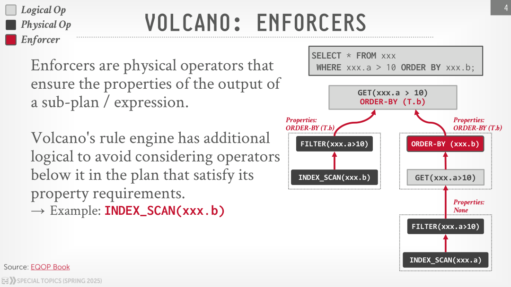

强制器使你仍然能够考虑查询计划或树中的其他子计划：它们自身可能不满足上方需要的属性，但在转换成物理操作符、物理计划时，我知道可以把强制器转换成提供该属性的物理操作符；对于排序顺序，比如快速排序或其他排序算法。

所以在这里，我同样有一个 `ORDER BY` 强制器，它的输入来自表 `xxx` 上带谓词的 `GET` 逻辑表达式。接着，当我展开并将逻辑操作符转换为物理操作符时，假设现在对 A 进行索引扫描，然后对 A 做过滤。

## 第 15 页：实现强制器

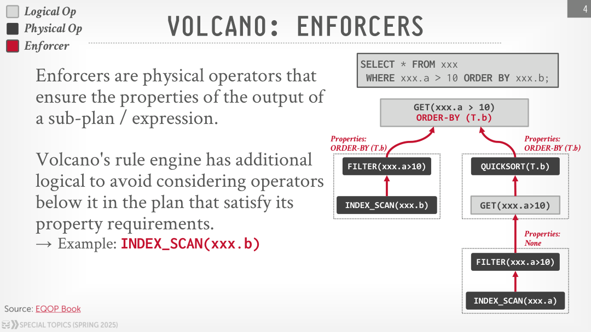

现在，由于它没有满足所需属性，我知道在转换这个强制器、为该表达式生成物理计划时，需要把强制器转换成一个按照我想要的列排序的算法。这样，这个表达式的属性及其输出的数据就满足了父节点所需要的属性。

这就是 Volcano 和 Cascades 之间的一个重大区别：在 Volcano 中，有明确的操作符叫作强制器；在 Cascades 中，它们只是规则，和其他规则一样。

这种方法的问题，在 Cascades 论文和你们阅读的章节里也提到了，基本上就是他们必须在系统或者优化器中加入大量专门代码来注入它。它可能并不完全像其他规则那样编写；当你要做这种转换时，就有点像一个专门处理：我知道需要满足这个属性，它是什么属性？然后通过一个映射说，对于这个属性，这是你需要用来强制满足它的物理操作符。

这有点像我们看过的第一个查询优化器 System R 中的排序顺序，是根据有趣顺序在最后附加上去的。这里的做法有些相似，虽然没有 System R 的做法那么……找不到更好的词来说，那么凑合。Cascades 会把强制器当成一等实体，或者说一条规则。

## 第 16 页：本节课安排

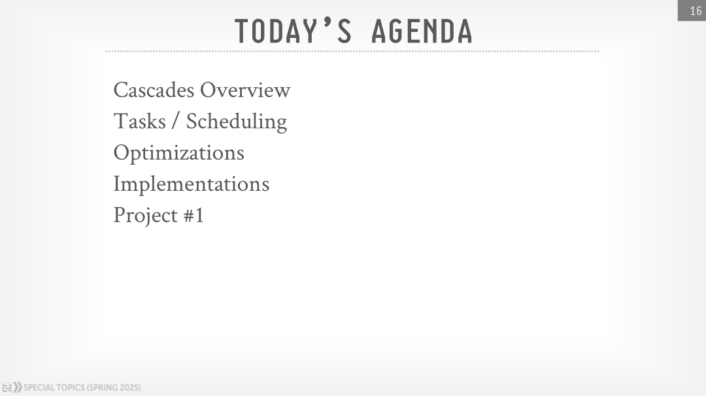

今天我想先概述 Cascades，深入讲解任务是什么样的，以及之后可以应用的优化，最后快速预览一下我们这学期接下来要看的其他 Cascades 查询优化器实现：ORCA 和微软的实现，也会稍微谈谈 Cockroach。

## 第 17 页：Cascades 优化器

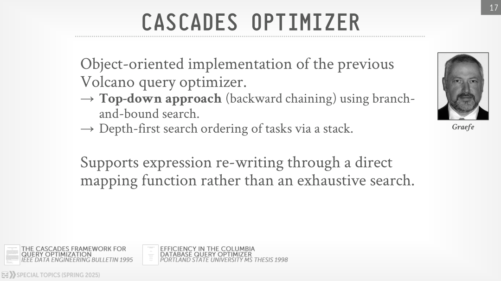

正如我说的，这是 Goetz Graefe 开发的第三个查询优化器。这个是在他离开科罗拉多大学、去了波特兰州立大学之后完成的。有一篇论文，我想不是在 SIGMOD 或 VLDB 上，而是在 IEEE 的一个会议或公报上，介绍了 Cascades 是什么；那就是最初的 Cascades 论文。

不过，据我所知，他实际上没有构建一个 Cascades 优化器。Volcano 有一个 Volcano 系统，得克萨斯州还有一个实际基于它的部署。据我所知，对于 Cascades，他写了论文，离开波特兰州立大学，最终没有真正把它构建出来。但后来他参与了一篇 1998 年的硕士论文，叫 Columbia，那是 Cascades 最早的实现之一。

他没有在波特兰州立大学构建它的原因是，他被微软挖走了，或者说他在 1995 年离开波特兰州立大学去了微软。微软聘请他帮助构建新的查询优化器，以 Cascades 以及我们在导论课讲过的 Volcano 并行 exchange 执行机制为基础。

所以，正如我说的，这是 1995 年的第一篇 Cascades 论文，但你不能像对 Starburst、System R，甚至 Volcano 的论文那样，直接拿着它来实现。

它会采用自顶向下的方法，就像我们在 Volcano 中看到的那样，使用反向链接（backward chaining）。它会做深度优先搜索，也和 Volcano 一样。不过，他们要排序的任务——我马上会解释，也就是为了继续探索和展开查询计划，我或者优化器需要做的事情——他们会用一个栈来维护这些任务需要应用的顺序。

而在 Volcano 中，它只是递归：我调用这个，再调用这个，再调用这个。到达树的底部并应用规则后，展开递归时，基本上就是调用 `return`，沿着调用栈返回。而这里的栈会是一个单独的数据结构，按照后进先出应用任务。还会有一些调度机制，从中取出任务，决定运行什么；它不总是后进先出。我们马上会看到 promise，实际上可以根据我认为某个任务会有多大收益来重新排序任务。

另外他们还能做一件事，论文没有真正讨论，但据我所知，他们可以直接在代码里重写谓词及其表达式，而不一定要进行穷举搜索。如果你知道 `1 = 1` 应该为真，他们有办法在最开始就触发并很快完成这个操作。我们马上会看到他们如何使用多个阶段。

## 第 18 页：Cascades 的关键想法

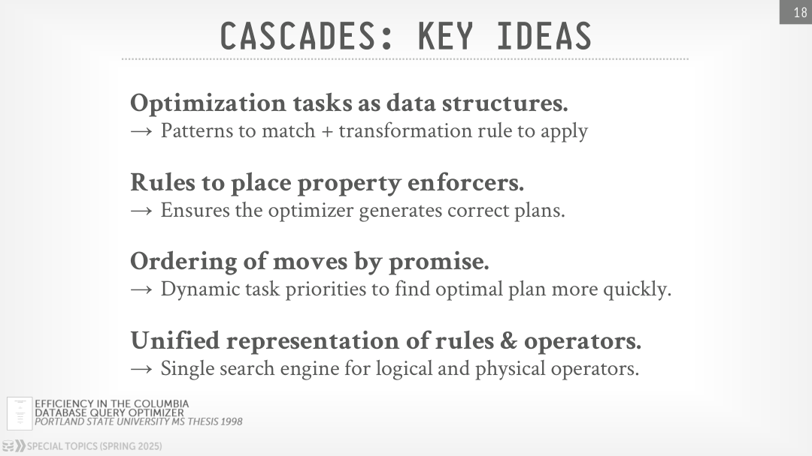

那么，Cascades 与 Volcano 不同的关键想法是什么？其中之一是把优化任务作为单独的数据结构或结构体，说明这是我需要做的事情，而不只是用规则触发机制说：好，如果做这个，就应用这个变化并更新东西，由规则本身来跟踪它试图完成的任务。

现在会有明确的任务，再说一次，它们是系统中的一等组成部分。然后你可以使用所有想用的调度技巧，确保事情正确运行以及并行运行。他们不再把强制器作为单独的虚拟计划节点或操作符，而是使用规则处理。我们马上会进一步看这个。

他们会有 promise 的概念，类似我们在 EXODUS 中看到的代价调整：我认为这件事对我来说收益更大，所以给这条规则更高的优先级，与其他规则相比，尽量更早应用它。

另一个重要的想法是统一表示所有规则和操作符，无论操作的是逻辑操作符还是物理操作符。在某些系统中，你也可以把谓词、谓词树放进来。所有这些都在一个搜索引擎中，使用同一套表示：这是规则，这是操作符。

再说一次，Volcano 论文里这一点不是很清楚，但基本上他们有用于编写逻辑操作符规则的 API，以及用于编写物理操作符规则的 API，然后有不同的机制，或者说不同的执行器，来触发这些不同的规则，你无法把它们混在一起。

而 Cascades 会说，有时我实际上可能想先做一些逻辑展开——抱歉，是先做物理展开，然后再做其他逻辑展开。它可以把这些东西混合起来，尝试引导搜索，更快找到收益更大的选择。

## 第 19 页：表达式

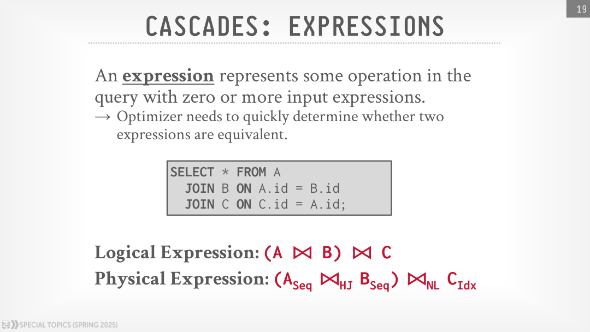

现在我们更详细地看表达式，然后由此引入组（group）。当我们沿查询计划树往下走时，组就是我们考察计划的范围。通过包含表达式的组，我们可以压缩查询计划的表示，这样向下遍历时，就不必在 memo 表中保存所有这些冗余信息，也不必一次又一次地想办法判断这些东西是否真的等价。我们把它们组合到组里，这样在程序或者优化器实现中的同一个位置，就能找到所有已知相同的东西。

我们之前说过，表达式是一组操作，有零个或多个输入表达式，可以是物理表达式或逻辑表达式的组合。系统里还需要有机制判断两个表达式是否等价。这既指两个逻辑表达式是否等价，也指物理表达式是否与逻辑表达式等价，对吧？两个方向都需要。

据我所知，在 Volcano 中，由于逻辑部分和物理部分分开保存，他们只需要比较逻辑和逻辑，或者物理和物理。在这里，我们必须知道跨这两种形式的东西是否等价。这使我们能够应用下周会看到的所有转换，依靠交换律、结合律，知道什么时候重新排序是可以的。

## 第 20 页：表达式组

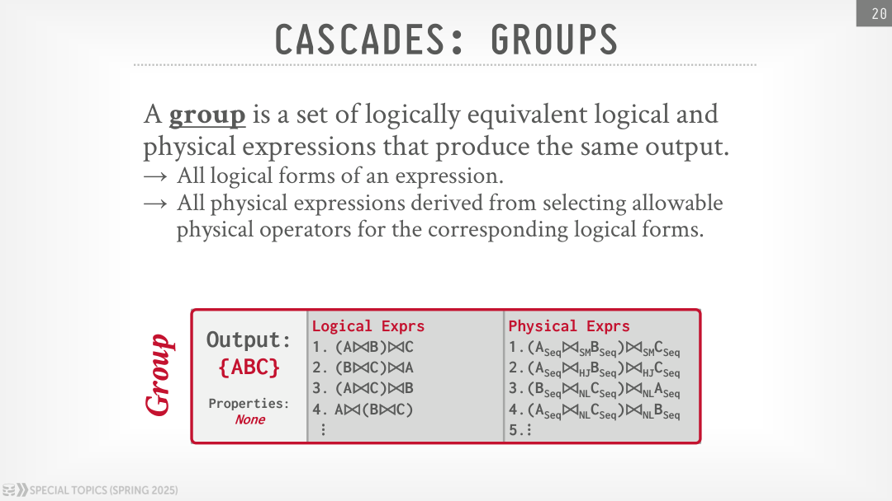

用来表示等价表达式的容器叫作组。组会有某种输出，由一个逻辑表达式定义它输出的是什么。它可以有属性，指定它输出的数据是什么样的，比如排序顺序，以及我们之前讨论过的所有东西。

然后它会有一个无序列表，包含其中所有等价的逻辑表达式。我不该说无序：如果你愿意，也可以有序，这不重要。总之，这里列出所有等价的逻辑表达式，它们产生我期望这个组输出的结果。同样，这里列出所有等价的物理表达式，它们也会产生组所指定的输出。

## 第 21 页：组的输出

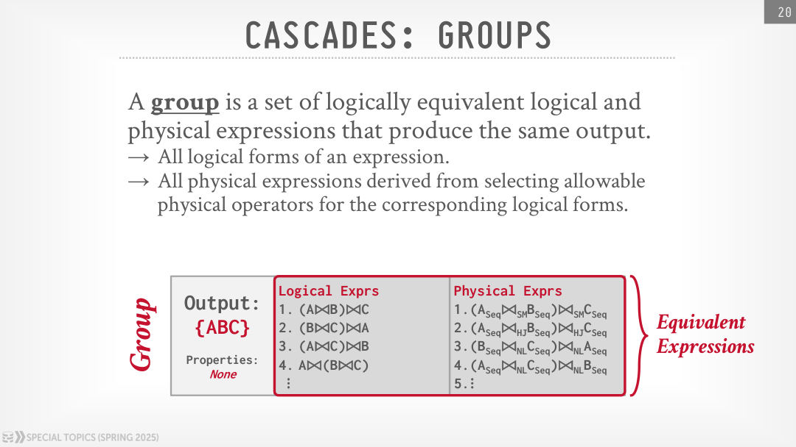

这里整个容器被视为组，这两部分则是所有等价表达式。比如，A 连接 B 再连接 C，等价于 B 连接 C 再连接 A。我们的输出在更高的层次定义为 A、B、C 的结果，我甚至没有指定任何顺序。

这个输出看起来有点像 QGM，也就是查询图模型。我不是说这是关系演算，而是说它比这些关于表达式的关系代数定义更高一层，因为我没有指定顺序。我只是说，这里有某种输出，是 A 连接 B 再连接 C 的逻辑表示。

## 第 22 页：等价表达式

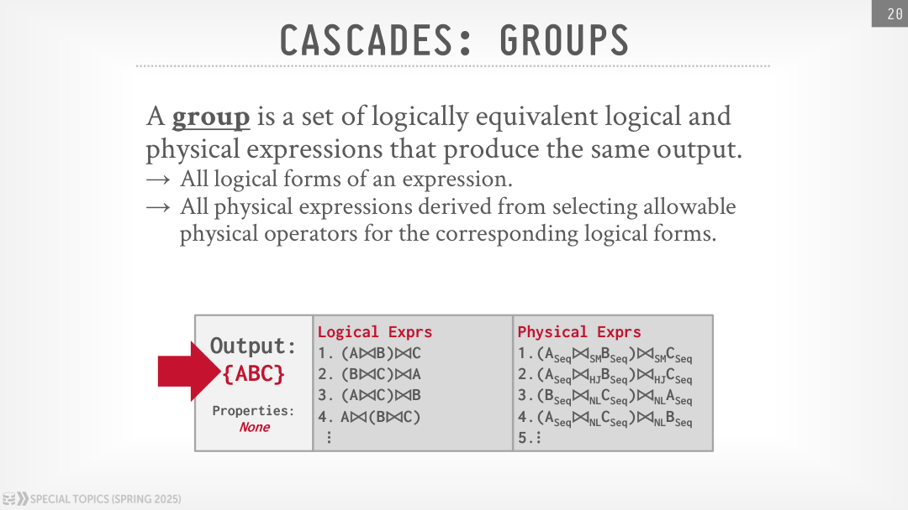

## 第 23 页：组作为占位符

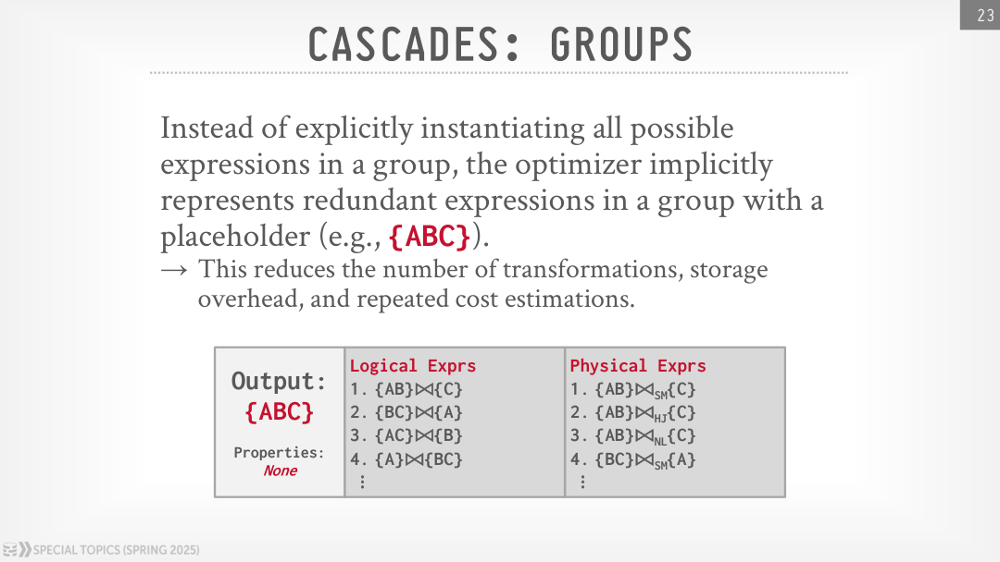

那么这个东西是什么？它是一个占位符，表示某个表达式或子表达式所期望的逻辑输出。现在我们用它来压缩实际需要存储的数据量，或者说为某个组保存的冗余表达式数量。

因为对于逻辑表达式、甚至物理表达式中处在查询计划下方的东西，我不知道它实际会如何执行。但在查询计划树的较高层，看某个给定的组时，我不关心。

回到这里：我有逻辑表达式 A 连接 B，再把输出与 C 连接。但我并不想在逻辑层面保存 A 和 B 连接方式的所有可能组合。我只用这里的表示说：查询计划中我的下方有 A、B，它们要连接在一起。我不会告诉你顺序，此时也不关心顺序；只要知道这里有一个占位符，表示下方有某个组会告诉我如何完成这个连接。

对于物理表达式也是一样。这里指定的连接顺序是先连接 A 和 B，不知道怎么连接，那是在我下面。然后我会把结果与 C 做排序合并连接。这里花括号中的占位符同样只是在说，下方会得到 C，我不知道如何得到它，但不需要记录所有可能的组合。

这也是 EXODUS 的问题之一：他们基本上就是这么做的，把所有东西一遍又一遍地冗余存储起来。

清楚吗？请说。问题是：组可以有输入吗？我想这里可以看到。我没有写出来。表达式可以有零个或多个输入，对吧？而组只是产生某种输出的一组表达式。所以由此隐含地说，它们有零个或多个输入。如果你是底部的顺序扫描，通常没有输入；上面的连接会有更多输入。

为简单起见，我们假设这里只处理二元、一元的组，也就是有一个输入、两个输入，或者零个输入。但如果做多路连接，虽然我们这学期不会讲，你可以有三个或更多输入。

## 第 24 页：转换规则与实现规则

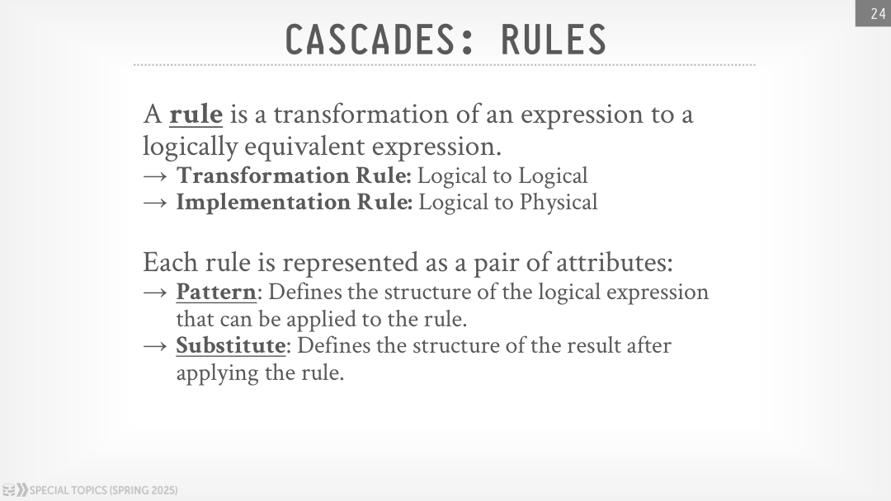

那么规则是什么样的？就像我们上节课在 Volcano 和之前的其他系统中看到的，我们会区分转换规则和实现规则。转换规则从逻辑到逻辑，也就是从一个逻辑表达式到另一个逻辑表达式；实现规则从逻辑到物理。

每条规则会由一对属性表示。我想在他们讨论的实现中，它是一个你调用的函数，传入正在看的表达式，也许还有其他上下文信息。但它只是用一种方式说明：我的查询计划中是否有某个东西匹配某个模式？如果有，那么某条规则就能说明，我希望对逻辑表达式或物理表达式作什么改变，以产生查询计划的一种变体。

下节课我们会更详细地讨论各种不同的转换。

## 第 25 页：规则示例

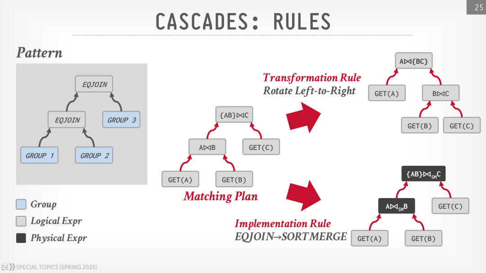

这里有一条可能比之前见过的更复杂的规则。假设我们要找出存在两个连接的地方，然后想办法优化它们。现在规则中有组的概念。它们只是占位符，表示在我这里进行的等值连接下方有一些东西。我不知道它是如何得到的，也不关心。可以把它想成通配符：下面是什么并不重要，但我知道规则中有这样一个想要匹配的结构。

查询计划到来时匹配了这个结构，我就可以进行逻辑到逻辑的转换，把左边转到右边。现在在根节点这里，我们只是把 A 移到连接的一边，把 B 移到另一边。或者我可以有一条实现规则，把这里用来连接的两个逻辑表达式转换成排序合并连接、哈希连接，或者其他你想要的东西。我们马上会看到。

我们还需要维护一个位图或额外的元数据，记录在搜索树中沿这条路径向下时，是否已经应用过这条规则，因为我不想反过来又做一次，然后一遍遍做同样的事，陷入无限循环。我想 Volcano 有明确的规则，他们会注入一些东西来避免这种情况；Cascades 里则说用一个位图来跟踪这些转换。

## 第 26 页：强制器规则

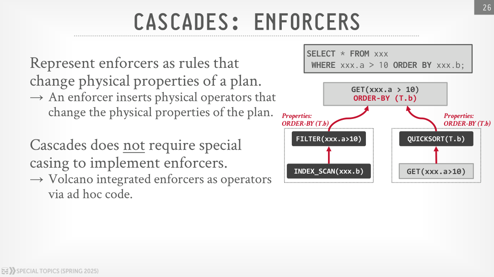

强制器现在只是规则。它是一种保证从组的输入向上流出的数据具有所需属性的方法。回到之前那个简单查询：现在我不再像 Volcano 那样在查询计划中放一个强制器计划节点，而是用一条规则来跟踪：如果转换到我下方的另一种形式、另一个表达式或组会产生我关心的属性，那么是否允许进行这个转换？

也就是说，不再让强制器相关的规则与其他规则的写法不完全一样，再加上额外的逻辑来判断这个强制器是否会给我想要的数据；它只是一条规则：当我从逻辑形式转换到物理形式时，除非能够保证我需要的属性，否则就不做转换。

如果这里是顺序扫描，它就不允许你把 `GET` 逻辑操作符转换成顺序扫描物理操作符，因为结果不会有序。就像规则会检查交换律以及关系形式、关系查询计划中我们关心的所有其他东西一样，属性也只是其中之一。它没有受到不同的处理，只是另一个可以检查并据此决定做什么的规则属性。

这个想法现在看来似乎很明显。我不知道，那时毕竟是 90 年代还是什么时候。对我来说，这是正确的做法。

## 第 27 页：优化任务

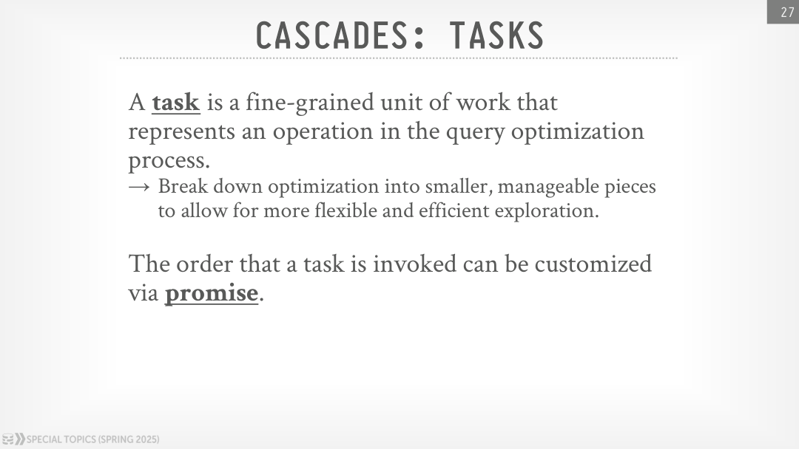

现在我们来讨论如何执行实际的搜索过程。Cascades 引入任务的概念；他们使用的说法是细粒度的工作单元，查询优化器可以在搜索或规划过程中执行它，对数据库系统应用某种变化——抱歉，是对查询计划应用某种变化。

想法是，把优化分成较小、理想情况下彼此独立的部分，让查询优化器自己学会以什么顺序应用它们才是最好的。

我们在 Volcano 中见过这个，这某种程度上是在反驳 Starburst 的做法：Starburst 说你可以把规则组合起来，做一堆复杂的事情。Cascades 和 Volcano 则说，不，不，不，你希望这些是完成某种转换的小块工作，把它们都扔进队列，然后我们会弄清楚正确的顺序。

微软的情况是，你们读的章节里有一个小节说，可以使用多阶段，抱歉，是宏规则、宏优化。这又违背了 Cascades 最初的理念或设计决定。不过，如果你不会让任何随便来的程序员都参与查询优化器的开发，也许这样仍然可以。

## 第 28 页：Promise

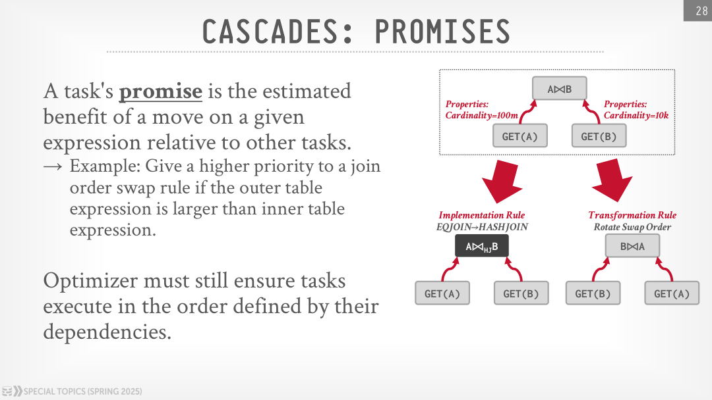

默认情况下，在最初的实现中，它只是一个栈；根据这些任务在实现中自然出现的顺序来选择接下来要做的事情。但现在可以做得更复杂一些，跟踪所谓的 promise，让你能够定制任务执行或规则应用的顺序。

在 EXODUS 中，他们有预期代价因子的概念。它的想法和这里的 promise 相似，但它本身与代价、与你想用来优化查询计划的代价或目标函数绑定。而这里的 promise 实际上独立于代价。当然，有时你确实想考虑代价，因为那可能是正确的做法；在过程中动态地为任务选择合适的 promise，可能引导你找到代价更低的结果。但 promise 本身的计算并不直接与代价函数绑定。

因为在做逻辑优化时，一开始可能根本没有代价。例如，你还没有确定如何扫描一张表，所以逻辑操作符没有代价的概念。你需要 promise 来判断什么可能是一个好的决定。

promise 就是在给定表达式上采取某个动作，相对于查询优化器此时可以选择的其他任务所估计的收益。假设我们有这样一个简单查询，要连接 A 和 B。我们跟踪每个操作符基数的关系属性；再说一次，它不是代价，只是对输出数据量的估计。

## 第 29 页：比较任务优先级

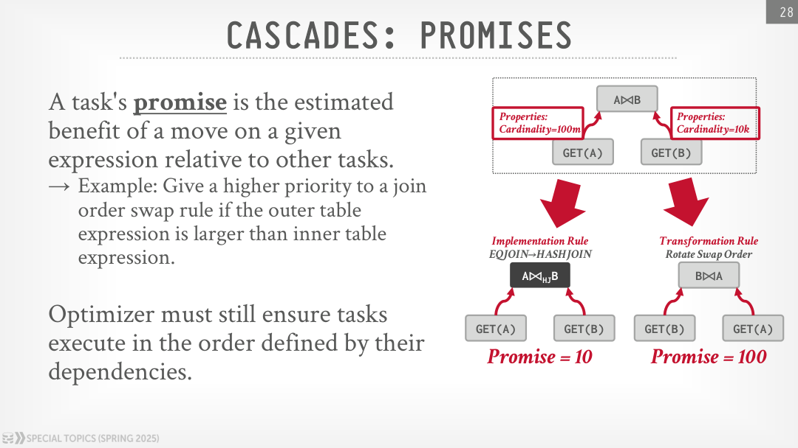

和之前一样，我可以有两条规则：把连接的逻辑操作符转换为哈希连接，或者交换连接顺序，让 B 成为外表、A 成为内表。

没有 promise 的话，顺序几乎是随机的。取决于我如何实现系统，规则应用的顺序决定任务如何被压入栈中，然后也许就按那个顺序执行。但如果通过检查当前正在优化的表达式的状态，我们知道一些关于它的信息，就可以决定哪个选择实际上更好。

## 第 30 页：利用基数估计

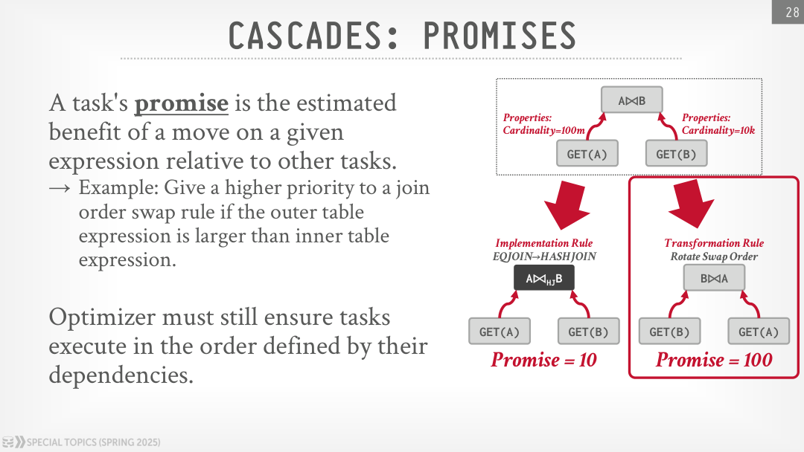

这里我们知道两张表上 `GET` 操作符的基数，可以看到较大的 A 有一亿个元组，B 是较小的表，有一万个元组。这就是导论课上教科书式的查询优化：总是希望较小的表作为外表。

于是可以根据这些属性计算 promise，给交换操作更高的优先级，因为我更愿意探索 B 为外表、A 为内表的查询计划，而不是先处理 A 连接 B 的物理操作符。

再说一次，我实际上没有计算这个逻辑计划的代价。promise 是我必须在查询优化器里实现的某种神奇函数。它告诉我：嘿，这条规则可能更好，先做这个，再做另一个。

假设这里只有两张表，我们基本上会进行穷举搜索。我会先探索这里的逻辑表达式，然后把 B 连接 A 的逻辑操作符转换成哈希连接、排序合并连接、嵌套循环连接，或者我拥有的任何连接实现，再得到它的代价。

然后如果我回来，应用这条规则，把 A 连接 B 的逻辑操作符转换为物理操作符，就会得到下方其余查询计划可能的代价估计。但我会看到，自己已经算出了 B 连接 A 的物理连接代价，而它低于我在这一边可能做的任何选择，所以我甚至不再探索下面的其他东西。

这并不能保证我们加速搜索。复杂性仍然很麻烦，我们仍然必须处理它。但在实践中，我们会更快找到一个更好的查询计划。这也取决于基数估计有多准确。如果 A 和 B 上没有谓词，那只是元组数量，系统目录会有这个信息。但如果你要估计谓词的选择率，而统计信息不好，promise 最后也可能是错的。

因此，从逻辑上说，实现可能是正确的，输入到计算 promise 的函数里的数据却可能是错误的。不过我们还没讲到那里，这学期晚些时候会讲。清楚吗？这很简单，也很巧妙。显然还可以扩展它，做更复杂的事情。

## 第 31 页：六种任务

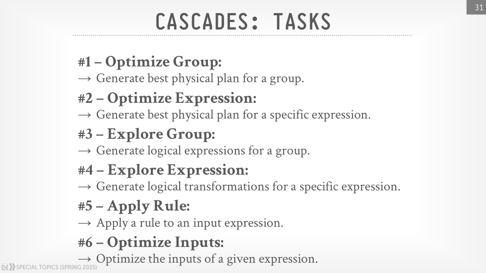

现在我们要讨论这些任务实际上是什么。再说一次，我之前说过，其中一些内容在 90 年代那位学生的 Columbia 论文里有提到。ORCA 的论文也有一些，但直到这本书写出来之前，其实没有完整定义 Cascades 中所有这些东西都在做什么。

不同的任务大致分为三组。首先是优化一个组或表达式，为特定目标生成最佳物理计划。然后，探索任务查看组或表达式，应用所有逻辑转换，以生成更多表达式或更多组。

生成更多内容的方式是应用规则：取一个输入表达式和一条规则，应用规则，产生一个或多个输出。之后可以把它们作为逻辑表达式或组反馈回去，留待以后探索；或者在得到物理形式后，如果知道正在看的组或表达式在下方还有尚未优化的子节点，就递归向下调用并优化它们。

## 第 32 页：任务流程

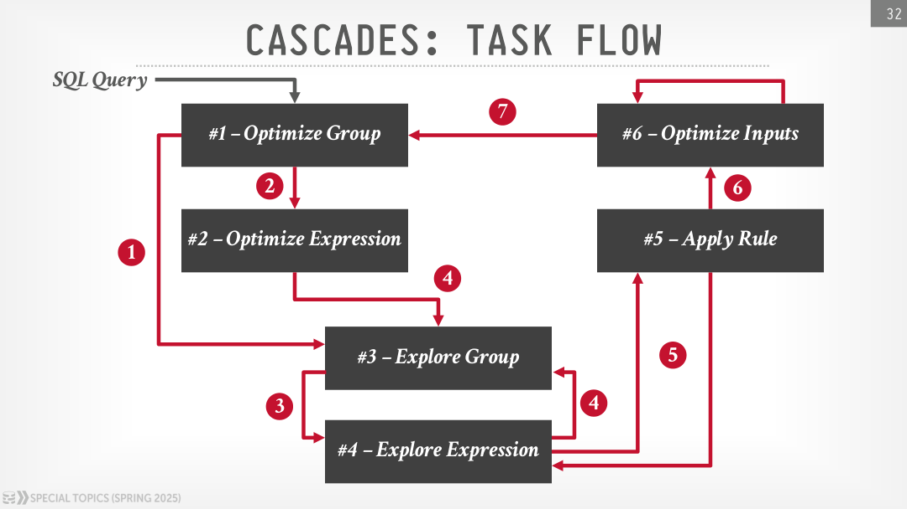

这么笼统地说可能不太好理解，我来走一遍流程图。最开始有一个 SQL 查询。假设经过解析器和绑定器之后，我们生成了顶层的组。再说一次，这是自顶向下、目标驱动的搜索，因此顶层会说明这个查询计划需要的预期输出，也就是查询计划的根组。此时下方还没有其他东西。

第一步，我们得说：好，根组中有一堆逻辑表达式，此时还没有物理表达式。让我应用所有可能的逻辑转换来探索它，从而在组中生成更多逻辑表达式。其中一些组内的表达式还可以进一步优化，为顶层组里的东西生成更多物理计划。

如果是没有任何谓词的 `SELECT * FROM table`，或者 `SELECT 1` 这样非常简单的查询，就不需要向下遍历，可以立即调用这个操作，生成所需的全部物理表达式。

探索组会进一步展开，在组中创建更多表达式。然后我要探索这些表达式，展开组内的逻辑表达式；其中一些又会生成更多组，我想进一步探索它们。在某些情况下，我可能会优化逻辑表达式，把它们转换成物理表达式，这也会生成其他逻辑表达式或新组，然后我再进一步探索。

在这一切发生时，从逻辑到逻辑、从逻辑到物理的实际转换是通过应用规则完成的。这里又有一个反馈循环：应用规则可能生成更多表达式，我想进一步探索。或者，如果我知道在这一层已经看完了想看的所有东西，想继续向查询计划下方走，去看子组、下方的组，就执行优化输入。它可以再次调用自身，然后在下一层开始这个过程。

我这里讲得有些笼统，我们马上会看一个例子。但基本想法是反复递归地对组应用规则，不断展开它。然后在某个时候，根据 promise，你可能决定：哦，我实际上想往下走，开始看下面的东西，因为继续对当前的组应用规则不会再提供足够的信息。

## 第 33 页：基于任务的搜索

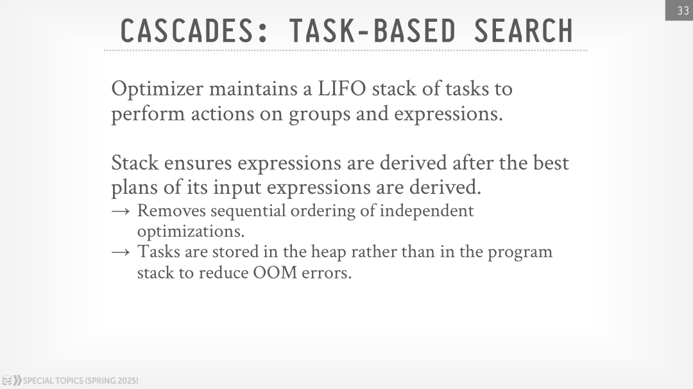

正如我说的，会有这样一个栈，我们不断把任务放进去，以便对正在看的组或表达式执行操作。这个栈很有用，因为现在它是一个集中的工作队列，与执行线程、搜索线程实际位于查询计划的什么位置无关。

在 Volcano 中，实际应用转换和探索的顺序，由代码中的程序计数器位置以及向数据结构下方遍历的过程决定。而现在我可以有一个单独的工作队列，不断把任务放进去；工作线程只需从中取出任务，理论上可以开始跳到查询计划的不同位置，而不必严格遵循递归编程可能规定的顺序。

当然，我仍然需要确保遵循任务依赖关系的顺序。必须先解决最上面的东西，才能跳到查询计划下方，因为那些组可能还没有被创建。我得保证遵守这些依赖。但现在，可能在同一个组内，我可以先走查询计划的一边，再走另一边，在两边来回切换，而不必在任何一边做穷举搜索。

如果只是后进先出，就能得到和 Volcano 中递归调用类似的性质。但如果我想使用 promise，做不同的、更复杂的重新排序，也可以做到。

那是 90 年代，计算机没有现在这么强大。所以他们很强调：在 Volcano 中，因为只是递归调用进入查询计划，某个时候会发生栈溢出，内存也会耗尽。但现在任务队列是独立的数据结构，放在有更多内存的堆上。

## 第 34 页：Memo 表

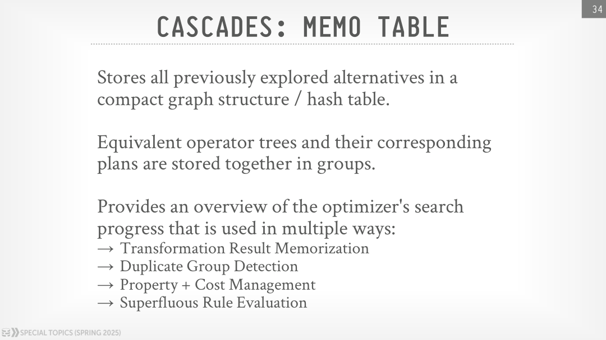

接下来讨论 memo 表。它是一个单独的数据结构，用来记录我们在查询计划中探索过的所有东西。现在我们还用它来记录查询计划中某个表达式或组所见过的最佳物理操作符。

memo 表的具体实现取决于你想做什么。据我所知，CockroachDB 在旁边有一张单独的哈希表，用来维护 memo 表。对于 SQL Server，据我了解，组本身会维护 memo 表的信息。因此 memo 表隐含地嵌在组里面，你维护的是树的组数据结构。

我想最初的 Cascades 论文讨论的是图数据结构，但据我所知，大多数人只使用哈希表。它提供优化器在优化查询时进度的全局视图。

我们记录从逻辑到物理所做的所有转换，这样就不会一遍又一遍地重复做同样的事。同样，如果某个任务展开表达式生成了一个新组，而这个组的输出已经存在于查询计划，抱歉，存在于 memo 表中，我们就知道不需要进一步探索。

如果有基本上做同一件事的子查询，这会很有用：不必把它们分别当作独立查询来优化；如果发现 memo 表的组中已经出现过这种子查询表达式，就不必进一步展开。还会在向下遍历时跟踪所有属性和代价。

论文还提到可以维护一个位图，记录之前是否对这个组应用过某条规则。如果没有，就应用；如果已经应用过，我能在位图中看到，那就不要做。因为我们要避免浪费计算。

## 第 35 页：最优性原理

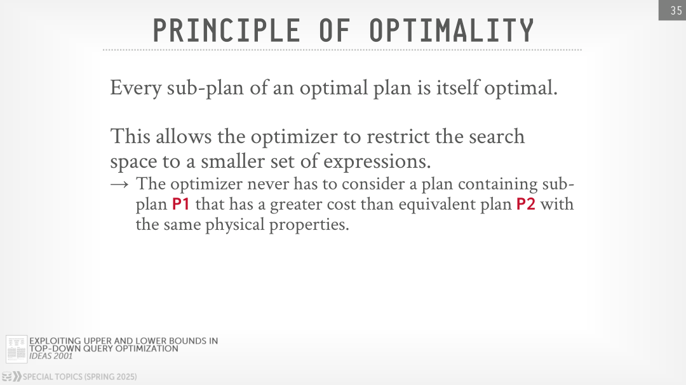

这不是 Cascades 特有的，Volcano 也有同样的性质，Starburst 和 System R 也是如此。这是 Bellman 的最优性原理。基本上，如果查询计划树中有一个子计划，而它是查询计划对应部分可能拥有的最优子计划，那么按照定义，最优计划必须包含这个子计划，否则全局最优就不是全局最优。

这有点像同义反复：子计划是最优的；如果全局计划是最优的，那么这个全局计划中的每个子计划都必须是最优的。

对我们而言，重要的是在搜索过程中向下遍历并展开组时，假设已经计算出某个全局代价，比如之前见过的最佳查询计划的代价。如果现在遇到一个组，计算它的代价后，当前正在构造的查询计划的代价超过了之前见过的最佳代价，我们就知道不需要再考虑其中的任何东西。这只是解释分支限界（branch-and-bound）如何工作的一种方式。

基本上，如果看到一棵子树，处于它的根部，还没有向下遍历，此时我们已有某个估计代价，而这个代价使总成本超过了迄今见过的最佳代价，就可以忽略它下面的所有东西。不会出现什么奇怪的曲线，让我们走进谷底，然后突然得到最优计划。事情不是那样工作的，它们会线性增长。

## 第 36 页：Memo 搜索示例

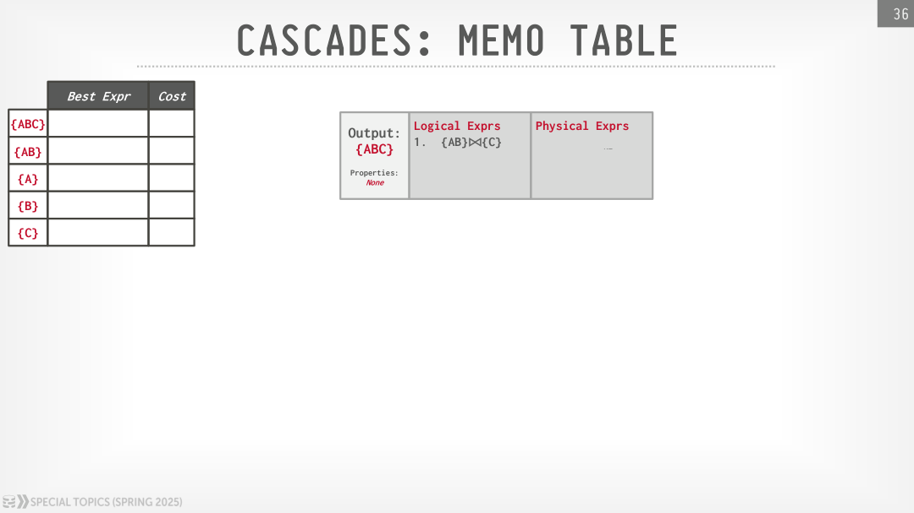

现在看一个简单的例子，看看搜索如何进行。我不会定义我们要做的任务，只会说明如何搜索、memo 表中会有什么，以及如何填充不同的组。

假设还是之前的查询，要连接 A、B、C。最开始我们只有这里这个组，它由绑定器在第一阶段结束后提供。没有逻辑表达式，也没有物理表达式；我们唯一知道的是，输出需要是连接在一起的 A、B、C。

我们应用的第一条规则基本上会问：为了产生所需的输出，我可以有哪些不同的逻辑连接顺序？假设第一个是 A 连接 B，然后把结果与 C 连接。同样，逻辑表达式中有花括号里的占位符，它们表示我不知道如何连接 A 和 B，也不知道如何访问 C，但这里有占位符。我知道会到下方去查看组，由它们提供我需要的输出，填入这个逻辑表达式。

假设根据 promise，我们决定更愿意探索如何连接 A 和 B，而不是在树的这一点迭代或枚举所有可能的连接顺序。因为逻辑表达式此时没有代价。我可以像 Volcano 那样展开它们，但实际上对我没有帮助。我想先得到某个东西的代价，至少先得到一个初始计划。它可能不是最佳计划，但至少有个东西，可以计算代价，然后帮助我做需要的剪枝。

在 Volcano 中，你会在去下方的任何其他位置之前，先列出 A、B、C 连接的所有排列。

## 第 37 页：展开 A 与 B 的组

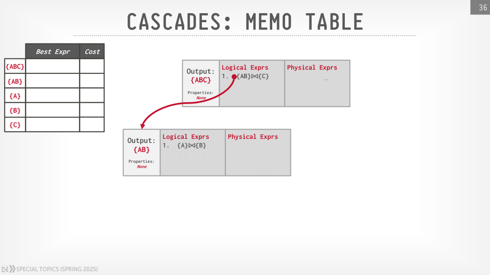

现在下方有一个组，它根据第一个组中的占位符连接起来。这个组会产生 A 连接 B 的输出。同样，我可以应用一条逻辑规则，生成一个表达式：取某个组输出的 A 的值、A 的元组，再把它和下方某个提供 B 的元组的组连接。

## 第 38 页：展开 A 的组

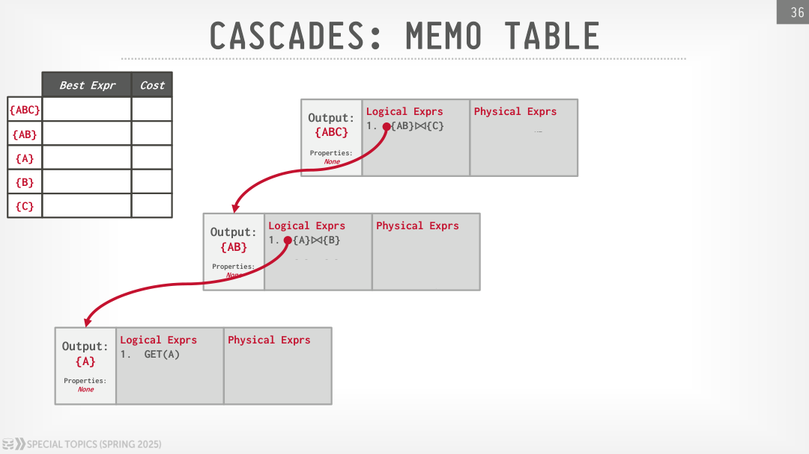

同样，我不在这里展开 B 连接 A，而是继续往下走，来到查询计划的底部。这个组会产生 A 的输出，而我唯一的逻辑表达式是 `GET(A)`：给我 A 的元组，没有别的。

## 第 39 页：A 的物理表达式

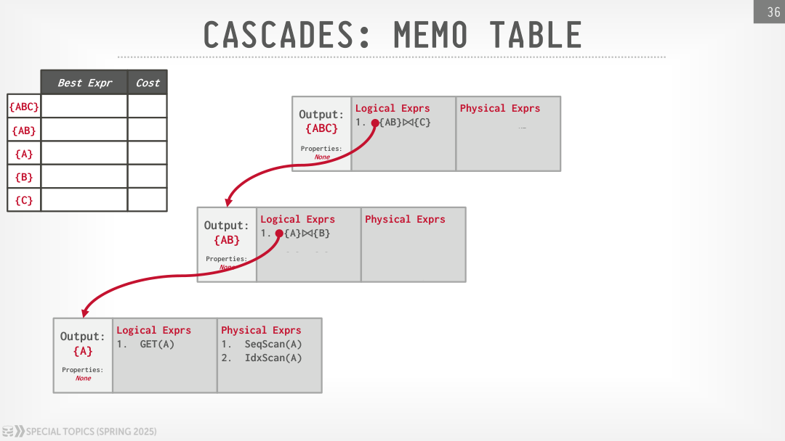

现在应用规则，把 `GET(A)` 逻辑表达式转换成可能拥有的两个物理表达式：对 A 做顺序扫描，或者对 A 做某种索引扫描。此时有了物理表达式，而且它们没有输入，没有东西送进来；它们就是访问表的基本访问方法，使用索引或者顺序扫描。所以现在可以计算它们的代价，选择哪一个更好。

## 第 40 页：记录 A 的最佳计划

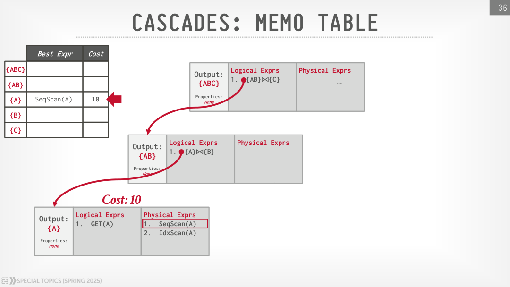

假设索引不是好主意，而顺序扫描更好。那么在搜索的这一刻，我选择顺序扫描作为该组最佳的物理表达式，它的代价是 10。我们之后会讲如何计算代价，现在先假设是 10。

然后在 memo 表中，对于 A 组，也就是第一列里看到的组，我会记录产生该组所需输出的最佳物理表达式：选择了顺序扫描，代价为 10。

## 第 41 页：展开 B 的组

现在我回到上面的组，查看连接的另一侧，做同样的事：能得到的最佳表达式是什么？探索能够产生 B 的元组的那个组的最佳表达式。

第一步，一条逻辑规则说：你想要 B，那就 `GET(B)`。这就是逻辑操作符。

## 第 42 页：B 的物理表达式

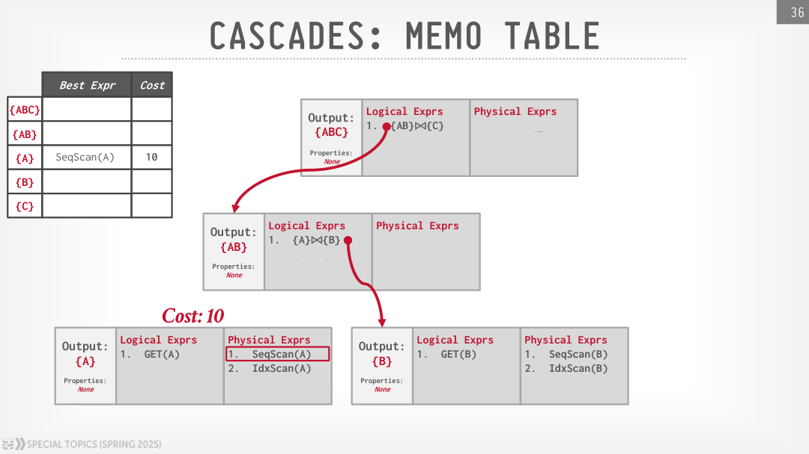

然后应用另一条实现规则，可以对 B 做顺序扫描，也可以做索引扫描。假设这次仍然是顺序扫描更好，代价为 20。

## 第 43 页：记录 B 的最佳计划

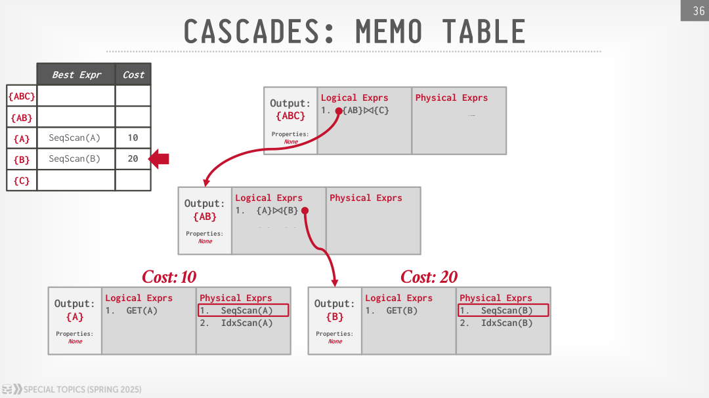

我更新 memo 表，记录对于产生 B 的输出的组，最佳物理表达式是 B 的顺序扫描，代价为 20。

## 第 44 页：交换 A 和 B

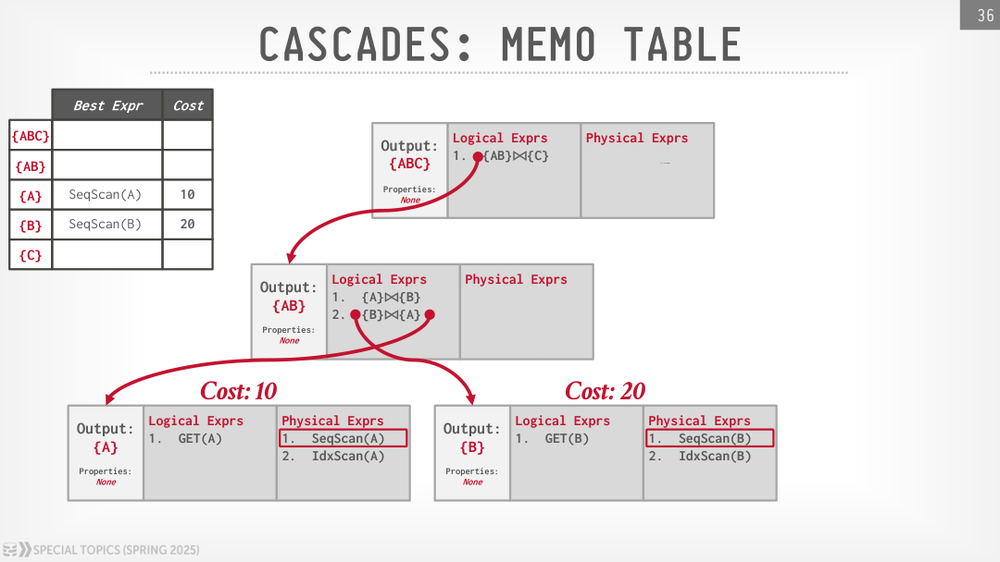

然后我回到这里。此时我知道已经探索过下面如何获取 A 和 B。根据 promise，我可以说，与其看 B 连接 A，也许我想先看要使用什么物理算法、什么物理连接算法。你的 promise 可以做到这一点。

或者这里，如果我确实做了交换，它的代价很低，因为这只是一个逻辑表达式。现在我需要评估这个新的逻辑表达式，需要获取 B 的元组，但我已经做过了，已经到下面去过了。我现在可以查 memo 表，说：哦，我已经有 A 和 B 的最佳物理表达式。

## 第 45 页：复用已有结果

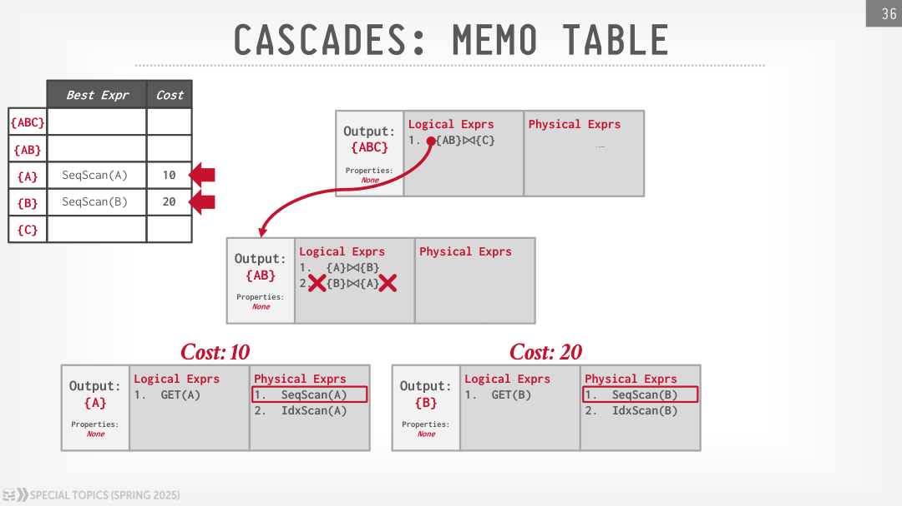

所以实际上不需要重新探索，已经完成了。memo 表提供结果，让你避免冗余计算。

## 第 46 页：选择连接算法

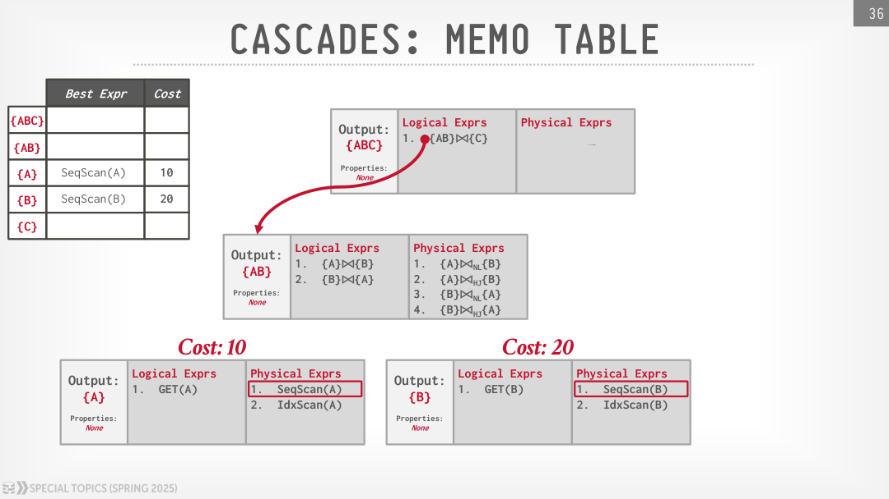

我们不再重新探索，而是使用实现规则，用实际想要的物理算法替换逻辑连接操作符。我可以对 A 连接 B 或 B 连接 A 使用嵌套循环连接、哈希连接，等等。

现在对于所有这些选择，都可以开始计算代价，因为我知道输入的代价，也对基数、上来的元组数量有一个近似值。接下来根据实际使用的连接算法，做教科书里的连接代价计算；导论课里有简单形式的计算。然后就可以选择这些连接算法中效率最高的一个。

## 第 47 页：记录连接代价

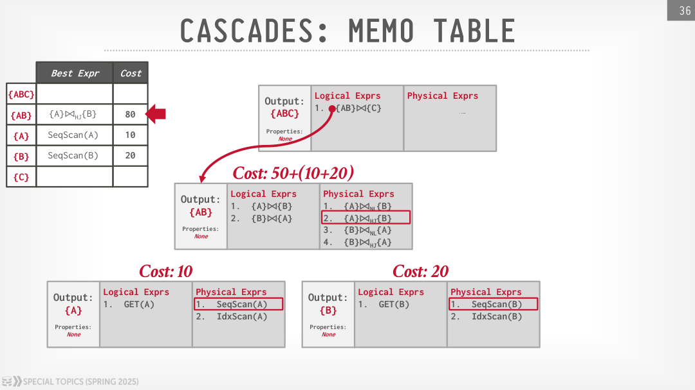

这个组的代价就是这里实现的物理操作符的代价，也就是连接代价，加上从下方获取数据的代价。我们把它放进 memo 表。

## 第 48 页：展开 C 的组

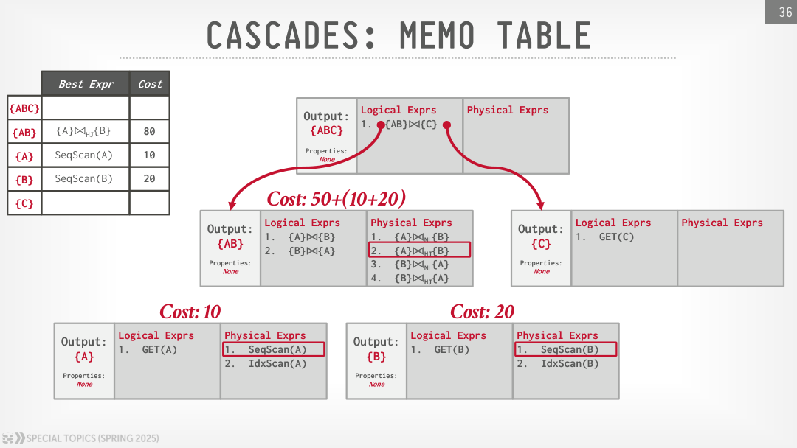

然后我回到顶部，现在想看看如何访问 C。同样，要看逻辑表达式，然后选择顺序扫描或索引扫描。

## 第 49 页：记录 C 的最佳计划

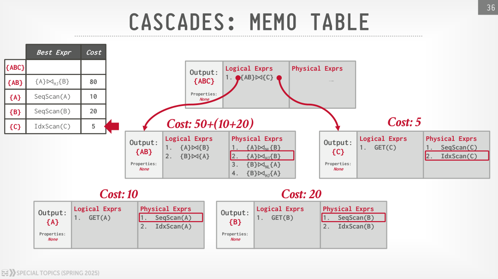

假设现在索引扫描更便宜，代价为 5，我把它填入 memo 表。

## 第 50 页：完整计划的候选表达式

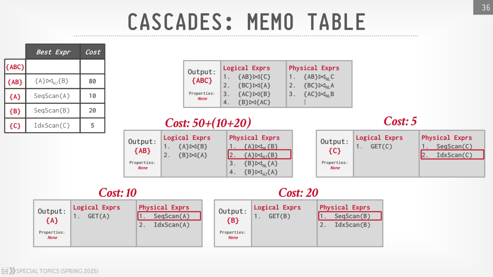

现在可以计算这个查询计划的总代价。在探索其他连接顺序之前，它可能不是最优的，但至少此时把结果反馈上去后，我有了可以执行的物理计划，也有了代价。

## 第 51 页：记录完整计划

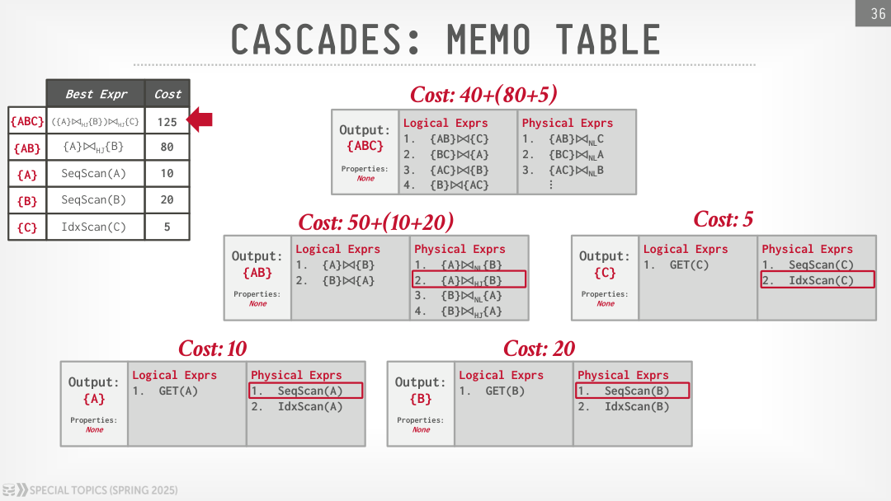

现在我也许想触发规则，进一步探索连接顺序、连接算法等，也许会找到某个不太显眼但代价更低的计划。但至少此时我知道，如果超时、不能继续探索，我有一个实际可以运行的物理计划。

请说。你的问题是，回到这里，假设有一个属性要求按 A 排序。当我走到这里，假设 A 的索引扫描满足排序属性，那么就不允许考虑顺序扫描，因为元数据要求送到我的数据是排好序的。

我们从顶部开始，因为输出必须有序，这个要求会向下传播。强制规则基本上会说，不要把 `GET(A)` 展开成 A 的顺序扫描，因为如果数据没有按我需要的方式聚簇，它就不满足这个属性。所以它甚至不会作为一个需要考虑的物理表达式展开出来。

对，那会怎么工作？如果我确实想做顺序扫描，怎样仍然执行顺序扫描，再注入一个 `ORDER BY`、快速排序之类的东西？那只会是另一条规则。你可以说，如果确实想做顺序扫描，就再创建一个负责 `ORDER BY` 的组，再把它链接到下方负责查找 B 的组。这样，输入 A 可以经过排序的那个组，也可以经过基本的那个组。还有问题吗？

当你应用规则时，它们可能产生其他表达式，也可能产生其他组。这里会发生链接；我画出了线，但实际上 memo 表可以跟踪：对于你想要的输出，比如需要表 A，这里是目前见过的所有能够提供它的组。你是在把穿过查询计划的路径拼接起来，不同的计划实例可能有所不同。

但你会记录所有东西，不会删除组。这与我们在查询图模型中看到的重写不同：Starburst 从一个查询图模型转换成另一个时，会丢弃旧的，因为那是单向转换。在这里，你会记录所有东西。

在 Volcano 中这很糟糕，因为你会记录那些自己甚至还没来得及探索的东西；而这里，除非我要继续探索一个组，否则不会在系统中创建并记录它。

## 第 52 页：搜索顺序与其他优化

正如我之前说的，promise 让我们能够在搜索过程中更快地针对可能更有收益的转换。它与代价或目标函数是分离的，EXODUS 并非如此。我们可以利用 promise 机制，手动引导搜索机制更快考虑我们认为更有收益的转换。

这也是实现类似 Starburst 重写的另一种方式。如果把某个东西的 promise 设为无穷大，更高的 promise 意味着它比其他东西更有可能被选中。如果把一堆东西设为无穷大，它们就会立刻触发。这等价于 Starburst 中“这些是我总想在最开始应用的规则”。

这很好，但系统实际工程实现和设计的整体灵活性，还会带来其他在其他系统中不容易做到的优化。它们不会改变搜索算法的渐近复杂度，但在实践中，在实际实现中，可能减少搜索时间，缩短找到好查询计划所需的时间。

## 第 53 页：简化规则

第一个优化来自微软的书。我不认为 Cascades 论文讨论了这个，我不记得它讨论过。正如刚才说的，在探索查询计划中的组时，我们记录之前见过的所有组。但在某些情况下，我知道自己总想应用某个优化，那就不要保留旧的东西，基本上和 Starburst 的做法一样。

我知道自己总想做谓词下推，那么为什么要保留没有做谓词下推的旧查询计划、旧查询图模型？这只是在浪费空间，维护我不需要的状态。

在 SQL Server 中，可以为规则指定：应用转换时删除旧的表达式。然后在位图中记录是否已经应用过这个转换，避免反转回先前的形式。

再说一次，这只是工程优化，不会让算法运行得更快，只是减少实际实现所需要的资源。

## 第 54 页：宏规则

另一种超出最初 Cascades 描述的规则是宏规则。这就是我之前说的微软优化：允许你在一条规则内做多阶段转换。

Volcano 原本规定的是，你有所有这些独立转换，把它们放在一起，然后算法自然会找到它们。他们说，不，有些事情你总想一个接一个地做，那就定义一条能够完成这些事情的宏规则。这样可以减少搜索空间的复杂度，或者说减少算法必须考虑的转换规则数量，使运行更高效。

他们没有分析这实际有多大帮助，只是说 SQL Server 里这么做。

## 第 55 页：并行搜索

最后一个非常重要，但现在不会讲太多细节，因为我们会在第 16 和第 17 讲用整整两节课讨论它。现在我不再依靠遍历查询计划的线程来记录自己位于计划的什么位置，因为有一个单独的专用任务队列，所以可以让多个工作线程并行执行搜索优化。

最开始，正如之前展示的，你从什么都没有开始，只有一个组，然后向下逐步构建组。因此一开始基本上会是单线程，没有什么魔法能让它并行。但开始展开已有表达式后，就可以让不同线程沿树的不同分支进行探索。

memo 表记录系统的全局状态，所以每次更新它时，你都知道迄今见过的最佳代价。线程可以检查它，判断是否需要剪掉正在看的分支。当然还必须确保任务之间的依赖关系得到满足；你不希望上面的事情还没做，就去优化树下方的东西。

但现在你可以让多个线程并行搜索。据我所知，唯一真正实现多线程 Cascades 的是 Greenplum 的 ORCA；这学期稍后我们会用一整节课讲它，我马上也会提到。据我所知，SQL Server 是单线程。CockroachDB 是开源的，你可以去看，它是单线程。Calcite 不是 Cascades，但它也是单线程。

所以，是的，Cascades 的任务队列使并行搜索成为可能，但大多数人实际上没有这么做。它肯定比 Volcano 和 EXODUS 更容易，我认为可能也比 Starburst 容易，但从工程角度看仍然很有挑战。

我猜 SQL Server 没这么做的原因是，他们在 90 年代开始构建 Cascades 优化器时，大概是 Pentium 4 时代，也许更早。那时只有一个 CPU、一个线程。直到 2004 年或 2005 年左右，像 Intel 的 Nehalem 架构，他们才开始放入更多核心。Sun 有 Niagara。多核 CPU 是一个古老的想法，但直到 2000 年代才真正在商业世界中更普遍。

所以，回头改造已经在生产中运行、为你赚取几十亿美元的现有代码库，重写并使其并行，可能是他们不愿承担的风险。几周后我们会更详细地讨论自顶向下和自底向上的搜索。

## 第 56 页：Cascades 的实现

正如我说的，并不存在一个唯一的代码库，可以说这就是 Cascades 优化器的实现。SQL Server 的实现是他后来在微软帮助设计和构建的。90 年代还有另外几个项目，我已经提过 Columbia，Goetz Graefe 在论文委员会里。威斯康星大学有一个叫 OPT++，我想它是 Jignesh 读研究生时的室友写的。

我们讲过 Greenplum，马上还会再提。还有我们在 CMU 尝试构建的 optd：第一个实现或多或少是 Volcano，然后我们把它扔掉了，现在改用 Cascades。

还有许多商业实现。Tandem NonStop SQL 有一篇 90 年代的论文描述它的做法。这是 Jim Gray 离开 IBM 后帮助构建的并行数据库。他在 70 年代末、80 年代初离开 IBM，有竞业限制，不能去做另一个数据库系统。于是他去了一家叫 Tandem 的公司。他们有叫 NonStop 的服务器，可以想成高度冗余的并行硬件：比如两颗或三颗 CPU 执行同样的计算，以防其中一个失败。类似航天飞机上的东西，但用于银行等场景。

不过在 80 年代，他们最终构建了一个并行分布式数据库系统 NonStop SQL。Jim Gray 的竞业限制结束了，所以他参与了这项工作。他们构建了 Cascades 优化器。

Clustrix 是 2000 年代的一家初创公司，来自 AOL，后来被 MariaDB 收购。它改名叫 Expand SQL，已经不叫 Clustrix 了，叫 Expand SQL 或者某个蠢名字。但它的文档提到了 Cascades 优化器，你看不到它的实现，它从未开源。

我们提过 CockroachDB，它的 Cascades 优化器是单线程的，由 Stonebraker 的一位前博士生用 Go 编写。Snowflake 有 Cascades 优化器。它和 Databricks 做的事情有些类似：由于它们要在数据湖上运行，统计信息可能不准确或者根本没有统计信息，所以不会对查询计划做完整转换，而是尝试把某些优化决定推迟到运行时。我们这学期稍后也会讲这种自适应的东西。

所以它还是 Cascades，你最终仍然会得到可以执行的完整物理查询计划，但其中某些东西有占位符，之后可能再做决定并修改它。

## 第 57 页：Microsoft SQL Server

SQL Server 的实现非常有意思。回到这里，对于 SQL Server、CockroachDB、Snowflake、Databricks，我想还有 Oracle，这些链接会带你去 YouTube 视频，因为我们邀请过所有这些人来我们的研讨会做报告，有些还来了好几次。

其中 SQL Server 的报告可能是我一生中看过的最好的报告之一。以前的 15-721 课程中，因为 Cascades 论文虽然可以读，却帮不了你太多，我指定的阅读材料就是看这个视频，因为它太棒了。他们讲了很多不同的事情，其中一些我马上会讲。强烈推荐。

他们不会真正描述算法，而是讲他们如何调整 Cascades，以适应自己关心的工程优先事项。我们会在第 5 章看到一些优化，你们读的第 2 章也提到了一些；实际上还有第 4 章。不过那个报告讲了各种各样疯狂的东西，太棒了。

SQL Server 在 1995 年开始了第一个 Cascades 实现。SQL Server 中最初有一个 Cascades 代码库，因为它是如此出色的查询优化器，后来微软推出不同的数据产品时，就把代码分叉，为数据仓库版本或他们构建的其他内部数据系统做修改。它们都大致使用同一个 Cascades 优化器。

我们这学期最后要读的论文讲的是统一查询优化器：他们基本上不再维护这些不同的分叉，而是把它们合并回一个代码库，然后为需要支持的不同系统提供各自特定的规则。我觉得这显然是个好主意。

所有东西都用 C++，没有 DSL。论文没有真正……书里没有真正讨论这一点。最初的 Cascades 论文说，不用 C 或 C++ 编写规则，而是用高级语言、DSL 来写，再编译成 C 或 C++。Cockroach 某种程度上这样做，但微软没有。所有东西都是过程式代码。

他们会根据查询的复杂度分多个阶段应用转换。这个做法又有点像 Starburst，尽管我之前讨论了统一搜索与分层搜索。虽然 Microsoft SQL Server 是 Cascades，但它采用的这种多阶段方法有点像 Starburst：有些转换总是希望应用，甚至可能不需要代价模型，但这些转换会为之后的代价搜索做好准备，使它更快找到好的计划。

不同于我们在 Volcano 和 Cascades 中看到的可能会自动学习某些规则应该很早应用，他们说：我们不做这些，我们是数据库领域的人，拿很多钱。他们基本上会手动挑选希望在这些不同阶段应用的转换规则。

## 第 58 页：SQL Server 的多阶段优化

第一阶段只做简化和规范化。想法是把一棵逻辑树转换成另一棵逻辑树。这些就是我们在 Starburst 中讨论过的总是想做的事情：谓词下推、空结果剪枝。如果一个子查询是 `SELECT * FROM table WHERE false`，你知道它不会产生结果，就把它扔掉，忽略它。

子查询消除，我们不会在这里讨论。实际上，下周一你们读转换那一章时，我让你们不要读他们如何处理子查询，因为我们会看到德国人怎么做，那才是正确的做法，我们稍后会讲。还有外连接转内连接等，都是希望一开始就非常快地完成的事情。对于非常简单的查询，这些可以在几毫秒，甚至更短的时间内完成。

然后有一个叫预探索阶段的准备过程。它不是基于代价的搜索，更像是在为基于代价的搜索做准备，比如丢弃无用计划、规范化投影。

他们做的一件有趣的事是，如果开始查看逻辑计划时发现没有所需要的统计信息，或者之后做代价搜索时会需要这些信息——代价模型基于系统目录中的统计信息，但目录里没有——他们实际上会在这里停下查询优化器，告诉数据库系统：我没有需要的统计信息，现在去运行 `ANALYZE`。等 `ANALYZE` 完成，再把控制权交回查询优化器。

MySQL 的做法有点类似，但不是去获取统计信息。如果有子查询，他们不尝试用德国人的方式重写，而是把子查询拿出来实际执行：阻塞查询优化器，去执行子查询，递归调用优化器，运行查询，然后把这个嵌套查询的输出反馈给正在优化的查询。这不是正确的做法，是错的，我们稍后会讲。如果没有统计信息，让系统去获取统计信息实际上是个好主意。

Databricks 和 Snowflake 无法做到这一点。这就是为什么我说它们会尝试延迟确定查询计划：如果 S3 上有一堆你从未见过的 Parquet 文件，没有人愿意在上面运行 `ANALYZE`，因为总得有人付钱。Snowflake 不想付，客户也不想付。因此他们会把一些决定推迟。在这个版本的 SQL Server 中，他们假设运行的机器上有数据，那就直接运行 `ANALYZE`。

然后进入探索阶段，在这里进行基于代价的探索，把逻辑表达式转换为物理表达式，就像之前展示的那样。但他们实际上把它分成多个阶段。

第一阶段预先声明允许应用哪些规则。比如非常简单的 `SELECT 1`，实际上 `SELECT 1` 会在这里被丢弃；但对于可以搜索的查询，例如按主键查找表中的数据，就在最开始完成这些转换。

这有点像 promise：阶段结束时检查还剩多少时间，如果还有时间，而且认为可以找到更好的查询计划，就允许进入下一阶段。下一阶段基本上做同样的事，仍然进行逻辑到物理的转换，并依靠上一阶段见过的最佳物理计划来截断查询搜索树，但现在允许应用更多规则。

特别是，现在可以开始考虑并行查询计划，引入 exchange 操作符，让多个线程扫描数据。优化器中的查询搜索不是并行的，但查询计划可以是并行的。

那个阶段结束时，如果仍认为有进一步改进的可能——他们如何估计这一点，就是这里的黑魔法——就允许进入完整计划阶段。有些查询甚至不会超过第一阶段，第一阶段完成后就结束；但真正复杂的查询会经过全部三个阶段。与此同时，他们会允许触发更多规则。基本上，不再把 promise 设成负零，而是设成某个实际值，然后优化器就可以选择触发这条规则。

完成后还有一个阶段，针对实际运行的目标引擎进行所有优化。SQL Server 有不同版本，有并行版本，比如数据仓库版本，现在还有 Fabric、Synapse 等。我们这学期稍后会讲。如果我知道自己运行的是分布式 SQL Server，就取这里第三阶段产生的单节点计划，基本上再对它做一次 Cascades，但这次在不同节点的查询计划之间引入传送操作符、发送和接收操作符。

请说？对，这些……如果没有想要的东西，就通知别人；或者连接合并，可以在逻辑上完成。不，promise 告诉你应用规则的顺序，代价告诉你计划实际上是不是个好主意。你仍然需要两者。不过你可以不使用 promise 来运行 Cascades，只是顺序会是随机的，这不好。那就只是 Volcano。对，就是 Volcano。但你仍然需要代价，才能判断这是我能拥有的最佳物理计划。

按照我的理解，他们描述的做法基本上是源代码中有一个文件，列出允许应用的规则，然后把它作为 Cascades 搜索的输入。使用 promise 的另一种做法是把规则的 promise 设为负无穷，使它们永远不会被选中。等到了某个阶段，如果想把它们包含进来，就把它们设为某个实际值。

## 第 59 页：SQL Server 的优化

我们之前讨论过 SQL Server 的第一个优化：不以实际经过的时间设置超时。回到这里，这个过程可能运行好几个小时；他们按照已应用的转换次数设置超时。

除了可能需要运行昂贵的 `ANALYZE`，前两个阶段基本可以瞬间完成，昂贵的是这里。如果我知道自己已经应用了 1000 次转换，而这就是我的预算，就在那里终止。

这比按实际时间更好。他们说，这能保证无论系统负载高还是低，对于给定查询，数据库系统总能产生相同质量的查询计划。因为如果系统非常慢，我给它一个查询优化，而它因为时间预算不得不赶快结束，生成一个糟糕的计划，那会是很差的体验。

另一个很酷的做法是，在之前所有例子中，我展示的都是 memo 表一开始完全为空。SQL Server 有大量逻辑，使用启发式方法预先填充 memo 表，放入他们认为应该考虑的东西。

对于简单查询，比如按主键查找，我会提前把它作为 memo 表里已有的最佳物理表达式。这样我甚至不必费心去探索，因为我知道它对我来说就是最好的。再说一次，这是丢掉计算，或者说让原本寻找最佳查询计划的原始探索过程提前结束的一种方式。

## 第 60 页：Greenplum ORCA

我不会花太多时间讲 Greenplum，因为我们会读一整篇关于它的论文。正如我说的，这是一个独立的 C++ Cascades 实现，最初为 Greenplum 和 HAWQ 编写。Greenplum 是 Postgres 的分布式版本，在 2000 年代分叉出来。HAWQ 基本上是他们的 Hive 版本，也就是 MapReduce 或 Hadoop 上的 SQL。

他们没有为两个系统分别构建查询优化器，而是把 ORCA 构建为独立服务，可以接收两个系统的查询。我觉得这是个非常好的主意。正如我说的，它是我知道的少数能够进行多线程搜索的实现之一。

使用 ORCA 的方式，与项目一中设置 Calcite 的方式相似：它有一个 API，你向它提供大量 XML，描述系统目录、统计信息和逻辑计划，它就为你搜索物理计划。

它在 2010 年代开源，不过这里的情况比较复杂。Pivotal 从 EMC 和 VMware 分拆出来，之后又被 VMware 买回，然后 Broadcom 收购 VMware，Broadcom 在 2024 年把所有东西闭源。所以尽管旧版本还在，开源版本已经不再积极维护，令人失望。不过我们还会更详细地讲。

## 第 61 页：CockroachDB OptGen

CockroachDB 是另一个有趣的例子，由 Stonebraker 的前学生在 2018 年定制编写。正如我说的，与 SQL Server 和其他实现不同的是，他们有一个自定义 DSL，叫 OptGen。这里的链接会带你到 GitHub 页面，我直接给你们看一下。

## 第 62 页：OptGen 规则

这里的 DSL 定义了匹配规则等内容，然后编译成 Go，再链接到程序中。这就像我们在 Volcano 中看到的想法：把规则生成 C 或 C++ 代码，比解释执行快得多。据我所知，Cascades 原本没有这样做；ORCA 也没有，但 CockroachDB 里有。

不过仍有后备机制。如果你不能完全用 DSL 表达规则中想要的逻辑，或者转换本身，可以放入原始 Go 代码。

## 第 63 页：最后的想法

好，快速收尾，因为我想快速讲一下项目一。我喜欢 Cascades，因为我觉得它更清晰：我能想明白查询优化器实际上在做什么。当然，魔鬼在细节里：怎样实现 promise、怎样决定规则触发顺序，以及怎样进行并行搜索，都更加复杂。但对我来说，与 Starburst 的 LOLEPOP、STAR 和其他东西相比，这似乎是更清晰的查询优化模型。我们之后还会看到其他做法。

当然，查询计划的准确性，或者说质量，可能高度依赖统计信息和代价估计。恰好 SQL Server 拥有一些最好的统计信息和代价估计，所以比较它与其他系统的查询计划时，它们经常表现更好，或者基数估计更准确，因此查询计划往往更好。

但我认为这更多和……究竟有多少可以归因于他们实现的 Cascades 搜索，有多少归因于代价估计，还有待观察。德国人不喜欢自顶向下搜索，他们全力支持自底向上搜索。我们会看到他们如何做连接枚举，我想实际上是下周。

关于 Cascades 还有问题吗？我要快速讲一下项目一。

## 第 64 页：项目一

这次的计划是实际使用一个查询优化器服务。我们使用 Apache Calcite，这学期之后会读它的论文。欧洲曾经有一个叫 LucidDB 的项目，是一家失败的初创公司。然后不知出于什么原因，他们把 LucidDB 中构建的查询优化器拿出来，做成了名为 Calcite 的开源项目。

你们要开始使用 Calcite 的一些规则处理 SQL 查询，看看它应用的转换规则如何改善性能。运行 SQL 查询有两种方式：一种是在 DuckDB 中运行优化后的形式，另一种是使用 Calcite 自带的执行引擎来运行查询。然后比较它们的结果，检查结果是否正确。

## 第 65 页：项目任务

我们提供了启动并运行 Calcite 的入门代码。它是 Java，所以抱歉。想法是，你要使用 Calcite 提供的接口，打开和关闭规则，填入统计信息等等。你要开始使用 Calcite，看看 Calcite 应用这些规则时查询如何变化。

它会再次输出 SQL，所以你不会得到一个整洁的计划。我们之后可以讨论。我们确实尝试过用某个东西生成并运行查询计划，它叫 Substrait，但没有成功。所以这是 SQL 到 SQL，不过你仍然可以看到它做了什么。

在 DuckDB 上运行查询时，必须确保使用 `disable_optimizer` 选项。它基本上会采用解析器和绑定器输出的几乎原样的逻辑计划，不再运行额外的优化。这样你就知道运行的是 Calcite 给出的查询。

对，但这只是输入 SQL 查询的一个转换。对，它没有做基于代价的搜索。

## 第 66 页：开发提示

好，Wan 为大家写了漂亮的入门说明，照着做就行。注意愚蠢的表名大小写敏感问题。标准规则库不包含针对特定操作的规则。这又是怎么回事？对，Calcite 基本上有规则分组，类似我们在 SQL Server 中看到的；默认情况下它们并非全部启用。谢谢。之后我们也可以再讨论这个。

## 第 67 页：项目注意事项

这里还有更多说明。再说一次，这是 Java。我们已经尽力让它简单一些，也打包好了环境。然后你们要在 Gradescope 上提交，Gradescope 基本上会运行……想法是检查，目标是看看你能否让 Calcite 生成的查询与 DuckDB 查询优化器生成的查询运行得一样高效。

因为 DuckDB 查询优化器实际上很好，它基于德国人的那个，我们之后会讲。好吧？我讲得很匆忙，抱歉。不过我们可以在 Piazza 上回答你们的问题。

## 第 68 页：下节课

下节课我们更详细地讨论转换。之前我们总是在说：哦，对，交换律，交换连接顺序。接下来要讲实际希望应用哪些转换来优化查询。阅读第 4 章中除子查询之外的所有内容，我们会用整整一节课讨论如何正确处理子查询。

和这节课一样，你们不需要提交阅读摘要，因为读的是教科书，而不是论文。好？谢谢。
