+++
title = "CMU 15-799 第 6 讲：查询计划转换"
date = 2026-11-20T00:00:00+08:00
slug = "06-transformations"
showTableOfContents = true
summary = "结合课程幻灯片和课堂讲稿，介绍查询优化中的转换规则。"
tags = ["查询优化", "CMU 15-799"]
categories = ["数据库系统", "计算机技术"]
draft = false
+++

[观看课程视频：Transformations](https://www.youtube.com/watch?v=oyi02nNjU-o)

## 第 1 页：课程开场

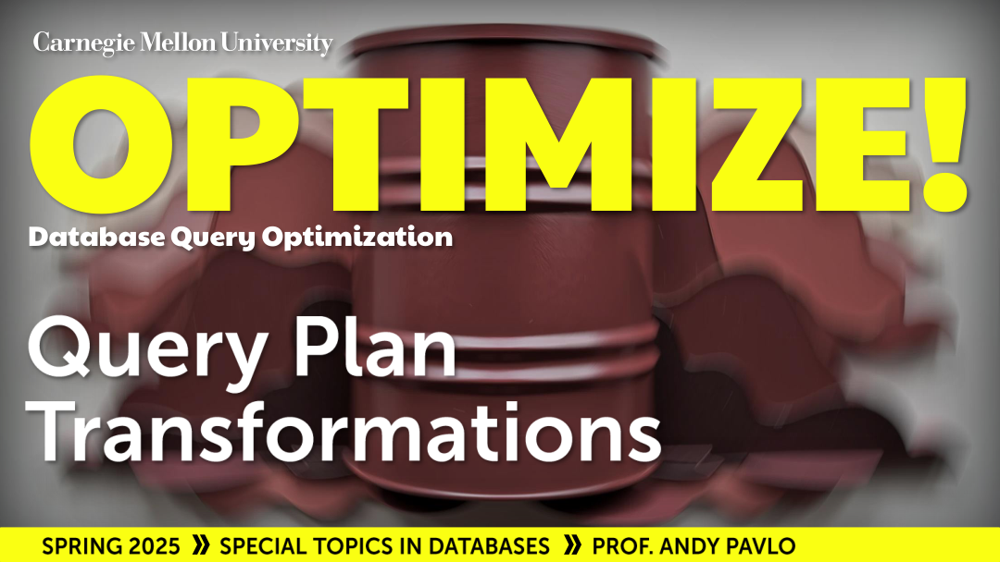

《Optimize！》：一段数据库查询优化之旅。本课程在卡内基梅隆大学现场录制，现场有听众。

今天我们要讲计划转换。我们再次回到如何构建优化器的整体视图，我马上会讲到这个。现在我们要进入查询优化器的内部，谈谈如何真正实现它们、优化它们，也就是优化优化器，让它高效地运行。

## 第 2 页：课程安排

在开始之前，给选这门课的同学说一下：本周三，也就是 5 号，我们继续在 Zoom 上讨论论文评阅。你们要读一篇关于 Hyper 和 Umbra 系统如何进行连接枚举的论文。有些人提交了课程笔记的 PR，Wayne 和我这周会看，然后开始给大家记分。项目一的截止日期是 28 号星期五。如果还没开始，请开始做。

关于论文评阅、笔记或项目一，有什么问题吗？昨天你们应该收到了我的邮件，里面是对你们评阅的一个评估。如果你低于那个水平，可能就需要多写一点，就是这样。是的，我们确实会读。有人说 Andy 不读这个，我们会发现的。不过，要针对每篇评阅给出“这里完全理解错了”这样的具体反馈，论文和学生都这么多，我们确实做不到。

什么？看起来像不像 ChatGPT 写的？是或不是；你做了没有？是或不是。也是给你们自己一个参考。有些人写得太多，有些人写得太少，落在中间就好。

这毕竟是一门高年级研究生课，你能从中学到多少，取决于你投入多少。是的，这不是科学的评估。往年有人说，不知道自己写得太多还是太少，所以我们就给出这些统计数据。不会根据这个评分。这是高年级课程，“专题”这个词是有含义的：我们是来好好享受这门课的。好，我会把那句话消音。说到这里，我确认一下我确实在录制。嗯，好的。

## 第 3 页：即将举行的数据库讲座

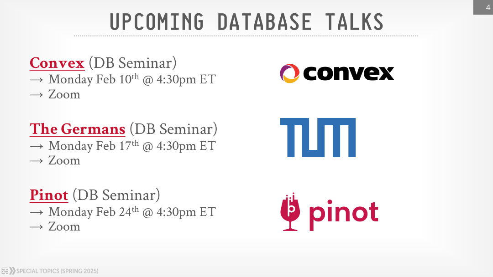

好的。学期开始时我提过，现在这学期的研讨会日程已经安排好了。这些都是可选的。如果你们想超出本课程的讲义，像我一样希望生活中有更多数据库，那就可以看看。

这学期的研讨会有两类。一类是 SQL 的替代品，或者构建在 SQL 之上的语言。这是一个相当新的现象：人们不再说 SQL 很蠢、要完全把它扔掉，而是在 SQL 上构建自己的 DSL。你用 DSL 写应用或者查询，它再被转译成 SQL，在数据库系统上运行。Convex 和 The Germans 会讲这个。我忘了 The Germans 的做法，但 Convex 会做转译。Malloy、PRQL、OxQL 是一批其他这样的 DSL；学期后面会有人讲到它们。

另一半研讨会是构建查询优化器的数据库开发者来谈他们实际如何实现优化器，也就是我们这门课正在讨论的东西。Pinot 会是第一个。StarRocks 的人会讲他们的查询优化器；MySQL 和 MariaDB 的发明者会讲 Redivis 的新优化器，那是在学期后面。

这些都是可选的。不过，如果想进一步了解课上讲的东西，我鼓励你们去看。关于优化器实现的讲座尤其好：到时候你们会听懂“我们是自底向上还是自顶向下”“我们如何做这个转换”“我们采用哪种枚举”。这学期讲的东西开始融会贯通，放到真实系统的语境中，你们也会发现我没有把这些东西全都编出来。

我们会把日程等信息发到 Piazza 上。

## 第 4 页：上节课回顾

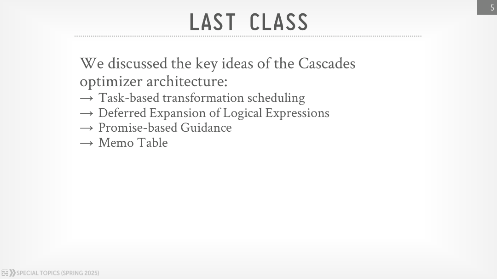

目前课程讲到哪里了？上节课我们花了一整天讲 Cascades。Cascades 是 Goetz Graefe 的 Volcano 的后继者。它基本上是 Volcano，但一个关键区别是没有分开的生成阶段和成本分析阶段。所有转换规则都放进同一个搜索空间，优化器可以根据它对查询的了解，以及我们加入实现中的额外指导或 promise 机制，自由决定规则的应用顺序：先进行转换，还是先处理物理规则，抱歉，我是说先进行逻辑到逻辑还是逻辑到物理的转换。我们用这些机制把查询优化器往正确的方向推一推。

另一个关键点是基于任务的转换：有各种任务可以应用规则、做不同的事情。至少在他们的实现中，这些任务被放到一个栈里，再从栈里取出来，而不是递归地一个接一个调用，进行深度优先搜索。为了避免一遍又一遍地重新计算同样的东西而导致爆炸，他们使用 memo 表。

Volcano 也有类似的东西，但 Cascades 中的做法更形式化、更严谨。

## 第 5 页：影响优化器质量的因素

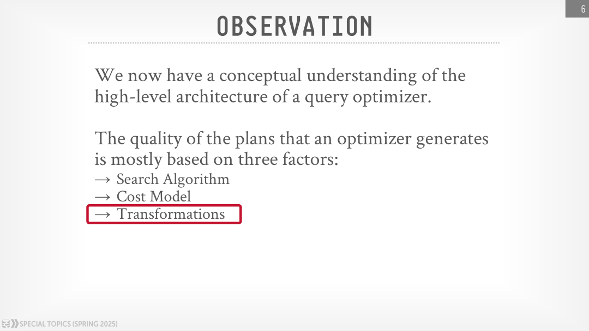

正如我一开始说的，这学期我们已经花时间讨论了 System R、Starburst、Volcano 和 Cascades 的优化器。它们基本上是构建查询优化器的高层架构，或者说蓝图。我没有把 Postgres 放进去，因为那东西像一团乱麻，就像一栋建立在稻草上的房子；据我所知，没有人坐下来为项目的长期发展想清楚 Postgres 优化器到底要是什么样。所以我不想把它算进去。

不过，Starburst 和 Cascades 是那些构建过多个优化器的人真正坐下来思考的结果：这东西应该是什么样，应该如何设计架构，既能扩展、添加对关系模型以外的东西的支持，也能长期维护和工程化，让系统开发者更容易添加新操作符。

现在我们知道了如何构建看起来像 Starburst 或 Cascades 的东西。这些优化器生成的计划质量取决于很多因素，接下来几周我们主要关注三个。第一是搜索算法，也就是如何枚举可能的替代查询计划，判断能否找到更好的计划；这涉及自顶向下和自底向上。第二是成本模型：如何根据统计信息和其他信息，预测一个查询计划或替代方案是否比另一个更好。这些信息可能来自 ANALYZE 阶段，也可能来自别人提供的提示。来源是否重要？其实重要，但我们之后会看怎么处理。显然，如果成本模型很差、统计信息偏差很大，其他东西再好也没用，因为我们最终会选到差的计划。

最后是转换，也就是今天要讲的。周三开始我们会回到第一项，讲搜索算法。如果我们无法识别当前查询是否有一个更好的替代计划，那么搜索算法和成本模型再好也没用。三个方面都需要做好，所以我要逐个讨论。

我们关心的是准确性和效率的结合。准确性是说，当我认为一个查询计划比另一个好时，我希望判断正确。效率方面，今天会稍微谈到，周三下节课一定会看到：如果搜索算法特别慢，成本模型、估计和转换再好也没用，因为我根本无法探索所有方案。同样，如果生成所有转换要花很长时间，可能也没有机会用到其他部分。这些因素相互依存，我们关心效率与准确性的结合。

## 第 6 页：转换

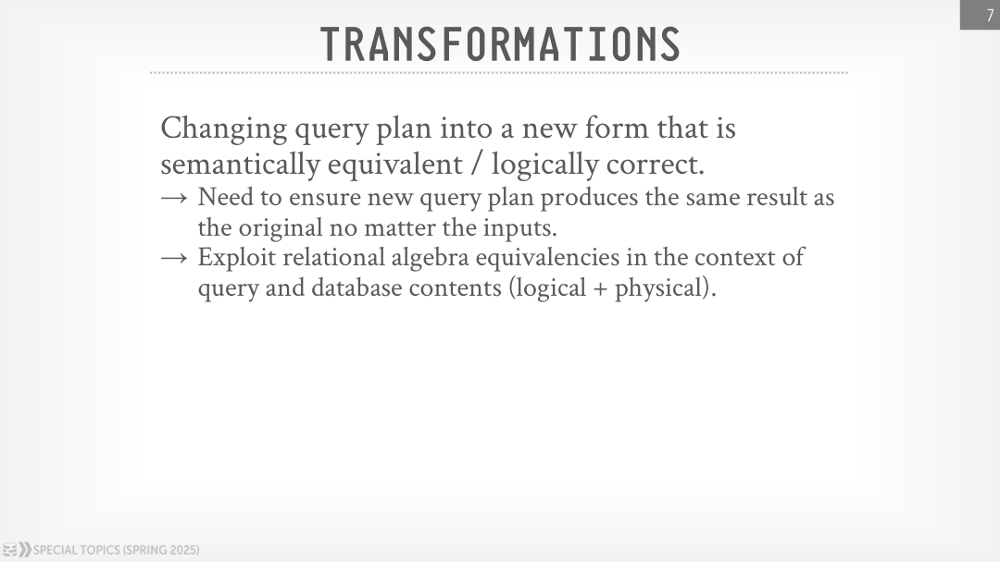

我们已经多次定义过转换，不过现在把它放到一张幻灯片上，作为后面讨论的依据。我们希望查询优化器有一种机制，能够把当前正在优化的查询计划变成不同的形式、结构或形状；新的形状要与原来的查询计划在语义上等价、逻辑上一致或者说正确。

有时一项转换可能让查询计划进入无效状态，使结果不正确。如果我们知道必须立即再应用一条规则才能保证正确，那么就应该把它们组合起来，形成 Cascades 那一章所说的宏规则。应用一项转换之后，总要得到正确的查询计划，因为搜索过程可能就在那个地方被截断，甚至没有机会再进行修正。

我们要依靠对所构建系统的领域知识，以及我们知道的关系代数等价关系，并结合数据库的信息：模式是什么样的、有哪些约束、不同表之间有哪些外键依赖和引用、数据类型是什么，等等。还要考虑数据本身的样子，例如选择率、元组数量和元组大小等。我们把这些因素结合起来，指导是否应用一条转换规则的决策。

## 第 7 页：转换的依据与目标

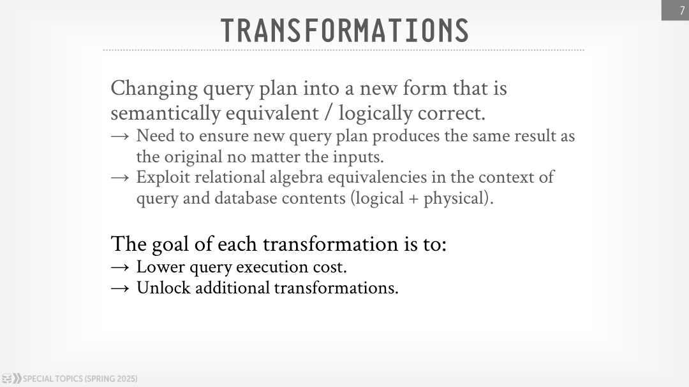

当然，整个过程的目标是最终得到更低的查询执行成本。但另一个关键点是，有些转换至少在立即执行之后可能使成本更高，却会解锁其他一系列转换，最终得到成本更低的计划。

你们读的那一章里有一个重要例子。有人记得最后这一项是什么吗？把外连接转换为内连接。我们马上会看到，如果能做到这一点，影响会非常大，因为外连接并不总能随意交换顺序。我们希望通过这样的转换，让优化器更高效，或者更快地找到最优、接近最优的查询计划。

## 第 8 页：谓词表达式的表示

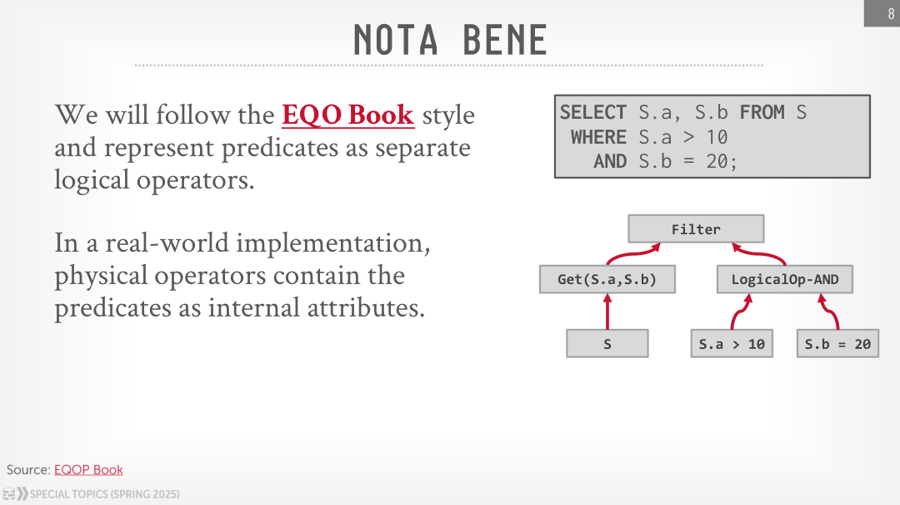

在进入今天的转换之前，我想指出，在其他讲座、其他课程或者 15-721 中，我们经常把谓词的表达式树表示成一个独立的东西，嵌在操作符内部。例如，连接操作符的内部属性之一就是连接谓词。但在这本书中，虽然他们并不总是一致，谓词表达式会被表示为查询计划中的另一个逻辑操作符。我会尽量沿用他们的命名和表示方式。

例如，这里有一个查询：从表 S 中选择满足 S.A 大于 10 且 S.B 等于 20 的数据。这里有一个过滤操作符；在其他讲座中，我有时会把表达式树表示在过滤操作符内部。而他们会把它表示成一个子操作符。

我提这个只是为了与他们保持一致，让你们读书时能把书中的内容和我今天讲的对应起来。他们自己也不总是一致：有时过滤操作符写成 select。我尽量把它们统一，让事情更清楚。在这个伪代码里，我知道他们把连接条件放在连接操作符的一个操作符——抱歉，是一个属性里；我们可以忽略这一点。

## 第 9 页：今天的议程

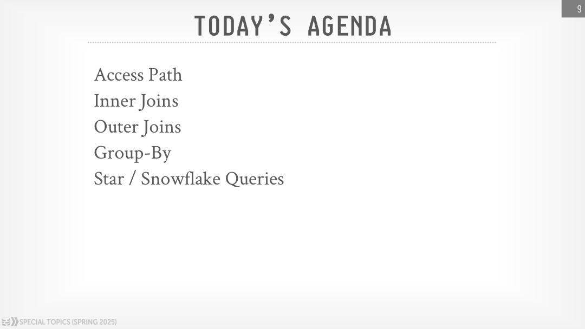

今天要讨论几类主要的转换：访问路径、内连接、外连接和分组。最后我想讲一个转换规则中特殊情况的例子：如果能立即识别出查询计划与数据库模式的组合符合某种已知的设计模式，例如星型查询，或者雪花模式、星型模式，那么可以用规则立即把它转成已知接近最优的形式。最后我们会看到。

## 第 10 页：访问路径转换

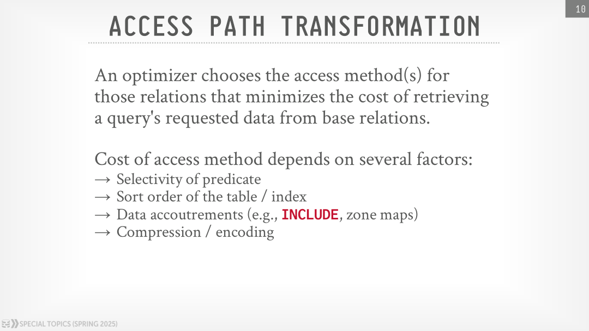

首先要确定如何访问数据库中的表、关系。目标是选择访问方法，从查询计划的叶子节点，也就是基本关系中，以最低成本取得需要的数据。

我们还没有讲如何估计成本模型，那要等几周以后。不过，根据你们在数据库入门课上的背景，显然重要的因素包括谓词的选择性、谓词本身、访问表中的哪些列，以及表或所访问的索引是否有序、查询计划的其他地方是否需要这个排序顺序。还要考虑表或索引是否附带了其他东西，例如 zone map 或 INCLUDE 子句。我发现自己在入门课上没有教 INCLUDE 子句，所以会很快用一张幻灯片讲一下。

其他因素还有数据的编码或压缩方式。如果我们知道谓词可以直接作用于压缩数据，而无须解压，也许就会因此选择一种访问路径而不是另一种。所以问题是：对于数据库中的某个表或关系，我们应该怎么访问？走索引，还是基本上做顺序扫描？

## 第 11 页：索引的 INCLUDE 列

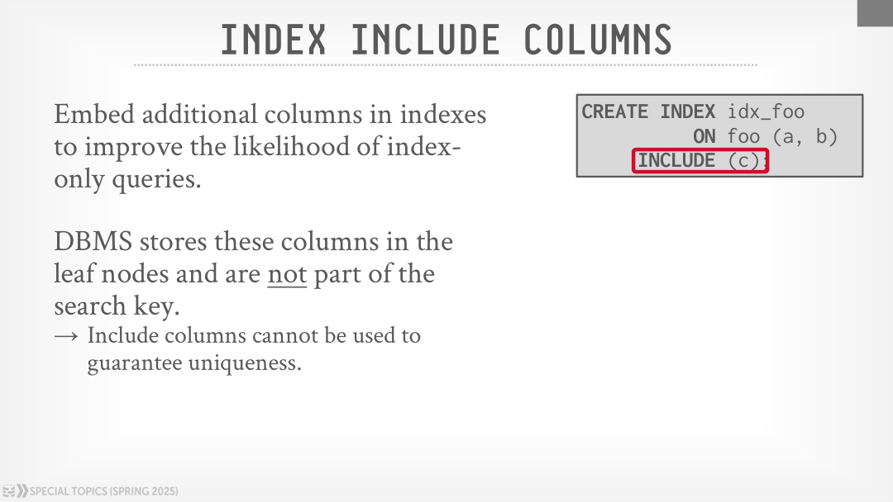

我很快讲一下 INCLUDE 列，因为我觉得它很酷，而我们在入门课上没机会讲。它很酷，却没有得到广泛使用，尽管它能带来很大的影响。索引中 INCLUDE 列的基本思想是：在索引中嵌入额外的列，但这些列不属于搜索键。

这里我可以在表 foo 上定义一个索引，查找时用的键是列 a 和 b，接着通过 INCLUDE 子句加入 c。假设这是 B+ 树，那么索引中引用的每个元组，其 c 列的实际值都会放在叶节点中。所有把你引导到叶节点的内部节点都基于 a 和 b。到达叶节点后，我要找到记录 ID 或行 ID，并根据它去获取原来的元组；在这个记录 ID 和 payload 里面，还会有列 c。

## 第 12 页：查询示例

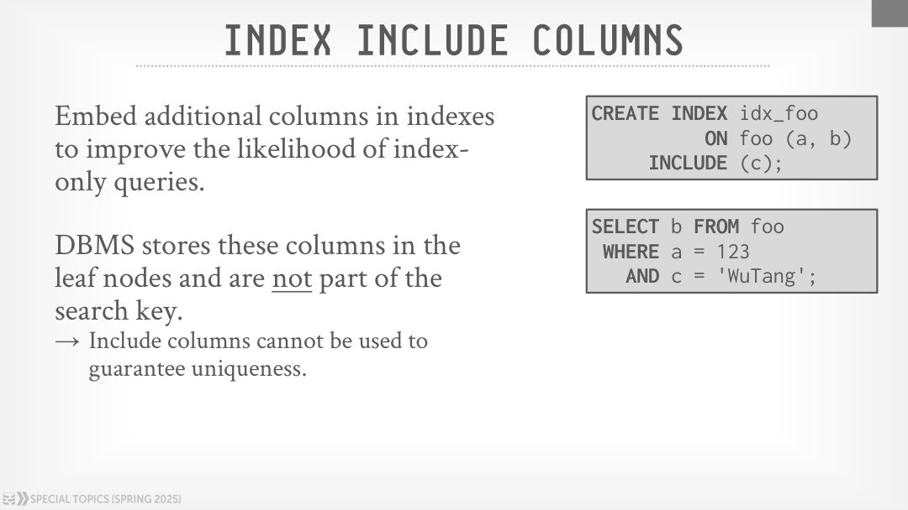

因此，对于某些查询，我基本上可以把它作为覆盖索引查询执行。假设这是行存储，我甚至不必去看原始元组，因为所需要的一切都在索引里，作为 INCLUDE 列打包在其中。

这里的查询是从 foo 中选择 b，条件是 a 等于 123 并且 c 等于 WuTang。

## 第 13 页：通过索引键查找

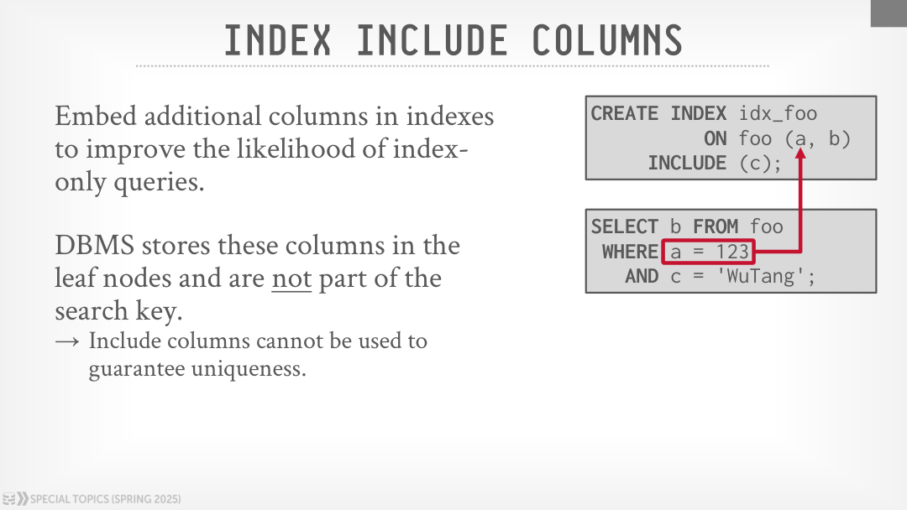

由于 a 是索引 idx_foo 的 B+ 树的前缀，我可以在索引上查找 a，沿树向下走，到达以 a 为起点的叶节点，然后找到所有 a 等于 123 的 a、b 组合。

## 第 14 页：检查 INCLUDE 列

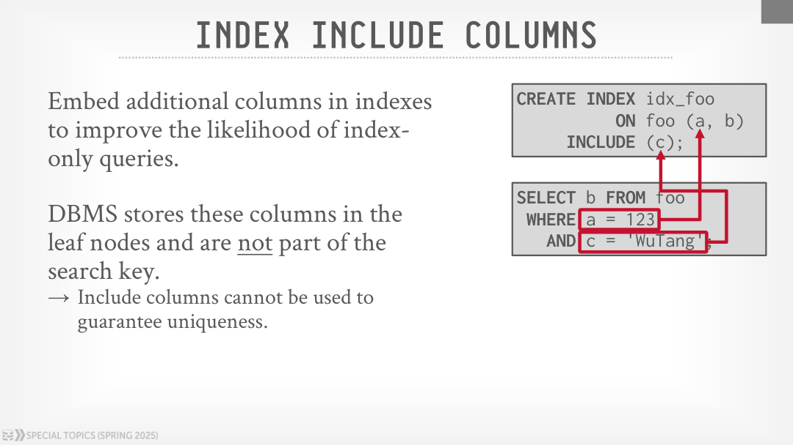

沿索引向下探查到叶节点时，我不能用 c 做什么。不过，到达叶节点后，我开始扫描 a 等于 123 的所有值、所有索引键，就可以看一眼 c 的值是否等于 WuTang。是的话就包含进来，否则就排除。

## 第 15 页：覆盖索引查询

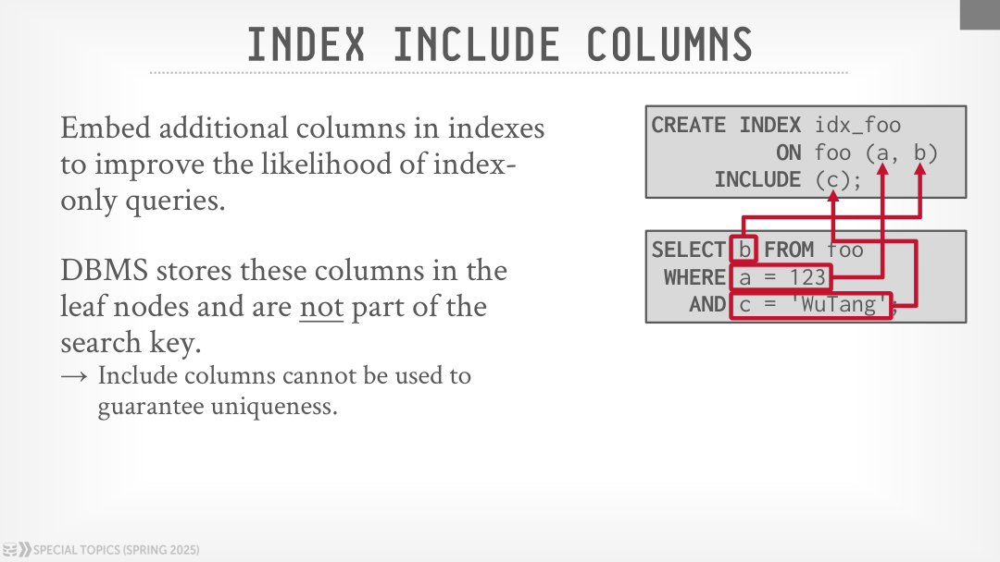

这里还有更好的地方：我也把 b 作为键打包进去了。虽然 WHERE 子句没有引用 b，我仍然可以取得 b 的值，因为它是键的一部分。因此，假设这是一个行存储系统，对于这个表、这个索引和这个查询，我根本不需要查找实际元组，只用索引就能回答查询。

## 第 16 页：访问方法

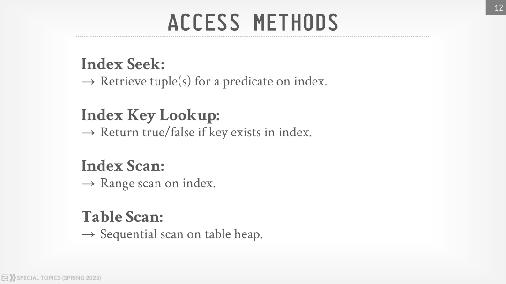

Postgres 加入这个功能，我想已经很久了，是 Postgres 11，那大约是多少，八年左右？不过 SQL Server、Oracle 和其他系统很早就有了。我要提这个，是因为等会儿讲一个例子的访问方法时会用到。

接下来列出不同访问方法的分类。这一套会偏向 SQL Server，但足够通用，我认为仍然适用于很多系统。

无论如何，访问表的默认选择总是顺序扫描，也就是他们所说的表扫描。如果没有索引，我仍然可以遍历表的堆文件中的页，访问所有内容。对某些系统来说这没有问题；如果是列存储，这甚至可能是最快的方法。比如 Snowflake，至少对于非混合表，你不能做索引探查，只能做表扫描。我们之后可以讲这个。

对于索引，我可以用三种方式查找。第一种是 index seek，根据某个谓词取得元组。比如范围扫描，我可以取得所有……抱歉，对于一个谓词，比如对键做精确匹配，取得所有元组。index seek 的一个子集或者说特殊情况叫作 index key lookup：我在索引中探查，不实际取得元组，只得到元组是否存在的 true 或 false。

这对一些我们想做的转换可能有用，因为我并不真的想取得元组，只想知道它是否存在，这样就不必担心到处复制所有数据。index scan 则是在索引上做范围扫描。

对给定的索引，我们会查看目录……抱歉，对给定的查询，我们查看目录，问这个查询访问了哪些谓词——抱歉，是访问了哪些表、这些表上有哪些谓词，以及我有哪些可用索引。这会带来一系列可选的转换，让我决定哪一个对查询最好。

## 第 17 页：选择单个访问方法

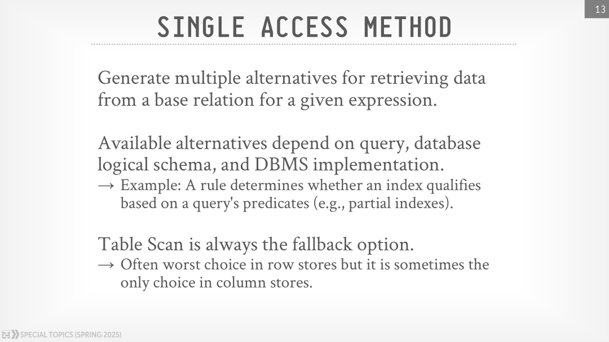

如果我想给一个表选一个访问方法，就像刚才说的，我会查看所有可用选择，选出我认为工作量最小的。挑选可用索引有点像资格审查：在这个表的索引选项中，哪些能用于当前查询？

假如一个表有许多属性和许多索引，而查询没有引用其中任何一个索引对应的属性，那我就不需要考虑探索它们，因为那只会变成沿叶节点的扫描，通常是个坏选择。

另外，我想我在入门课上没有讲部分索引。有时可以在索引上使用 WHERE 子句。例如，可以在表 foo 上创建一个日期等于 2025 年 2 月的索引，再创建一个日期等于 2025 年 1 月的索引。如果查询的 WHERE 子句引用了日期字段或属性，优化器就可以挑选应该使用哪些部分索引。

所以这是一轮资格审查，不只是看是否访问了属性；索引还可能有其他属性，决定它能否被使用。另一个明显的例子是，等值谓词可以在哈希索引上查找；如果是小于或大于，就不能在哈希索引上做这种查找，因此它不符合条件。如果没有好的选择，总可以回退到顺序扫描，也就是表扫描。

## 第 18 页：单访问方法示例

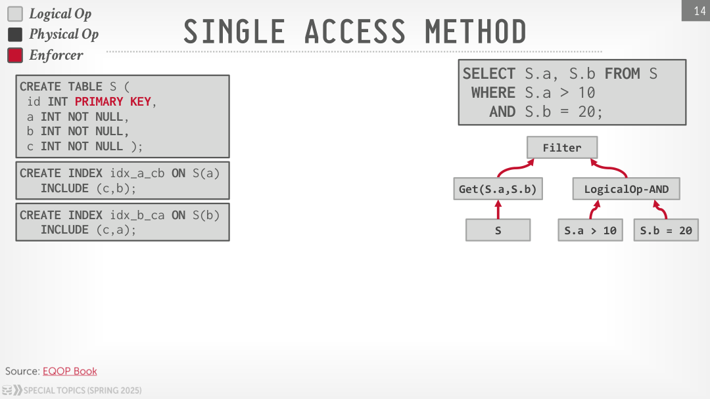

来看一个简单的例子，就是之前的查询：从 S 中选择 a 和 b，条件是 S.a 大于 10，S.b 等于 20。这里有两个索引：一个在 a 上，INCLUDE 列是 c 和 b；另一个在 b 上，INCLUDE 列是 c 和 a。

## 第 19 页：表扫描

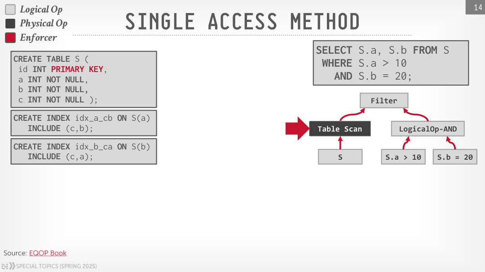

回退选择是：我不想看任何索引，就选顺序扫描作为物理操作符。我这里没有用 Cascades 的方式画出来，不过会有一张 memo 表或者一个组，记录获取表 S 这个表达式有哪些替代方案。表扫描就是我可能放进去并加以探索的一个物理表达式。

## 第 20 页：利用 a 上的索引

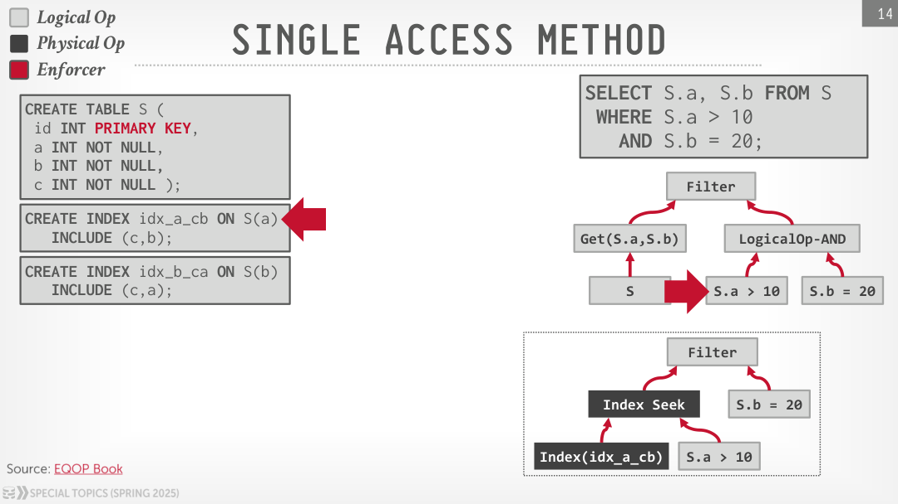

假设我要尝试在这里做索引扫描。我可以看第一个谓词 S.a 大于 10。我有 S.a 上的索引，假设它是 B+ 树，那么就能做范围扫描。我可以创建一个转换，把这里的 Get 操作符转成 index seek，因为它会在索引上做范围扫描。

逻辑 AND 操作符下面的表达式现在被提取出来，成为 index seek 的一部分。这里指定我要扫描哪个索引，以及用哪个谓词确定起点。在某些情况下还会有终止点，例如范围扫描停止的上界。

## 第 21 页：利用 b 上的索引

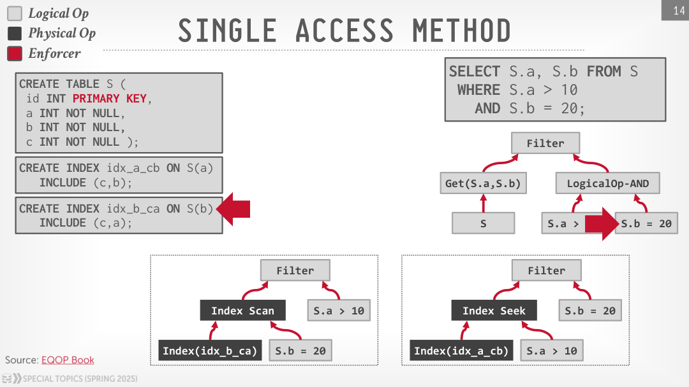

这是一个例子：看到 S.a 上的范围扫描，就选相应的索引物理操作符。现在这里有 S.b 上的等值谓词，同样可以用 b 上的索引，再做一个转换，把它转换成 index scan，因为现在我们要取恰好一个键——抱歉，是给定单个键，取得索引中所有的属性或匹配项。同样，把 S.b 移过去，附在 index scan 或 index seek 操作符上。

然后成本模型会决定哪种方法最好。我们还没讲到那里。

是的，seek 可能没有界限：我可能需要查看跨越多个键的多少东西是不受限制的。我说的是 S.a 大于 10。是的，但在实际实现中，它本身只是另一个迭代器。假设 S.b 上的索引不是唯一索引，那么它会给我 S.b 等于 20 的所有键值对，我在迭代器上不断调用 get next、get next、get next。它们是等价的，只是这里相当于没有界限，可以一直走到树的末尾。

我想 SQL Server 可能会区分这两者；但据我所知，在 Postgres 里没有这个区别。

## 第 22 页：多个访问方法

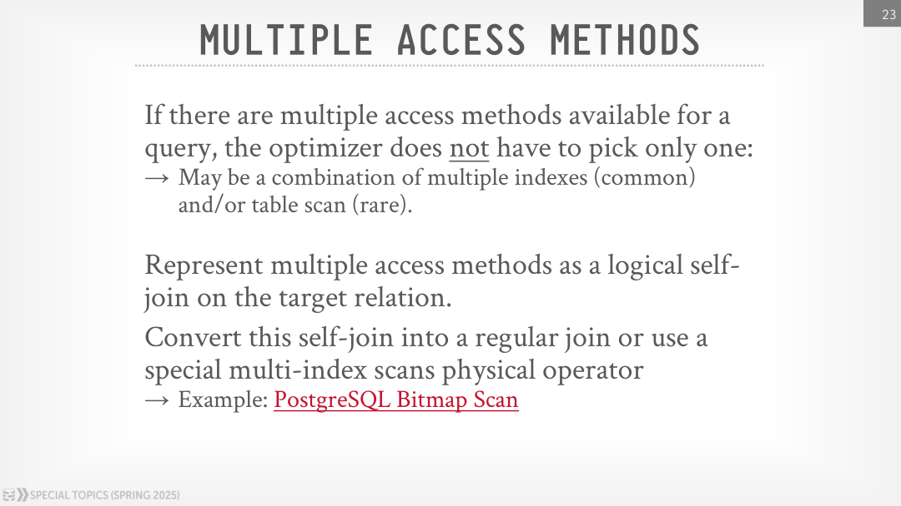

还有些情况，我们想要——或者说，没有哪一个访问方法最好，因此可以选择多个访问方法。访问两个索引似乎很浪费，但事实证明，这样可以减少总工作量，因为我们可能不需要做大量顺序扫描或表查找，去取得判断谓词是否满足所需要的额外属性。

回到刚才的例子，我没有画出完整的物理计划：我在 S.b 等于 20 上做索引扫描，但还得弄清楚它们是否满足 S.a 大于 10。因此物理计划实际上会被转换为某种表查找：先取回行 ID，再根据行 ID 查表，探查表堆，取得需要的其余元组。这可能很昂贵。

也许这个谓词匹配很多元组，另一个谓词也匹配很多元组，但两者组合起来选择性很高。既然我必须去表里取另一个属性，那就会很慢。

大多数系统都能做这个：我不知道 SQLite 能不能做，但所有商业系统、Postgres 和 MySQL 都可以。有人说 MySQL 的实现很差、速度慢，不过那是文档或者博客上说的。

基本思想是，根据谓词选择一个——抱歉，两个或更多索引来访问，然后根据谓词是合取还是析取，取交集或并集。合并两次索引查找的结果，就能得到我们想要的正确答案。

在书中，他们把对单个表使用多个访问方法表示成对所访问关系的逻辑自连接。这是说得通的：连接的一侧对同一张表做某种扫描，用某个访问方法取得结果；然后把输出与同一张表上的另一个访问方法连接起来，合在一起得到想要的结果。

我不知道 SQL Server 是否真的把它实现为普通连接。Postgres 的情况，我想它甚至不会把它表示成自连接，而是直接识别出可以对表做多次索引探查，把它们合成一个物理操作符，叫 bitmap scan、bitmap heap scan、bitmap index scan，或者 bitmap heap scan。概念上基本是同一个想法。

## 第 23 页：不带 INCLUDE 列的索引

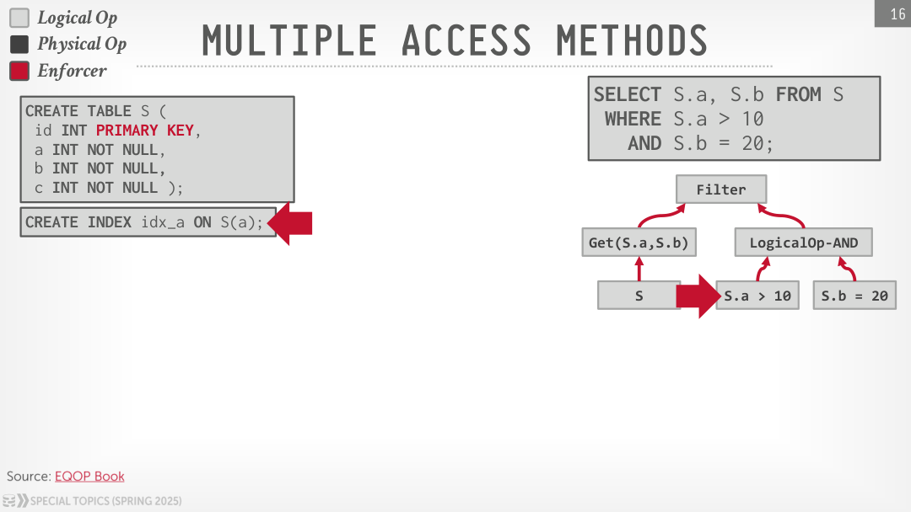

回到例子。现在去掉那些带 INCLUDE 子句的索引，只保留一个单独建在 a 上的索引。我们可以选择它，说这个看起来不错。

## 第 24 页：索引扫描与主键查找

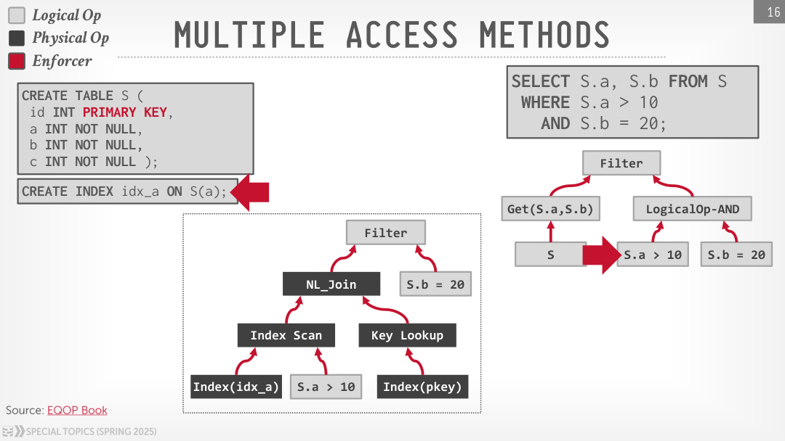

对于这个索引，在嵌套循环连接的一侧做索引扫描，也就是范围扫描，查找并取得 S.a 大于 10 的所有键和元组。但它不会给出这个查询所需的 b 的实际值，所以我们再探查主键索引。

这里假设数据组织成聚簇索引或索引组织表，也就是说主键索引的叶节点实际上就是元组本身。第一次探查只给出行 ID，接着根据行 ID 探查主键，取得实际想要的元组。然后在上面进行过滤，得到最终结果。

## 第 25 页：连接两次访问的结果

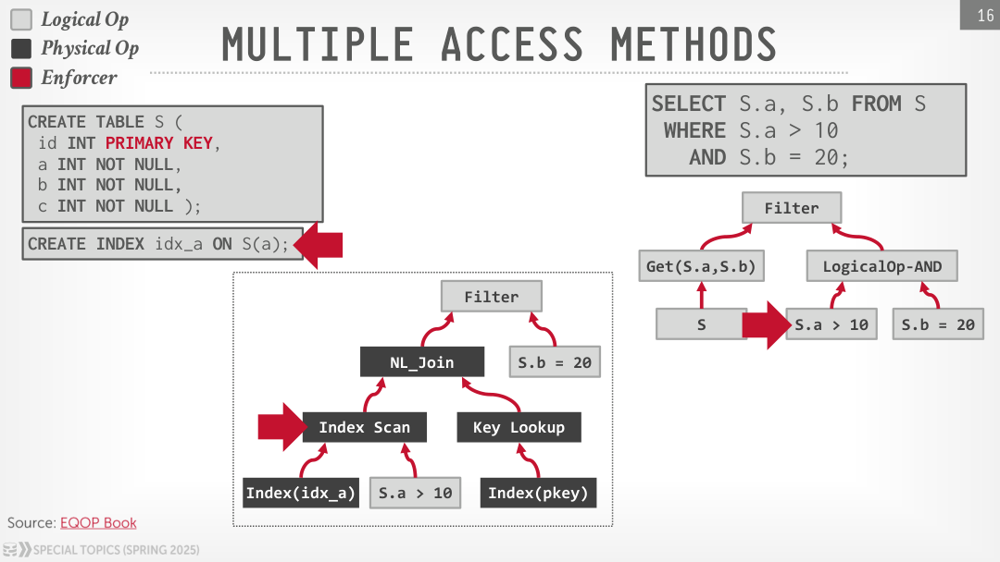

他们选择这个索引来做索引扫描，但它只给出了所需数据的大约一半：它只是找到满足这个谓词的记录。要取得实际需要的数据，还必须走另一侧。

在入门课上我们讲过两次索引探查，将结果做 OR 或 AND，取交集，从而得到所有匹配的记录 ID。概念上这里是一样的想法，不过这里的嵌套循环连接会给我们所有需要的数据：这一侧只是找到匹配项并传到另一边，去找到实际匹配的元组。

## 第 26 页：何时采用这种访问方式

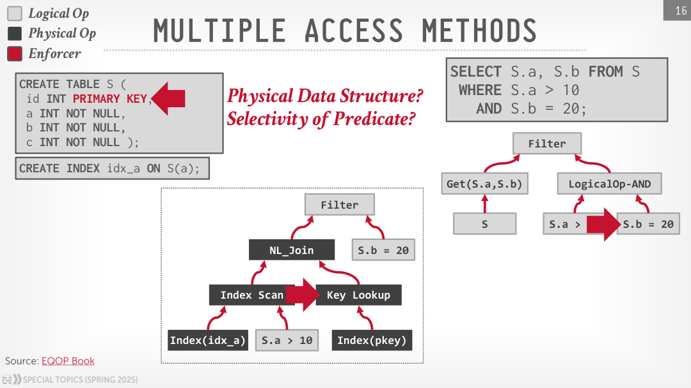

什么时候这样做是个好主意？取决于很多因素，包括用于表示数据的数据结构。刚才说过，只有当它是聚簇索引或索引组织表，主键查找能给出所需的 b 值时，这样做才真正有意义。

在其他系统中，比如 Postgres——我不是说 Postgres 有什么不好，只是说它就是这样实现的——这没有意义。因为对主键做 key lookup 只会得到记录 ID，而我在另一边已经有了它，这没有帮助。如果我在 b 上也有索引，也许最好探查那个索引，然后取两者的交集。

显然，这还取决于谓词的选择性。如果它匹配 99% 的元组，我只是在这里浪费工作量；还不如顺序扫描整个表，自己找出所有匹配的元组。

在多访问方法方面，我们不深入实现细节。例如 Postgres 会尝试维护一个位图：假设表里有一百万个元组，就建立一个大约一百万位的位图，当某个访问方法的一侧找到匹配时，把对应的位设为 true。如果超过一百万，他们就会改用 Bloom filter，因此匹配时可能出现假阳性。于是他们还要多做一步，再去查看元组是否真的匹配。

但从优化器的角度，这些都包含在判断访问方法是否有意义的成本中，是谓词选择性或大小等因素的组合。

## 第 27 页：内连接

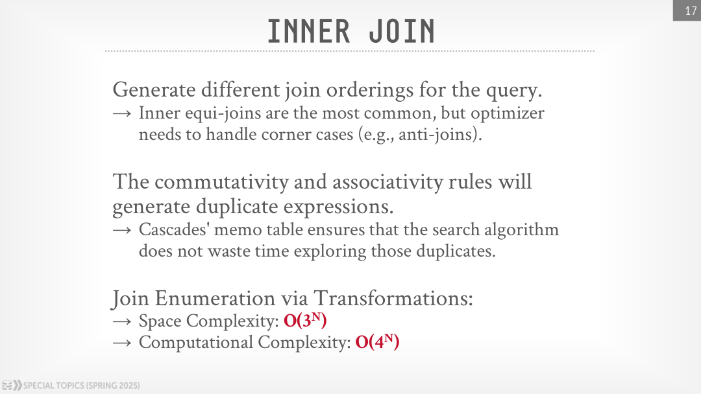

为基本关系选择好访问方法之后，现在要做数据库中除了 SELECT * 和 SELECT COUNT(*) 之外最常见的事情：把数据连接起来。

如前所述，目标是为查询生成所有可能的不同连接顺序——也不是所有可能的顺序，而是我们认为真正有益的那些。我们从内连接或内等值连接开始讲，因为这是最常见的情况。但也仍然要处理各种特殊情况，生成连接顺序时要注意，尤其是存在外连接时，如果交换了不该交换的东西，是否会破坏查询计划的正确性。

基于转换的查询优化器，例如 Cascades，会面临一个挑战。下节课我们会看到德国人的方法，它没有这个问题。memo 表确保我们不会反复浪费时间探索重复表达式或查询子计划：查一下 memo 表，发现以前见过，就不再探索那条分支。但生成这些转换本身可能相当昂贵。

Cascades 绕过了这个问题，因为它不会预先急切地一次转换所有东西。之前的 Volcano 会这样做，导致搜索空间爆炸。

如果穷尽地应用所有改变连接顺序的逻辑转换规则，需要存储的所有不同替代方案的空间复杂度是 3 的 N 次方，而实际应用所有转换的计算复杂度是 4 的 N 次方，因为你会不断递归地重复同样的事情。不仅探索不同组合的成本很高，实际生成所有组合的成本也很高，而且有浪费。

## 第 28 页：重复生成的代价

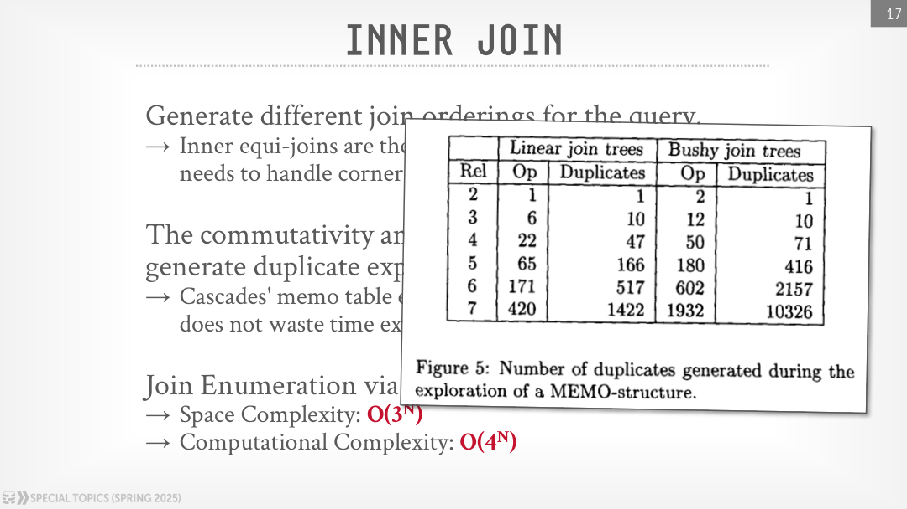

有一篇 90 年代的论文展示了，当关系数量较少时，在展开所有转换的过程中，memo 结构中要考虑多少不同的操作符，其中又有多少是重复的。

## 第 29 页：连接枚举的指导

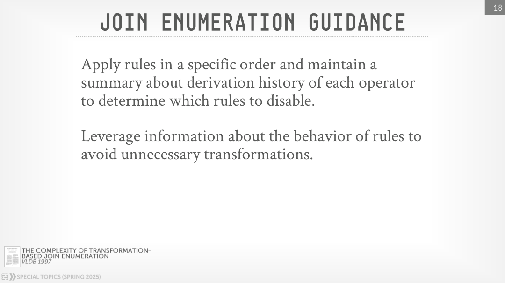

在基于转换的查询优化器中，解决办法是利用有关转换规则行为的信息，决定转换规则的应用顺序。应用一条规则之后，它会针对每个操作符排除未来可以再次应用的某些规则。

目标是不生成重复表达式，甚至避免继续考虑是否要应用某条规则，也就是避免检查查询计划是否符合规则的模式。我们希望完全省掉这种检查。

做法是在每个操作符上维护一个小位图，记录我应用了哪些转换规则——抱歉，记录哪些规则允许应用。基本上这是一个 bit set，在每个操作符上禁用某些转换规则。

涉及多个操作符的组合时如何处理，会更复杂。我认为基本上有某种虚拟操作符、虚拟规则，用来表示给定操作符可以应用的规则组合。论文并没有说明；这篇早期论文基于的我想是 Volcano，而不是 Cascades，所以更简单。这本书也没有说明，以上是我对他们做法的理解。

## 第 30 页：四条连接枚举规则

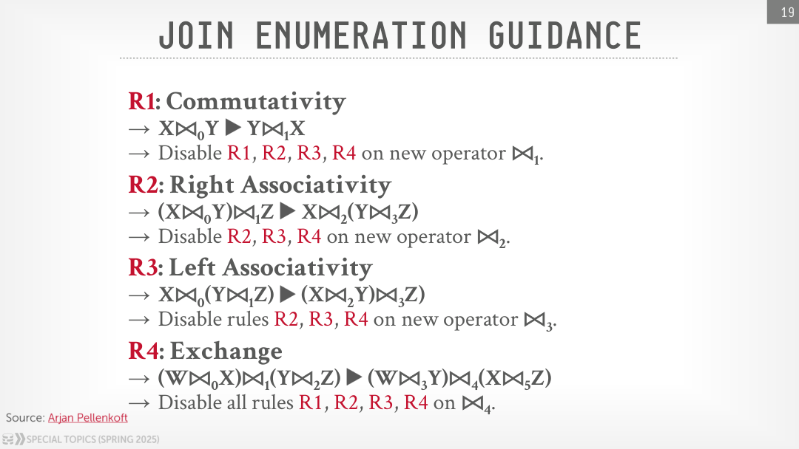

这里是连接枚举中的四条基本规则，我们之前已经讲过很多：交换律、右结合律、左结合律和 exchange。exchange 有点像交换律，但你是把连接的一个子计划中的一个元素，与另一侧的一个元素交换。

这里我要连接 W 和 X、Y 和 Z，于是把 X 和 Y 交换。W 仍在这一侧，Z 仍在另一侧，我只是交换 Y 和 X 的位置。

应用一条规则时，要为转换结果中的某些操作符指定今后不允许再应用哪些规则。最明显的例子是最上面的交换律：X join Y 变成 Y join X，生成的新操作符是 join 1。我显然不想再应用一次交换律，因为那会把我带回原来的位置。

## 第 31 页：限制规则的应用

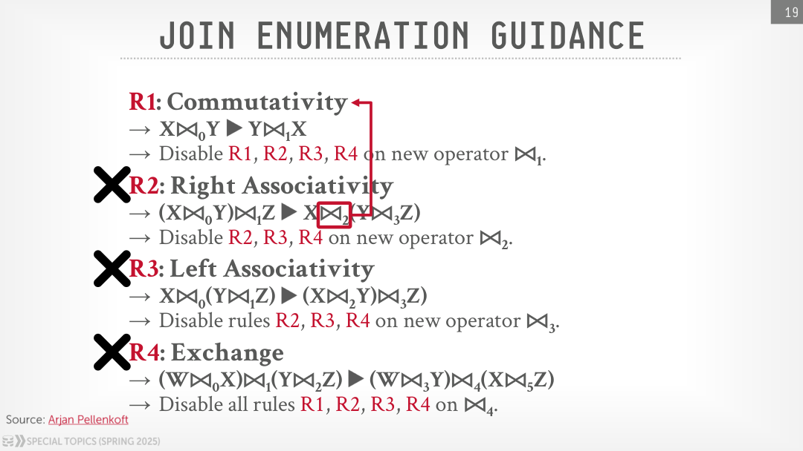

看一个更复杂的例子：右结合律。如果应用这条规则，得到新的 join 2，那么我不想在这个连接操作符上应用 R2、R3 和 R4，但允许应用交换律，因为我可能希望把 Y 和 Z 的连接放到连接的外侧，因此可以交换顺序。

当然，一旦这样做，又会禁止所有其他操作。你可以看到这种循环依赖：如果我用交换律换了顺序，然后再应用右结合律或左结合律，基本上就会换回去，陷入无限循环。因此我说，对于这个操作符，如果它是由某条规则生成的，那么这些规则就不能再应用。注意这只针对这里生成的部分操作符。

## 第 32 页：禁用规则的讨论

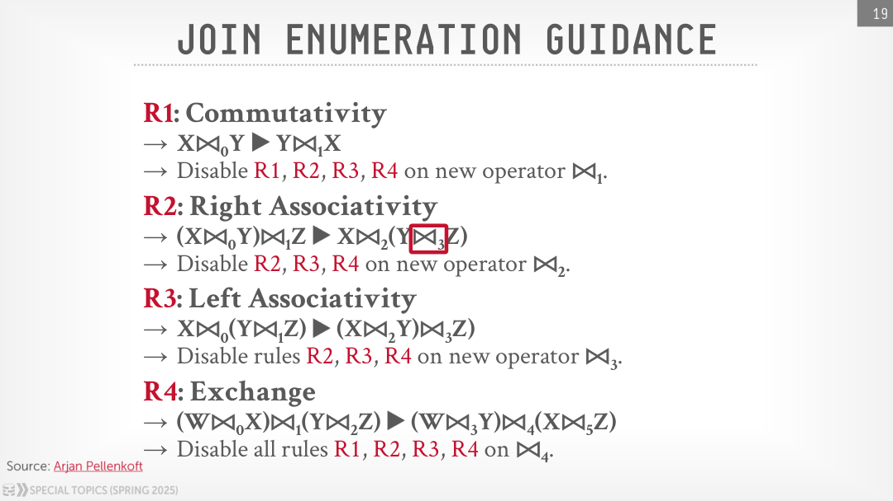

我在这里创建了 join 3，但仍然可以对它里面的东西自由操作，那不会让我陷入无限循环。所以我可以把 Y join Z 的顺序换成 Z join Y，这没有问题。根据具体查询，这也可能正是我想做的。

因此，我们要了解这些规则的类别以及它们实际上做了什么，把它们联系起来并记录：如果我做了这个，就不能再做那个。清楚了吗？

是的，问题是：对于规则四，为什么不能应用规则一？这只是针对这个操作符；不是说你不能改变 X、join 3 和 join 5……如果做交换，那是很重的操作，所以才不这样做。我的意思是把整个子计划从一侧移到另一侧。等一下，让我想想。难道它们不都是组吗？

他的意思是，在 Cascades 里这一切都被抽象成组了，他说得对。这篇论文基于 Volcano，不过这里就是 W 和 X；我没有说明到底是怎么得到它们的，所以这并不是很重的操作，只是把组移到另一侧。实际上，是的，我不知道为什么 exchange 是特殊情况、会禁用所有规则。

应用顺序是从上到下。你会先做交换律，所以可以交换这些，没问题。然后可能已经遍历并交换过这些东西，等到最后一条规则时，你已经探索过交换的情况，所以不再应用规则一。是的，如果应用规则四，会得到规则四在这里的反向结果；但因为规则一，你永远不会应用规则四……让我再检查一下，因为 R4 显然是有用的，我想把东西移来移去，看看另一种情况是否更好。

我看不出怎么到达那里。是的，让我再检查哪些规则会被禁用，我会发到 Piazza 上。我想，前面三条规则可能已经探索了这个，最后一条有点像兜底，不过我会再核实。

有同学问了一个更一般的问题：如果用 Cascades，有 memo 表，表达式已经存在，其中可能标记着正在探索或者记录了它的成本，那禁用规则是不是只省掉了一次函数调用？是的，确实如此，省下的只是很小一部分。这里展示的只是让我们不去检查。正如你说的，是一次函数调用；但如果探索几千、几万个不同的……是的，你们两位说得都对。

他们想避免的是跳到哈希表里。你可能说那是 O(1)，有什么关系？他说得对，这只是跳到另一个数据结构做一次查找，时间是常数。但如果对一个查询做几万次、几百万次，不进行额外跳转和匹配判断，就是很大的收益。这篇论文写于 1997 年，当时计算机更差、更慢，所以对他们来说这也是个问题。

我们没有真正讨论过这个：现在的查询确实比 90 年代更复杂了，因为 SQL 扩展了，数据更多了，不同工具生成不同的仪表盘等等。但查询复杂度的分布是这样的：大部分查询并不复杂。他们当时处理的是两表连接；如果有连接，大多数查询是两表连接。我们今天仍然处在同样的世界，所以大多数时候，他们要规划的查询和我们今天要规划的基本相同。

在那个环境里，避免查找以判断是否应当应用规则，对性能的影响可能比今天更大；不过当连接的表越来越多时，它对我们仍然有用。我会再跟他讨论，检查从上到下应用规则时，例如禁用 join 4 上的 R1 后，怎么仍然得到这个结果。

## 第 33 页：谓词下推

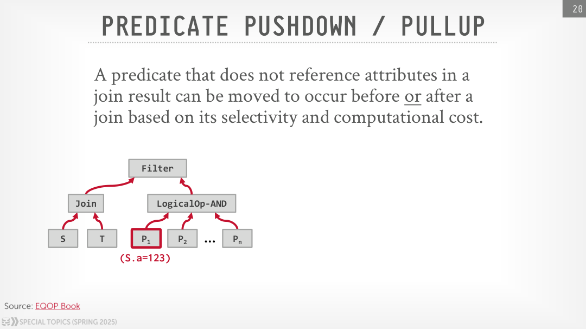

接下来，每个人都会做的一个最明显的操作是谓词下推，或者谓词上拉。如果我们发现一个谓词没有引用需要连接结果才能取得的任何属性，就希望把它下推到连接下面，在进入连接之前先过滤数据。

这里的谓词要检查 S.a 是否等于 123。这是便宜的计算，所以我们肯定希望把它下推到这个连接下面。

## 第 34 页：计算昂贵的谓词

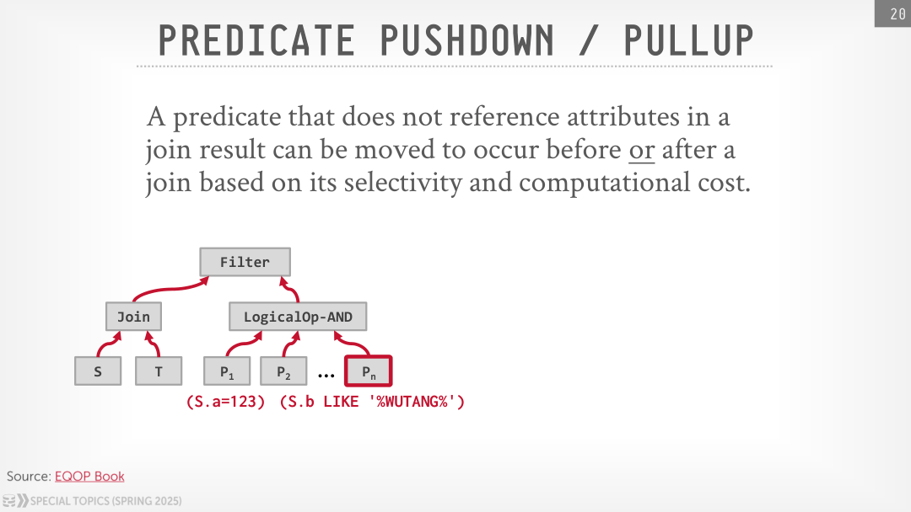

不过，即使一个谓词只引用不需要完整连接结果的属性，它的计算本身也可能很昂贵。连接基本上也是一个过滤器，因为它要匹配外侧和内侧的数据。所以，如果执行谓词的计算成本很高，我可能想把它留在连接上方。

## 第 35 页：拆分谓词

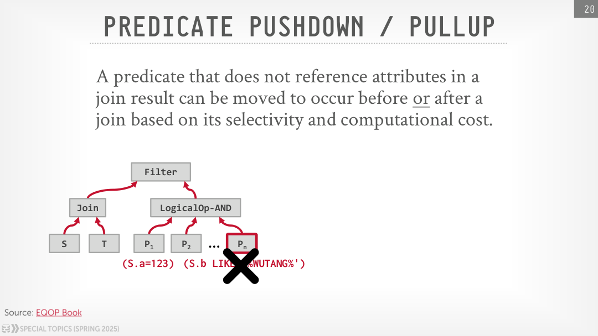

这也是为什么查询到来后，我们解析它并交给 binder。binder 试图弄清楚你引用了哪些列，然后会尝试拆分……不管是优化器还是 binder 做的，它会按照合取把所有谓词拆开，成为独立的单元。这样就可以根据最佳执行位置，在查询计划中独立地移动它们；有时甚至可以复制它们。

这里虽然它可以放在连接下面，但我们可以说 LIKE 的计算成本很高，因此把它放在连接上方。

## 第 36 页：谓词下推和上拉的选择

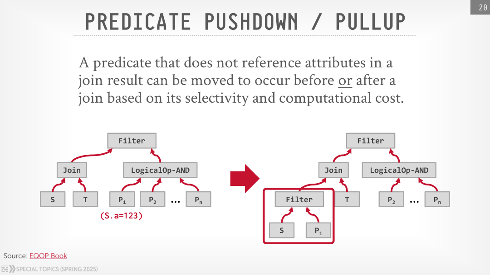

在重写后的查询里，我只把 P1 移成连接下面的过滤器，其他谓词留在另一边。

是的？你的意思是，这只对合取有效，我知道可以下推某些条件而不必检查其他条件？不是所有情况都这样。如果条件是 S.id 等于 123 或 S.b 等于 456，这也可以下推，没有问题。问题在于表达式可能同时引用连接中两个表的东西，例如 S.id 加 1 等于 T 的某个值加 4；我需要两边，因此必须在连接之后计算。析取仍然可以下推。

## 第 37 页：物理连接操作符转换

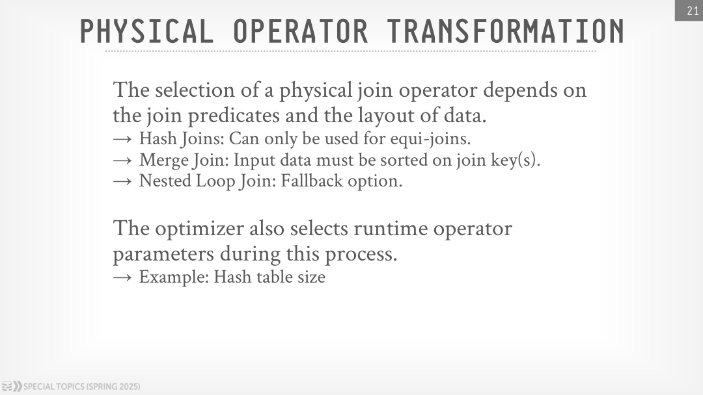

接下来要转换成实际想实现的连接操作符。这取决于谓词以及进入连接的数据是什么样。我们已经提过，最明显的例子是哈希连接：如果连接子句在连接键上使用小于或大于，我就不能使用哈希连接，因为哈希查找只能处理等值谓词。

这种连接不太常见，但有时会见到。反连接是另一个例子：某个东西不等于另一个东西，这在数据清洗工作负载中很常见，你想知道是否以前见过这个东西。在这种情况下不能使用哈希连接。

某些归并连接显然要求输入数据按连接键排序。我们讨论过如何使用强制规则来保证数据满足这个要求；如果不满足，优化器就需要知道不能选归并操作符。就像访问方法没有别的选择时，顺序扫描或表扫描是回退选择一样，嵌套循环连接虽然慢，却是连接数据时的回退选择。无论谓词是什么、数据是什么样，嵌套循环连接都能产生正确结果。它会慢，但能做到。

查询优化期间还有一件书中没有讨论的事：这些连接操作符有时会有额外参数，指定运行时如何执行。最明显的例子是哈希连接，我希望在运行时知道哈希表应该有多大。

在 Postgres 这样的面向行的系统，或者使用向量化执行模型的系统中，数据进来时，我不知道要连接的数据的完整大小。如果使用物化查询处理模型，这就容易了：先运行扫描，它产生完整结果，我就知道要访问多少元组，从而选择哈希表大小。只有 MonetDB 这样做，大多数系统不这样做。

因此我必须知道哈希表应该多大，因为我不想空间用完之后停下所有工作，把大小翻倍，再把所有东西装回去；那会非常慢。如果每次处理一个元组或者一个向量，我无法在运行时知道完整数据是什么样。

查询优化时，我有谓词选择性的估计，因为那是成本模型的一部分。因此，在选择物理连接操作符的同时，我也会选择实际运行时如何设置它。例如 Postgres 会在查询优化器里设置哈希表大小。你也可以想象其他东西，比如排序可能有不同算法。如果数据已经排好序，冒泡排序可能很好，所以也许我会选冒泡排序而不是快速排序。这类选择不会是不同的物理操作符，而是那个物理操作符的一个设置或参数。

## 第 38 页：外连接

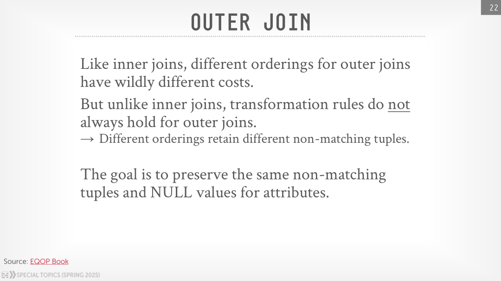

外连接比较棘手。和内连接一样，不同顺序会让查询性能产生很大的差异。但难点在于，并非所有适用于内连接的转换规则都适用于外连接。如果改变连接顺序，最终得到的匹配和不匹配元组会不同。

假设我做左外连接，如果内侧表没有匹配项，仍然会产生一个输出元组，但内侧表各列的值都是 NULL。因此，根据左外连接执行顺序的不同，我可能得到完全不同的结果。

我们的目标是把左外连接转换成内连接，或者只做那些允许进行的小转换，同时为不匹配的元组及属性中的 NULL 值产生正确的结果。这本书只是简要解释了如何判断能否把外连接转成内连接。

## 第 39 页：外连接的冗余规则

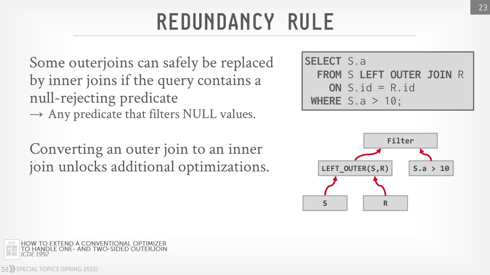

基本思想是，如果我发现查询中有一个谓词，会丢弃左外连接内侧产生的任何含 NULL 值的结果，那么就可以把左外连接转成内连接，因为结果仍然相同。

这里有谓词 S.a 大于 10。这意味着，如果我知道连接的输出会忽略……这个查询实际上……是的，抱歉，应该是 R.a，因为假设这是左侧。

## 第 40 页：空值与过滤

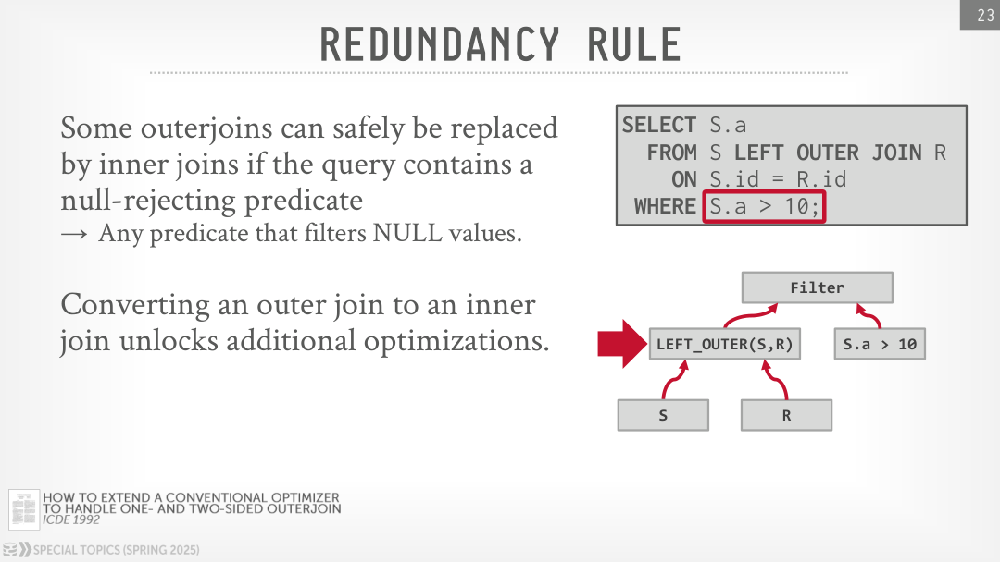

如果 S 做左外连接，连接 R 时，假如 R 中没有与 S 匹配的行，那么 R 的那些列会输出一堆 NULL。假设条件是 R.a 大于 10，那么如果 S 和 R 不匹配，R.a 就是 NULL，我检查的便是 NULL 是否大于 10。

NULL 不等于任何东西，NULL 甚至不等于 NULL。所以 NULL 大于 10 就是 false。这意味着我会丢掉左外连接输出中所有这样的 NULL 结果。

## 第 41 页：转换成内连接

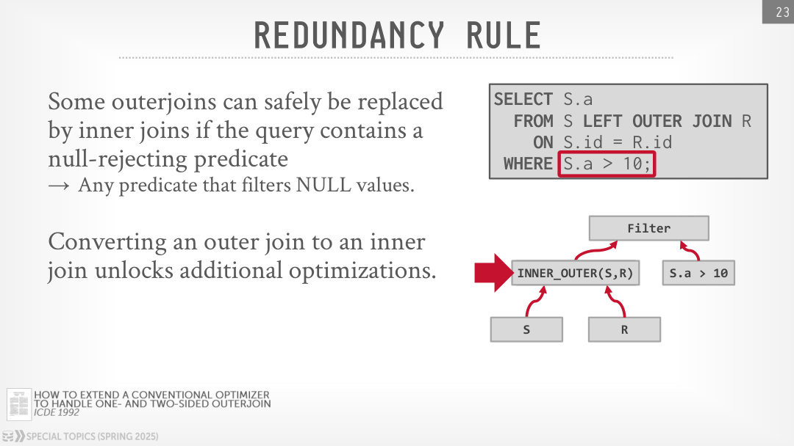

因此，把它转换成内连接是安全的，因为语义上结果相同。清楚了吗？右外连接也可以做同样的事；全外连接更棘手，我们先忽略。右外连接就是左外连接的反过来。

我们想这样做，是因为外连接不能应用一大批转换规则。如果可以把它转换为内连接，就能用上刚才讨论的所有优化。这里我画的是两表查询，但如果有几十张表，能把其中一批左外连接转换为内连接，就可以做所有想做的优化，找出最优顺序。这是一个很大的收益。

当然，你不总能这样做。如果我去掉这个 WHERE 子句，就不能这样转换。

## 第 42 页：GROUP BY 转换

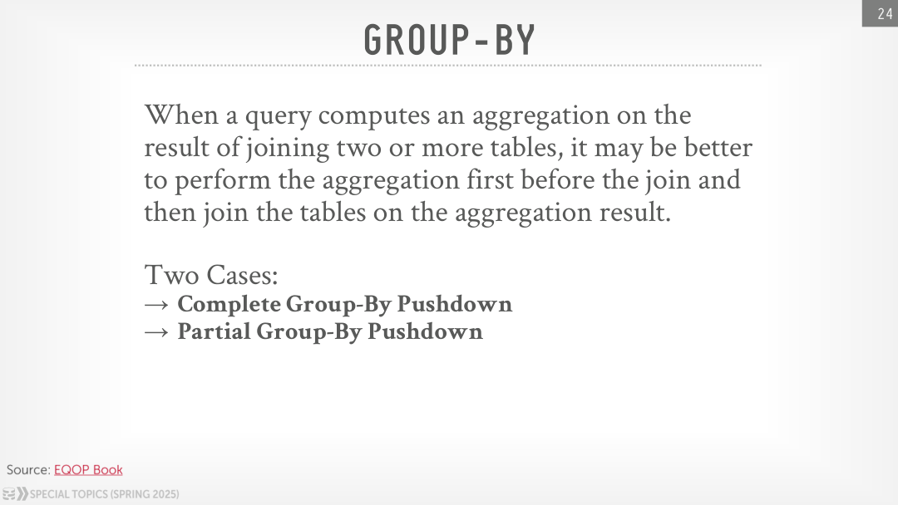

下一个要讨论的操作符是 GROUP BY。基本思想是，如果我要做连接，也要做聚合，那么可能应该先聚合再连接，因为这会减少送入连接操作符的元组数量。连接通常是计算中最昂贵的部分。

在某些情况下，我可以把聚合完全移到连接下面。另一些情况下，只能保留根节点的聚合，同时复制聚合操作符，也就是 GROUP BY 操作符，把它放到连接下面。它计算一些部分结果，再拿去连接，这比把原始元组送上去快得多。连接输出之后，再计算查询结果所需的完整、正确的聚合。

## 第 43 页：完全下推 GROUP BY

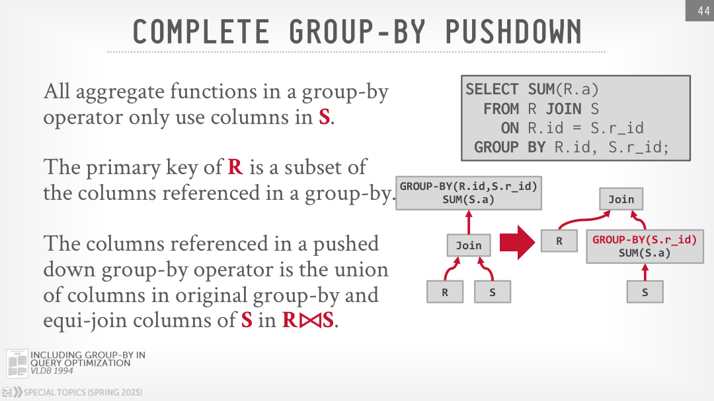

完全下推 GROUP BY 有一系列必须满足的规则。最明显的一条是，如果我在做连接，而聚合只引用一个表中的元组，就可以很容易地把它下推。其他情况下，比如我知道用于查找的主键是被引用列的子集……这里还有一系列其他规则。

看这个非常简单的例子：我在 R 与 S 根据外键引用连接时，计算 R.a 的 SUM。S 的外键引用 R 的主键。现在 GROUP BY 是 ID 和 r_id 的组合，它们本质上是同一个东西。

最初的查询计划是这样：GROUP BY 和聚合在连接上面计算。但因为这里引用的东西都是从 S 取得的，我可以把它放到连接下面。虽然我引用了 R.id，它和 R.id 是一样的——抱歉，R.id 和 S.r_id 是一样的。所以用 R.id 和 S.r_id 做连接时，它基本上与我的 GROUP BY 做的是同一件事，然后把所有结果合并，产生正确的列。

对两个值完全一样的列分组，等价于对一个列分组。如果 ID 的值是 1、2 或 3，我尝试按 ID 等于 1 和 ID 等于 1 分组，它们会进入同一个桶，不会额外细分。因此，既然可以识别出它们等价，而连接也会按相同的顺序正确地聚合或合并结果，我就可以把 GROUP BY 放到连接下面。

假设从 S 读出一百万个元组，或者十亿个，总要想得更大些。现在做 GROUP BY，如果聚合后只有十个不同的值，那么连接的输入就只有十个元组，而不是十亿个。

你是说 R 的主键也可以只是唯一键？S 有一个外键指向 R，可以保证在 R.id 中有匹配项，所以我认为只说它唯一也可以。是的，说得好。这就是完全下推 GROUP BY，聚合完全移到连接下方。但有时并不能这样做。

## 第 44 页：部分下推 GROUP BY

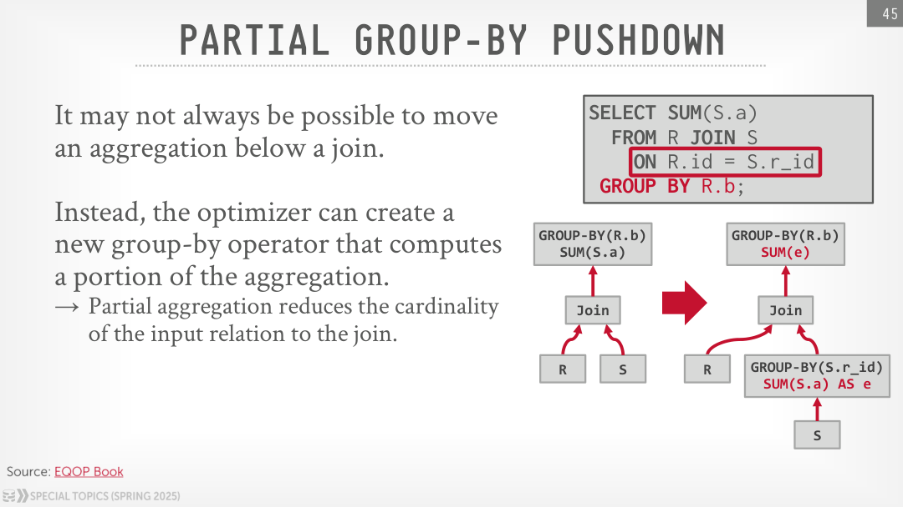

这种情况下，我们可以创建新的 GROUP BY 操作符，仍然保留原来的操作符，稍微调整它，并再做一次聚合。我们实际上会计算两次聚合，但有时仍然更高效，因为进入连接操作符的数据量可能少得多。

这里和之前的查询相同，不过现在只按 R.b 分组。之前我们连接 R 和 S，按 R.b 分组，并对 S.a 计算聚合。现在可以在连接下面创建一个新的聚合，按 r_id 分组，这就是连接键。

请记住，我刚才说过，连接键和 GROUP BY 时用于合并数据的键是同一个东西，因此这里能够把东西匹配起来。现在先为这些 r_id 的值计算部分 SUM，再把结果送进连接操作符。上面的 GROUP BY 按 R.b 分组；当我在连接中把 R.id 与从下面上来的 S.r_id 匹配后，就知道 R.b 的值，然后对下面这个聚合为各个 r_id 类别或分组生成的值进一步计算。

Snowflake 很有名的一点就是会这样做，不过他们会做晚绑定：由于它是分布式系统，他们会在查询计划中保留一个占位位置，扫描开始运行后，如果发现输出数据比预想的多得多，就打开部分聚合下推。

我认为他们可能总是先做，然后把它关掉；或者总是不做，然后把它打开，二者之一。不过基本思想相同。关于 GROUP BY 有问题吗？

## 第 45 页：识别常见设计模式

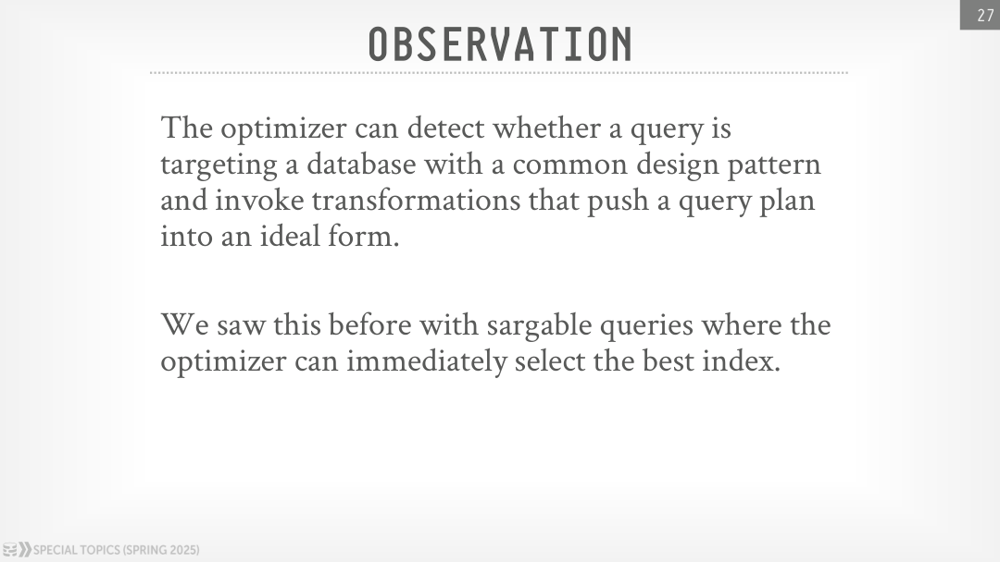

最后我想讲一个特殊情况。正如之前所说，有些数据库设计模式非常常见。如果优化器发现一个查询访问的表遵循其中一种模式，就有些转换值得立即应用，因为考虑一大堆不同选项、连接顺序、bushy 计划和左深链可能根本不值得。我可能知道这样做是对的，就直接把它转换成一种形式，让后面的工作轻松许多。

我们之前看到过一个简化版本：查询到来后是 sargable 的，比如 SELECT * FROM table WHERE id = 4，而 id 是主键。我可能不想费劲查看所有访问方法、应用所有转换。我知道主键上有索引，又在主键上写了等值谓词，就跳过那些东西，立刻应用转换选中索引，因为这几乎总是最优选择。

这里也是同样的思想，只不过现在看的是包含连接的多层查询计划。

## 第 46 页：星型与雪花型查询

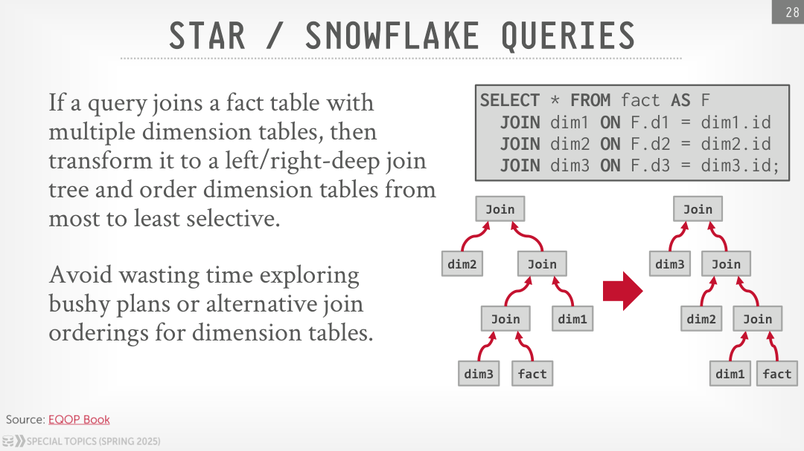

书中特别讨论了如何处理雪花模式和星型模式。我们在入门课上也提过：90 年代 Ralph Kimball 有一本非常著名的数据仓库著作，他是星型模式的早期倡导者。

你有一张巨大的事实表，记录业务中发生的每个事件，比如 Amazon 或 Walmart 上每件被购买过的商品。然后还有通过外键引用的维度表，记录产品名称、价格、售出商品的商店位置等。做分析操作或分析查询时，就把事实表与各种维度表连接起来。星型模式只有一层维度，雪花模式有多层维度。

当我们识别出事实表正在与一批维度表连接，因为显然有从维度表到事实表——从事实表到维度表的外键引用，就可以不再探索所有 bushy 计划和连接顺序，而是用一条转换规则直接生成左深或右深连接树。

有时还可以根据维度表的选择性给它们排序。可能只是简单地看表里的元组数量，或者实际查看谓词，确定在这些表上查找的选择性。于是我跳过所有 bushy 树转换和其他东西，说这里我只做右深树；直接跳到这个查询计划，会比进行各种探索快得多。

如果上过 15-721，或者我想我们在入门课上也讲过，这在列存储上会非常快。假设这些都是哈希连接，我在 dim3、dim2、dim1 上建立哈希表，然后顺序扫描事实表，让数据沿流水线上行并探查这些哈希表。实际上先探查 Bloom filter，看看是否可能在哈希表里；如果可能再探查哈希表。整个过程沿一条流水线跑过去，会非常快。Snowflake、ClickHouse、DuckDB 都这样做。

因此，与其处理其他东西，不如直接转成需要的形式。上节课讲 Cascades 和 Microsoft SQL Server 时，我们看到它们分阶段应用某些转换。这是其中一个在基于成本的搜索之前优先应用的转换：如果有星型模式，就做这个转换，它可能让后续工作提前结束。

是的？怎么确定模式的结构？是不是看有十张表，其中一张特别大，比如比其他表大一万倍？

他的问题是如何检测星型模式。你在数据库中有一张表，它只通过外键引用其他表，没有多层外键。这并不难。有些人甚至会把表命名为 dimension one、dimension store、dimension date 之类。当然，不要依赖命名，而要看模式结构，就能知道是否有外键依赖。

实际情况并不总像这个例子一样显而易见。数据总是脏的，模式也会变脏，可能有叫 fact one 的表，然后又有 fact real 之类的表。不过一般来说，从查询中能看出：我从一张中心表向外面的各个维度表做一堆外键查找。有时有些表比其他表大得多，这也能提供线索。

是的，正如你说的，是数据库模式本身和查询如何使用该模式的组合。我想说的是，它不总像这个例子那样显然。你应用转换，先得到这种形式，然后也许还要进一步调整。或者情况比较奇怪，有两张事实表要连接；你仍然可能需要其他转换。

不过，因为我已经引导搜索直接得到这种形式，而不是靠转换规则自然地发现它，就可以开始 branch-and-bound，丢弃我知道表现不会比它好的方案。仍然要做基于成本的搜索，只是有点像预先填充 memo 表。并不完全一样，因为表里还没有东西，但你是在一开始就说：这里有个相当不错的方案。这会让你之后剪枝很多东西。

它就是在进入搜索之前的一个阶段？是的，但和填充 memo 表不同。我想也可以那样做。这里是把搜索推向一种形式，而不是从随机起点开始，或者以查询中表出现的顺序作为初始连接顺序。我先把它放进一种我知道可能不错的形式。

这条规则可以放在 binder 里？可以，但那是一个工程问题。不要放在 binder 里，因为这属于查询优化逻辑。你希望有这样考虑模式的规则；大多数规则不考虑模式，虽然它们可以。这项优化是为了让查询优化器的搜索算法更好，不要把它放在 binder 这样的其他组件里，而应当和其他查询优化逻辑放在一起。所以 binder 可以做，但不要这么做。

Microsoft 也这样做，不过通常用于列存储……Databricks、Snowflake，随便挑一个数据仓库系统，它们都会这么做。这是有道理的。为什么 SQL Server 会这么做？默认情况下它是行存储，为什么会关心这种操作？

学期后面我们会讲到。他们有自己的 Databricks 或 BigQuery 一类产品，比如 Synapse。我想之前提过，他们把为行存储 SQL Server 构建的 Cascades 优化器 fork 出来，针对其他系统改写。有 SQL Server Parallel Data Warehouse，现在是 SQL Server……我想是 Synapse，也许又改成 Fabric 了，名字总在变。他们有不同版本的 Cascades，包含针对目标系统的特定规则。Microsoft 内部还有其他基于 Cascades 的系统；这学期最后要读的一篇论文，就是他们试图把这些统一到一个代码库。

所以你说得对，如果运行的是行存储版本的 SQL Server，可能不想检查这个。也许在调用 CREATE TABLE 时会做一些额外分析，说这看起来像 OLTP 模式，之后不要在优化器里启用这个转换检查。

这里还有很多品牌命名的问题：下载 SQL Server，你得到的是行存储；其中可以有列存储索引，但核心仍是行存储。然后还有在线的——我想现在叫 Synapse——他们拿了很多 SQL Server 的部件，重构成数据仓库一类的东西。还有 Parallel Data Warehouse，是 Jignesh 的导师离开 Wisconsin 去 Microsoft 后构建的 shared-nothing 系统，也基于 SQL Server。

所以我说 SQL Server 时，一般指你下载下来本地运行的东西，或者它们的托管版本，那是行存储。但 SQL 部门可能还有其他产品，仍然使用 SQL Server 的某些部分，例如 Cascades 查询优化器，核心引擎却可能不同。

## 第 47 页：结束语

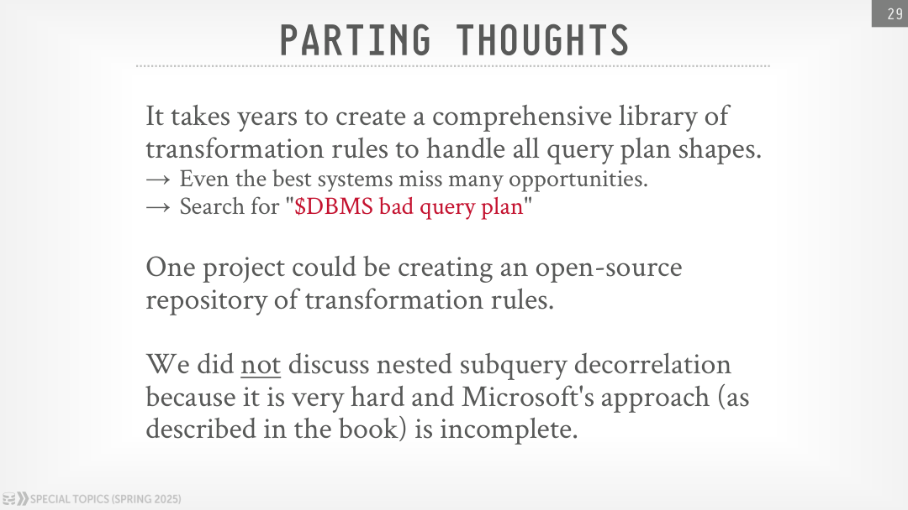

最后强调一下：我们讲了一些基本的、看起来很明显的优化，但要为可能遇到的任何查询计划生成所有可能的转换，几乎只能靠反复试错。搜索你喜欢的任何数据库名字，再加上“bad query plan”，就会找到很多博客文章：这是我的查询，这是查询计划，看看 SQL Server、Oracle、Postgres 或 MySQL——不管是谁——怎么选了这么糟糕的计划，这本该很明显。

原因可能是成本模型不够好，但很多时候也是因为缺少转换规则。Broadcom 收购 Pivotal 或 VMware 后，把 GitHub 上的 ORCA 仓库归档了，我认为他们还删除了所有 issue 和 pull request，这很遗憾。以前在那里可以看到：我们遇到这个查询，漏掉了这个转换；然后新增一条转换规则来处理它。

这就是通过不断有人运行查询，说“这太糟糕了，为什么不这样做”，然后添加规则实现的。所以需要很多年，甚至几十年。

如果能有一种办法，从 CockroachDB、Calcite 中提取这些东西，或者从 ORCA 的旧提交中找到类似内容，那会很好。本书介绍了一些基本规则，但如果能有一个不针对某个特定系统的规则库或仓库——虽然做得通用可能很难——列出所有可用转换，那么像我们这样构建新查询优化器的人，就可以直接以它为起点，而不必花十年等人运行查询、发现错误。

下节课会讲德国人的工作。我知道 Thomas 的手机上有 Slack，或者德国那边某个免费版本的类似工具。当有人在他的数据库系统中运行了一个让优化器应付不了的查询，他就会收到提醒，立刻去弄清楚需要添加什么转换规则来修复。还是要靠试错、看各种随机查询；fuzzer 也找不到所有问题。如果能提前有这些规则就好了。

这节课没有讨论的另一个关键内容是子查询去相关化。我说过不要读那一部分，希望你们没有读。这非常难，我们会花一整节课讲怎么做。书里实际上没有涵盖解决问题的全部方法。Microsoft 还有一篇正在撰写的论文，修复了书中处理不了的一些情况；那项工作我至少现在还不能分享。

我们还会读德国人的方法。他们这个月或上个月刚出了一篇新论文，现在已经放在课程网站上，修复了他在 2015 年还不知道的一些问题。所以这非常难，我们要花一整节课讨论。这本书并不完整，但我们几周后会讲。

## 第 48 页：下节课

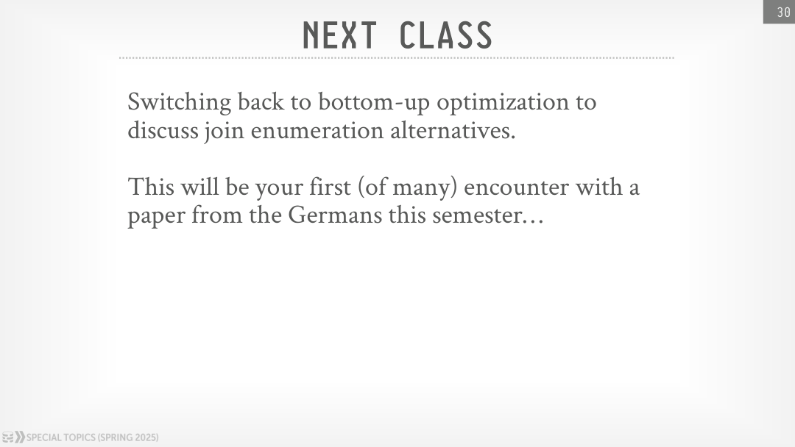

下节课将是你们本学期多次接触德国人论文的第一次。他们的论文非常棒，他们简直是怪才。我们会看他们如何做连接枚举，因此现在要切换回自底向上：先讲自底向上连接枚举，然后讲自顶向上连接枚举、自底向上并行化、自顶向下并行化，再讲 unnesting 和其他许多东西。

我们现在已经有了查询优化器的概念框架，接下来要更详细地讨论如何实现这些工业级组件。好，大家下次见。
