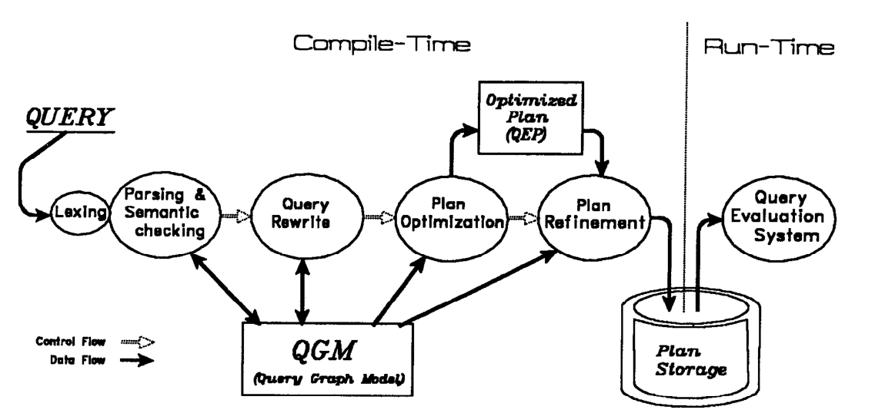
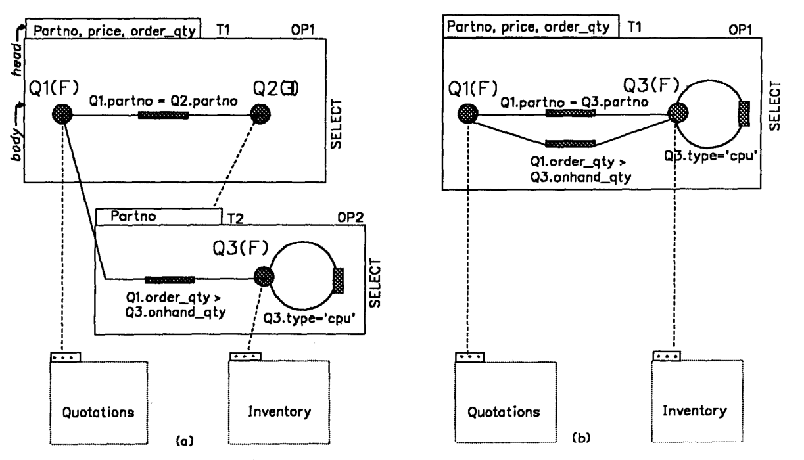

+++
title = "[译文] Starburst 中的可扩展查询处理"
date = 2026-11-16T00:00:00+08:00
slug = "extensible-query-processing-in-starburst"
summary = "Starburst 查询语言处理器论文中文译文，涵盖查询图模型、查询重写、计划优化与执行。"
tags = ["Starburst", "查询优化", "数据库"]
categories = ["数据库系统", "计算机技术"]
draft = false
+++

原文：*Extensible Query Processing in Starburst*

作者：Laura M. Haas、J. C. Freytag[^1]、G. M. Lohman、H. Pirahesh

机构：IBM Almaden Research Center，San Jose，CA 95120

年份：1989；原文页码：377–388，共 12 页。
来源：[原始 PDF](https://15799.courses.cs.cmu.edu/spring2025/papers/03-starburst/haas-sigmodrec1989.pdf)

<a id="abstract"></a>
## 摘要

今天的 DBMS 无法满足那些希望使用 DBMS 的各类应用日益增长的需求。每一类应用都会对 DBMS 提出新的要求。IBM Almaden 研究中心的 Starburst 项目旨在扩展关系 DBMS 技术，弥合应用与 DBMS 之间的这一鸿沟。Starburst 在提供功能完整的关系系统、支持跨应用共享的同时，也将允许有经验的程序员为基础系统添加多种扩展，包括语言扩展，例如新的数据类型和操作；数据管理扩展，例如新的访问方法和存储方法；以及内部处理扩展，例如新的连接方法和查询变换。要支持这些功能，数据库查询语言处理器就必须功能强大且高度可扩展。Starburst 的语言处理器具有功能强大的查询语言、基于规则的优化和查询重写，以及基于扩展关系代数的执行系统。本文介绍 Starburst 查询语言处理器的设计，并讨论如何扩展语言处理器以实现 Starburst 的目标。

<a id="introduction"></a>
## 1 引言

随着关系 DBMS 得到更广泛的使用，它们也吸引了原先设计目标以外的应用。工程、办公和地理等应用都曾尝试使用关系数据库存储数据。然而，每类应用都有标准关系系统无法满足的需求。它们的数据都具有某种结构，有时结构相当复杂，而且都有操作这些数据的函数。但不同应用对于新数据类型和函数的需求各不相同。

对于这类应用，使用关系 DBMS 可能令人沮丧。关系系统提供了应用所需的一些功能，例如关联任意信息片段、方便地存储基本事实、具有自动优化能力的高级查询语言、并发控制和恢复，但对应用所需的函数与数据类型支持不足。因此，要从关系系统中获益，应用本身就必须在 DBMS 之上构建额外的功能。尤其是，应用必须把自己的类型映射为 DBMS 类型，并自行求值所有未内置于 DBMS 的函数，即使这些函数出现在谓词中也是如此。这会使应用既复杂又低效：复杂，是因为每个应用都必须完成这些额外工作；低效，是因为大量数据必须返回应用，以便进行处理和谓词求值，而且 DBMS 内部对这些数据快速访问的支持很少，甚至完全没有，例如缺少专用访问路径或存储管理。

IBM Almaden 研究中心的 Starburst 项目 [SCHW86] 旨在弥合关系 DBMS 与希望使用它们的应用之间的这一鸿沟。Starburst 将作为关系数据库技术和数据库应用的研究试验平台，也用于研究面向应用、硬件体系结构和设备的数据库扩展支持。实现这些目标的关键是可扩展性，即能够定制 DBMS 代码以支持特定应用或硬件。因此，Starburst 支持添加新的表存储方法、新种类的访问方法和完整性约束、新的数据类型、函数以及表操作。在大多数情况下，这些扩展将由熟悉数据库实现的人员完成，我们称其为数据库定制者，简称 DBC，而非最终用户，甚至也非熟练的应用程序员。

Starburst 包含两个主要组件：查询语言处理器 Corona 和数据管理器 Core，大体上分别对应 System R 的 RDS 和 RSS [ASTR76]。Corona 负责将用户查询编译成可高效解释执行的形式。因此，它的职责包括解析查询、进行语义分析、选择执行策略，以及生成实现该策略的算子集合，即查询求值计划（Query Evaluation Plan）。它还通过解释查询求值计划来驱动执行，并控制数据定义过程，也就是创建和销毁表、访问方法等对象的过程。在这些活动中，Corona 按需调用数据管理器的服务。Core 提供的服务包括记录管理，即记录的定位、检索和存储，以及缓冲区管理、访问路径管理、并发控制和恢复。

Core 有一个方面值得进一步说明，因为它对 Corona 的能力提出了要求，这就是 Core 的数据管理扩展体系结构 [LIND87]。该体系结构允许 DBC 为 Starburst 添加新种类的 attachment，即访问方法和完整性约束，以及新的存储管理器。例如，DBC 可以定义一种仅处理定长记录、但效率极高的新存储管理器。Corona 必须确保访问表时调用正确的存储管理器。同样，DBC 可以定义一种新的访问方法，例如 R-tree [GUTT84]。Corona 必须识别该访问方法何时对查询有用，以及何时调用它。因此，语言处理器必须能够适应数据管理器能力的这些扩展。

Starburst 原型在 IBM PC/RT 工作站的 AIX 系统上运行，并使用 C 语言实现，以提高可移植性。Starburst 仍处于原型实现的早期阶段。设计已经基本完成，下文介绍的各个组件都有了初步实现，但健壮程度各不相同。一些组件，例如解析器，已经完成并经过充分测试；另一些组件虽然功能齐全，但尚未集成。我们正在集成这些组件，以形成一个协调一致、可供使用的系统。

许多其他系统提供了与 Starburst 类似的功能。DASDBS [PAUL87]、Exodus [CARE86]、Genesis [BATO86]、Postgres [STON86]、Probe [DAYA86] 和 SABRE [ABIT86] 都是可扩展系统。Exodus 和 Genesis 的特色在于采用所谓的“工具箱”方法：它们都允许数据库实现者混合搭配一组组件，再从这些组件生成 DBMS，从而针对某个特定应用精细定制 DBMS。Starburst 的方法则允许 DBMS 向多个方向扩展，从而促进跨应用的数据集成。DASDBS、Postgres 和 SABRE 基于关系数据模型，其中 DASDBS 允许嵌套关系。其余系统基于函数式数据模型。此外，还有一些具有类似目标的“面向对象”系统，包括 Orion [BANE87, KIM87] 和 Gemstone [MAIE86]。我们选择继续采用关系模型，是因为它功能强大、简单，并且目前在商业领域广受欢迎。我们希望证明，可以通过扩展为用户的对象提供所需支持，同时保留关系 DBMS 的优势。

语言处理分为两部分，分别处理数据定义语句和数据操纵语句。本文重点讨论 Starburst 对数据操纵语句的处理。Starburst 数据定义的概览见 [HAAS88]。下一节讨论 Starburst 的查询语言。第 3 节概述一条数据操纵语句的处理过程。第 4 节介绍查询的内部表示，这种表示对于实现可扩展性至关重要。随后讨论查询优化：第 5 节先介绍语义层面的“重写”优化，第 6 节再介绍基于代价的优化。第 7 节介绍查询执行组件。最后，我们总结实现经验、说明当前状态，并讨论 Starburst 及一般可扩展系统面临的一些挑战。

<a id="language"></a>
## 2 语言

Starburst 的语言 Hydrogen 基于 SQL [IBM87]。与 SQL 一样，查询使用类似英语的语法来表达，即 `SELECT...FROM...WHERE...`。Hydrogen 包含并推广了 SQL 的大多数功能，除关系演算的标准操作外，还允许聚合、集合操作和嵌套子查询。它在两个重要方面扩展了 SQL。首先，它推广 SQL 文法，使语言更加正交 [DATE84]。其次，它允许 DBC 为语言添加新功能，也就是说，Hydrogen 本身是可扩展的。

对 SQL 的推广有两种形式：放宽 SQL 中许多依赖实现的限制，以及添加一种新构造来增强语言的正交性。SQL 对特定构造可以出现的位置有许多限制，其中涉及视图和集合操作，如 `UNION` 等的限制尤其明显。例如，在 SQL 中，如果一个视图执行了聚合，就不能在查询中将它与另一个表或视图连接。这迫使视图使用者了解视图定义。而在 Hydrogen 中，视图可以出现在 select 语句中任何允许基表出现的位置，也可以出现在许多更新语句中。如果通过视图进行的更新没有歧义，就允许执行；否则返回错误。同样，带有集合操作的查询可以出现在任何允许 select 语句出现的位置，例如视图定义和子查询中。Hydrogen 的目标是完全正交：任何表操作都产生一个表，并且都能用在通常允许使用表的地方。

为实现这一目标，语言引入了表表达式 [DATE84]，它可以出现在任何允许视图或表出现的位置。表表达式是以表作为输出的表达式，通常是查询。可以为输出表命名，并在同一查询的后续部分引用它。表表达式显著增强了语言的能力，允许用户提取公共子表达式，将查询模块化。它们虽然类似视图，但功能更强，因为它们可以引用宿主语言变量，也可以与查询的其他部分相关联。

表表达式的一个重要用途是表达递归。通过对命名表表达式形成循环引用，就能表达递归。将规则映射为表表达式后，可以使用 Hydrogen 进行逻辑编程。递归查询可以包含关系演算操作、聚合，甚至外部定义的函数，见下文。因此，还可以在 Hydrogen 中表达路径代数计算 [ROSE86, CARR79]。这样，Hydrogen 就能作为一种集成逻辑编程与数据库访问的语言，使优化范围同时包含规则和数据库查询，从而有机会得到全局优化的执行计划。

DBC 可以通过多种方式扩展 Hydrogen。他们可以定义新的列函数、新的表操作和新的列数据类型。可以定义几种不同类型的函数。标量函数，例如 `Area(Width, Length)`，从单个元组中取得一个或多个字段值，并返回单个值；该元组也可以是复合元组。凡是可以引用列的位置，都可以使用标量函数。聚合函数，例如 `StandardDeviation(Salary)`，遍历一个表中的多个元组，并返回一个聚合值。外部定义的聚合函数可以替代内置聚合函数。Starburst 可以在系统底层调用这两种函数，以更高效地处理数据。例如，在谓词求值器中调用函数，可以减少返回给用户的无关数据量。

还可以定义新的集合谓词函数。集合谓词函数接收一个元组集合和一个谓词作为输入。在 SQL 中，内置集合谓词函数包括 `ALL` 和 `ANY`，其操作数是一个简单谓词，例如 `T1.c1 = T2.c1`，以及一个定义该谓词取值范围的子查询，例如 `SELECT T2.c1 FROM T2 WHERE T2.c2=5`。如果集合中所有元素或任一元素满足该谓词，函数就返回 true。在 Hydrogen 中，DBC 可以定义新的集合谓词函数，例如 `MAJORITY`：当集合中多数元素满足谓词时，它就返回 true。

Hydrogen 中的第四类函数是表函数。它们接收一个或多个表或表表达式，以及可能存在的其他参数作为输入，并输出一个新表。例如，函数 `SAMPLE(table, int)` 可以产生一个由 `table` 中 `int` 行组成的新表。凡是可以使用表或表表达式的位置，都可以使用表函数。它们可以定义新的表操作，以补充基础系统支持的关系演算操作。例如，DBC 可以添加外连接、关系除法，或者求解联立方程的操作。虽然新操作在语法上看起来只是函数调用，但表函数在内部需要复杂的处理，见第 4 节“查询图模型”。

为列定义新数据类型，对 DDL 的影响大于对 DML 的影响。不过，对于编写 DML 查询的用户，这些类型极为有用，因为它们能够使类型检查更好地反映用户的语义意图，并使用户的数据具有更好的结构。Starburst 将允许定义几乎任意类型。外部定义类型的列，可以出现在任何允许内置类型的列出现的位置，也可以在这些列上定义函数。我们对外部定义类型的处理方法概述见 [WILM88]。

借助更强的正交性和可扩展性，Hydrogen 能表达非常复杂的查询。这是 Starburst 支持逻辑编程等非传统应用所必需的。与 SQL 一样，Hydrogen 的内置构造数量相对较少，这使文法保持小巧紧凑，也可能让语言更易学习。然而，这也带来两个困难。首先，虽然可以表达复杂查询，但它们在 Hydrogen 中的表示通常也相当复杂。这可能使 Hydrogen 非常难读难写，增加应用开发难度。可能需要在 Hydrogen 之上添加一些“语法糖”，使 Starburst 足够易用。此外，即使构造数量很少，同一查询也常常有多种表达方式。例如，在 SQL 中，查询所有薪资高于其经理的雇员，既可以写成子查询，也可以写成连接 [KIM82]，还可以在谓词顺序等方面有多种变化。在 Hydrogen 中，它还可以用表表达式写成若干不同形式。在可行的情况下，查询性能应当取决于查询的含义，而非表达方式；这有助于增强非过程性。识别查询的等价表达式，为优化带来了重大挑战。

尽管存在潜在困难，总体而言，我们对 Hydrogen 的表达能力感到满意。我们正在试验一种功能强大的查询重写体系结构，以解决优化问题，见第 5 节“查询重写”。待积累一些 Starburst 应用开发经验后，我们将能够更好地处理复杂性问题。

<a id="overview"></a>
## 3 语言处理概览

与 System R 和 R* 一样，数据操纵语言 DML 的处理分为两个阶段：先编译查询，再执行 [CHAM81]。这两个阶段在时间上可以分离，因为编译结果可以存储起来供以后使用。图 1 展示了查询处理的各个阶段。首先将查询分解为 token，然后通过解析生成内部表示，即查询图模型 QGM。查询的语义分析也在解析期间完成，因此可以保证生成的 QGM 是有效的。查询重写阶段将查询的 QGM 表示转换为等价的 QGM，以获得更好的性能。可以跳过这个阶段来加快查询编译，但代价可能是运行时性能较低。计划优化器根据估计代价为查询选择执行策略，即查询求值计划 QEP，然后进一步细化该策略，即 Plan Refinement，以便查询求值系统在运行时高效地解释执行。



**图 1：查询处理的各个阶段。**

<a id="qgm"></a>
## 4 查询图模型

Starburst 必须能够适应多种扩展，包括语言扩展、数据管理扩展和语言处理扩展。对于其中许多扩展，DBC 可能希望影响 Corona 的基本内部处理。例如，提供外连接操作的 DBC 可能希望告诉系统，何时能将该连接上的谓词“下推”到各个表上，也就是应用到各个表。外连接的谓词下推规则不同于普通连接 [ROSE84]。同时，扩展通常又能利用基础系统的许多功能，例如系统目录接口。理想情况下，DBC 的扩展应当能够直接调用 Corona 实现这些公共功能的代码，而不必修改它们。

在 Starburst 中，我们通过定义一种通用的查询内部表示，并向 DBC 开放这种表示，同时满足上述两个目标：DBC 可以尽可能利用 Corona 的功能，其余部分则自行编写。我们将这种表示称为查询图模型，即 Query Graph Model，简称 QGM。可以把 QGM 看作一个存储查询信息的内存数据库的 schema。这个数据库是查询编译各阶段之间的主要接口，见图 1，也是 Corona 与各类扩展之间的主要接口。

本文没有篇幅形式化描述 QGM 的语义 [PIRA89]。我们将使用下面的查询及其对应的 QGM，见图 2(a)，说明 QGM 最重要的构造：

```sql
SELECT partno, price, order_qty
FROM quotations Q1
WHERE Q1.partno IN
    (SELECT partno
     FROM inventory Q3
     WHERE Q3.onhand_qty < Q1.order_qty
       AND Q3.type = 'cpu')
```



**图 2：(a) 一个查询的 QGM；(b) 应用重写规则后的同一 QGM。**

这个查询返回每份符合以下条件的报价所对应的零件编号、价格和订购数量：零件为库存中的 CPU 零件，并且现有库存不足。

在 QGM 中，查询表示为一系列高级表操作。这些操作包括：`SELECT`，执行选择、投影和连接；`GROUP BY`，将输入表的元组划分为等价类，即组，并对各组应用聚合函数；以及 `INSERT`、`UPDATE`、`DELETE`、`UNION`、`INTERSECTION` 等。我们的查询包含两个 `SELECT` 操作，每个 `SELECT...FROM...WHERE` 对应一个。图 2(a) 用两个独立的框表示它们。每个操作都有一个 head，描述输出表的列名和数据类型[^2]，以及一个以图形方式表示操作的 body。在该查询中，外层 `SELECT` 包括一次对 `quotations` 表的访问，以及一个针对子查询结果的谓词。内层 `SELECT` 包含一次对 `inventory` 的访问，以及一个由两个合取项组成的谓词。每次访问存储表或派生表，即另一个操作产生的表，都在 QGM 中表示为一个顶点，以及一条将该顶点连接到所访问表或操作的虚线，称为 range edge。谓词的每个合取项，则表示为连接一个或多个顶点的实线上的一个矩形，这种实线称为 qualifier edge；自环表示单表谓词。因此，在该查询的 QGM 中，Q1 表示对 `quotations` 的访问，Q2 表示对下层 `SELECT` 结果的访问，Q3 表示对 `inventory` 的访问。存储表用虚线框表示，以区别于派生表。Q1 与 Q2 之间的 qualifier edge 表示针对子查询结果的谓词，即 `IN` 谓词；Q1 与 Q3 之间的边表示下层 `SELECT` 谓词的第一个合取项 `Q3.onhand_qty < Q1.order_qty`；Q3 上的自环表示 `Q3.type = 'cpu'`。

顶点表示迭代器，可以是 setformer，也可以是量词。setformer，例如顶点 Q1 或 Q3，从输入表创建一个新表，也就是集合，本质上是通过投影实现的。量词，例如 Q2，则是在其输入表上取值的元组变量。setformer 与量词的区别在于：setformer 遍历的表中，每个元素都可以用来构造该操作的输出，即输出表；量词遍历的元素则不会加入输出表，而只用于限制输出。因此，Q3 是一个 setformer，生成包含 `partno` 的表。Q2 是在此表上取值的量词：它所遍历的元素用于限制上层框中 Q1 产生的元素，但不会加入上层框的结果。

多个迭代器可以在同一个输入表上取值，因为每个迭代器都代表一次独立的表访问。量词有不同类型，不同操作可以对它们作不同解释。例如，`SELECT` 操作将 `Exists`（∃）和 `All`（∀）类型分别解释为存在量词和全称量词。Q2 是一个存在量词，对应查询中的 `IN` 关键字。setformer 只有一种内置类型，即 `ForEach`（F），不过也可以添加其他类型，见下文。

顶点，即 setformer 和量词；边，即 range edge 和 qualifier edge；以及带有 head 的框，是 QGM 的主要构造。这些构造非常强大，能够表达任意复杂的查询。此外，由于这些构造的解释可以随操作类型而变化，QGM 是可扩展的。我们预计，最常见的扩展是添加新的表操作，这要求 DBC 为 qualifier edge 以及任何新的迭代器类型赋予解释。QGM 的其余部分是“通用的”，即无论操作是什么，这些信息都是标准的，并具有标准解释。这是因为 QGM 的大部分内容描述的是输入表和输出表，而非操作本身。

例如，假设要添加左外连接操作。此时，qualifier edge 与 `SELECT` 中一样，对应谓词。然而，谓词的含义不同，因为即使找不到匹配的内侧值，外侧元组仍必须包含在结果中。标记这一区别的一个简单办法是，将外侧表的 setformer 改为一种新类型，例如 `PF`，即 Preserve Foreach。Corona 的许多内置功能，例如系统目录查找、名称解析和大部分语义检查，都可以用于生成包含外连接的查询的 QGM。对于不同的部分，DBC 必须编写代码。在本例中，他可能需要编写代码来检查该外连接是否满足结合律或交换律，一般情况下并不满足，并在必须保留元组的地方将 F 类型的 setformer 改为 PF。当然，在用户能够实际编写并执行外连接查询之前，系统的其他部分也必须修改。查询重写规则、优化器代价估计、执行例程等都是必需的。这里的重要之处在于，QGM 可以修改，从而能够在内部表示这种操作。

文献中曾描述过类似的查询图 [RIES83, ZANI82]。QGM 在两个方面扩展了这些模型。首先，QGM 具有 Hydrogen 的完整表达能力，因此可以表示语言中的复杂特性，例如嵌套操作、不同迭代器类型、聚合、相关引用和递归。其次，由于接口具有通用性，QGM 还可以表示系统和语言的扩展，例如外部定义的表函数和迭代器类型。

总之，QGM 为查询提供了一种易于理解、详细且无歧义的语义表示，DBC 在向系统添加操作时可以修改它。此外，由于表抽象具有通用性，DBC 可以利用 Corona 提供的公共服务。因此，QGM 在简化 DBC 工作的同时，也赋予他很大的灵活性和能力。

<a id="rewrite"></a>
## 5 查询重写

关系 DBMS 需要重写查询，原因有几个。一个查询常常有几种不同的表述。由于关系查询语言本应是非过程式的，这些表述应当具有等价的性能。此外，复杂应用常依赖视图提供的抽象，降低查询描述的复杂性。由于视图定义对查询编写者是隐藏的，只有 DBMS 才能重写涉及视图的查询。

查询重写期间可以执行的变换十分丰富。可以将视图与使用它的查询合并，System R 和 INGRES 就采用了这种做法 [STON76]。可以消除冗余连接 [OTT82]。可以把谓词从一个操作迁移到另一个操作，以尽量减少访问的数据量，这也包括“横向信息传递” [ULLM85]。随着 DBMS 查询引入递归，还应纳入 magic sets 等变换 [BANC86]。语义查询优化利用完整性约束变换查询 [KING81, SHEN87]。这些变换都可能改善查询性能，而且不断有新的变换被提出，例如 [DAYA87]。

即使对于标准关系语言，我们也不太可能获得一套完备的变换。对于 Hydrogen 这样的可扩展语言，随着新语言构造和新操作的加入，还需要新的变换。因此，系统的这一部分必须具有很强的可扩展性。为实现这一点，我们在查询处理中设立了一个新阶段，使用基于规则的方法在 QGM 层面处理查询重写 [HASA88]。查询重写本质上是一种优化。不过，传统 DBMS 优化主要处理低层决策，例如表访问方法，以及连接的方法和顺序，并生成查询执行计划。查询重写发生在更高的抽象层面，在我们的系统中就是 QGM，但这个层面又略低于查询语言层面，也就是说，稍微更具过程性。

虽然已有许多基于规则的系统，我们仍选择为查询重写开发自己的规则系统。我们需要丰富的查询图操纵原语、规则的嵌套执行、对规则执行顺序的显式控制，以及某种在保持一致性的同时避免无限循环的终止保证。我们估计，将现有系统集成到 Starburst 并修改到满足这些要求，工作量会大于自行实现的成本。

在我们的规则系统中，规则语言是 C。一条规则由条件和动作两部分组成，每部分都是一个 C 函数。规则编写者应保证每条规则都将一个一致的 QGM 表示转换成另一个一致的 QGM 表示，也就是说，每条规则都完成一次完整变换。我们提供一组用于重写基础系统操作的规则。DBC 可以为这些操作添加规则，也可以为新的外部定义操作提供规则。规则可以分组为规则类，以限制需要检查的规则数量、支持规则模块化，并使 DBC 和我们能够更明确地控制执行顺序。

例如，考虑以下规则：

规则 1：子查询转连接。[^3]

```text
IF OP1.type = Select ∧ Q2.type = '∃' ∧
   （每次对存在性谓词求值时，T2 中至多有一个元组满足该谓词）
THEN
    Q2.type = 'F';    /* 转换为连接 */
```

规则 2：操作合并。

```text
IF OP1.type = Select ∧ OP2.type = Select ∧ Q2.type = 'F'
   ∧ (NOT (T1.distinct = false
           ∧ OP2.eliminate_duplicate = true))
THEN
    将 OP2 合并到 OP1;
    IF OP2.eliminate_duplicate = true
    THEN OP1.eliminate_duplicate = true;
```

第一条规则指出：如果对于主查询的每个元组，子查询至多有一个匹配元组，那么就可以将存在子查询转换为连接。第二条规则指出：只要两个 `SELECT` 操作对重复项的处理方式不冲突，就可以合并它们。[^4] 将这些规则应用于图 2(a) 的 QGM，就会得到图 2(b) 的 QGM。合并操作后，优化的空间更大，因此可能产生更好的执行计划。

我们为基础系统操作提供的规则主要分为三类：谓词迁移、投影下推和操作合并。谓词迁移允许将谓词下推到较低层操作，以尽量减少检索的数据量。也可以复制谓词，并将副本迁移到多个操作，以降低执行代价。将谓词向上移动，再可能向下移到其他操作，也可能有益。投影下推规则避免检索表或视图中未使用的列。这些规则会与谓词迁移规则相互作用：例如，将一个谓词下推到较低层操作后，上层操作便不再需要仅由该谓词引用的列。操作合并规则合并 QGM 的“框”，将原操作的谓词和迭代器取并集，为优化提供更大空间。视图合并规则和示例中的合并规则都属于这一类。并非所有操作都能合并，例如 `GROUP BY` 不能与 `SELECT` 合并。即使两个操作都是 `SELECT`，也不一定能合并，例如这取决于它们如何处理重复项。其他规则将子查询转换为连接 [KIM82, GANS87]，并执行各种其他变换。

DBC 可以利用上述任一类中的现有规则，也可以在这些类或其他类中编写自己的规则。例如，谓词下推规则有两种：一种规定何时可以从某个操作向下推出谓词，另一种规定某个操作何时可以接收被下推的谓词。添加左外连接操作的 DBC，希望前一种规则自动适用于 F 类型的 setformer，见第 4 节，而不必重新指定规则。但这些规则不应适用于 PF 类型的 setformer，否则会消除本应保留的元组。左外连接与 `SELECT` 不同，它不保留谓词；不过，如果谓词只引用 PF setformer 的列，它可以接收该谓词。此时，谓词会穿过外连接操作，下推到 PF setformer 所遍历的操作。因此，DBC 必须自行编写接收谓词的规则。

除重写规则外，我们的规则系统还有两个主要组件：规则引擎和搜索设施。规则引擎独立于各条具体规则，但其设计面向查询重写规则的一般需求。它使用前向链策略处理 `IF THEN` 规则。系统提供几种控制策略：顺序策略，按顺序处理规则；优先级策略，优先给予高优先级规则执行机会；统计策略，根据用户定义的概率分布随机选择下一条规则。为了避免规则引擎在查询重写上耗时过多，可以为它设定预算。预算耗尽时，处理会停在 QGM 的一个一致状态上。搜索策略独立于规则和规则引擎，但专用于 QGM。它的作用是遍历 QGM，为规则提供工作上下文。系统同时支持深度优先，即自顶向下，以及广度优先搜索。

一个查询可能有多种候选变换。例如，一个连接谓词可以下推到它的任一迭代器，但不能同时下推到两者！如果查询在多处使用同一视图，可以在每处都将视图合并到查询中，也可以只物化一次，再使用多次。要在这些方案间选择，就需要代价分析。然而，只有在计划层面才能得到代价估计，因为必须先决定连接顺序、访问方法等，才能估算代价。因此，查询重写必须与计划优化交互，才能估计不同 QGM 表示的代价。我们最初选择在查询重写期间生成候选方案，再在优化期间进行选择。为此，我们向 QGM 添加了一个新操作 `CHOOSE`，将这些候选方案连接起来。优化器选定一个方案后，可以消除此操作；也可以将它保留在计划中直到运行时，再根据运行时参数，例如程序设计语言变量的值，作出选择。Graefe 曾为计划提出过一种类似操作 [GRAE89]。

将候选方案的选择推迟到优化阶段，有一个缺点：查询重写期间无法对候选方案剪枝。这对谓词迁移尤其麻烦，因为候选方案数量随迭代器数量与谓词数量的乘积增长。我们正在研究将查询重写与优化阶段集成起来的方法，以避免这一问题。

我们已构建规则系统，并为基础操作及若干扩展定义了规则。最近，我们一直在添加递归查询的重写规则，包括执行 magic set 变换的规则 [BANC86]。仍有大量工作要做。特别是，我们希望全面研究规则系统的性能。我们希望证明迄今设计的重写规则的正确性，并开发工具帮助 DBC 确立其变换的正确性。我们正在设计一种限制更多的规则语言，以便自动分析规则并优化规则执行，同时也在研究 RETE 网络 [FORG82] 和规则索引等高效执行技术的适用性。最后，我们需要为更多扩展添加规则，以确定规则系统是否足够灵活，并研究不同扩展的规则之间的相互作用。

<a id="optimization"></a>
## 6 计划优化

给定查询的 QGM 表示，优化器估计执行该查询的不同查询求值计划 QEP 的代价，并选择其中最便宜的一个。与其他查询优化器一样，可以从优化的三个主要方面来描述 Starburst 优化器的方法：（1）计划生成，（2）计划代价估算，（3）搜索策略。Starburst 的可扩展性目标再次要求，这三个方面的描述方式必须比早期 System R [SELI79] 和 R* [LOHM85] 优化器更加灵活；后两者将所有执行策略、代价公式和搜索策略都嵌入代码。挑战在于，为每个方面找到一种既高效又易于指定的表示，使其能够描述丰富的候选执行计划，同时不牺牲编译器性能。为增强可扩展性，这三个方面在设计上基本正交，因此可以彼此独立地修改。

优化器算法自底向上、独立地优化每个 QGM 操作，使用规则驱动的计划生成器，以及该操作类型专属的规则，构造 QEP 并计算其代价。例如，最常见的操作类型 `SELECT`，既有以各种方式访问存储表的规则，也有连接多个迭代器的规则。添加左外连接操作的 DBC 需要为外连接操作本身添加新规则，但可以利用现有的单表访问规则。

Starburst 计划生成器采用构造式的“搭积木”方法生成候选计划 [LOHM88]。这种方法更接近 Genesis 项目的方法 [BATO87a]，而非 Exodus 项目 [GRAE87a, GRAE87b] 或 Freytag [FREY87] 的计划变换方法。可执行计划由一组类似文法的参数化产生式规则定义，这些规则称为 strategy alternative rules，简称 STARS。它们将低层“终结符”数据库算子串接起来，定义高层“非终结符”构造，其方式类似于函数式程序设计语言 [BACK78]。这种文法中的“终结符”是一个低层计划算子，简称 LOLEPOP，运行时由查询求值系统解释执行。LOLEPOP 是关系代数的一种变体，例如 `JOIN`、`UNION` 等，并补充了 `SCAN`、`SORT`、`SHIP` 等物理算子。每个 LOLEPOP 表示为一个函数，对零个或多个元组流进行操作，并产生零个或多个新流，通常是一个。Starburst 的 QEP 是 LOLEPOP 调用的嵌套。一个 STAR 包含一个名字，即文法的非终结符；零个或多个参数；以及一个或多个用 LOLEPOP 或其他 STAR 名字表达的候选定义。可以为任一候选定义附加 `IF` 条件，确定其适用性；还可以使用“∀”子句，生成一组相关的候选定义。

每个表，无论基表还是计划结果，都具有一组概括其特征的属性 [BATO87b, ROSE87]，因此这些属性对于代价模型十分重要。属性分为三类：关系属性，例如已连接的表、已访问的列和目前已应用的谓词；操作属性，例如元组的顺序，如果存在顺序的话，以及结果所在的站点；估计属性，例如累计代价和基数。每个 LOLEPOP 都会以受其参数影响的方式，改变操作数的某些属性，通常还会增加代价。这些改变，包括相应的代价和基数估计，由每个 LOLEPOP 对应的一个 C 函数定义。例如，`SORT` 将元组顺序改为参数指定的顺序；`SHIP` 将站点改为指定站点；`SCAN` 将存储表变为驻留内存的元组流，还可以选择只取部分列，并应用作为参数列举的谓词。后一种选择当然也会改变基数属性。

STAR 可以要求其操作数具备某些属性，某些连接方法尤其如此。例如，归并连接要求输入表流按连接列排序。额外的“glue” STARS 用于获得所需属性，寻找满足要求的最便宜计划。必要时，glue STARS 可以添加 LOLEPOP，使现有计划满足要求。例如，可以添加 `SORT` 来改变元组顺序，或添加 `SHIP` 来改变站点 [LOHM88]。

当一个 QGM 操作，特别是 `SELECT`，包含多个迭代器时，连接枚举器便枚举所有有效的连接序列。它从先前为单迭代器集合生成的计划开始，反复将两个[^5]较小的迭代器集合组合成更大的迭代器集合。对于每一对这样的集合，连接枚举器都会调用计划生成器，使用连接 STARS 生成并评价该连接的候选 QEP。枚举过程利用引用两个以上迭代器的连接谓词、隐含谓词，以及允许复合内表的连接，所产生的计划集合可能比 R* 和 System R 优化器更大 [ONO88]。

Starburst 更广泛的计划范围，需要更强的搜索限制机制。我们的优化器既有用于限制搜索空间的查询专属参数，也有可扩展的搜索策略。STAR 的每个候选定义都会关联一个 rank，计划生成器可据此剪去超过给定 rank 的候选定义。此外，一个优先队列机制对 STAR 的求值顺序进行参数化。只需改变优先级，这个通用机制就能实现广度优先、深度优先及许多其他策略。另外两个参数允许连接枚举器剪去包含复合内表，即“bushy trees”，或者不包含连接谓词，即笛卡尔积的连接序列，System R 和 R* 始终都进行这种剪枝。

我们已经实现完整的连接枚举器 [ONO88] 和一个初步的基于 STAR 的计划生成器 [LEE88]。计划生成器包含：（1）通用 STAR 求值器，（2）选择下一个待求值 STAR 的搜索策略，（3）STAR 数组。这种设计允许优化器设计者添加、修改或删除 STAR 数组中的规则，而不影响搜索策略或规则求值器的代码。同样，可以改变搜索策略，而不影响规则求值器或 STARS。每次调用计划生成器时，它都会随着 STAR 被求值并替换为候选定义，构造一棵候选 QEP 树，这很像宏处理器的工作过程，直到所有 STAR 都完全细化为 LOLEPOP。随后，从存储表的统计信息出发，调用各个 LOLEPOP 的属性函数，评价它对操作数属性的影响。目前，STAR 数组在代码中手工初始化；但最终，我们希望构建一个编译器，使 DBC 能够使用非常高级的函数式程序设计语言来指定 STARS。

这种设计功能强大，而且高度可扩展。使用 STARS，我们可以轻易表达 R* 优化器的全部策略，以及面向复合内表的新策略，例如 `(A*B)*(C*D)`、新的连接方法、新的访问方法、索引 AND 操作、半连接和 Bloom-join 等过滤方法 [MACK86]、在中间结果上动态创建索引、将子查询转换为连接，以及在任意位置物化表以强制执行投影；所有这些只需不到 20 条规则。我们可以为现有算子添加新属性、添加新算子、以新的方式组合现有算子来形成新计划、缩小或扩大搜索空间，以及改变搜索方法。其中许多改变只需简单修改现有规则或赋予参数不同的值即可完成。另一些改变，例如添加新属性，则要求 DBC 具备更多经验。易于扩展的优化器对于实现 Starburst 的目标至关重要。我们计划试验各种扩展，以展示优化器的能力和可扩展性。

<a id="qes"></a>
## 7 查询求值系统

运行时，Starburst 的查询求值系统 QES 接收查询求值计划 QEP，并针对数据库对它求值。QES 调用 Core，将表和 attachment 中的元组检索到自己的缓冲区集合中，然后在这些缓冲区中执行连接或聚合等复杂操作。为实现可扩展性，我们需要一个易于修改和扩展的 QES，使其能够容纳新的访问方法或连接方法等，而不必改变整体结构或实现。为此，我们在优化器与 QES 之间建立了代数接口。QEP 是一棵算子树，类似于关系代数中的查询描述。每个算子接收一个或多个元组流作为输入，并产生一个或多个元组流，通常是一个，作为输出。我们通过惰性求值实现流的概念，使算子之间的“中间”结果可以小至一个元组。

这种方法有几个优点。首先，流抽象使添加新算子变得容易。算子间的交互可以标准化，因此，从其他算子获取元组、向其他算子传递元组的细节，可以隐藏在预定义宏中。新算子的实现者可以复用这些宏，而不必为每项扩展重新实现它们。其次，代数接口保证了 QES 各部分的独立性。只要算子使用流模型作为彼此之间的接口，我们就不认为 QES 其他部分的扩展或改变会要求修改现有算子。最后，代数方法不仅为解释 QEP 的组件提供接口，也可以作为将 QEP 编译成迭代程序的组件的输入描述 [FREY86]。

Starburst 将包含约十二个内置 LOLEPOP。其中最难实现的无疑是 `JOIN` 算子。原因之一是，在 Starburst 中，我们将子查询视为特殊种类的连接。这大大简化了 QGM、查询重写和优化，但也给执行系统带来几个问题。首先，连接算子必须能够处理不同种类的连接，即 QGM 中不同迭代器类型之间的连接。这些连接种类包括“普通”连接、“exists”连接，即半连接、“scalar-subquery”连接，即以标量比较算子引入子查询的连接，以及与全称量词对应的“op-ALL”连接。随着 QGM 添加新的迭代器类型，这组连接种类也可以扩展。每个连接算子都接收一个表示连接种类的函数名作为参数之一。这样，一个算子就能处理多种连接种类。[^6] 通过明确区分连接的“控制结构”，即连接方法，与连接过程中执行的功能，即连接种类，我们为连接实现提供了额外的灵活性。例如，可以将“左外”连接作为一种连接种类添加，使左外连接算子能够利用现有的连接求值方法。也可以选择，或同时选择，仅通过添加一个新 LOLEPOP，加入专用于左外连接的新连接方法。

其次，与 SQL 一样，Hydrogen 允许相关子查询和非相关子查询，连接算子必须处理这两者。在 Corona 中，我们用一种统一机制“evaluate-on-demand”，即按需求值，取代分别用于非相关子查询和相关子查询的“evaluate-at-open”和“evaluate-at-application”机制 [LOHM84]。采用这种方法后，只有需要子查询时才对其求值。我们还加入了相应逻辑：当相关值没有变化时，避免重新求值子查询，从而提高执行性能。

第三个问题出现在对包含子查询的 OR 谓词求值时。考虑下面的 Hydrogen 查询：

```sql
SELECT * FROM T1
WHERE T1.A1 = 5 OR T1.A2 =
    (SELECT B2 FROM T2 WHERE T2.B1 = 16).
```

这两个谓词必须由不同算子执行。第一个可以使用 `FILTER` 算子求值；另一个可以使用 `JOIN` 算子，采用任意连接方法并结合“scalar-subquery”连接种类，将 T1 与子查询涉及的表连接起来。然而，如果先执行 `FILTER`，它就不能直接丢弃不满足该谓词的元组，而必须将元组交给 `JOIN` 算子进一步处理。为此，我们设计了一个额外的 `OR` 算子，它基于“流的思想”，而且不需要改变用于求值各谓词项的算子。

在 QES 的初步实现过程中，我们认识到，由于采用代数方法，它的结构非常规整，接口也很简单。为了支持扩展 QES 的 DBC，我们希望提供一种额外工具，让他无需了解为组件添加或删除算子时应当修改系统的哪些部分。我们考虑过提供一个 QES 生成器。DBC 可以用某种明确定义的方式，指定每个算子及其对应的执行例程，可能还包括打印例程和构建例程。生成器随后会添加必要的数据结构和过程，将这些算子“粘合”成 QES。

<a id="conclusions"></a>
## 8 结论

Starburst 原型的实现正在稳步推进。本文介绍的 Corona 各部分都已在 Core 的基本功能之上完成初步实现，目前正在集成。任意复杂的 Hydrogen 语句都可以被解析并转换为 QGM，而 QGM 可以由一组初步的视图合并和谓词下推规则进行重写。优化器的大部分基础设施已经就位，包括 STARS 的推理引擎。大多数 QEP 算子的解释例程已经编写完成，并在人工构造的环境中经过测试，但将优化器输出的 QEP 转换为可执行 QEP 的例程，目前只有很少一部分存在。我们已经执行了第一个单表 `SELECT`。关于语言处理的可扩展性，我们也有了一些初步证明。我们已能够扩展系统的前端部分，添加左外连接操作，使包含外连接的查询现在可以被解析、表示为 QGM，并由重写规则正确处理。为新操作向优化器添加规则似乎很容易，尽管定义这些规则可能很难；在算子代码已经写好的前提下，为 QES 添加新算子也十分简单。

虽然 Corona 的工作远未完成，但我们已经从可扩展系统的设计与构建中学到几个重要经验。迄今为止，我们在构建和扩展 Corona 方面取得的成功，基于两个原则：正交性和表抽象。理解系统中哪些部分在逻辑上正交，使我们能够将它们分离，形成高度模块化的设计。这样，复杂组件就被分解成独立部分，可以逐一替换或扩展。让扩展与基础系统保持正交，也为不同应用领域之间的共享奠定了基础。Corona 各处都依赖正交性。此外，强大的内部处理模型也至关重要。基于表抽象和 QGM 表示设计语言处理，带来了更简单的设计和清晰的扩展接口。由于扩展与基础系统都使用同一种高层模型来编写，不同扩展与系统之间的共享应当得到加强。

总体而言，我们对 Corona 的设计感到满意。各个部分都很强大，也易于扩展。不过，仍然存在一些顾虑。在 Corona 中，系统不同层次的扩展采用不同方式，各自适合相应的问题。例如，查询重写使用产生式规则，代价优化采用类似文法的规则，而 QES 采用代数方法。我们需要在实践中观察这些方法能否良好配合，能否合并进一个统一框架，以及这样合并是否有益。系统性能也是一个尚未解决的问题。只有完成原型并使用真实应用进行实验，才能回答这些问题。

可扩展系统还有许多其他未解决的问题。目前，定制 Corona 乃至整个 Starburst，需要熟练的程序员，而且许多扩展还要求具备数据库技术和实现经验。即使这种程度的可扩展性已经比标准 DBMS 大有改善，我们仍认为研究让定制更加容易的工具十分重要。哪些工具是合适的？这一过程能够简化到什么程度？如何组合独立扩展？或者更重要的是，如何确保独立扩展之间不会冲突？例如，如何确保某个扩展的变换规则不干扰另一个扩展的规则？一般而言，在进行多项扩展后，如何保证 DBMS 仍然“正常”？随着我们考察具体应用，并进一步扩展 Starburst 的功能，还会出现许多其他挑战。例如，在分布式环境中，不同 Starburst 节点可能沿不同方向扩展，这时查询规划和元数据协调就可能很困难。

近期，我们正在完成原型实现。未来，我们计划研究这种可扩展技术的用途。我们将为 Starburst 构建应用系统，或者请其他人构建，以检验系统的可扩展性。目前，我们正在探索以知识为基础的系统，将其作为第一个应用领域，研究如何在数据库中表示和支持 frame 与规则、哪些功能应放在 DBMS 中、哪些功能应留在应用中等问题。我们还将继续推进数据库技术，包括新的访问方法、连接算法、并行性和其他执行策略，并将 Starburst 作为研究试验平台。

总之，本文描述了 Starburst 语言处理组件的整体设计。语言处理的主要挑战，是处理数据管理器、语言以及语言处理本身的扩展。我们认为，Corona 在实现这一目标方面已经取得了很大进展。帮助我们实现这种可扩展性的新特性包括：基于表的查询内部模型、用于查询重写的规则处理、优化各组件的分离及使用类似文法的规则生成计划，以及基于关系代数的执行系统。不过，可扩展数据库研究仍有许多令人振奋的开放问题。

<a id="acknowledgements"></a>
## 致谢

还有几位同事为 Corona 的设计作出了重要贡献。Mavis Lee 和 Waqar Hasan 分别设计并实现了基于规则的优化器原型，以及查询重写的规则引擎。Kiyoshi Ono 创建了优化器基础设施和连接枚举器。Bill Cody 设计并构建了词法分析器和解析器。Bruce Lindsay 和 George Lapis 设计并实现了 Corona 的大部分基础设施，以及可扩展的数据定义、授权和目录管理组件。Shel Finkelstein 在研究 Starburst 如何支持以知识为基础的系统应用时，提出了许多增强 Corona 可扩展性的建议，也常常促使我们重新审视设计。Starburst 的同事和合作者 Walter Chang、John McPherson、C. Mohan、Peter Schwarz、Paul Wilms 和 Bob Yost 改进了我们的设计，澄清了我们的思路，同时也促使我们进一步努力，以适应他们在 Core 中的创新。感谢 Bruce Lindsay、Shel Finkelstein、John McPherson、Pat Selinger、Irv Traiger、Paul Wilms 以及几位匿名审稿人，他们认真阅读了本文草稿，并提出了建设性意见。

<a id="bibliography"></a>
## 9 参考文献

- [ABIT86] Abiteboul, S., M. Scholl, G. Gardarin and E. Simon, Towards DBMSs for Supporting new Applications, *Procs. of the Twelfth International Conference on Very Large Databases* (Kyoto, Aug. 1986).
- [ASTR76] Astrahan, M., M. Blasgen, D. Chamberlin, K. Eswaran, J. Gray, P. Griffiths, W. King, R. Lorie, P. McJones, J. Mehl, G. Putzolu, I. Traiger, B. Wade and V. Watson, System R: Relational approach to database management, *ACM Transactions on Database Systems* 1:2 (June 1976).
- [BACK78] Backus, J., Can programming be liberated from the von Neumann style? A functional style and its algebra of programs, *Comm. ACM* 21:8 (Aug. 1978).
- [BANC86] Bancilhon, F., D. Maier, Y. Sagiv and J. Ullman, Magic sets and other strange ways to implement logic programs, *5th ACM Symposium on Principles of Database Systems*, Cambridge (1985).
- [BANE87] Banerjee, J., W. Kim, H.J. Kim and H. Korth, Semantics and Implementation of Schema Evolution in Object-Oriented Databases, *Procs. ACM SIGMOD* (San Francisco, May 1987).
- [BATO86] Batory, D., GENESIS: A Project to Develop an Extensible Database Management System, *Procs. 1986 Int. Workshop on Object-oriented Database Systems* (Asilomar, Sept. 1986).
- [BATO87a] Batory, D., A Molecular Database Systems Technology, *Tech. Report TR-87-23* (Dept. of Comp. Sci., Univ. of Texas at Austin, June 1987).
- [BATO87b] Batory, D., Extensible Cost Models and Query Optimization in GENESIS, *IEEE Database Engineering* 10:4 (Dec. 1986).
- [CARE86] Carey, M., D. DeWitt, D. Frank, G. Graefe, M. Muralikrishna, J. Richardson and E. Shekita, The Architecture of the EXODUS Extensible Database System, *Procs. 1986 Int. Workshop on Object-oriented Database Systems* (Asilomar, Sept. 1986).
- [CARR79] Carr, B., *Graphs and Networks*, Oxford University Press: New York, NY, 1979, ch.3 (1979).
- [CHAM81] Chamberlin, D., M. Astrahan, W. King, R. Lorie, J. Mehl, T. Price, M. Schkolnick, P. Selinger, D. Slutz, B. Wade and R. Yost, Support for Repetitive Transactions and Ad-Hoc Queries in System R, *ACM Trans. on Database Systems* 6:1 (Mar. 1981).
- [DATE84] Date, C., A Critique of the SQL Database, *ACM SIGMOD Record* (1984).
- [DAYA86] Dayal, U. and J. Smith, PROBE: A Knowledge-Oriented Database Management System, *On Knowledge Base Management Systems: Integrating Artificial Intelligence and Database Technologies*, Springer Verlag (Brodie & Mylopoulos (eds.), 1986).
- [DAYA87] Dayal, U., Of Nests and Trees: A Unified Approach to Processing Queries That Contain Nested Subqueries, Aggregates, and Quantifiers, *Procs. of the Thirteenth International Conference on Very Large Databases* (Brighton, Sept. 1987).
- [FORG82] Forgy, C., RETE: A fast algorithm for the many pattern/many object pattern match problem, *Artificial Intelligence* 19:17–38 (1982).
- [FREY86] Freytag, J.C. and N. Goodman, Rule-Based Translation of Relational Queries into Iterative Programs, *Procs. ACM SIGMOD* (Washington, D.C., May 1986).
- [FREY87] Freytag, J.C., A Rule-Based View of Query Optimization, *Procs. ACM SIGMOD* (San Francisco, May 1987).
- [GANS87] Ganski, R. and H. Wong, Optimization of Nested SQL Queries Revisited, *Procs. ACM SIGMOD* (San Francisco, May 1987).
- [GRAE87a] Graefe, G. and D. DeWitt, The EXODUS Optimizer Generator, *Procs. ACM SIGMOD* (San Francisco, May 1987).
- [GRAE87b] Graefe, G., Software Modularization with the EXODUS Optimizer Generator, *IEEE Database Engineering* 10:4 (Dec. 1986).
- [GRAE89] Graefe, G., Dynamic Query Evaluation Plans, *Oregon Graduate Center TR No. CSE 88-003* (1988).
- [GRIF76] Griffiths, P. and B. Wade, An Authorization Mechanism for a Relational Database System, *ACM Trans. on Database Systems* 1:3 (Sept. 1976).
- [GUTT84] Guttman, A., R-Trees: A Dynamic Index Structure for Spatial Searching, *Procs. ACM SIGMOD* (Boston, June 1984).
- [HAAS88] Haas, L., W. Cody, J. Freytag, G. Lapis, B. Lindsay, G. Lohman and H. Pirahesh, An Extensible Processor for an Extended Relational Query Language, IBM Research Report RJ 6182 (April 1988).
- [HASA88] Hasan, W. and H. Pirahesh, A Rule System for Query Rewrite Optimization in Starburst, IBM Research Report RJ6367 (Aug. 1988).
- [IBM87] IBM Systems Application Architecture, Common Programming Interface: Database Reference, SC 26-4348-0 (Sept. 1987).
- [KIM82] Kim, W., On Optimizing an SQL-like Nested Query, *ACM Trans. on Database Systems* 7:3 (Sept. 1982).
- [KIM87] Kim, W., J. Banerjee, H.-T. Chou, J. Garza and D. Woelk, Composite Object Support in an Object-Oriented Database System, *Procs. ACM Conf. on Object Oriented Programming Systems, Languages and Applications* (Orlando, Oct. 1987).
- [KING81] King, J., QUIST: A system for semantic query optimization in relational database, *Procs. of the Seventh International Conference on Very Large Databases* (1981).
- [LEE88] Lee, M., J.C. Freytag and G. Lohman, Implementing an Interpreter for Functional Rules in a Query Optimizer, *Procs. of the Fourteenth International Conference on Very Large Databases* (Los Angeles, Aug. 1988).
- [LIND87] Lindsay, B., J. McPherson and H. Pirahesh, A Data Management Extension Architecture, *Procs. ACM SIGMOD* (San Francisco, May 1987).
- [LOHM84] Lohman, G., L. Haas, R. Kistler, P. Selinger and D. Daniels, Optimization of Nested Queries in a Distributed Relational Database, *Proc. of the Tenth International Conference on Very Large Database* (Singapore, Aug. 1984).
- [LOHM85] Lohman, G., C. Mohan, L. Haas, B. Lindsay, P. Selinger, P. Wilms and D. Daniels, Query Processing in R*, *Query Processing in Database Systems*, Springer-Verlag (Kim, Batory, & Reiner (eds.), 1985).
- [LOHM88] Lohman, G., Grammar-like Functional Rules for Representing Query Optimization Alternatives, *Procs. of ACM-SIGMOD* (Chicago, IL, June 1988).
- [MACK86] Mackert, L. and G. Lohman, R* Optimizer Validation and Performance Evaluation for Distributed Queries, *Procs. of the Twelfth International Conference on Very Large Databases* (Kyoto, August 1986).
- [MAIE86] Maier, D., J. Stein, A. Otis and A. Purdy, Development of an Object-Oriented DBMS, *Procs. ACM Conf. on Object Oriented Programming Systems, Languages and Applications* (Portland, Sept. 1986).
- [ONO88] Ono, K. and G. Lohman, Extensible Enumeration of Feasible Joins for Relational Query Optimization, IBM Research Report RJ6625 (Dec. 1988).
- [OTT82] Ott, N. and K. Horlander, Removing Redundant Join Operations in Queries Involving Views, *Heidelberg Scientific Center, TR 82.03.003* (March 1982).
- [PAUL87] Paul, H., H. Schek, M. Scholl, G. Weikum and U. Deppisch, Architecture and Implementation of the Darmstadt Database Kernel System, *Procs. ACM SIGMOD* (San Francisco, CA, May 1987).
- [PIRA89] Pirahesh, H. and S. Finkelstein, An Extensible Query Graph Model, internal working paper.
- [RIES83] Ries, D., A. Chan, U. Dayal, S. Fox, K. Wen-Te and L. Yedwab, Decompilation and Optimization for ADAPLEX: A procedural Database Language, *Technical Report, CCA-82-04* (Sept. 1983).
- [ROSE84] Rosenthal, A. and D. Reiner, Extending the Algebraic Framework of Query Processing to handle Outerjoins, *Procs. of the Tenth International Conference on Very Large Databases* (Singapore, Aug. 1984).
- [ROSE86] Rosenthal, A., S. Heiler, U. Dayal and F. Manola, Traversal Recursion: A Practical Approach to Supporting Recursive Applications, *Procs. ACM Sigmod* (Boston, June 1984).
- [ROSE87] Rosenthal, A. and P. Helman, Understanding and Extending Transformation-Based Optimizers, *IEEE Database Engineering* 10:4 (Dec. 1986).
- [SCHW86] Schwarz, P., W. Chang, J.C. Freytag, G. Lohman, J. McPherson, C. Mohan, H. Pirahesh, Extensibility in the Starburst Database System, *Procs. 1986 Int. Workshop on Object-oriented Database Systems* (Asilomar, Sept. 1986).
- [SELI79] Selinger, P., M. Astrahan, D. Chamberlin, R. Lorie, and T. Price, Access Path Selection in a Relational Database Management System, *Procs. ACM SIGMOD* (June 1979).
- [SHEN87] Shenoy, S. and Z. Ozsoyoglu, A System for Semantic Query Optimization, *Procs. ACM SIGMOD* (May 1987).
- [STON76] Stonebraker, M., E. Wong, P. Kreps and G. Held, The design and implementation of INGRES, *ACM Trans. on Database Systems* 1:3 (Sept. 1976).
- [STON86] Stonebraker, M. and L. Rowe, The Design of POSTGRES, *Procs. ACM SIGMOD* (Washington, D.C., May 1986).
- [ULLM85] Ullman, J., Implementation of Logic Query Languages for Databases, *ACM Trans. on Database Systems* 10:3 (Sept. 1985).
- [WILM88] Wilms, P., P. Schwarz, H. Schek and L. Haas, Incorporating Data Types in an Extensible Database Architecture, *3rd Int’l Conference on Data and Knowledge Bases* (Jerusalem, June 1988).
- [ZANI82] Zaniolo, C. and M. Melkanoff, A Formal Approach to the Definition and the Design of Conceptual Schemata for Database Systems, *ACM Trans. on Database Systems* 7:1 (March 1982).

[^1]: 作者当时的现地址：ECRC，Arabellastrasse 17，D-8000 Munich，德意志联邦共和国。
[^2]: 为简洁起见，图 2 只显示列名。
[^3]: 为便于说明，假设子查询是谓词的一个合取项。
[^4]: 关于这些规则更完整的说明，以及规则 1 的更一般版本，见 [HASA88]。
[^5]: 连接通常实现为二元算子，但在 Starburst 中可以取消这一限制。
[^6]: 这并不意味着每种连接方法都可以与每种连接种类组合。

---

原文版权与复制许可：允许免费复制本材料的全部或部分，前提是副本不以直接商业获利为目的制作或分发，副本中须包含 ACM 版权声明、出版物标题及日期，并注明复制已获 Association for Computing Machinery 许可。其他复制方式，或再次出版，需要支付费用和／或取得专门许可。

© 1989 ACM 0-89791-317-5/89/0005/0377 $1.50
