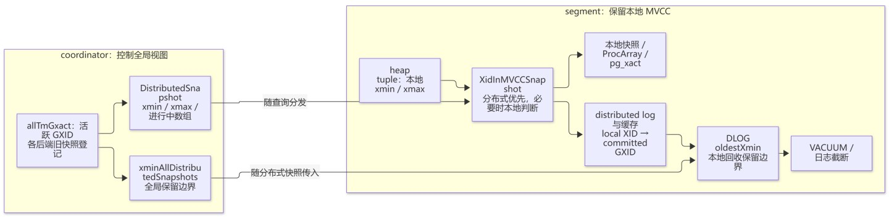
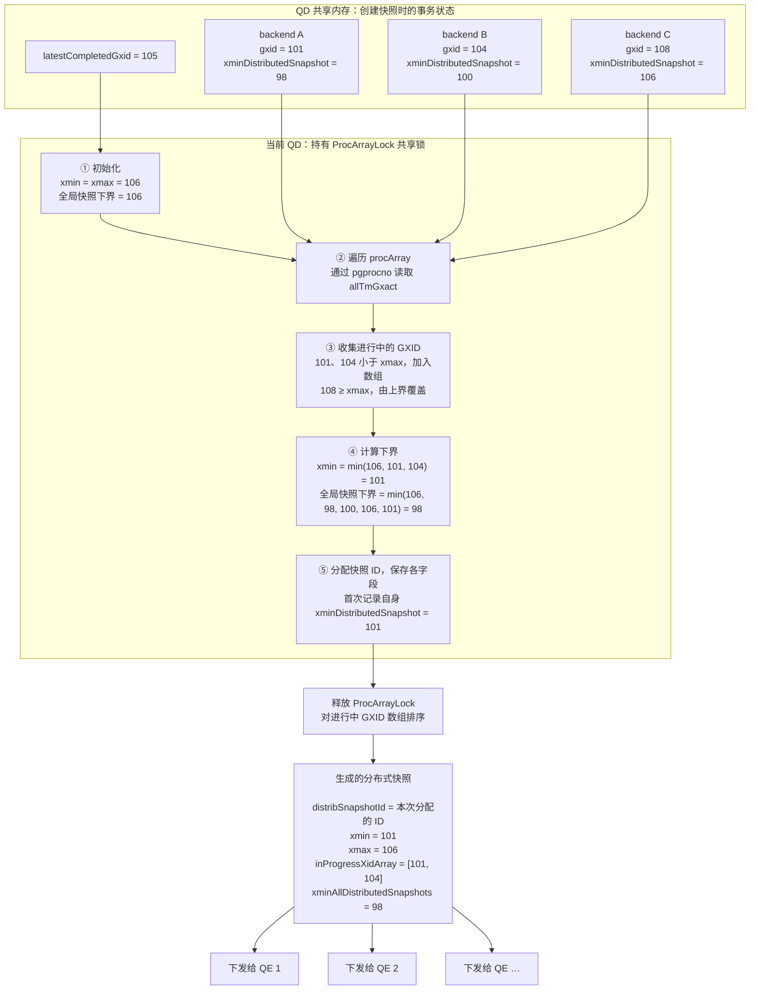

+++
featureImage = "img/covers/greenplum-snapshot.webp"
title = "Greenplum 分布式快照：从创建、分发到可见性判断"
date = 2026-10-27T00:00:00+08:00
slug = "distributed-snapshots"
summary = "沿查询执行路径解析 Greenplum 分布式快照的创建、GXID 分配、QD/QE 分发、共享快照及 MVCC 可见性判断。"
description = "基于 PostgreSQL 12 的 Greenplum 实现笔记，梳理分布式快照、事务身份与本地可见性规则如何协作。"
tags = ["Greenplum", "PostgreSQL", "分布式事务", "MVCC"]
categories = ["数据库系统", "计算机技术"]
weight = 1
draft = false
+++

本文是 [Greenplum 专题]()的第一篇，沿着一条查询的执行路径，梳理分布式快照如何在 QD 上创建、下发到 QE，并与本地快照一起参与元组可见性判断。

在单机 PostgreSQL 中，一个 backend 可以依靠本地事务号和 MVCC 快照判断数据版本。在 Greenplum 中，同一条查询会由多个 segment 上的 QE 协作完成：它们既要遵循统一的分布式读取视图，也要识别同一事务中其他 QE 已经写入的数据。理解这两种一致性要求，是读懂分布式快照代码的起点。

本文沿用原始笔记中基于 PostgreSQL 12 的 Greenplum 实现及相关符号。源码片段用于说明关键路径，省略了部分分支；不同版本的结构、函数和执行计划可能存在差异。

## 1. 总体结构与术语



Greenplum 中的分布式事务查询执行大致上可以理解为：

- QD 选定全局读取 snapshot；
- 把 snapshot 与任务一起发往 QE；
- QE 读取本地元组时，将元组中的本地事务号 XID 映射为全局事务号 GXID，再判断当前快照下的事务可见性。映射通过 segment 上的 DLOG（事务映射日志）实现。

先明确执行过程中的几个术语：

| 术语 | 含义 |
| --- | --- |
| QD（Query Dispatcher） | 协调查询执行，选择并分发分布式快照。 |
| QE（Query Executor） | 在 segment 上执行查询任务。 |
| gang | 为一组执行任务分配的 QE 集合。 |
| slice | 执行计划中由 Motion 边界划分的执行片段。 |

事务身份涉及两个编号空间：

- XID：各个节点本地可见的事务 ID；
- GXID：全局可见的分布式事务 ID。

## 2. 从本地快照到分布式快照

GP 对 PG 事务管理的核心数据结构进行了扩展，事务快照的核心数据结构是 `SnapshotData`，该结构为事务提供一致的读取视图，PG 中定义了多种 `SnapshotType` 快照类型：

| 类型                        | 语义                                                                                                                       | 常见用途                                                           |
| --------------------------- | -------------------------------------------------------------------------------------------------------------------------- | ------------------------------------------------------------------ |
| `SNAPSHOT_MVCC`           | 按快照时刻判断：看到当时已提交的事务和本事务之前命令的修改；看不到快照时仍在进行的事务、之后开始的事务，以及本命令的修改。 | 普通查询扫描最常见的可见性规则。                                   |
| `SNAPSHOT_SELF`           | 按“对自己可见”判断：包括已提交事务和本事务的修改（含当前命令），但不包括其他仍在进行的事务。                             | 需要看到本事务修改的特殊检查。                                     |
| `SNAPSHOT_ANY`            | 不做事务可见性筛选，元组一律视为可见。                                                                                     | 需要遍历、检查原始元组的特殊场景。                                 |
| `SNAPSHOT_TOAST`          | 不做通常的时间快照判断，只检查 TOAST 元组相关的移动、回收状态。                                                            | 读取 TOAST 数据；主表行可见时，需要能取到它引用的 TOAST 值。       |
| `SNAPSHOT_DIRTY`          | 把其他事务的进行中效果也纳入判断；还会通过 snapshot 的字段返回影响该元组的进行中事务 ID，必要时返回 speculative token。    | 常用于索引唯一性检查等需要发现并发冲突的场景，不是普通查询的快照。 |
| `SNAPSHOT_HISTORIC_MVCC`  | 大体按 MVCC 规则判断，但支持回到历史时点解释事务状态。                                                                     | 逻辑解码时读取历史 catalog 内容。                                  |
| `SNAPSHOT_NON_VACUUMABLE` | 判断元组是否“可能仍对某个事务可见”；只有确定已经对所有事务都不可见、可以回收时才返回不可见。                             | VACUUM 等回收判断；需要设置可见性下界。                            |

不同的快照类型在进行元组可见性判断时，可能进入不同的扫描逻辑或判断规则，Greenplum 分布式事务的核心流程由 `SNAPSHOT_MVCC` 类型的快照作为载体，因此本文后续的章节默认 `SnapshotType` 为 `SNAPSHOT_MVCC`。

### SnapshotData 扩展

Greenplum 在 PG12 的 `SnapshotData` 基础上进行了扩展：

- `haveDistribSnapshot`：标记分布式快照是否有效；
- `distribSnapshotWithLocalMapping`：分布式快照及当前快照的本地 XID 映射缓存。

其中，分布式快照 `distribSnapshotWithLocalMapping.ds`：

```c
typedef struct DistributedSnapshot
{
    DistributedTransactionId xminAllDistributedSnapshots;
    DistributedSnapshotId distribSnapshotId;
    DistributedTransactionId xmin;  // GXID下界
    DistributedTransactionId xmax;  // GXID上界
    int32 count;
    DistributedTransactionId *inProgressXidArray;  // [xmin, xmax) 中仍在活跃的 GXID
} DistributedSnapshot;
```

对于已确认提交、需要进行分布式快照检查的其他事务，GXID 的判定规则类似本地快照。下表中的“修改可见”表示通过分布式快照这一层检查，最终元组可见性还取决于插入、删除以及当前事务命令号等规则。

| GXID 所在的范围                                         | 可见性     |
| ------------------------------------------------------- | ---------- |
| < xmin                                                  | 修改可见   |
| ≥ xmax                                                 | 修改不可见 |
| 位于 [xmin, xmax) 内，且出现在 `inProgressXidArray`   | 修改不可见 |
| 位于 [xmin, xmax) 内，且未出现在 `inProgressXidArray` | 修改可见   |

### TMGXACT

每个 backend 在共享内存中都有一份全局的 **分布式事务信息**，保存在 `TMGXACT` 类型的数组 `allTmGxact[pgprocno]` 中。

```c
typedef struct TMGXACT
{
    DistributedTransactionId gxid; // backend 当前分布式事务的 GXID
    DistributedTransactionId xminDistributedSnapshot;  // backend 创建分布式事务时看到的全局下界
    bool includeInCkpt;  // 是否需要纳入分布式事务 checkpoint 记录
    int sessionId;  // 会话 id
} TMGXACT;
```

`allProcs`、`allPgXact`、`allTmGxact` 三个数组分别记录当前实例上的**进程信息、本地事务信息和分布式事务信息**：

```c
/* Array of PGPROC structures (not including dummies for prepared txns) */
PGPROC    *allProcs;
/* Array of PGXACT structures (not including dummies for prepared txns) */
PGXACT    *allPgXact;
/* Array of TMGXACT structures (not including dummies for prepared txns) */
TMGXACT   *allTmGxact;
```

## 3. QD 如何创建分布式快照

QD 创建全局快照的入口是 `GetSnapshotData`，获取到 `ProcArrayLock` 共享锁后，在需要分布式快照的上下文中调用 `CreateDistributedSnapshot` 实现。

创建流程与本地快照类似：

1. xmin/xmax 初始化为“当前最大的已结束 GXID” `ShmemVariableCache->latestCompletedGxid + 1`。
2. 全局快照下界 `globalXminDistributedSnapshots` 初始化为 xmax。
3. 遍历 procArray，读取每个活跃 backend 记录在 allTmGxact 中的全局事务状态 gxact。
4. 读取 `gxact->xminDistributedSnapshot`，如果该值为有效值且小于 `globalXminDistributedSnapshots` 就更新全局最小 GXID 值。
5. 读取 `gxact->gxid`，如果是一个有效且小于 xmax 的 GXID，就将 xmin 更新为更小的 gxid 值；将其他事务的这类 GXID 添加到 `inProgressXidArray` 中，当前事务自身的 GXID 仅参与 xmin 计算。
6. 将 `shmNextSnapshotId + 1` 分配为当前快照的 `distribSnapshotId`。
7. 将 `min(globalXminDistributedSnapshots, xmin)` 保存到快照的 `xminAllDistributedSnapshots`；若 `MyTmGxact->xminDistributedSnapshot` 尚无有效值，将其设置为本次 xmin。
8. 释放 procArray 的共享锁，对 `inProgressXidArray` 排序。

下面以 `latestCompletedGxid = 105` 为例，展示 QD 从共享内存中的分布式事务状态生成快照的过程。示例中，当前 QD 尚未分配 GXID。



`ProcessQuery()` 使用当前活动快照创建 `QueryDesc`，随后调用 `ExecutorStart`。

## 4. 分布式事务与 GXID 的分配

分布式事务的创建时机：

- 显式 BEGIN：`ProcessUtility → sendDtxExplicitBegin → setupDtxTransaction`。
- 自动提交的分布式 DML：`standard_ExecutorStart` 下发计划前调用 `setupDtxTransaction`。

分布式事务创建时，本地事务状态必须是 `TRANS_INPROGRESS`，DTX 创建的核心操作由 `setupDtxTransaction() → currentDtxActivate()` 实现，将 nextGxid 分配为当前事务的 GXID。

DTX 的元数据和状态由两个进程全局变量记录：

| 结构               | 存放位置     | 作用                               |
| ------------------ | ------------ | ---------------------------------- |
| `MyTmGxact`      | 共享内存     | 保存 GXID、session ID 等元数据     |
| `MyTmGxactLocal` | 进程私有内存 | 保存 DTX 状态、参与 Segment 列表等 |

本文涉及的实现使用 64 位 GXID，并在接近编号上限时触发 `PANIC`。

GXID 从预留的编号池中分配：

```text
bumpGxid() 预留一批大小为 nextCount 的 GXID
  → XLogPutNextGxid() 将预留 GXID 上界写入 WAL
  → backend 从这批预留编号中逐个分配
  → 恢复时从持久化的预留 GXID 继续分配
```

预留设计主要是考虑到如下的情况：

QE 在 PREPARE 阶段将当前事务的 GXID 持久化后，QD 决定提交前进入故障恢复状态，此时 QD 需要知道哪些 GXID 可能已经被 QE 落盘。

GP 采用的方式是在 `bumpGxid` 中一次性将 `nextGxid + GxidCount + gp_gxid_prefetch_num`（笔记所述实现中的默认值为 8192）这个批次的分配上界写入 XLOG 中：

```c
/* nextLimit should be always multiple of gp_gxid_prefetch_num. */
SpinLockAcquire(shmGxidGenLock);
nextCount = ShmemVariableCache->GxidCount + gp_gxid_prefetch_num;
nextLimit = ShmemVariableCache->nextGxid + nextCount;
if (nextLimit >= (LastDistributedTransactionId - gp_gxid_prefetch_num))
    ereport(PANIC,
            (errmsg("Will soon reach the limit of global transactions: "UINT64_FORMAT,
                    ShmemVariableCache->nextGxid)));
SpinLockRelease(shmGxidGenLock);

/* It might be time-consuming, so put it out of the spin locking section. */
XLogPutNextGxid(nextLimit);
```

GXID 的分配逻辑实际上为：

```c
MyTmGxact->gxid = ShmemVariableCache->nextGxid++;
ShmemVariableCache->GxidCount--;
```

事务创建成功后，当前 backend 的本地事务全局状态 `MyTmGxactLocal` 设置为 `DTX_STATE_ACTIVE_DISTRIBUTED`，当前事务的后续语句执行时可以通过 `MyTmGxactLocal` 状态判断事务是不是已经激活来避免重复分配。

GP 在 PG 的锁管理器基础上增加了 GXID 分布式事务锁的 TAG，以分配到的 gxid 为标识申请排他锁。其它事务需要同步时，可以通过调用 `GxactLockTableWait` 阻塞等待这个分布式事务执行完成。

## 5. 分布式快照如何下发到 QE

分发执行计划时，QD 从当前 ActiveSnapshot 中取出分布式快照，放进 DtxContextInfo，再序列化到发给 QE 的请求中。

```text
cdbdisp_buildPlanQueryParms()
  → qdSerializeDtxContextInfo()
    → DtxContextInfo_CreateOnCoordinator()
    → DtxContextInfo_Serialize()
```

`DtxContextInfo_CreateOnCoordinator` 将分布式快照拷贝到 `DtxContextInfo` 中：

```c
	if (snapshot && snapshot->haveDistribSnapshot)
	{
		DistributedSnapshot_Copy(&dtxContextInfo->distributedSnapshot,
								 &snapshot->distribSnapshotWithLocalMapping.ds);
		dtxContextInfo->haveDistributedSnapshot = true;
	}
```

QE 按下面的路径接收 QD 下发的分布式快照：

```text
PostgresMain()：处理 QD 下发的请求
  ├─ DtxContextInfo_Deserialize(..., &TempDtxContextInfo)
  │    └─ 将网络数据反序列化到 TempDtxContextInfo
  │
  ├─ 继续解析计划、分发描述等消息内容
  │
  ├─ setupQEDtxContext(&TempDtxContextInfo)
  │    └─ DtxContextInfo_Copy(&QEDtxContextInfo, dtxContextInfo)
  │       并设置 QE 的分布式事务上下文
  │
  └─ 进入查询执行
```

QE 进入查询执行后，调用 `GetTransactionSnapshot` 获取当前事务的本地快照，`GetSnapshotData` 会检查 `QEDtxContextInfo` 是否有效，如果有效就将分布式快照拷贝到当前事务快照中。

## 6. 同一 segment 上的快照共享

分布式快照来自 QD 下发的 `QEDtxContextInfo`，本地快照来自共享槽，两部分共同组成事务实际使用的快照。

Segmate 指同一个 Greenplum 会话中，运行在同一个 segment 数据库实例上的一组 QE 进程。这些进程共同处理该会话的事务，因此需要共享本地事务信息。

Greenplum 在实例启动的共享内存初始化阶段调用 `CreateSharedSnapshotArray` 分配共享快照数组。

- Writer QE 在 `InitPostgres` 调用 `addSharedSnapshot` 创建本会话的 `SharedSnapshotSlot`；
- Reader 调用 `lookupSharedSnapshot` 根据 `gp_session_id` 找到本实例共享数组中对应的 slot，并将指针保存到全局变量 `SharedSnapshotSlot` 中。

以一个涉及 `segment0`、`segment1` 的事务为例。先准备两张分布键不同的表：

```sql
CREATE TABLE snapshot_src (id int, v int)
DISTRIBUTED BY (id);

CREATE TABLE snapshot_dst (id int, v int)
DISTRIBUTED BY (v);
```

在同一事务中，先向源表写入数据，再通过 `INSERT ... SELECT` 将数据写入目标表：

```sql
BEGIN;
INSERT INTO snapshot_src VALUES (1, 20), (2, 20);
INSERT INTO snapshot_dst SELECT id, v FROM snapshot_src;
SELECT * FROM snapshot_dst ORDER BY id;
COMMIT;
```

### ① 执行 BEGIN

```text
BeginTransactionBlock()
sendDtxExplicitBegin()
  → setupDtxTransaction() // 建立 DTX，分配 GXID，writer QE 开始本地事务
  → rememberDtxExplicitBegin()
```

### ② 执行第一条 INSERT

QD 为写入 `snapshot_src` 分配 writer gang：

```text
AssignGangs()
  → AssignWriterGangFirst()
    → AllocateGang()  // GANGTYPE_PRIMARY_WRITER，要求 SEGMENTTYPE_EXPLICT_WRITER
      → cdbgang_createGang()
        → buildGangDefinition()
          → cdbcomponent_allocateIdleQE()
```

在一个尚未建立 QE 连接的会话中，各个目标 segment 上创建的第一个 QE 会被标记为 writer：

```c
/* cdbutil.c: cdbcomponent_allocateIdleQE()，创建新连接的分支 */
isWriter = contentId == -1 ? false :
    (cdbinfo->numIdleQEs == 0 && cdbinfo->numActiveQEs == 0);
segdbDesc = cdbconn_createSegmentDescriptor(cdbinfo,
    nextQEIdentifer(cdbinfo->cdbs), isWriter);
```

Writer QE 在连接初始化时通过 `InitPostgres()` → `addSharedSnapshot()` 创建本会话在该 segment 上的共享槽。执行语句时，`GetSnapshotData()` 获取快照，`updateSharedLocalSnapshot()` 将本地快照和事务信息发布到共享槽。

第一条 INSERT 写入的数据尚未提交。语句结束后，QD 将可复用的 writer QE 连接放回对应 segment 的 `freelist` 表头，供后续语句使用。

### ③ 执行 INSERT ... SELECT

源表按 `id` 分布，目标表按 `v` 分布。`INSERT ... SELECT` 需要按 `v` 重分布数据，写入目标表的 slice 使用 writer gang，扫描源表的 slice 使用独立的 reader gang。

```text
写入 snapshot_dst                    ← writer gang
  → Redistribute Motion（按 v 重分布）
    → 扫描 snapshot_src              ← reader gang
```

这条语句同时需要写入目标表和扫描源表，QD 按以下顺序分配 gang：

```text
AssignGangs()
  → AssignWriterGangFirst()
    → AllocateGang(GANGTYPE_PRIMARY_WRITER)
      → 从 freelist 取回 writer QE，分配给目标表写入 slice
  → InventorySliceTree()
    → 为源表扫描 slice 分配 reader gang
      → AllocateGang()  // 普通语句请求 SEGMENTTYPE_ANY
        → writer QE 已被占用，复用或创建 reader QE
```

同一 segment 上，writer 和 reader 是两个独立进程。新建的 reader 在 `InitPostgres()` 中调用 `lookupSharedSnapshot()`，按 `gp_session_id` 找到 writer 创建的共享槽；复用的 reader 已持有该槽的指针。

writer 为本条语句获取快照，并发布到共享槽；reader 从共享槽复制本地快照。两者分别从 QD 下发的 `QEDtxContextInfo` 获取分布式快照：

```text
writer QE                              reader QE
  收到 QD 下发的事务上下文                收到 QD 下发的事务上下文
  GetTransactionSnapshot()             GetTransactionSnapshot()
    → GetSnapshotData()                  → GetSnapshotData()
      → 复制 QD 的分布式快照                → 复制 QD 的分布式快照
      → 生成本地快照                       → readerFillLocalSnapshot()
      → updateSharedLocalSnapshot()          → 等待 ready 和 segmateSync 匹配
        → 发布本地快照、事务身份和命令号          → 检查 distributedXid
        → 设置 distributedXid、segmateSync      → copyLocalSnapshot()
        → 设置 ready = true                   → SetSharedTransactionId_reader()
                    │                                  ▲
                    └────── SharedSnapshotSlot ────────┘
```

### ④ 查询结果并 COMMIT 提交

`INSERT ... SELECT` 结束时，可复用的 QE 连接已回到会话连接缓存。COMMIT 完成事务提交，共享槽随 writer QE 保留，供同一会话后续语句复用；writer 退出时通过 `SharedSnapshotRemove()` 释放共享槽。

## 7. 从扫描算子到元组可见性判断

从 Scan 算子的角度看，核心流程是：使用执行器传入的快照，从存储层取出可见版本，再执行 SQL 条件过滤，最后把结果交给上层算子。分布式可见性判断发生在存储层取元组的过程中。

对于一个分布式事务来说，可见性判断可以总结为：元组保存本地事务号 XID，QD 确定统一事务的分布式快照并下发到 QE，各个 QE 将元组的本地事务号映射为 GXID，再按分布式快照确定可见数据版本。

QE 的执行器在 `estate->es_snapshot` 中持有当前事务快照，包含本地事务快照以及分布式事务快照：

```text
estate->es_snapshot
    |
    +-- 本地快照 L
    |     xmin / xmax / xip / subxip
    |
    +-- QD 下发的分布式快照 D
          xmin / xmax / 进行中 GXID 数组
```

上层算子每次请求下一行，Scan 算子根据初始化时保存的事务快照调用存储层接口获取下一条可见的元组：

```text
上层算子请求下一行
    |
    v
ExecSeqScan()
    |
    v
ExecScan()
    |
    v
ExecScanFetch()
    |
    v
SeqNext()
    |
    v
table_scan_getnextslot()
    |
    v
heap_getnextslot()
    |
    v
读取数据页，找出对 rs_snapshot 可见的元组
    |
    v
将可见元组放入 TupleTableSlot
```

事务可见性判断包含两个层面：事务间的快照可见性，以及事务内由命令号决定的可见性。核心逻辑在 `HeapTupleSatisfiesMVCC` 中实现：

```text
HeapTupleSatisfiesMVCC(Relation relation, HeapTuple htup, Snapshot snapshot,
                      Buffer buffer)
│
├─ ① 检查插入事务 xmin
│   │
│   ├─ 当前事务：按 cmin / curcid 判断事务内可见性
│   │
│   └─ 其他事务：XidInMVCCSnapshot(xmin, snapshot, ...)
│       │
│       ├─ QE 持有分布式快照，且需要分布式检查
│       │   │
│       │   ├─ xid >= 本地 snapshot.xmax
│       │   │   └─ 返回 XID_IN_SNAPSHOT
│       │   │
│       │   └─ DistributedSnapshotWithLocalMapping_CommittedTest()
│       │       │
│       │       ├─ 当前快照缓存：是否已知应按进行中处理
│       │       ├─ LocalDistribXactCache_CommittedFind()
│       │       ├─ 缓存未命中：DistributedLog_CommittedCheck()
│       │       │                └─ 得到 local XID → GXID
│       │       │
│       │       └─ 用 GXID 检查 D.xmin / D.xmax / 进行中数组
│       │           ├─ INPROGRESS → XID_IN_SNAPSHOT
│       │           ├─ VISIBLE    → XID_SURELY_COMMITTED
│       │           └─ UNKNOWN / IGNORE → 本地判断
│       │
│       └─ 本地判断：XidInMVCCSnapshot_Local()
│           └─ 检查本地 xmin / xmax / xip / subxip
│
│   根据返回结果：
│   ├─ XID_IN_SNAPSHOT       → 插入不可见，返回 false
│   ├─ XID_SURELY_COMMITTED  → 继续检查 xmax
│   └─ XID_NOT_IN_SNAPSHOT   → 结合提交状态，必要时调用
│                              TransactionIdDidCommit(xmin)
│
└─ ② 插入可见后，检查删除／更新事务 xmax
    │
    ├─ xmax 无效、已回滚或仅用于加锁 → 元组可见
    ├─ 当前事务：按 cmax / curcid 判断
    └─ 其他事务：XidInMVCCSnapshot(xmax, snapshot, ...)
        ├─ XID_IN_SNAPSHOT      → 删除尚未生效，元组可见
        ├─ XID_SURELY_COMMITTED → 删除已生效，元组不可见
        └─ XID_NOT_IN_SNAPSHOT  → 结合提交状态判断
```

### 事务内的可见性判断

单机事务的 writer 和后续 reader 通常是同一个进程。GP 上，同一 segment 的 writer QE 写入后，另一个 reader QE 可能读取这些版本。因此 reader 必须把 writer 的事务识别为“当前事务”，才能正确地进行事务内的可见性判断：

```text
reader QE
    |
    v
SharedLocalSnapshotSlot
    |
    +-- writer_proc → PGPROC
    |                  └─ subxids.xids[]：缓存的子事务 XID
    |
    +-- writer_xact → PGXACT
                       ├─ xid：顶层事务 XID
                       ├─ nxids：缓存的子事务数量
                       └─ overflowed：子事务缓存是否溢出
```

#### ① xmin 是当前事务

如果 reader 判断是在当前事务中修改（xmin 是当前事务 ID）的，此时就需要进一步通过 CID 判断这个修改对当前语句是否可见。

| cid 判定           | 语义                                           |
| ------------------ | ---------------------------------------------- |
| `cmin >= curcid` | 由当前或后续的 INSERT 插入，对当前快照不可见   |
| `cmin < curcid`  | 由先前的 INSERT 插入，需要进一步判断是否被删除 |

检查 xmax，如果 xmax 也是当前事务，则继续检查 cmax 是否位于可见区间：

| cid 判定           | 语义                                        |
| ------------------ | ------------------------------------------- |
| `cmax < curcid`  | 由先前的命令更新/删除，对当前语句不可见     |
| `cmax >= curcid` | 由当前或后续的命令更新/删除，对当前语句可见 |

如果 `xmax` 不属于当前事务，则需要结合对应事务在快照中的状态及其提交状态继续判断，不能仅凭 `xmax` 与当前 XID 的数值大小确定可见性。

cid 在元组中仅占 1 个 uint32 的字段，但元组的创建和删除属于同一个事务时，需要同时检查 cmin/cmax 两个字段。实际上 PG 中的 CID 字段存的可以是三类值：cmin/cmax/combocid。

当一个元组被同一个事务创建又删除时，元组头中的 CID 字段保存 ComboCID，存储层通过它间接访问映射表 `comboCids[combocid]`，取得原始的 `(cmin, cmax)`。

#### 共享 CID 映射表

PG 事务由单进程执行，comboCids 在当前进程上下文中分配即可。GP 涉及 writer/reader QE 之间的共享，因此将 comboCids 放到 DSM 中共享。

### 事务间的可见性判断

#### ② xmin 不属于当前事务

此时，需要进一步判断 xmin 所属事务的状态以及在当前快照下是否处于进行中状态。`XidInMVCCSnapshot` 函数负责判断元组的本地 xid 在本事务快照下是否仍是一个“进行中的”事务，返回值是一个枚举：

```c
typedef enum
{
    XID_NOT_IN_SNAPSHOT,   // 不在快照的进行中集合中，提交状态需另行判断
    XID_IN_SNAPSHOT,       // 事务在当前快照下视为“仍在进行中”
    XID_SURELY_COMMITTED   // 已确认提交，且通过分布式快照检查
} XidInMVCCSnapshotCheckResult;
```

`XidInMVCCSnapshot` 在需要分布式检查时尝试将 XID 映射到 GXID，判断对应事务在分布式快照下是否应视为进行中；无法由此确定结果时，再回到本地快照判断。映射关系的查找分三级：

- `inProgressMappedLocalXids`：快照级缓存，记录快照 gxidlist 中的仍应该被视为“IN-PROGRESS”的事务 XID；
- `LocalDistribXactCache`：XID → GXID 的本地 LRU 缓存；
- DLOG：已提交的分布式事务号映射日志。

根据映射的结果，xmin 对应的事务提交状态有三种可能：

- `XID_IN_SNAPSHOT`：该事务在当前快照下仍然是进行中事务；
- `XID_SURELY_COMMITTED`：已确认提交，且通过当前分布式快照的可见性判断；
- `XID_NOT_IN_SNAPSHOT`：不在当前快照的进行中集合中，提交状态需另行判断。

#### Hint Bits

GP 在 `t_infomask2` 中增加了两个辅助 DTX 可见性判断的 Hint Bits：

```c
#define HEAP_XMIN_DISTRIBUTED_SNAPSHOT_IGNORE 0x0800
/* t_xmin is either an old committed
 * distributed transaction or local.
 * They can be ignored for distributed
 * snapshots.
 */
#define HEAP_XMAX_DISTRIBUTED_SNAPSHOT_IGNORE 0x1000
```

带有对应标记的 xmin/xmax 可以跳过分布式快照的提交判断。

#### 插入版本可见后，继续判断删除版本

确认插入事务已提交且其修改对当前快照可见后，还需要检查 `xmax`：

```text
xmax 无效、已回滚或仅用于加锁
  → 元组可见
xmax 属于当前事务
  → cmax >= curcid：删除对当前命令尚不可见，元组可见
  → cmax < curcid：删除已生效，元组不可见
xmax 属于其他事务
  → 删除事务在快照下仍视为进行中：元组可见
  → 删除事务已提交且通过快照检查：元组不可见
  → 其他情况：结合本地事务状态继续判断
```

这里需要区分“事务已经提交”和“修改对当前快照可见”。即使删除事务此刻已经提交，只要它在读取快照中仍被视为进行中，当前查询就仍应读取删除前的版本。

## 8. 串起整条执行路径

回到开头的问题，一次分布式查询的读取视图由几部分共同组成：

1. **QD 创建分布式快照**：记录 GXID 的上下界、进行中事务集合及全局快照下界。
2. **事务上下文随计划分发**：QE 从 `QEDtxContextInfo` 取得统一的分布式快照。
3. **同一 segment 的 QE 共享本地事务视图**：writer 发布本地快照和事务身份，reader 通过共享槽识别同一事务，并共享命令号相关信息。
4. **存储层判断具体版本**：先处理当前事务及 CID，再根据需要进行 XID → GXID 映射、分布式快照检查和本地状态检查，分别判断插入与删除是否对当前查询生效。

阅读源码时，可以围绕 `CreateDistributedSnapshot`、`DtxContextInfo`、`SharedSnapshotSlot` 和 `HeapTupleSatisfiesMVCC` 四个入口展开。它们分别对应快照的生成、传输、进程间共享和最终使用，也构成了理解 Greenplum 分布式读取一致性的一条主线。
