+++
featureImage = "img/covers/orca-optimizer.webp"
title = "[译文] Orca：面向大数据的模块化查询优化器架构"
date = 2026-11-14T00:00:00+08:00
slug = "orca-modular-query-optimizer"
summary = "Orca 查询优化器架构论文的中文译文，涵盖查询优化流程、元数据交换、可验证性和实验。"
description = "论文 Orca: A Modular Query Optimizer Architecture for Big Data 的中文译文。"
tags = ["Greenplum", "Orca", "查询优化", "数据库"]
categories = ["数据库系统", "计算机技术"]
draft = false
+++

# Orca：面向大数据的模块化查询优化器架构

原文：[Orca: A Modular Query Optimizer Architecture for Big Data](https://15721.courses.cs.cmu.edu/spring2019/papers/22-optimizer1/p337-soliman.pdf)，SIGMOD 2014。

Mohamed A. Soliman∗、Lyublena Antova∗、Venkatesh Raghavan∗、Amr El-Helw∗、Zhongxian Gu∗、Entong Shen∗、George C. Caragea∗、Carlos Garcia-Alvarado∗、Foyzur Rahman∗、Michalis Petropoulos∗、Florian Waas‡、Sivaramakrishnan Narayanan§、Konstantinos Krikellas†、Rhonda Baldwin∗

∗ Pivotal Inc.，美国帕洛阿尔托；‡ Datometry Inc.，美国旧金山；† Google Inc.，美国山景城；§ Qubole Inc.，美国山景城。

## 目录

- [摘要](#abstract)
  - [类别和主题描述符](#categories)
  - [关键词](#keywords)
- [1. 引言](#section-1)
- [2. 预备知识](#section-2)
  - [2.1 大规模并行处理](#section-2-1)
  - [2.2 Hadoop 上的 SQL](#section-2-2)
- [3. Orca 架构](#section-3)
- [4. 查询优化](#section-4)
  - [4.1 优化工作流程](#section-4-1)
  - [4.2 并行查询优化](#section-4-2)
- [5. 元数据交换](#section-5)
- [6. 可验证性](#section-6)
  - [6.1 最小复现](#section-6-1)
  - [6.2 测试优化器准确性](#section-6-2)
- [7. 实验](#section-7)
  - [7.1 TPC-DS 基准测试](#section-7-1)
  - [7.2 MPP 数据库](#section-7-2)
    - [7.2.1 实验设置](#section-7-2-1)
    - [7.2.2 性能](#section-7-2-2)
  - [7.3 Hadoop 上的 SQL](#section-7-3)
    - [7.3.1 实验设置](#section-7-3-1)
    - [7.3.2 性能](#section-7-3-2)
- [8. 相关工作](#section-8)
  - [8.1 查询优化基础](#section-8-1)
  - [8.2 MPP 数据库上的 SQL 优化](#section-8-2)
  - [8.3 Hadoop 上的 SQL](#section-8-3)
- [9. 总结](#section-9)
- [10. 参考文献](#section-10)
- [原文版权声明](#copyright-notice)

<a id="abstract"></a>

## 摘要

数据管理系统中分析查询处理的性能主要取决于系统查询优化器的能力。数据量的增长以及人们对处理复杂分析查询兴趣的提高，促使 Pivotal 构建了一个新的查询优化器。

本文介绍 Orca 的架构。Orca 是 Pivotal 所有数据管理产品的新查询优化器，其中包括 Pivotal Greenplum Database 和 Pivotal HAWQ。Orca 是一项综合性开发成果，它将最先进的查询优化技术与我们自己的原创研究相结合，形成了一个模块化、可移植的优化器架构。除了描述整体架构外，我们还重点介绍了几个独特的特性，并给出与其他系统的性能比较。

<a id="categories"></a>

### 类别和主题描述符

H.2.4 [数据库管理]：系统——查询处理；分布式数据库

<a id="keywords"></a>

### 关键词

查询优化、代价模型、MPP、并行处理

<a id="section-1"></a>

## 1. 引言

大数据使人们重新关注查询优化。新一代数据管理系统在可扩展性、可用性和处理能力方面达到了前所未有的水平（例如参见 [9, 18, 20, 21]），使人们可以通过 SQL 或类 SQL 接口方便地访问数百 TB 甚至 PB 级的大型数据集进行分析。优秀优化器与平庸优化器之间的差距一直被认为相当大 [15]。然而，这些系统必须处理的数据量增加，放大了优化错误的影响，使查询优化的重要性比以往任何时候都更加突出。

尽管该领域已有大量研究，商业和开源项目中的大多数现有查询优化器仍主要基于可追溯到商业数据库开发早期的技术 [22]，并且经常容易产生次优结果。

认识到研究与实际实现之间的这一重大差距后，我们着手设计一种既满足当前需求，又为未来发展留有充足空间的架构。

本文描述 Orca，这是我们近期在 Greenplum/Pivotal 进行的研究与开发工作的成果。Orca 是一个专门为要求严苛的分析工作负载设计的先进查询优化器。它在以下几个重要方面有别于其他优化器：

**模块化。** Orca 使用高度可扩展的元数据和系统描述抽象，因此不再像传统优化器那样局限于特定宿主系统。相反，它可以通过其 Metadata Provider SDK 支持的插件快速移植到其他数据管理系统。

**可扩展性。** Orca 将查询及其优化的所有元素都表示为地位平等的一等公民，从而避免多阶段优化的陷阱：某些优化在多阶段优化中会被当作事后补充来处理。多阶段优化器出了名地难以扩展，因为新的优化或查询结构往往与预先设定的阶段边界不相匹配。

**多核支持。** Orca 使用一个高效的、具备多核感知能力的调度器，将单个细粒度优化子任务分配到多个核心，以加快优化过程。

**可验证性。** Orca 在内置机制层面专门提供了验证正确性和性能的功能。除了改进工程实践，这些工具还支持以较高的信心快速开发，缩短新特性开发和错误修复的周转时间。

**性能。** 与我们之前的系统相比，Orca 有显著改进，在许多情况下能使查询速度提高 10 倍至 1000 倍。

我们描述 Orca 的架构，并重点介绍其设计所支持的一些高级特性。我们给出各组件的设计蓝图，并详细介绍为实现该项目而开创并采用的工程实践。最后，我们基于 TPC-DS 基准测试给出 Orca 与其他系统的性能比较结果，特别关注已贡献给开源领域的查询处理系统。

本文其余部分安排如下：第 2 节介绍计算架构的预备知识；第 3 节介绍 Orca 的架构及其组件；第 4 节介绍查询优化工作流程；第 5 节描述 Orca 如何与后端数据库系统交换元数据；第 6 节描述我们为维护可验证的查询优化器而构建的工具；第 7 节介绍实验研究；第 8 节讨论相关工作；第 9 节以最后的讨论总结全文。

<a id="section-2"></a>

## 2. 预备知识

我们介绍大规模并行处理数据库（第 2.1 节）和 Hadoop 查询引擎（第 2.2 节）的预备知识。

<a id="section-2-1"></a>

### 2.1 大规模并行处理

Pivotal 的 Greenplum Database（GPDB）[20] 是一个大规模并行处理（MPP）分析型数据库。GPDB 采用由两个或更多协作处理器组成的无共享计算架构。每个处理器都有自己的内存、操作系统和磁盘。GPDB 利用这种高性能系统架构来分配 PB 级数据仓库的负载，并并行使用系统资源来处理给定查询。

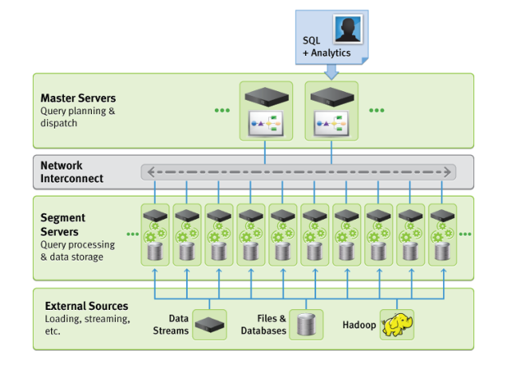

<!-- **Figure 1 caption 中文翻译**：见下方。 **视觉校验**：通过。 -->

图 1：GPDB 的高层架构。

图中文字：Master Servers——主服务器（查询规划与分发）；Network Interconnect——网络互连；Segment Servers——Segment 服务器（查询处理与数据存储）；External Sources——外部来源（加载、流处理等）；Data Streams——数据流；Files & Databases——文件和数据库。

图 1 展示了 GPDB 的高层架构。大量数据的存储和处理通过将负载分配到多台服务器或主机来完成，由此创建一个由多个独立数据库组成的阵列；它们共同工作，对外呈现为一个数据库。master 是 GPDB 的入口，客户端在此连接并提交 SQL 语句。master 与称为 segment 的其他数据库实例协调工作，以处理数据处理和存储。当查询提交给 master 时，查询会被优化并拆分为较小的组件，分派给各 segment，由它们共同生成最终结果。interconnect 是负责 segment 之间进程间通信的网络层。interconnect 使用标准的千兆以太网交换结构。

在查询执行期间，数据可以通过多种方式分布到各 segment，包括哈希分布（hashed distribution），即根据某个哈希函数将元组分布到各 segment；复制分布（replicated distribution），即在每个 segment 上存储表的完整副本；以及单点分布（singleton distribution），即将整个分布式表从多个 segment 汇集到一台主机，通常是 master。

<a id="section-2-2"></a>

### 2.2 Hadoop 上的 SQL

在 Hadoop 上处理分析查询正变得越来越流行。最初，查询被表达为 MapReduce 作业，Hadoop 的吸引力在于其可扩展性和容错能力。然而，在 MapReduce 中编写、手动优化和维护复杂查询十分困难，因此人们在 Hadoop 之上开发了 Hive [28] 等类 SQL 声明式语言。HiveQL 查询被编译成 MapReduce 作业并由 Hadoop 执行。HiveQL 加快了复杂查询的编写，但也使人们明显意识到 Hadoop 生态系统需要优化器，因为编译得到的 MapReduce 作业性能较差。

Pivotal 通过推出 HAWQ [21] 应对这一挑战。HAWQ 是构建在 HDFS 之上的、符合 SQL 标准的大规模并行引擎。HAWQ 在核心中使用 Orca 来设计高效的查询计划，以尽量降低访问 Hadoop 集群中数据的代价。HAWQ 的架构将创新的先进代价优化器与 Hadoop 的可扩展性和容错能力相结合，实现了对 PB 级数据的交互式处理。

近期，包括 Cloudera 的 Impala [17] 和 Facebook 的 Presto [7] 在内的其他一些项目引入了新的优化器，以支持 Hadoop 上的 SQL 处理。目前，这些项目只支持 SQL 标准特性的一个子集，其优化仅限于基于规则的优化。相比之下，HAWQ 具有功能完备、符合标准的 SQL 接口和基于代价的优化器，这两者在 Hadoop 查询引擎中都是前所未有的特性。我们在第 7 节的实验研究中说明，Orca 在功能和性能两方面对 HAWQ 区别于其他 Hadoop SQL 引擎所起的关键作用。

<a id="section-3"></a>

## 3. Orca 架构

Orca 是 Pivotal 数据管理产品的新查询优化器，这些产品包括 GPDB 和 HAWQ。Orca 是一个基于 Cascades 优化框架 [13] 的现代自顶向下查询优化器。虽然许多 Cascades 优化器与宿主系统紧密耦合，但 Orca 的一个独特特性是能够在数据库系统之外作为独立优化器运行。对于使用同一个优化器支持不同计算架构的产品（例如 MPP 和 Hadoop），这一能力至关重要。它还使得在 Hadoop 等新的查询处理范式 [7, 10, 16, 17] 中利用关系优化方面的丰富既有成果成为可能。此外，将优化器作为独立产品运行，能够在不经过数据库系统整体结构的情况下进行详尽的测试。

**DXL。** 将优化器与数据库系统解耦，需要构建一种处理查询的通信机制。Orca 包含一个用于在优化器与数据库系统之间交换信息的框架，称为 Data eXchange Language（DXL）。该框架使用基于 XML 的语言对通信所需的信息进行编码，例如输入查询、输出计划和元数据。DXL 之上还有一个简单的通信协议，用来发送初始查询结构并获取优化后的计划。DXL 的一项主要好处是能够将 Orca 封装为独立产品。

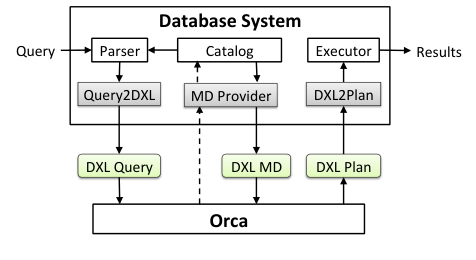

<!-- **Figure 2 caption 中文翻译**：见下方。 **视觉校验**：通过。 -->

图 2：Orca 与数据库系统的交互。

图中文字：Database System——数据库系统；Query——查询；Parser——解析器；Catalog——目录；Executor——执行器；Results——结果；MD Provider——元数据提供程序；DXL Query——DXL 查询；DXL MD——DXL 元数据；DXL Plan——DXL 计划。

图 2 展示了 Orca 与外部数据库系统之间的交互。Orca 的输入是 DXL 查询，输出是 DXL 计划。在优化过程中，可以向数据库系统查询元数据，例如表定义。Orca 允许数据库系统注册元数据提供程序（MD Provider），以此抽象元数据访问细节；该提供程序负责在将元数据发送给 Orca 之前，将其序列化为 DXL。元数据也可以从包含以 DXL 格式序列化的元数据对象的普通文件中读取。

数据库系统需要包含以 DXL 格式读取或输出数据的转换器。Query2DXL 转换器将查询解析树转换为 DXL 查询，而 DXL2Plan 转换器将 DXL 计划转换为可执行计划。这些转换器完全在 Orca 外部实现，因此多个系统可以通过提供相应的转换器来使用 Orca。

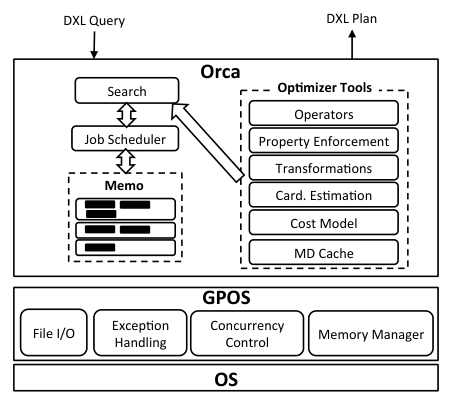

<!-- **Figure 3 caption 中文翻译**：见下方。 **视觉校验**：通过。 -->

图 3：Orca 架构。

图中文字：Search——搜索；Job Scheduler——作业调度器；Optimizer Tools——优化器工具；Operators——运算符；Property Enforcement——属性强制；Transformations——变换；Card. Estimation——基数估计；Cost Model——代价模型；MD Cache——元数据缓存；File I/O——文件输入输出；Exception Handling——异常处理；Concurrency Control——并发控制；Memory Manager——内存管理器；OS——操作系统。

Orca 的架构具有很高的可扩展性；所有组件都可以单独替换和分别配置。图 3 展示了 Orca 的不同组件。我们简要介绍如下。

**Memo。** 优化器生成的备选计划空间被编码在一种紧凑的内存数据结构中，称为 Memo [13]。Memo 结构由一组称为组（group）的容器组成，每个组包含逻辑等价的表达式。Memo 组表示查询的不同子目标，例如对表进行过滤，或连接两个表。组的成员称为组表达式，它们以不同的逻辑方式实现组目标，例如不同的连接顺序。每个组表达式都是一个运算符，其子节点是其他组。Memo 的这种递归结构可以紧凑地编码规模巨大的可能计划空间，如第 4.1 节所示。

**搜索和作业调度器。** Orca 使用搜索机制遍历备选计划空间，找出估计代价最低的计划。搜索机制由专用作业调度器支持，该调度器创建存在依赖关系或可并行的工作单元，通过三个主要步骤执行查询优化：探索，生成等价逻辑表达式；实现，生成物理计划；优化，强制满足所需的物理属性（例如排序顺序），并计算备选计划的代价。我们将在第 4.2 节讨论优化作业调度的细节。

**变换。** [13] 备选计划通过应用变换规则生成；这些规则既可以产生等价的逻辑表达式（例如 `InnerJoin(A,B) → InnerJoin(B,A)`），也可以产生现有表达式的物理实现（例如 `Join(A,B) → HashJoin(A,B)`）。应用变换规则的结果被复制到 Memo 中，这可能导致创建新组和／或向现有组添加新的组表达式。每条变换规则都是一个独立组件，可以在 Orca 配置中显式启用或禁用。

**属性强制。** Orca 包含一个可扩展框架，根据形式化的属性规范描述查询要求和计划特征。属性有不同类型，包括逻辑属性（例如输出列）、物理属性（例如排序顺序和数据分布）以及标量属性（例如连接条件中使用的列）。在查询优化期间，每个运算符都可以向其子节点请求特定属性。优化后的子计划可能自行满足所需属性，例如 IndexScan 计划提供已排序数据；否则就需要在计划中加入强制器（enforcer），例如 Sort 运算符，以提供所需属性。该框架允许每个运算符根据子计划的属性和运算符自身的行为控制强制器的放置位置。我们将在第 4.1 节更详细地描述该框架。

**元数据缓存。** 由于元数据（例如表定义）变化不频繁，每次查询都传送元数据会产生开销。Orca 在优化器端缓存元数据，只有当某些元数据不在缓存中，或者自上次载入缓存后发生了变化时，才从目录中获取相应部分。元数据缓存还为优化器屏蔽了数据库系统的细节，这在测试和调试时尤其有用。

**GPOS。** 为了与可能具有不同 API 的操作系统交互，Orca 使用一个称为 GPOS 的操作系统抽象层。GPOS 层为 Orca 提供广泛的基础设施，包括内存管理器、并发控制原语、异常处理、文件 I/O 和同步数据结构。

<a id="section-4"></a>

## 4. 查询优化

我们在第 4.1 节描述 Orca 的优化工作流程，然后在第 4.2 节展示如何并行执行优化过程。

<a id="section-4-1"></a>

### 4.1 优化工作流程

我们使用下面贯穿本节的示例来说明查询优化工作流程：

```sql
SELECT T1.a FROM T1, T2
WHERE T1.a = T2.b
ORDER BY T1.a;
```

其中 T1 的分布为 `Hashed(T1.a)`，T2 的分布为 `Hashed(T2.a)`（参见第 2.1 节）。

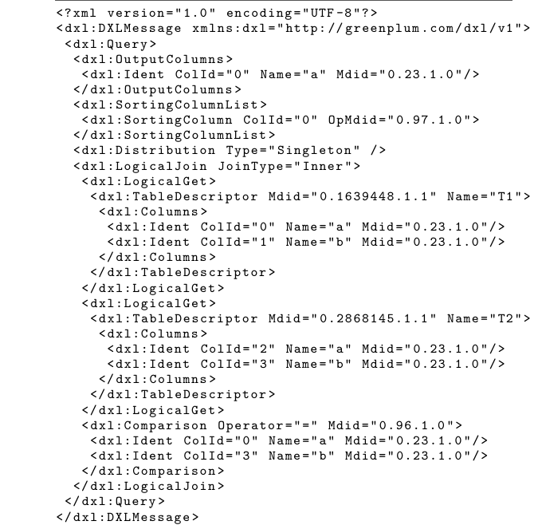

代码清单 1：DXL 查询消息。

代码清单 1 展示了上述查询在 DXL 中的表示，其中给出了所需的输出列、排序列、数据分布和逻辑查询。元数据（例如表和运算符的定义）附有元数据 ID（Mdid），以便在优化期间请求更多信息。Mdid 是由数据库系统标识符、对象标识符和版本号组成的唯一标识符。例如，`0.96.1.0` 指的是 GPDB 中版本为 `1.0` 的整数相等运算符。元数据版本用于使在不同查询之间发生过修改的缓存元数据对象失效。我们将在第 5 节更详细地讨论元数据交换。

DXL 查询消息被发送给 Orca，在那里解析并转换成内存中的逻辑表达式树，然后复制到 Memo 中。图 4 展示了 Memo 的初始内容。该逻辑表达式为两个表和 InnerJoin 操作创建了三个组。为简洁起见，我们省略了连接条件。组 0 称为根组，因为它对应逻辑表达式的根节点。逻辑表达式中运算符之间的依赖关系通过组之间的引用来表示。例如，`InnerJoin[1,2]` 引用组 1 和组 2 作为子节点。优化按照以下步骤进行。

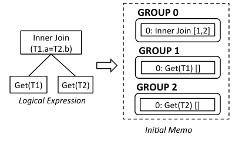

<!-- **Figure 4 caption 中文翻译**：见下方。 **视觉校验**：通过。 -->

图 4：复制初始逻辑表达式。

图中文字：Logical Expression——逻辑表达式；Initial Memo——初始 Memo；Group——组。

**（1）探索。** 触发生成逻辑等价表达式的变换规则。例如，触发连接交换律规则，由 `InnerJoin[1,2]` 生成 `InnerJoin[2,1]`。探索会向现有组添加新的组表达式，也可能创建新组。Memo 结构内置了基于表达式拓扑的重复检测机制，用来检测并消除由不同变换创建的重复表达式。

**（2）统计信息推导。** 探索结束时，Memo 保存了给定查询的完整逻辑空间。接着触发 Orca 的统计信息推导机制，为 Memo 组计算统计信息。Orca 中的统计信息对象主要是一组列直方图，用于估计基数和数据倾斜。统计信息推导在紧凑的 Memo 结构上进行，以避免展开搜索空间。

为了推导目标组的统计信息，Orca 选择最有希望提供可靠统计信息的组表达式。统计信息可信潜力的计算取决于具体表达式。例如，连接条件较少的 InnerJoin 表达式比具有较多连接条件的另一个等价 InnerJoin 表达式更有希望提供可靠结果（在生成多个连接顺序时可能出现这种情况）。其原因是连接条件越多，估计误差传播和放大的可能性越高。计算基数估计的置信分数很有挑战性，因为需要汇总给定表达式所有节点的置信分数。我们目前正在探索多种在紧凑的 Memo 结构中计算置信分数的方法。

在目标组中选出最有希望的组表达式后，Orca 递归地对所选组表达式的子组触发统计信息推导。最后，通过合并子组的统计信息对象来构建目标组的统计信息对象。

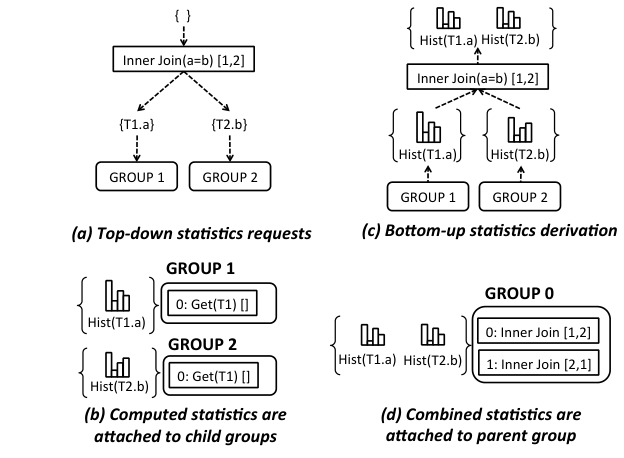

<!-- **Figure 5 caption 中文翻译**：见下方。 **视觉校验**：通过。 -->

图 5：统计信息推导机制。

图中文字：（a）自顶向下的统计信息请求；（b）计算出的统计信息被附加到子组；（c）自底向上的统计信息推导；（d）合并后的统计信息被附加到父组。

图 5 展示了上述示例中的统计信息推导机制。首先进行一次自顶向下的遍历，其中父组表达式向其子组请求统计信息。例如，基于 `(a=b)` 的 `InnerJoin(T1,T2)` 请求 T1.a 和 T2.b 的直方图。所请求的直方图通过已注册的 MD Provider 按需从目录中加载，解析为 DXL，并存储在 MD Cache 中以服务后续请求。接下来进行一次自底向上的遍历，将子统计信息对象合并为父统计信息对象。这会得到 T1.a 和 T2.b 列上可能发生变化的直方图，因为连接条件可能影响列的直方图。

构建好的统计信息对象附加到各个组上，在优化期间可以对它们进行增量更新，例如添加新的直方图。这对于将统计信息推导的代价保持在可控范围内至关重要。

**（3）实现。** 触发为逻辑表达式创建物理实现的变换规则。例如，触发 Get2Scan 规则，由逻辑 Get 生成物理表扫描 Scan。类似地，触发 InnerJoin2HashJoin 和 InnerJoin2NLJoin 规则，生成哈希连接和嵌套循环连接的实现。

**（4）优化。** 在此步骤中，强制满足属性并计算备选计划的代价。优化从向 Memo 的根组提交初始优化请求开始，该请求指定结果分布、排序顺序等查询要求。向组 g 提交请求 r，相当于请求一个满足 r 且根物理运算符属于 g 的最低代价计划。

对于每个传入请求，每个物理组表达式根据传入要求和运算符自身的要求，向子组传递相应请求。在优化期间，可能有许多相同请求提交给同一个组。Orca 将已计算的请求缓存在组哈希表中。只有当传入请求尚不存在于组哈希表中时，才对其进行计算。此外，每个物理组表达式维护一个局部哈希表，将传入请求映射到相应的子请求。局部哈希表提供从 Memo 中提取物理计划时所用的链接结构，本节后面将对此进行说明。

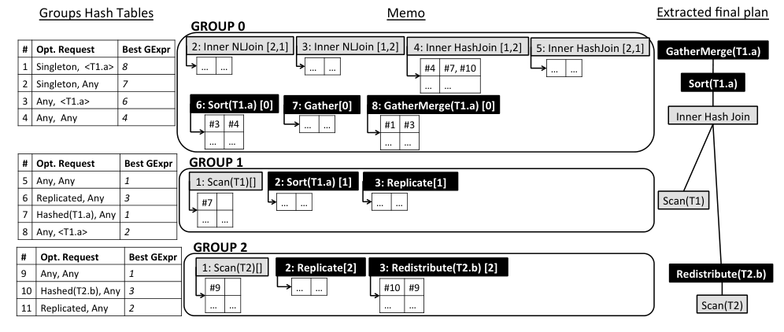

<!-- **Figure 6 caption 中文翻译**：见下方。 **视觉校验**：通过。 -->

图 6：在 Memo 中处理优化请求。

图中文字：Groups Hash Tables——组哈希表；Opt. Request——优化请求；Best GExpr——最佳组表达式；Extracted final plan——提取出的最终计划。

图 6 展示了示例中 Memo 内的优化请求。初始优化请求为 `req. #1: {Singleton, <T1.a>}`，它指定查询结果需要按照 T1.a 给出的顺序汇集到 master。[^1] 图中还展示了组哈希表，其中每个请求都关联一个以最低估计代价满足该请求的最佳组表达式（GExpr）。黑色方框表示插入 Memo 中以提供排序顺序和数据分布的强制器运算符。Gather 运算符将元组从所有 segment 汇集到 master。GatherMerge 运算符将已排序数据从所有 segment 汇集到 master，同时保持排序顺序。Redistribute 运算符根据给定参数的哈希值将元组分布到各 segment。

[^1]: 所需属性还包括输出列、可重绕性、公共表表达式和数据分区。由于篇幅限制，我们省略这些属性。

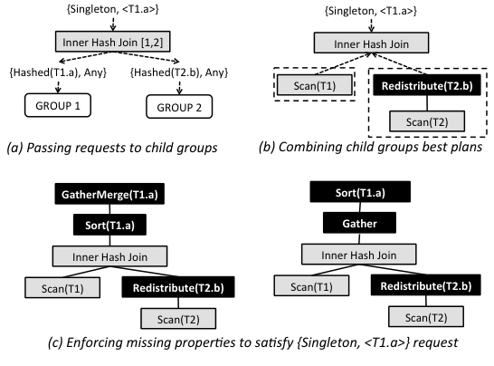

<!-- **Figure 7 caption 中文翻译**：见下方。 **视觉校验**：通过。 -->

图 7：生成 InnerHashJoin 备选计划。

图中文字：（a）向子组传递请求；（b）合并子组的最佳计划；（c）强制满足缺失属性以满足 `{Singleton, <T1.a>}` 请求。

图 7 展示了 `InnerHashJoin[1,2]` 对 `req. #1` 的优化。对于该请求，一种备选计划是根据连接条件对齐子节点的数据分布，使需要连接的元组位于同一位置。[^2] 这通过向组 1 请求 `Hashed(T1.a)` 分布、向组 2 请求 `Hashed(T2.b)` 分布来实现。两个组均被要求提供任意排序顺序（Any）。找到子节点的最佳计划后，InnerHashJoin 合并子节点属性，以确定其提供的数据分布和排序顺序。注意，组 2 的最佳计划需要按 T2.b 对 T2 进行哈希分布，因为 T2 原本按 T2.a 进行哈希分布；而组 1 的最佳计划是简单的 Scan，因为 T1 已按 T1.a 进行哈希分布。

[^2]: 还可能有许多其他备选方案，例如要求将子节点数据汇集到 master 并在那里执行连接。Orca 允许为每个运算符扩展任意数量的优化备选方案，并通过属性强制框架清晰地隔离这些备选方案。

当确定所提供的属性不能满足初始要求时，就必须强制满足未满足的属性。Orca 中的属性强制是一个灵活的框架，允许每个运算符根据子计划提供的属性和运算符自身的行为，定义强制满足所需属性的方式。例如，如果外侧子节点已经提供所需顺序，保持顺序的 NL Join 运算符可能不需要在连接之上强制执行排序。

强制器被添加到包含正在优化的组表达式的组中。图 7 展示了两个通过属性强制满足 `req. #1` 的可能计划。左侧计划在各 segment 上对连接结果排序，然后在 master 上合并汇集已排序结果。右侧计划将连接结果从各 segment 汇集到 master，然后对其排序。这些不同的备选方案都被编码在 Memo 中，由代价模型区分它们的代价。

最后，根据优化请求给出的链接结构，从 Memo 中提取最佳计划。图 6 展示了示例的计划提取过程。图中给出了相关组表达式的局部哈希表。每个局部哈希表都将传入优化请求映射到相应的子优化请求。

我们首先在根组中查找 `req. #1` 的最佳组表达式，结果是 GatherMerge 运算符。GatherMerge 的局部哈希表中相应的子请求是 `req #3`。`req #3` 的最佳组表达式是 Sort，因此我们将 GatherMerge 链接到 Sort。Sort 的局部哈希表中相应的子请求是 `req #4`。`req #4` 的最佳组表达式是 `InnerHashJoin[1,2]`，因此我们将 Sort 链接到 InnerHashJoin。按照相同过程完成计划提取，得到图 6 所示的最终计划。

提取出的计划被序列化为 DXL 格式，并发送给数据库系统执行。数据库系统中的 DXL2Plan 转换器根据底层查询执行框架将 DXL 计划转换为可执行计划。

**多阶段优化。** 我们目前在 Orca 上正在进行的工作包括实现多阶段优化。Orca 中的一个优化阶段被定义为使用一部分变换规则以及可选的超时和代价阈值来执行完整的优化工作流程。当满足以下任一条件时，阶段终止：（1）找到代价低于代价阈值的计划；（2）发生超时；或（3）该部分变换规则已用尽。用户可以通过 Orca 的配置指定优化阶段。这种技术支持资源受限的优化；例如，可以将代价最高的变换规则配置在后续阶段运行，以避免增加优化时间。这种技术也是尽早获得查询计划、以缩小复杂查询搜索空间的基础。

**查询执行。** 最终计划的副本被分派给每个 segment。在分布式查询执行期间，每个 segment 上的分布强制器既充当数据发送方，也充当数据接收方。例如，在 segment S 上运行的 `Redistribute(T2.b)` 实例根据 T2.b 的哈希值将 S 上的元组发送给其他 segment，同时也从其他 segment 上的其他 `Redistribute(T2.b)` 实例接收元组。

<a id="section-4-2"></a>

### 4.2 并行查询优化

查询优化可能是数据库系统中 CPU 使用最密集的过程。有效使用 CPU 可以产生更好的查询计划，从而提高系统性能。并行化查询优化器对于利用能够使用越来越多核心的先进 CPU 设计至关重要。

Orca 是支持多核的优化器。优化过程被拆分成称为优化作业的小型工作单元。Orca 目前有七种不同类型的优化作业：

- `Exp(g)`：生成组 g 中所有组表达式的逻辑等价表达式。
- `Exp(gexpr)`：生成组表达式 gexpr 的逻辑等价表达式。
- `Imp(g)`：生成组 g 中所有组表达式的实现。
- `Imp(gexpr)`：生成组表达式 gexpr 的备选实现。
- `Opt(g, req)`：返回估计代价最低、以组 g 中的运算符为根且满足优化请求 req 的计划。
- `Opt(gexpr, req)`：返回估计代价最低、以 gexpr 为根且满足优化请求 req 的计划。
- `Xform(gexpr, t)`：使用规则 t 变换组表达式 gexpr。

对于给定查询，每种类型可能创建数百甚至数千个作业实例。这给处理作业依赖关系带来了挑战。例如，只有在子组也完成优化后，才能优化某个组表达式。图 8 展示了一个局部作业图，其中在优化请求 req0 下优化组 g0 会触发一棵很深的依赖作业树。依赖关系被编码为子节点到父节点的链接；父作业在其子作业完成之前不能完成。当子作业正在运行时，父作业需要被挂起。如果子作业不依赖其他作业，这使它们可以使用可用线程并行运行。当所有子作业完成后，挂起的父作业会收到通知以恢复处理。

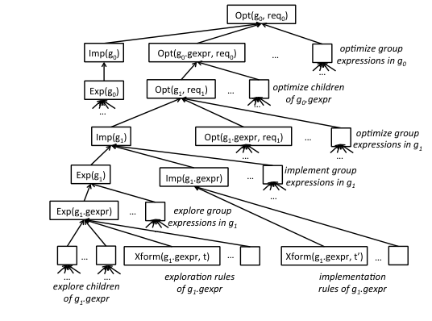

<!-- **Figure 8 caption 中文翻译**：见下方。 **视觉校验**：通过。 -->

图 8：优化作业依赖关系图。

图中文字：优化 g0 中的组表达式；优化 g0.gexpr 的子节点；优化 g1 中的组表达式；实现 g1 中的组表达式；探索 g1 中的组表达式；探索 g1.gexpr 的子节点；g1.gexpr 的探索规则；g1.gexpr 的实现规则。

Orca 包含一个从头设计的专用作业调度器，旨在最大化作业依赖图的扇出，并提供并行查询优化所需的基础设施。调度器提供 API，将优化作业定义为可由空闲处理线程领取的可重入过程。它还维护作业依赖图，以识别并行机会，例如在不同组中运行变换，并在被依赖的作业终止时通知挂起的作业。

在并行查询优化期间，不同优化请求可能触发多个并发请求来修改同一个 Memo 组。为了尽量减少具有相同目标的作业之间的同步开销，例如探索同一个组，作业不应知道彼此的存在。当具有某个目标的优化作业正在处理时，所有具有相同目标的新到作业都必须等待，直到收到正在运行的作业已完成的通知。此时，挂起的作业可以获取已完成作业的结果。为实现这一功能，每个组都附有一个作业队列；只要存在具有相同目标的活动作业，新到作业就会进入队列。

<a id="section-5"></a>

## 5. 元数据交换

Orca 被设计为在数据库系统之外工作。优化器与数据库系统之间的一个主要交互点是元数据交换。例如，优化器可能需要知道某个表上是否定义了索引，以设计高效的查询计划。元数据访问由一组 Metadata Provider 提供支持；这些提供程序是针对特定系统的插件，用于从数据库系统获取元数据。

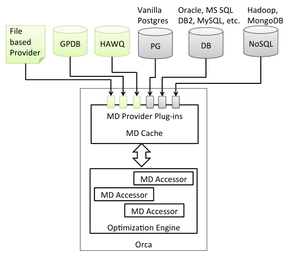

<!-- **Figure 9 caption 中文翻译**：见下方。 **视觉校验**：通过。 -->

图 9：元数据交换框架。

图中文字：File based Provider——基于文件的提供程序；Vanilla Postgres——原版 Postgres；MD Provider Plug-ins——元数据提供程序插件；MD Cache——元数据缓存；MD Accessor——元数据访问器；Optimization Engine——优化引擎。

图 9 展示了 Orca 如何与不同的后端系统交换元数据。在查询优化期间，Orca 访问的所有元数据对象都被固定在内存缓存中，并在优化完成或抛出错误时解除固定。对元数据对象的所有访问都通过 MD Accessor 完成；它跟踪优化会话中正在访问的对象，并确保在不再需要它们时将其释放。如果请求的元数据对象尚不在缓存中，MD Accessor 还负责从外部 MD Provider 透明地获取元数据。服务于不同优化会话的不同 MD Accessor 可以使用不同的外部 MD Provider 来获取元数据。

除了特定于系统的提供程序之外，Orca 还实现了一个基于文件的 MD Provider，用于从 DXL 文件加载元数据，从而不必访问正在运行的后端系统。Orca 包含一个自动化工具，将优化器需要的元数据收集到一个最小的 DXL 文件中。我们将在第 6.1 节说明如何使用该工具在后端数据库系统离线时重放客户查询的优化过程。

<a id="section-6"></a>

## 6. 可验证性

测试查询优化器与构建查询优化器一样具有挑战性。Orca 从开发早期就将测试纳入设计考虑。它内置了一套测试机制，使开发人员难以在添加新特性时引入回归，也使测试工程师能够方便地添加在每次构建时验证的测试用例。此外，我们利用自己构建的多个工具和测试框架来保证 Orca 的质量和可验证性，包括基数估计测试框架、若干不同规模的基准测试、一个可以通过逆向利用数据库统计信息生成数据的数据生成器 [24]，以及下面将讨论的两个独特测试工具。

第一个工具将在第 6.1 节讨论，它自动捕获并重放优化器异常。第二个工具将在第 6.2 节讨论，它实现了一种自动测量优化器代价模型准确性的方法。

<a id="section-6-1"></a>

### 6.1 最小复现

AMPERe [3] 是一个用于自动捕获最小、可移植且可执行复现案例（Automatic capture of Minimal Portable and Executable Repros）的工具。构建 AMPERe 的动机是能够在无法访问客户生产系统的情况下复现和调试优化器中的客户问题。

遇到意外错误时会自动触发 AMPERe 转储，也可以按需生成转储，以调查次优查询计划。转储捕获复现问题所需的最少数据，包括以 DXL 序列化的输入查询、优化器配置和元数据（参见第 3 节）。如果转储因异常而生成，还会包含异常的堆栈跟踪。

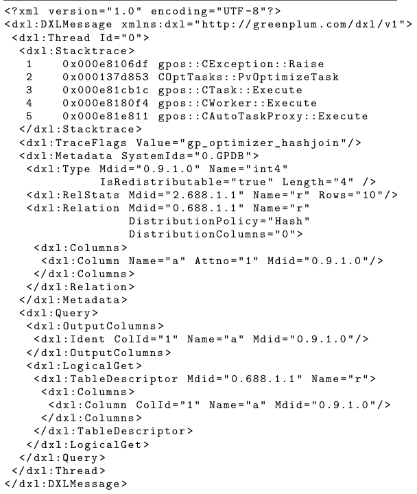

代码清单 2：简化的 AMPERe 转储。

代码清单 2 展示了一个简化 AMPERe 转储的示例。该转储只包含复现问题所需的数据。例如，转储捕获了 MD Cache 的状态，其中只包含查询优化过程中获取的元数据。AMPERe 也被设计为可扩展的。Orca 中的任何组件都可以向 AMPERe 序列化器注册，以在输出转储中生成额外信息。

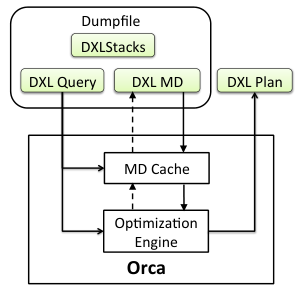

<!-- **Figure 10 caption 中文翻译**：见下方。 **视觉校验**：通过。 -->

图 10：重放 AMPERe 转储。

图中文字：Dumpfile——转储文件；DXL Query——DXL 查询；DXL MD——DXL 元数据；DXL Plan——DXL 计划；MD Cache——元数据缓存；Optimization Engine——优化引擎。

AMPERe 允许在生成转储的系统之外重放转储。任何 Orca 实例都可以加载转储以获取输入查询、元数据和配置参数，从而调用与触发当前问题的优化会话完全相同的会话。图 10 描述了这一过程：优化器从转储中加载输入查询，为元数据创建基于文件的 MD Provider，设置优化器配置，然后启动优化线程，立即复现问题。

AMPERe 还被用作测试框架，其中转储充当包含输入查询及其预期计划的测试用例。在重放转储文件时，Orca 可能生成与预期不同的计划，例如由于代价模型发生变化。这种差异会导致测试用例失败，并触发对计划差异根本原因的调查。使用这一框架，任何附带 AMPERe 转储的缺陷，无论来自内部测试还是客户报告，都可以自动转换为独立的测试用例。

<a id="section-6-2"></a>

### 6.2 测试优化器准确性

Orca 代价模型的准确性可能受到多种误差来源的影响，包括不准确的基数估计和未恰当调整的代价模型参数。因此，代价模型对计划实际执行时间的预测并不完美。量化优化器的准确性对于避免错误修复和新特性引入性能回归至关重要。

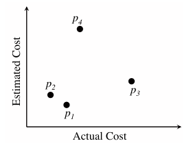

<!-- **Figure 11 caption 中文翻译**：见下方。 **视觉校验**：通过。 -->

图 11：计划空间。

图中文字：Estimated Cost——估计代价；Actual Cost——实际代价。

Orca 包含一个名为 TAQO [15] 的内置工具，用于测试查询优化器的准确性。TAQO 测量优化器代价模型对任意两个给定计划正确排序的能力，即估计代价较高的计划确实运行时间更长。例如，在图 11 中，优化器对 `(p1, p3)` 的排序正确，因为它们的实际代价与计算出的代价估计成正比。另一方面，优化器对 `(p1, p2)` 的排序不正确，因为它们的实际代价与计算出的代价估计成反比。

TAQO 通过对优化器在优化给定查询时考虑的计划计算代价并执行这些计划，来测量优化器的准确性。一般来说，评估搜索空间中的每一个计划都是不可行的。可以通过从搜索空间中均匀采样计划来克服这一限制。优化请求的链接结构（参见第 4.1 节）提供了基础设施，使 TAQO 能够基于 [29] 中提出的方法构建均匀计划采样器。

给定从某个查询的搜索空间中采样得到的一组计划，TAQO 计算这些计划按估计代价排序与按实际代价排序之间的相关性得分。该得分综合了多种度量，包括计划的重要性（对于非常好的计划的代价估计错误，得分会对优化器施加更大惩罚）以及计划之间的距离（对于实际执行时间接近的计划，如果其估计代价只有微小差异，得分不会惩罚优化器）。相关性得分还可用于对不同数据库系统的优化器进行基准测试，以评估它们的相对质量。我们在 [15] 中更详细地讨论了 TAQO 实现的测试方法。

<a id="section-7"></a>

## 7. 实验

在实验研究中，我们选择对配备 Orca 的数据库系统进行端到端评估，而不是评估 Orca 的各个组件，以突出新查询优化器带来的价值。我们首先将 Orca 与 Pivotal GPDB 的原有查询优化器进行比较，然后将 Pivotal HAWQ（其核心使用 Orca）与其他流行的 Hadoop SQL 解决方案进行比较。

<a id="section-7-1"></a>

### 7.1 TPC-DS 基准测试

我们的实验基于 TPC-DS 基准测试 [1]。TPC-DS 是一个被广泛采用的决策支持基准，由一组复杂的业务分析查询组成。与著名的 TPC-H 相比，它提供了丰富得多的模式和种类更多的业务问题，涵盖业务报告、即席探索、迭代查询和数据挖掘，因此取代了 TPC-H。在开发过程中，我们观察到 TPC-H 往往缺少企业客户工作负载的复杂程度。另一方面，TPC-DS 有 25 个表、429 列和 99 个查询模板，能够很好地代表现代决策支持系统，是测试查询优化器的优秀基准。TPC-DS 查询中丰富的 SQL 语法（WITH 子句、窗口函数、子查询、外连接、CASE 语句、INTERSECT、EXCEPT 等）是对任何查询引擎 SQL 标准符合性的严峻测试。

<a id="section-7-2"></a>

### 7.2 MPP 数据库

在这一部分，我们比较 Orca 与 GPDB 原有查询优化器的性能；后者又称 Planner，其部分设计继承自 PostgreSQL 优化器。Planner 是一个稳健的优化器，一直为数百个生产系统提供良好服务，并在过去十年中不断改进。

<a id="section-7-2-1"></a>

#### 7.2.1 实验设置

为了比较 Orca 和 Planner，我们使用由 10 Gbps 以太网连接的 16 节点集群。每个节点配有两颗 3.33 GHz Intel Xeon 处理器、48 GB 内存和 12 块 600 GB SAS 硬盘，组成两个 RAID-5 组。操作系统为 Red Hat Enterprise Linux 5.5。

我们安装了同一 GPDB 版本的两个隔离实例，一个使用 Orca，另一个使用 Planner。我们使用具有分区表的 10 TB TPC-DS 基准进行性能评估。

<a id="section-7-2-2"></a>

#### 7.2.2 性能

我们从 TPC-DS 的 99 个模板中生成了 111 个查询。Orca 和 Planner 都支持所有查询的原始形式，无需任何改写。完全符合 SQL 标准使 BI 工具具有最大的兼容性，也便于不同背景的数据分析人员使用。正如我们在第 7.3 节的 Hadoop SQL 实验中展示的那样，目前许多 Hadoop SQL 引擎开箱即用时仅支持 TPC-DS 查询的一小部分。

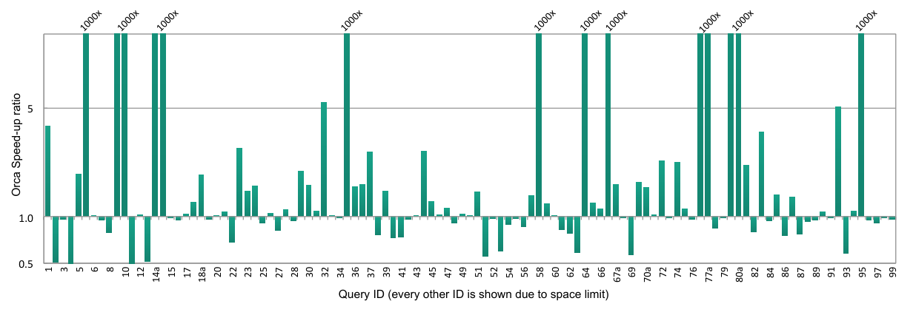

<!-- **Figure 12 caption 中文翻译**：见下方。 **视觉校验**：通过。 -->

图 12：Orca 相对于 Planner 的加速比（TPC-DS，10 TB）。

图中文字：纵轴为 Orca 加速比；横轴为查询 ID（由于篇幅限制，隔一个显示一个 ID）。

图 12 展示了 Orca 相对于 Planner 在所有查询上的性能加速比，其中高于加速比 1 的柱表示 Orca 的性能有所改善。我们观察到，Orca 能够为 80% 的查询生成相同或更好的查询计划。对于整个 TPC-DS 测试集，Orca 相对于 Planner 加速了 5 倍。特别是，Orca 对 14 个查询实现了至少 1000 倍的加速比——这是因为我们设置了 10000 秒的超时。这些查询使用 Planner 的计划需要超过 10000 秒，而使用 Orca 的计划能够在几分钟内完成。

Orca 带来的性能改进源于多种突出特性的结合，包括：

- **连接顺序。** Orca 包含多种连接顺序优化，基于动态规划、左深连接树和基数的连接顺序选择。
- **相关子查询。** Orca 采用并扩展了子查询的统一表示，以检测深层相关谓词并将它们上拉到连接中，从而避免重复执行子查询表达式。
- **分区消除。** Orca 引入了一个用于在运行时裁剪分区表的新框架 [2]。该特性通过扩展 Orca 的强制器框架以容纳新属性来实现。
- **公共表达式。** Orca 为 WITH 子句引入了新的生产者—消费者模型。该模型允许复杂表达式只计算一次，并由多个运算符消费其输出。

上述特性之间的协同由 Orca 的架构和组件抽象支持。每项特性的设计、实现和测试都只需对其他特性的行为进行最少的更改。图 12 展示了这些特性结合后的收益及其清晰的交互。

对于较少数量的查询，Orca 生成了次优计划，相对于 Planner 最多慢了 2 倍。这些次优计划部分是由于基数估计误差或需要进一步调整的次优代价模型参数造成的。我们正在积极调查这些问题并持续改进 Orca。

我们还测量了使用完整变换规则集时的优化时间和 Orca 的内存占用。平均优化时间约为 4 秒，平均内存占用约为 200 MB。如第 4.1 节所述，我们正在实现提前结束优化的技术，以改善复杂查询的资源消耗。

<a id="section-7-3"></a>

### 7.3 Hadoop 上的 SQL

由于其可扩展性，Hadoop 迅速成为流行的分析生态系统。近年来，许多 Hadoop 系统开发了 SQL 或类 SQL 查询接口。在本节中，我们将由 Orca 驱动的 Pivotal HAWQ 与三个 Hadoop SQL 引擎 Impala [17]、Presto [7] 和 Stinger [16] 的性能进行比较。关于这些系统的讨论请参见第 8 节。

<a id="section-7-3-1"></a>

#### 7.3.1 实验设置

实验在一个 10 节点集群上进行；其中两个节点用于 HDFS 名称节点和 SQL 引擎的协调服务，八个节点用于 HDFS 数据节点和工作节点。每个节点配有两颗 2.7 GHz 的八核 Intel Xeon 处理器、64 GB 内存以及 22 块 900 GB 硬盘，以 JBOD 方式配置。操作系统为 Red Hat Enterprise Linux 6.2。

Impala 使用 CDH 4.4 和 Impala 1.1.1，Presto 使用 0.52，Stinger 使用 Hive 0.12。我们尽最大努力调整每个系统的配置，包括启用短路读取、为工作节点分配尽可能多的内存，以及为协调服务使用一个独立节点。对于 HAWQ，我们在实验中使用 Pivotal HD 1.1 版本。

由于这些系统目前对 SQL 的支持有限，在不同系统中优化 TPC-DS 查询被证明相当困难。例如，Impala 尚不支持窗口函数、没有 LIMIT 的 ORDER BY 语句，以及 ROLLUP 和 CUBE 等一些分析函数。Presto 尚不支持非等值连接。Stinger 目前不支持 WITH 子句和 CASE 语句。此外，这些系统均不支持 INTERSECT、EXCEPT、析取连接条件和相关子查询。这些不受支持的特性迫使我们从考虑范围中排除大量查询。

排除不受支持的查询后，我们需要改写剩余查询，以绕过不同系统的解析限制。例如，Stinger 和 Presto 不支持隐式交叉连接和某些数据类型。经过大量筛选和改写后，在总共 111 个查询中，我们最终在 Impala 中为 31 个查询、在 Stinger 中为 19 个查询、在 Presto 中为 12 个查询获得了查询计划。

<a id="section-7-3-2"></a>

#### 7.3.2 性能

我们首先尝试使用 10 TB TPC-DS 基准评估不同系统。然而，Stinger 中的大多数查询没有在合理时限内返回，Impala 和 Presto 中几乎所有查询都因内存不足错误而失败。这主要是因为当某个运算符的内部状态超过内存限制时，这些系统无法将部分结果溢写到磁盘。

为了在不同系统中获得更好的覆盖率，我们使用了 256 GB TPC-DS 基准，考虑到集群的总工作内存约为 400 GB（50 GB × 8 个节点）。遗憾的是，即使在这种设置下，我们也无法在 Presto 中成功运行任何 TPC-DS 查询，尽管我们成功在 Presto 中运行了简单得多的连接查询。对于 Impala 和 Stinger，我们成功运行了一些 TPC-DS 查询，下面将对此进行讨论。

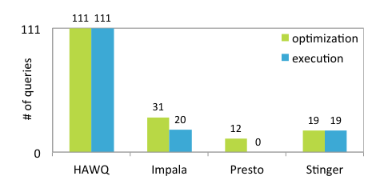

<!-- **Figure 15 caption 中文翻译**：见下方。 **视觉校验**：通过。 -->

图 15：TPC-DS 查询支持情况。

图中文字：纵轴为查询数量；图例中的 optimization 为优化，execution 为执行。

图 15 总结了所有系统支持的查询数量。我们展示了每个系统能够优化的查询数量，即返回查询计划的查询数量，以及能够在 256 GB 数据集上完成执行并返回查询结果的查询数量。

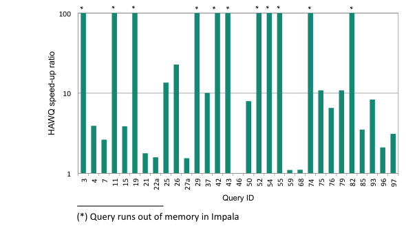

<!-- **Figure 13 caption 中文翻译**：见下方。 **视觉校验**：通过。 -->

图 13：HAWQ 与 Impala 的比较（TPC-DS，256 GB）。

图中文字：纵轴为 HAWQ 加速比，横轴为查询 ID；`*` 表示查询在 Impala 中运行时内存耗尽。

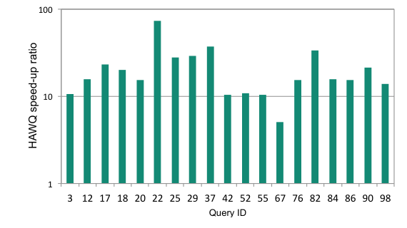

<!-- **Figure 14 caption 中文翻译**：见下方。 **视觉校验**：通过。 -->

图 14：HAWQ 与 Stinger 的比较（TPC-DS，256 GB）。

图中文字：纵轴为 HAWQ 加速比，横轴为查询 ID。

图 13 和图 14 展示了 HAWQ 相对于 Impala 和 Stinger 的加速比。由于这两个系统并不支持所有查询，我们只列出成功的查询。图 13 中标有 `*` 的柱表示运行时内存耗尽的查询。对于查询 46、59 和 68，Impala 和 HAWQ 的性能相近。

对于 HAWQ 加速最明显的查询，我们发现 Impala 和 Stinger 按查询中字面指定的顺序处理连接，而 Orca 探索不同的连接顺序，并使用基于代价的方法给出最佳顺序。例如，在查询 25 中，Impala 首先连接两个事实表 `store_sales` 和 `store_returns`，然后将这个巨大的中间结果与另一个事实表 `catalog_sales` 连接，效率相当低。相比之下，Orca 首先将事实表与维度表连接，以减少中间结果。一般而言，连接顺序选择是一项复杂的优化，需要优化器端具备大量基础设施。

Impala 建议用户按被连接表大小的降序编写连接。然而，这一建议忽略了表上的过滤条件（这些条件可能具有选择性），给数据库用户处理复杂查询增加了不可忽视的负担，并且可能无法得到自动生成查询的 BI 工具支持。查询优化器缺乏连接顺序优化会对生成计划的质量产生负面影响。HAWQ 加速的其他可能原因，例如资源管理和查询执行，不在本文讨论范围内。

在这组实验中，HAWQ 相对于 Impala 的平均加速比为 6 倍，相对于 Stinger 为 21 倍。请注意，图 13 和图 14 中列出的查询是 TPC-DS 基准中相对简单的查询。更复杂的查询，例如包含相关子查询的查询，其他系统尚不支持，而 Orca 完全支持。我们计划在未来其他系统支持所有查询时，重新进行 TPC-DS 基准性能评估。

<a id="section-8"></a>

## 8. 相关工作

在过去几十年中，查询优化一直是多项开创性创新的沃土。在本节中，我们讨论若干基础查询优化技术，以及 MPP 数据库和基于 Hadoop 的系统领域近期提出的方案。

<a id="section-8-1"></a>

### 8.1 查询优化基础

Volcano 并行数据库 [12] 提出了在数据库中实现并行性的基本原则。所提出的框架引入了 exchange 运算符，支持两种并行方式：通过流水线实现的运算符间并行，以及通过将元组分区到运行在不同进程中的运算符来实现的运算符内并行。该设计允许每个运算符在本地数据上独立执行，同时与运行在其他进程中的该运算符副本并行工作。多个 MPP 数据库 [6, 8, 18, 20, 23] 利用这些原则构建了商业上成功的产品。

Cascades [13] 是一个可扩展的优化器框架，其原则已被用于构建 MS-SQL Server、SCOPE [6]、PDW [23]，以及本文介绍的优化器 Orca。该框架广受欢迎的原因在于它清晰地分离了逻辑计划空间和物理计划空间。这主要通过将运算符和变换规则封装为独立组件来实现。这种模块化设计使 Cascades 能够将逻辑等价的表达式分组以消除冗余工作，允许按需触发规则，而不同于 Volcano [14] 的穷尽式方法，并允许根据规则对给定运算符的效用来确定应用顺序。

基于 Cascades 的原则，文献 [30] 提出了一个并行优化框架，使人们能够为多核架构构建类似 Cascades 的优化器。Orca 中的并行查询优化框架（参见第 4.2 节）基于 [30] 中提出的原则。

<a id="section-8-2"></a>

### 8.2 MPP 数据库上的 SQL 优化

存储和查询的数据量呈指数增长，使得大规模并行处理（MPP）系统得到更广泛的使用，例如 Teradata [27]、Oracle Exadata [31]、Netezza [25]、Pivotal Greenplum Database [20] 和 Vertica [18]。由于篇幅限制，我们概述近期为应对大数据挑战而重新设计查询优化器的一些工作。

SQL Server Parallel Data Warehouse（PDW）[23] 大量重用了成熟的 Microsoft SQL Server 优化器。对于每个查询，PDW 都向 SQL Server 优化器发出一个优化请求，该优化器作用于一个空壳数据库，其中只维护数据库的元数据和统计信息，而不维护用户数据。SQL Server 优化器探索得到的备选计划随后被发送给 PDW 的 Data Movement Service（DMS），在那里为这些逻辑计划补充分布信息。虽然这种方法避免了从头构建优化器，但由于优化逻辑分散在两个不同的进程和代码库中，调试和维护变得更加困难。

Structured Computations Optimized for Parallel Execution（SCOPE）[6] 是微软的数据分析平台，利用了并行数据库和 MapReduce 系统两者的特征。SCOPE 的脚本语言与 Hive [28] 一样，基于 SQL。SCOPE 为 Cosmos 分布式数据平台而开发，后者使用仅追加文件系统；而 Orca 的设计愿景是能够与多个底层数据管理系统配合工作。

SAP HANA [11] 是一个分布式内存数据库系统，处理业务分析和 OLTP 查询。MPP 数据库中的分析查询可能产生大量中间结果。并发分析查询可能耗尽可用内存，而其中大部分内存已被用于存储原始数据并为其建立索引，这会触发数据溢写到磁盘，从而对查询性能产生负面影响。

Vertica [18] 是 C-Store 项目 [26] 的商业化 MPP 版本；数据被组织为多个投影，每个投影都是表属性的一个子集。最初的 StarOpt 及其改进版本 StratifiedOpt 优化器是为星型／雪花型模式上的查询专门设计的，其中相同范围的连接键位于同一位置。当无法实现数据共置时，相关投影会在所有节点上复制以提高性能，Vertica 的 V2Opt 优化器处理了这一问题。

<a id="section-8-3"></a>

### 8.3 Hadoop 上的 SQL

在 Hadoop 上执行 SQL 的经典方法是使用 Hive [28] 将查询转换为 MapReduce 作业。对于交互式分析，MapReduce 的性能可能不能令人满意。Stinger [16] 是一个通过利用和扩展 Hive 来优化 Hadoop 上查询求值的项目。然而，这种方法可能需要大幅重新设计 MapReduce 计算框架，以优化对数据的多次遍历以及中间结果在磁盘上的物化。

一些工作通过创建专门的查询引擎来实现 Hadoop 上的交互式处理，使得不必使用 MapReduce 即可基于 SQL 处理 HDFS 中的数据。Impala [17]、HAWQ [21] 和 Presto [7] 是这一方向的主要工作。这些方法在查询优化器和执行引擎的设计与能力上有所不同，而这两者都是影响查询性能的关键区别。DBMS 与 Hadoop 技术的共置允许数据在各自平台上以原生方式处理：在 DBMS 中使用 SQL，在 HDFS 中使用 MapReduce。Hadapt [4] 开创了这种方法。微软还推出了 PolyBase [10]，提供将 PDW [23] 中的表与 HDFS 中的数据连接的能力，以优化平台之间的数据交换。

AsterixDB [5] 是一个开源项目，旨在基于 NoSQL 风格的数据模型高效存储、索引和查询半结构化信息。目前，AsterixDB 的查询计划器由用户提示驱动，而不是像 Orca 那样采用基于代价的方法。Dremel [19] 是 Google 的一个可扩展列式解决方案，用于分析 MapReduce 流水线的输出。Dremel 提供类似于 AsterixDB 脚本语言 AQL [5] 和 SCOPE [6] 的高级脚本语言，以处理只读嵌套数据。

<a id="section-9"></a>

## 9. 总结

开发 Orca 时，我们的目标是构建一个查询优化平台，它不仅代表最先进的技术水平，而且足够强大、足够可扩展，能够支持快速开发新的优化技术和高级查询特性。

本文描述了完全从头构建这样一个系统所需的工程工作。将多项技术保障机制集成到 Orca 中需要重大投入，但这些投入已经以快速开发和由此产生的高软件质量的形式带来了显著回报。Orca 的模块化使其能够通过清晰、统一的抽象对系统能力和元数据进行编码，从而轻松适配不同的数据管理系统。

<a id="section-10"></a>

## 10. 参考文献

[1] TPC-DS. http://www.tpc.org/tpcds, 2005.

[2] L. Antova, A. ElHelw, M. Soliman, Z. Gu, M. Petropoulos, and F. Waas. Optimizing Queries over Partitioned Tables in MPP Systems. In SIGMOD, 2014.

[3] L. Antova, K. Krikellas, and F. M. Waas. Automatic Capture of Minimal, Portable, and Executable Bug Repros using AMPERe. In DBTest, 2012.

[4] K. Bajda-Pawlikowski, D. J. Abadi, A. Silberschatz, and E. Paulson. Efficient Processing of Data Warehousing Queries in a Split Execution Environment. In SIGMOD, 2011.

[5] A. Behm, V. R. Borkar, M. J. Carey, R. Grover, C. Li, N. Onose, R. Vernica, A. Deutsch, Y. Papakonstantinou, and V. J. Tsotras. ASTERIX: Towards a Scalable, Semistructured Data Platform for Evolving-world Models. Dist. Parallel Databases, 29(3), 2011.

[6] R. Chaiken, B. Jenkins, P.-Å. Larson, B. Ramsey, D. Shakib, S. Weaver, and J. Zhou. SCOPE: Easy and Efficient Parallel Processing of Massive Data Sets. PVLDB, 1(2), 2008.

[7] L. Chan. Presto: Interacting with petabytes of data at Facebook. http://prestodb.io, 2013.

[8] Y. Chen, R. L. Cole, W. J. McKenna, S. Perfilov, A. Sinha, and E. Szedenits, Jr. Partial Join Order Optimization in the Paraccel Analytic Database. In SIGMOD, 2009.

[9] J. C. Corbett, J. Dean, M. Epstein, A. Fikes, C. Frost, J. J. Furman, S. Ghemawat, A. Gubarev, C. Heiser, P. Hochschild, W. Hsieh, S. Kanthak, E. Kogan, H. Li, A. Lloyd, S. Melnik, D. Mwaura, D. Nagle, S. Quinlan, R. Rao, L. Rolig, Y. Saito, M. Szymaniak, C. Taylor, R. Wang, and D. Woodford. Spanner: Google’s Globally-distributed Database. In OSDI, 2012.

[10] D. J. DeWitt, A. Halverson, R. Nehme, S. Shankar, J. Aguilar-Saborit, A. Avanes, M. Flasza, and J. Gramling. Split Query Processing in Polybase. In SIGMOD, 2013.

[11] F. Färber, S. K. Cha, J. Primsch, C. Bornhövd, S. Sigg, and W. Lehner. SAP HANA Database: Data Management for Modern Business Applications. SIGMOD Rec., 40(4), 2012.

[12] G. Graefe. Encapsulation of Parallelism in the Volcano Query Processing System. In SIGMOD, 1990.

[13] G. Graefe. The Cascades Framework for Query Optimization. IEEE Data Eng. Bull., 18(3), 1995.

[14] G. Graefe and W. J. McKenna. The Volcano Optimizer Generator: Extensibility and Efficient Search. In ICDE, 1993.

[15] Z. Gu, M. A. Soliman, and F. M. Waas. Testing the Accuracy of Query Optimizers. In DBTest, 2012.

[16] Hortonworks. Stinger, Interactive query for Apache Hive. http://hortonworks.com/labs/stinger/, 2013.

[17] M. Kornacker and J. Erickson. Cloudera Impala: Real-Time Queries in Apache Hadoop, for Real. http://www.cloudera.com/content/cloudera/en/products-and-services/cdh/impala.html, 2012.

[18] A. Lamb, M. Fuller, R. Varadarajan, N. Tran, B. Vandiver, L. Doshi, and C. Bear. The Vertica Analytic Database: C-store 7 Years Later. VLDB Endow., 5(12), 2012.

[19] S. Melnik, A. Gubarev, J. J. Long, G. Romer, S. Shivakumar, M. Tolton, and T. Vassilakis. Dremel: Interactive Analysis of Web-Scale Datasets. PVLDB, 3(1):330–339, 2010.

[20] Pivotal. Greenplum Database. http://www.gopivotal.com/products/pivotal-greenplum-database, 2013.

[21] Pivotal. HAWQ. http://www.gopivotal.com/sites/default/files/Hawq_WP_042313_FINAL.pdf, 2013.

[22] P. G. Selinger, M. M. Astrahan, D. D. Chamberlin, R. A. Lorie, and T. G. Price. Access Path Selection in a Relational Database Management System. In SIGMOD, 1979.

[23] S. Shankar, R. Nehme, J. Aguilar-Saborit, A. Chung, M. Elhemali, A. Halverson, E. Robinson, M. S. Subramanian, D. DeWitt, and C. Galindo-Legaria. Query Optimization in Microsoft SQL Server PDW. In SIGMOD, 2012.

[24] E. Shen and L. Antova. Reversing Statistics for Scalable Test Databases Generation. In Proceedings of the Sixth International Workshop on Testing Database Systems, pages 7:1–7:6, 2013.

[25] M. Singh and B. Leonhardi. Introduction to the IBM Netezza Warehouse Appliance. In CASCON, 2011.

[26] M. Stonebraker, D. J. Abadi, A. Batkin, X. Chen, M. Cherniack, M. Ferreira, E. Lau, A. Lin, S. Madden, E. J. O’Neil, P. E. O’Neil, A. Rasin, N. Tran, and S. B. Zdonik. C-Store: A Column-oriented DBMS. In VLDB, 2005.

[27] Teradata. http://www.teradata.com/, 2013.

[28] A. Thusoo, J. S. Sarma, N. Jain, Z. Shao, P. Chakka, N. Zhang, S. Anthony, H. Liu, and R. Murthy. Hive - A Petabyte Scale Data Warehouse using Hadoop. In ICDE, 2010.

[29] F. Waas and C. Galindo-Legaria. Counting, Enumerating, and Sampling of Execution Plans in a Cost-based Query Optimizer. In SIGMOD, 2000.

[30] F. M. Waas and J. M. Hellerstein. Parallelizing Extensible Query Optimizers. In SIGMOD Conference, pages 871–878, 2009.

[31] R. Weiss. A Technical Overview of the Oracle Exadata Database Machine and Exadata Storage Server, 2012.

<a id="copyright-notice"></a>

## 原文版权声明

> 允许免费制作本作品全部或部分内容的电子或纸质副本，供个人或课堂使用，但不得为营利或商业利益制作或分发副本，且副本首页必须载有本声明和完整引用信息。必须尊重本作品中归 ACM 以外其他方所有的组成部分的版权。允许注明出处后摘录。以其他方式复制、再版、发布到服务器或重新分发到邮件列表，须事先获得专门许可和／或支付费用。许可申请请联系 permissions@acm.org。版权 © 2014 ACM 978-1-4503-2376-5/14/06 … $15.00。http://dx.doi.org/10.1145/2588555.2595637。SIGMOD’14，2014 年 6 月 22–27 日，美国犹他州斯诺伯德。
