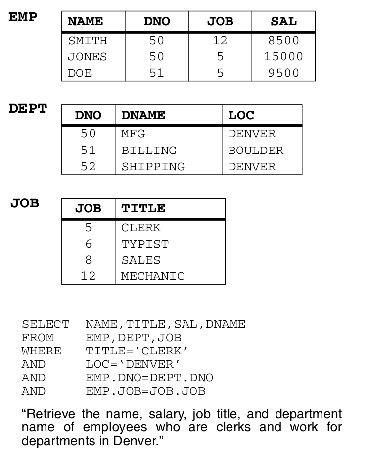
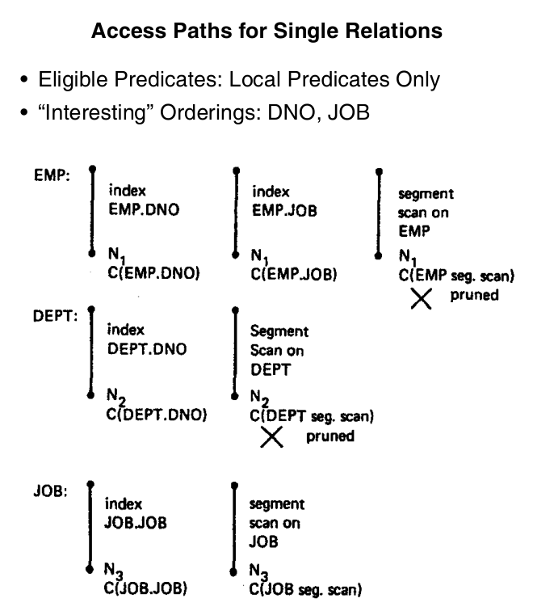
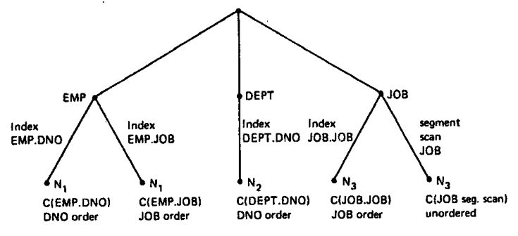
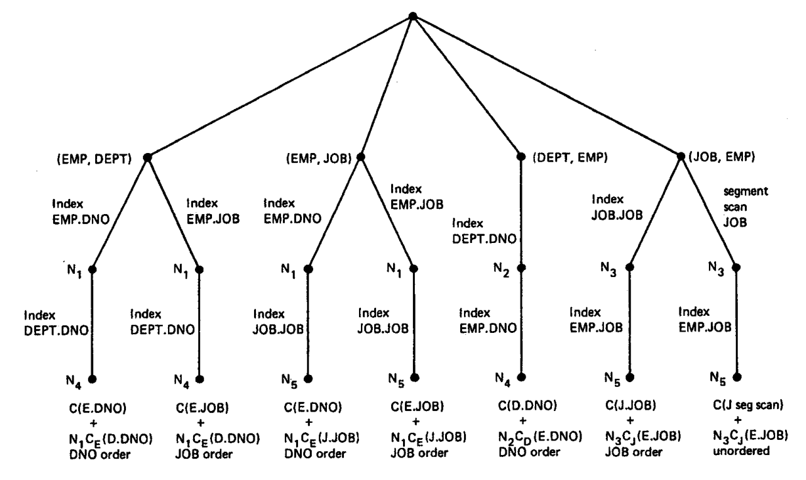
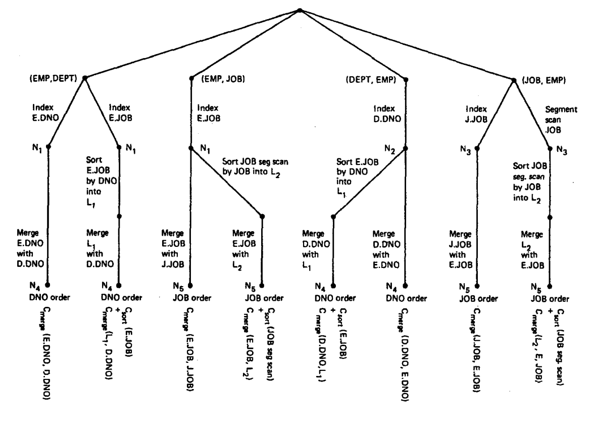
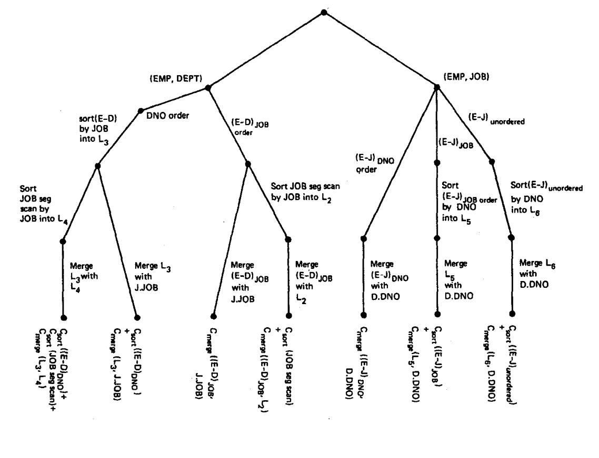

+++
title = "[译文] 关系数据库管理系统中的访问路径选择"
date = 2026-11-16T00:00:00+08:00
slug = "system-r-access-path-selection"
summary = "System R 查询优化器访问路径选择论文的中文译文。"
tags = ["System R", "查询优化", "数据库"]
categories = ["数据库系统", "计算机技术"]
draft = false
+++

原文：[Access Path Selection in a Relational Database Management System](https://doi.org/10.1145/582095.582099)，P. Griffiths Selinger、M. M. Astrahan、D. D. Chamberlin、R. A. Lorie、T. G. Price，SIGMOD 1979，第 23–34 页。

原文版权声明：Copyright © 1979 by the ACM, Inc., used by permission. Permission to make digital or hard copies is granted provided that copies are not made or distributed for profit or direct commercial advantage, and that copies show this notice on the first page or initial screen of a display along with the full citation. Originally published in the Proceedings of the 1979 ACM SIGMOD International Conference on the Management of Data. Digital recreation by Eric A. Brewer, brewer@cs.berkeley.edu, October 2002.

## 摘要

在 SQL 这样的高级查询和数据操作语言中，请求以非过程式的方式表述，不涉及访问路径。本文描述 System R 如何根据用户用谓词布尔表达式指定的所需数据，为简单查询（单关系查询）和复杂查询（如连接）选择访问路径。System R 是为研究关系数据模型而开发的实验性数据库管理系统，由 IBM 圣何塞研究实验室的成员设计和构建。

## 1. 引言

System R 是一个基于关系数据模型的实验性数据库管理系统，自 1975 年起在 IBM 圣何塞研究实验室开发 [1]。该软件是用于关系数据库研究的工具，通常不向 IBM 研究部门之外提供。

本文假设读者熟悉 Codd [7] 和 Date [8] 所述的关系数据模型术语。System R 的用户接口是统一的查询、数据定义和操作语言 SQL [5]。SQL 语句既可以从面向临时用户的联机终端接口发出，也可以从 PL/I 和 COBOL 等编程语言中发出。

在 System R 中，用户不必知道元组如何物理存储，也不必知道有哪些访问路径可用（例如哪些列有索引）。SQL 语句不要求用户指定检索元组时使用的访问路径，用户也不指定连接的执行顺序。System R 优化器为 SQL 语句中的每个表选择连接顺序和访问路径。在众多可能的选择中，优化器选择执行整条语句的“总访问代价”最小的方案。

本文讨论查询的访问路径选择问题。数据操作（UPDATE、DELETE）的检索过程与之类似。第 2 节描述优化器在 SQL 语句处理中的位置，第 3 节描述存储组件为单个物理存储表提供的访问路径。第 4 节介绍优化器对单表查询使用的代价公式，第 5 节讨论两个或更多表的连接及其相应代价，第 6 节讨论嵌套查询（谓词中的查询）。

## 2. SQL 语句的处理

一条 SQL 语句要经过四个处理阶段。根据语句的来源和内容，这些阶段之间可能相隔任意长的时间。在 System R 中，这些任意的时间间隔对处理 SQL 语句的系统组件是透明的。文献 [2] 进一步讨论了这些机制，以及来自程序和终端的 SQL 语句的处理过程。这里仅概述与访问路径选择有关的处理步骤。

语句处理的四个阶段是解析、优化、代码生成和执行。每条 SQL 语句都被送往解析器，检查语法是否正确。一个查询块由 SELECT 列表、FROM 列表和 WHERE 树表示，分别包含要检索的项、引用的表，以及用户指定的简单谓词的布尔组合。一条 SQL 语句可能包含多个查询块，因为谓词的一个操作数本身可能是查询。

如果解析器返回时没有发现错误，就调用 OPTIMIZER 组件。OPTIMIZER 收集查询中引用的表名和列名，并在 System R 系统目录中查找它们，以验证其存在并取得相关信息。

OPTIMIZER 的目录查找部分还获取所引用关系的统计信息，以及每个关系上可用的访问路径，供之后选择访问路径使用。目录查找得到每列的数据类型和长度后，OPTIMIZER 重新扫描 SELECT 列表和 WHERE 树，检查表达式和谓词比较中的语义错误及类型兼容性。

最后，OPTIMIZER 进行访问路径选择。它首先确定语句中各查询块的求值顺序，然后处理每个查询块 FROM 列表中的关系。如果一个块中有多个关系，就评估连接顺序和连接方法的各种排列。从备选路径构成的树中选择该块总成本最低的访问路径。这个最低成本方案通过修改语法分析树的结构来表示，得到的是用访问规格语言（ASL）[10] 表示的执行计划。

为每个查询块选择计划并在语法分析树中表示后，系统调用 CODE GENERATOR。CODE GENERATOR 是一个表驱动程序，它将 ASL 树转换成机器语言代码，以执行 OPTIMIZER 选定的计划。为此，它使用数量相对较少的代码模板，每种连接方法（包括不连接）对应一个模板。嵌套查询的查询块被当作“子程序”，向包含它们的谓词返回值。文献 [9] 进一步描述了 CODE GENERATOR。

在代码生成过程中，语法分析树被可执行机器代码及其相关数据结构取代。系统根据语句的来源（程序或终端），立即将控制权交给这些代码，或将代码存入数据库以供日后执行。无论哪种情况，代码最终执行时，都会通过存储系统接口（RSI）调用 System R 内部存储系统（RSS），扫描查询中每个物理存储的关系。这些扫描沿 OPTIMIZER 选定的访问路径进行。下一节描述生成的代码可以使用的 RSI 命令。

## 3. Research Storage System

Research Storage System（RSS）是 System R 的存储子系统，负责维护关系的物理存储、关系上的访问路径、锁（在多用户环境中）以及日志和恢复设施。RSS 为用户提供面向元组的接口 RSI。尽管 RSS 可以独立于 System R 使用，本文关注的是上一节所述的、用 RSS 执行 System R 中处理 SQL 语句时生成的代码。RSS 的完整描述见 [1]。

RSS 将关系存储为元组的集合，元组的各列在物理上连续。元组存储在 4 KB 页面中；一个元组不会跨页。页面被组织成称为段的逻辑单元。一个段可以包含一个或多个关系，但一个关系不能跨段。两个或更多关系的元组可以出现在同一个页面中。每个元组都带有其所属关系的标识。

访问关系中元组的主要方式是 RSS 扫描。扫描沿给定访问路径一次返回一个元组。OPEN、NEXT 和 CLOSE 是扫描的主要命令。

目前 SQL 语句可以使用两种扫描。第一种是段扫描，用于查找给定关系的所有元组。段扫描中的一系列 NEXT 会检查该段中包含任意关系元组的所有页面，并返回属于给定关系的元组。

第二种是索引扫描。System R 用户可以在关系的一个或多个列上创建索引，一个关系可以有任意数量的索引，也可以没有索引。索引存储在与关系元组不同的页面上。索引以 B 树 [3] 实现，其叶子页面包含键及含有该键的元组标识符集合。因此，索引扫描中的一系列 NEXT 沿索引叶子页面顺序读取，取得与键匹配的元组标识符，并利用它们找到数据元组，按键值顺序返回给用户。索引叶子页面通过链连接，因此 NEXT 不必访问索引的上层页面。

在段扫描中，段内所有非空页面都会被访问，无论其中是否有目标关系的元组；但每个页面只访问一次。通过索引扫描检查整个关系时，每个索引页面只访问一次，但如果一个数据页面上的两个元组在索引顺序中相距较远，该数据页面可能被检查多次。如果元组按索引顺序插入段页面，并且维护了这种与索引键值对应的物理邻近关系，我们称该索引为聚簇索引。聚簇索引具有这样的性质：沿该索引扫描时，不仅每个索引页面，而且包含该关系元组的每个数据页面也只会访问一次。

索引扫描不一定要扫描整个关系。可以指定起始和终止键值，只扫描键落在某个索引值范围内的元组。索引扫描和段扫描都可以选择性地接受一组称为搜索参数（SARGS）的谓词，在元组返回给 RSI 调用者之前应用这些谓词。如果元组满足谓词，就返回它；否则扫描继续，直到找到满足 SARGS 的元组，或耗尽该段或指定的索引值范围。这避免了为 RSS 内部即可高效排除的元组进行 RSI 调用的开销，从而降低代价。并非所有谓词都具有可成为 SARGS 的形式。可搜索谓词（sargable predicate）具有或可以转换为“列 比较运算符 值”的形式。SARGS 表示为这类谓词的析取范式布尔表达式。

## 4. 单关系访问路径的代价

在接下来的几节中，我们将描述如何选择查询求值计划。首先介绍最简单的情况：访问单个关系，然后说明它如何扩展和推广到两个关系的连接、n 个关系的连接，最后是多个查询块（嵌套查询）。

OPTIMIZER 检查查询中的谓词以及所引用关系上可用的访问路径，使用下列代价公式预测每个访问计划的代价：

```text
COST = PAGE FETCHES + W × RSI CALLS
```

该代价是 I/O（读取的页面数）和 CPU 使用量（执行的指令数）的加权度量。W 是 I/O 与 CPU 之间可调整的权重因子。RSI CALLS 是预计从 RSS 返回的元组数。由于 System R 的大部分 CPU 时间花在 RSS 中，RSI 调用次数能够较好地近似 CPU 使用量。因此，选择处理查询的最低代价路径，是在设法减少所需的总资源。

在 OPTIMIZER 执行类型兼容性和语义检查期间，会检查每个查询块的 WHERE 谓词树。WHERE 树被视为合取范式，每个合取项称为一个布尔因子。布尔因子的重要性在于：返回给用户的每个元组都必须满足每个布尔因子。如果布尔因子是可搜索谓词，而且引用的列是索引键，就称该索引与该布尔因子匹配；例如 SALARY 上的索引与谓词 `SALARY = 20000` 匹配。更准确地说，如果谓词可搜索，且其中涉及的列构成索引键列集合的起始子串，就称这个谓词或谓词集合与该索引访问路径匹配。例如，NAME、LOCATION 索引与 `NAME = 'SMITH' AND LOCATION = 'SAN JOSE'` 匹配。如果索引与布尔因子匹配，使用该索引访问是满足该布尔因子的一种高效方式。可搜索的布尔因子也可以作为搜索参数高效地满足。注意，一个布尔因子可能是一棵以 OR 为根的完整谓词树。

目录查找期间，OPTIMIZER 获取查询中各关系以及每个关系上可用访问路径的统计信息。保存的统计信息如下：

对于每个关系 T：

- `NCARD(T)`：关系 T 的基数。
- `TCARD(T)`：段中存有关系 T 元组的页面数。
- `P(T)`：段的数据页面中存有关系 T 元组的比例，等于 `TCARD(T) / 段中的非空页面数`。

对于关系 T 上的每个索引 I：

- `ICARD(I)`：索引 I 中不同键的数量。
- `NINDX(I)`：索引 I 的页面数。

这些统计信息保存在 System R 系统目录中，来源有多个。初始装载关系和创建索引时会初始化统计信息；此后，通过任何用户都可以运行的 UPDATE STATISTICS 命令定期更新。System R 不会在每次 INSERT、DELETE 或 UPDATE 时更新这些统计信息，因为这会增加数据库操作，并在系统目录上形成锁瓶颈。动态更新统计信息会使修改关系内容的访问趋于串行化。

利用这些统计信息，OPTIMIZER 为谓词列表中的每个布尔因子分配一个选择率因子 `F`。这个因子非常粗略地对应于预计满足谓词的元组比例。表 1 列出了不同谓词的选择率因子。我们假定缺少统计信息意味着关系很小，因此选择一个任意因子。

**表 1：选择率因子**

1. `column = value`：如果 column 上有索引，`F = 1 / ICARD(column index)`；这假定元组在索引键值之间均匀分布。否则 `F = 1/10`。
2. `column1 = column2`：如果两列都有索引，`F = 1 / MAX(ICARD(column1 index), ICARD(column2 index))`；这假定基数较小的索引中的每个键值都在另一个索引中有匹配值。如果只有 column-i 上有索引，则 `F = 1 / ICARD(column-i index)`；否则 `F = 1/10`。
3. `column > value`（或其他无界比较）：如果列是算术类型且在选择访问路径时已知 value，则通过在键值范围内线性插值计算 `F = (high key value - value) / (high key value - low key value)`；否则 `F = 1/3`（例如列不是算术类型）。这个数字本身没有特殊含义，只是它的选择性低于没有索引时为等值谓词猜测的选择性，而且小于 1/2。我们假设很少有查询使用超过半数元组满足的谓词。
4. `column BETWEEN value1 AND value2`：如果 column 是算术类型且选择访问路径时两个值都已知，则使用 BETWEEN 值范围与整个键值范围的比例，即 `F = (value2 - value1) / (high key value - low key value)`；否则 `F = 1/4`。同样，这个选择没有特殊含义，只是它介于等值谓词和范围谓词的默认选择率之间。
5. `column IN (list of values)`：`F = 列表中的项数 × (column = value 的选择率因子)`，上限为 1/2。
6. `columnA IN subquery`：`F = 子查询结果的预期基数 / 子查询 FROM 列表中所有关系基数的乘积`。查询基数的计算将在下文讨论。该公式由以下论证推导：考虑最简单的情况，子查询形式为 `SELECT columnB FROM relationC ...`。假定 relationC 中所有 columnB 值的集合包含所有 columnA 值。如果子查询选中 relationC 的所有元组，该谓词总为 TRUE，且 `F = 1`。如果子查询的元组受到选择率因子 `F'` 的限制，则假定子查询结果中与 columnA 值匹配的不同值集合也按比例受到限制，即谓词的选择率因子应为 `F'`。`F'` 是子查询所有选择率因子的乘积，也就是子查询基数除以所有可能子查询答案的基数。稍微乐观一些，可以将这一推理推广到连接子查询，以及 columnB 被包含列名的算术表达式替换的子查询，从而得到上述公式。
7. `(pred1) OR (pred2)`：`F = F(pred1) + F(pred2) - F(pred1) × F(pred2)`。
8. `(pred1) AND (pred2)`：`F = F(pred1) × F(pred2)`。注意，这假定列值彼此独立。
9. `NOT pred`：`F = 1 - F(pred)`。

查询基数（QCARD）是查询块 FROM 列表中各关系基数的乘积，再乘以该查询块所有布尔因子选择率的乘积。预计的 RSI 调用次数（RSICARD）是关系基数乘积再乘以可搜索布尔因子的选择率：可搜索的布尔因子将放入搜索参数，从而在元组穿过 RSS 接口返回之前将其过滤掉。

为单个关系选择最优访问路径，就是在公式中结合这些选择率因子和可用访问路径的统计信息。在描述这一过程之前，需要先给出一个定义。使用索引访问路径或对元组排序，会按索引值或排序键的顺序产生元组。如果一种元组顺序是查询块的 GROUP BY 或 ORDER BY 子句指定的顺序，我们就称它为一个有趣顺序（interesting order）。

对于单个关系，通过计算每个可用访问路径（关系上的每个索引，加上段扫描）的代价来获得最便宜的访问路径。下文将说明这些代价。对每条这样的访问路径，都会计算预测代价以及它产生的元组顺序。例如按升序扫描 SALARY 索引，会得到某个代价 C 和 SALARY 升序的元组顺序。要找到单关系查询最便宜的访问计划，只需检查产生每种“有趣”顺序的最便宜访问路径，以及最便宜的“无序”访问路径。注意，“无序”访问路径实际上也可能产生某种顺序，只不过该顺序不是“有趣”的。如果查询没有 GROUP BY 或 ORDER BY 子句，就没有有趣顺序，选择最便宜的访问路径。如果有 GROUP BY 或 ORDER BY 子句，则必须将产生该有趣顺序的代价，与最便宜的无序路径加上把 QCARD 个元组排序到适当顺序的代价进行比较。选择这些备选方案中最便宜的作为查询块计划。

表 2 给出了单关系访问路径的代价公式。公式由读取的索引页面、读取的数据页面，以及 RSI 元组检索调用次数乘权重因子组成。W 是读取页面与 RSI 调用之间的权重因子。某些情况有多个备选公式，取决于检索出的元组集合是否能够全部放入 RSS 缓冲池（或每个用户的有效缓冲池）。对于聚簇索引，我们假设页面在缓冲区中停留足够长的时间，以便从中检索每个元组。对于非聚簇索引，我们假定那些放不进缓冲区的关系相对于缓冲区足够大，以至于每次检索元组都需要读取一个页面。

**表 2：代价公式**

| 情况 | 代价（以页面为单位） |
| --- | --- |
| 与等值谓词匹配的唯一索引 | `1 + 1 + W` |
| 与一个或多个布尔因子匹配的聚簇索引 I | `F(preds) × (NINDX(I) + TCARD) + W × RSICARD` |
| 与一个或多个布尔因子匹配的非聚簇索引 I | `F(preds) × (NINDX(I) + NCARD) + W × RSICARD`；如果能够放入 System R 缓冲区，则为 `F(preds) × (NINDX(I) + TCARD) + W × RSICARD` |
| 不匹配任何布尔因子的聚簇索引 I | `(NINDX(I) + TCARD) + W × RSICARD` |
| 不匹配任何布尔因子的非聚簇索引 I | `(NINDX(I) + NCARD) + W × RSICARD`；如果能够放入 System R 缓冲区，则为 `(NINDX(I) + TCARD) + W × RSICARD` |
| 段扫描 | `TCARD / P + W × RSICARD` |

## 5. 连接的访问路径选择

1976 年，Blasgen 和 Eswaran [4] 研究了多种执行两表连接的方法，并在多种关系基数下分析了每种方法的性能。他们的证据表明，除非常小的关系外，两种连接方法中总有一种是最优或接近最优的。System R 优化器在这两种方法之间选择。我们先描述这些方法，再讨论如何将它们扩展到 n 表连接，最后说明如何选择连接顺序，即关系被连接的顺序。对于两个关系的连接，首先从中检索元组的关系称为外关系；从中检索元组、且检索可能依赖外关系元组中所获值的关系称为内关系。关联两个待连接表的列的谓词称为连接谓词。连接谓词中引用的列称为连接列。

第一种连接方法称为嵌套循环方法，它对外关系和内关系使用扫描，扫描结果不要求特定顺序。系统打开外关系的扫描并取得第一个元组。对于取得的每个外关系元组，打开一次内关系扫描，逐个检索满足连接谓词的所有内关系元组。由外关系元组和内关系元组配对形成的复合元组构成连接结果。

第二种连接方法称为归并扫描，要求按连接列的顺序扫描外关系和内关系。这意味着，除了 ORDER BY 和 GROUP BY 中涉及的列以外，等值连接谓词（形如 `Table1.column1 = Table2.column2`）的列也定义了“有趣”顺序。如果有多个连接谓词，则使用其中一个作为连接谓词，其余作为普通谓词处理。归并扫描方法只应用于等值连接，虽然原则上它也可用于其他类型的连接。如果一个或两个待连接关系在连接列上没有索引，就必须将它排序到按连接列排列的临时列表中。

归并扫描连接方法的逻辑更复杂，它利用连接列的顺序，避免对外关系的每个元组都重新扫描整个内关系以查找匹配项。它通过根据匹配的连接列值同步内外扫描，并“记住”匹配的连接组位于何处，来实现这一点。如果内关系按连接列聚簇（例如按连接列排序的输出），还可以进一步节省开销。在某列上“聚簇”意味着该列具有相同值的元组在物理上存储得很近，因此一次页面访问可以取回多个元组。

n 表连接可以看作一系列两表连接：先连接两个关系，再将得到的复合关系与第三个关系连接，依此类推。在 n 表连接的每一步，都可以区分外关系（通常是复合关系）和内关系（正在加入连接的关系）。因此，上述两表连接方法很容易推广到 n 表连接。不过必须强调，开始第二个两表连接之前，不必先完成第一个两表连接。一旦第一个两表连接产生一个复合元组，就可以将其与第三个关系的元组连接，形成三表连接的结果元组，以此类推。嵌套循环连接和归并扫描连接可以在同一个查询中混用；例如三表连接的前两个关系可以使用归并扫描连接，复合结果再使用嵌套循环连接与第三个关系连接。只有下一次连接需要排序时，中间复合关系才会被物理存储。如果没有指定对复合关系排序，就逐个物化复合元组，让它们参与下一次连接。

现在考虑选择关系连接顺序的问题。应当注意，尽管 n 个关系连接结果的基数与连接顺序无关，但不同顺序的连接代价可能有很大差异。如果查询块的 FROM 列表中有 n 个关系，就有 n 阶乘种关系连接顺序。利用以下观察可以缩小搜索空间：前 k 个关系连接之后，将复合关系与第 k+1 个关系连接的方法不依赖于前 k 个关系的连接顺序；也就是说，适用的谓词集合、有趣顺序集合和可能的连接方法等都相同。利用这一性质，可以通过依次寻找越来越大的表子集的最佳连接顺序，高效地组织搜索。

系统使用启发式规则减少考虑的连接顺序排列。在可能的情况下，搜索只考虑那些内关系与已经参与连接的其他关系之间存在连接谓词的连接顺序。也就是说，对于待连接关系 `t1, t2, ..., tn`，只检查满足以下条件的顺序 `ti1, ti2, ..., tin`：对所有 `j = 2, ..., n`，有：

1. `tij` 与某个 `tik`（`k < j`）至少有一个连接谓词；或者
2. 对所有 `k > j`，`tik` 与 `ti1, ..., ti(j-1)` 都没有连接谓词。

这意味着所有需要笛卡尔积的连接都尽可能放在连接序列的后面。例如，假设 T1、T2、T3 是查询块 FROM 列表中的三个关系，T1 与 T2 之间有连接谓词，T2 与 T3 之间也有连接谓词，且后者使用的列不同于 T1–T2 连接所用的列，那么不会考虑以下排列：

```text
T1–T3–T2
T3–T1–T2
```

为了找到连接 n 个关系的最优计划，系统构造一棵可能方案的树。如上所述，搜索通过寻找各关系子集的最佳连接方式来进行。对每个已连接的关系集合，系统估计并保存复合关系的基数。此外，对于无序连接以及到目前为止连接产生的每一种有趣顺序，保存获得该顺序的最便宜方案及其代价。一个方案由待连接关系的有序列表、每次连接所用的方法，以及指明如何访问每个关系的计划组成。如果连接之前需要对外部复合关系或内关系排序，也会将其纳入计划。与单关系情况一样，“有趣”顺序包括查询块 GROUP BY 或 ORDER BY 子句中列出的顺序（如果有）。此外，每个连接列都定义一个“有趣”顺序。为了减少不同有趣顺序的数量，从而减少树中的方案数量，系统计算有趣顺序的等价类，并只保存每个等价类的最佳方案。例如，如果有连接谓词 `E.DNO = D.DNO` 和 `D.DNO = F.DNO`，那么这三列属于同一个顺序等价类。

搜索树按已经连接的关系数量迭代构建。首先，找出在每种有趣元组顺序以及无序情况下访问每个单关系的最佳方式。接着，在连接顺序启发式规则允许的范围内，找出将任意关系与这些关系连接的最佳方式，得到两关系连接的方案。然后，考虑所有两关系集合，并将启发式规则允许的每个第三关系加入连接，以找出三关系集合的最佳连接方式。对于连接某个关系集合的每个计划，复合结果的顺序也保存在树中。这样可以考虑不需要对复合结果排序的归并扫描连接。找到完整方案（所有关系连接在一起）后，优化器选择满足所需顺序（如果指定）的最便宜方案。注意，即使存在顺序正确的方案，如果它比最便宜的无序方案加上排到所需顺序的代价更昂贵，仍会为 ORDER BY 或 GROUP BY 排序；否则不执行排序。

必须保存的方案数量最多是 `2^n`（n 个表的子集数）乘以有趣结果顺序的数量。生成树所需的计算时间大致与同一数量成正比。连接顺序启发式规则常常可以大幅减少这个数量。根据我们的经验，典型情况只需要几千字节存储空间和零点几秒的 370/158 CPU 时间；8 个表的连接已经可以在几秒内完成优化。

### 代价计算

连接代价根据各关系的扫描代价和基数计算。各关系的扫描代价使用第 4 节给出的单关系访问路径代价公式计算。

令 `C-outer(path1)` 为通过 path1 扫描外关系的代价，N 为满足适用谓词的外关系元组基数。N 计算如下：

```text
N = （目前连接的所有关系 T 的基数乘积）×（所有适用谓词的选择率因子乘积）
```

令 `C-inner(path2)` 为扫描内关系并应用所有适用谓词的代价。注意，在归并扫描连接中，这意味着扫描内关系中与外关系一个连接列值相对应的连续元组组。因此，嵌套循环连接的代价为：

```text
C-nested-loop-join(path1, path2) = C-outer(path1) + N × C-inner(path2)
```

归并扫描连接的代价可以分为实际归并的代价以及必要时对外关系或内关系排序的代价。归并本身的代价为：

```text
C-merge(path1, path2) = C-outer(path1) + N × C-inner(path2)
```

如果内关系被排序到一个临时关系中，第 4 节的单关系访问路径公式都不适用。此时内关系扫描类似于段扫描，但归并扫描方法利用了内关系已排序这一事实，因此不需要扫描整个内关系来查找匹配项。在这种情况下，我们使用以下公式计算内关系扫描代价：

```text
C-inner(sorted list) = TEMPPAGES / N + W × RSICARD
```

其中 TEMPPAGES 是容纳内关系所需的页面数。该公式假定归并期间内关系的每个页面被读取一次。

值得注意的是，嵌套循环连接和归并扫描的代价公式基本相同。归并扫描有时优于嵌套循环，是因为内关系扫描的代价可能低得多。排序之后，内关系在连接列上聚簇，这往往会减少页面读取次数；而且不必对外关系的每个元组都扫描整个内关系以查找匹配项。

关系排序的代价 `C-sort(path)` 包括使用指定访问路径检索数据、对数据排序（可能需要多趟）以及将结果放入临时列表的代价。注意，内表排序之前只能应用局部谓词。此外，如果需要对复合结果排序，则必须先将整个复合关系存入临时关系，才能进行排序。排序前将复合元组插入临时关系的代价包含在 `C-sort(path)` 中。

### 搜索树示例

现在以图 1 所示连接为例说明搜索过程。首先找出单个关系在只应用局部谓词时所有合理的访问路径，结果如图 2 所示。EMP 表有三条访问路径：DNO 上的索引、JOB 上的索引以及段扫描。有趣顺序为 DNO 和 JOB。DNO 索引按 DNO 顺序提供元组，JOB 索引按 JOB 顺序提供元组。就我们的目的而言，段扫描路径是无序的。在本例中，我们假设 JOB 索引是最便宜的路径，因此剪去段扫描路径。对于 DEPT 关系，有两条访问路径：DNO 索引和段扫描。假定 DNO 索引更便宜，因此剪去段扫描路径。对于 JOB 关系，有 JOB 索引和段扫描两条访问路径。假定段扫描路径更便宜，因此两条路径都被保留。上述结果按图 3 所示保存在搜索树中。在这些图中，`C(EMP.DNO)` 或 `C(E.DNO)` 表示通过 DNO 索引扫描 EMP 的代价，同时应用在已取得指定关系集合中的元组后可以应用的所有谓词。`Ni` 表示不同部分结果的基数。



**图 1：连接示例。** 查询检索担任职员、且部门位于丹佛的雇员姓名、薪水、职务名称和部门名称。



**图 2：单关系的访问路径。** 可用谓词仅为局部谓词；“有趣”顺序为 DNO 和 JOB。



**图 3：单关系搜索树。**

接下来，通过将第二个关系与图 3 所示的单关系结果连接，找到各关系对的方案。对于每个单关系，我们为每个存在谓词与第一个关系相连的第二关系寻找加入连接的访问路径。首先考虑嵌套循环连接的访问路径选择。在本例中，假设通过 JOB 索引访问 JOB 时 EMP–JOB 连接最便宜。这很可能成立，因为它可以直接取出 JOB 值匹配的元组，而不必扫描整个关系。实际情况下，系统使用前面给出的公式估算连接代价并选择最便宜的路径。对于将 EMP 关系与 DEPT 关系连接，假设 DNO 索引最便宜。将每个第二层关系的最佳访问路径与图 3 中的每个计划组合，形成图 4 所示的嵌套循环方案。



**图 4：加入第二个关系的扩展搜索树（嵌套循环连接）。**

接着生成使用归并扫描方法的方案。如图 3 左侧所示，EMP 关系有一个按 DNO 顺序的扫描，因此可以使用该扫描和 DEPT 关系的 DNO 扫描执行归并扫描连接，无需任何排序。尽管可以如上所述不排序就进行归并连接，但使用 EMP 的 JOB 索引、按 DNO 排序再归并可能更便宜。注意，我们从不考虑对 DEPT 表排序，因为该表最便宜的扫描已经按 DNO 排序。

为了将 JOB 与 EMP 归并，我们只考虑 EMP 上的 JOB 索引，因为不论顺序如何，这都是 EMP 最便宜的访问路径。使用 JOB 上的 JOB 索引，可以不排序就进行归并。不过，也可能以关系扫描作为排序输入，对 JOB 排序后再归并更便宜。

参看图 3，可以看到为 DEPT 关系选定的访问路径是 DNO 索引。通过该索引访问 DEPT 之后，可以使用 EMP 的 DNO 索引与 EMP 归并，同样不需要排序。但是，先使用 JOB 索引作为排序输入对 EMP 排序，然后再归并，可能更便宜。这两种情况都显示在图 5 中。



**图 5：加入第二个关系的扩展搜索树（归并连接）。**

计算图 4 和图 5 中的每个代价时，都会将其与迄今找到的最便宜等价方案（相同的表和相同的结果顺序）比较，并保存最便宜的方案。剪枝之后，系统寻找涉及全部三个关系的方案。对于每一对关系，寻找将剩余第三个关系加入连接的访问路径。与之前一样，我们使用嵌套循环连接和归并扫描扩展树，将第三个关系加入连接。三个关系的搜索树如图 6 所示。注意，在一种情况下，复合关系和正在加入的表 JOB 都要排序。还要注意，在某些情况下完全不执行排序；这时复合结果逐个元组地物化，中间复合关系从未被存储。与前面一样，每计算一个代价，就与最便宜的方案比较。



**图 6：加入第三个关系的扩展搜索树。**

## 6. 嵌套查询

查询可以作为形如“表达式 运算符 查询”的谓词的操作数出现。这种查询称为嵌套查询或子查询。如果运算符是六种标量比较之一（`=`, `-=`, `>`, `>=`, `<`, `<=`），那么子查询必须返回单个值。第 2 节给出了下面使用 `=` 运算符的例子：

```sql
SELECT NAME
FROM EMPLOYEE
WHERE SALARY =
  (SELECT AVG(SALARY)
   FROM EMPLOYEE)
```

如果运算符是 IN 或 NOT IN，子查询可以返回一个值的集合。例如：

```sql
SELECT NAME
FROM EMPLOYEE
WHERE DEPARTMENT_NUMBER IN
  (SELECT DEPARTMENT_NUMBER
   FROM DEPARTMENT
   WHERE LOCATION = 'DENVER')
```

在这两个例子中，子查询都只需求值一次。OPTIMIZER 会安排在顶层查询求值之前先求值子查询。如果返回单个值，就将其并入顶层查询，就像它原本就是查询语句的一部分一样。例如，如果上面的 `AVG(SAL)` 在执行时求值得到 15000，那么谓词就变成 `SALARY = 15000`。如果子查询可以返回一个值的集合，这些值将放在临时列表中返回；这是一种比关系更高效、但只能顺序访问的内部形式。在上面的例子中，如果子查询返回列表 `(17,24)`，那么谓词的求值方式与原谓词为 `DEPARTMENT_NUMBER IN (17,24)` 时类似。

译注：原文称第一个示例曾出现在第 2 节，但本 PDF 的第 2 节没有该示例；原文在上段写作 `AVG(SAL)`，示例中则为 `AVG(SALARY)`。

子查询也可以包含带有子查询的谓词，嵌套层次在理论上可以任意深。当这样的子查询不引用更高层查询块中的表的列时，它们都在顶层查询求值之前求值。此时，嵌套最深的子查询最先求值，因为每个子查询都必须在其父查询求值之前求值。

子查询可以引用从更高层查询块的候选元组取得的值（见下例）。这样的查询称为相关子查询。原则上，相关子查询必须对所引用查询块的每个候选元组重新求值。在更高层查询块中、包含该相关子查询的父谓词能够通过测试接受或拒绝候选元组之前，必须完成这次重新求值。例如，考虑以下查询：

```sql
SELECT NAME
FROM EMPLOYEE X
WHERE SALARY > (SELECT SALARY
                FROM EMPLOYEE
                WHERE EMPLOYEE_NUMBER = X.MANAGER)
```

该查询选择薪水高于其经理的 EMPLOYEE 的姓名。这里 X 标识为相关引用提供候选元组的查询块和关系。对于顶层查询块的每个候选元组，使用 MANAGER 值对子查询求值，然后将子查询结果返回给 `SALARY >` 谓词，以测试是否接受该候选元组。

如果相关子查询不直接位于它所引用的查询块之下，而是与该查询块之间相隔一个或多个中间查询块，那么相关子查询将在最上层中间查询块求值之前求值。例如：

```sql
-- 第 1 层
SELECT NAME
FROM EMPLOYEE X
WHERE SALARY >
  -- 第 2 层
  (SELECT SALARY
   FROM EMPLOYEE
   WHERE EMPLOYEE_NUMBER =
     -- 第 3 层
     (SELECT MANAGER
      FROM EMPLOYEE
      WHERE EMPLOYEE_NUMBER = X.MANAGER))
```

译注：原 PDF 的三级查询示例中，表名一处写作 `ERPLOYEE`，列名两处写作 `EMPLOYEE-NUMBER`；上例根据上下文分别统一为 `EMPLOYEE` 和 `EMPLOYEE_NUMBER`。

该查询选择薪水高于其经理的经理的 EMPLOYEE 的姓名。与之前一样，对于第 1 层查询块的每个候选元组，使用 `EMPLOYEE.MANAGER` 的值对第 3 层查询块求值。在这种情况下，由于第 3 层子查询引用第 1 层的值，却不引用第 2 层的值，它对每个新的第 1 层候选元组求值一次，而不是对每个第 2 层候选元组求值一次。

如果相关子查询引用的值（上例中的 `X.MANAGER`）在候选元组集合中并不唯一（例如许多员工有同一个经理），上述过程仍会在重复值每次出现时重新求值子查询。但是，如果所引用的关系按所引用列排序，就可以通过测试当前引用值是否与前一个候选元组的值相同，有条件地进行重新求值。如果相同，就可以重用先前的求值结果。有些情况下，甚至值得按引用列对所引用关系排序，以避免不必要地重新求值子查询。为了确定引用列的值是否唯一，OPTIMIZER 可以利用 `NCARD > ICARD` 这样的线索，其中 NCARD 是关系基数，ICARD 是引用列上的索引的基数。

## 7. 结论

本文描述了 System R 对单表查询、连接和嵌套查询的访问路径选择。目前正在开展评估工作，将系统作出的选择与“正确”选择进行比较，结果将在后续论文中介绍。初步结果表明，尽管优化器预测代价的绝对值通常并不准确，但在绝大多数情况下，系统选择了真正的最优路径。在许多情况下，所有被考虑路径的估计代价顺序与实际测得的代价顺序完全相同。

此外，路径选择的代价并不高得令人无法承受。对于两表连接，优化的代价约相当于 5 到 20 次数据库检索。当这样的路径选择器置于 System R 这样的环境中时，这个数字就更加微不足道，因为应用程序只编译一次，却运行多次；优化代价被摊销到多次运行中。

与该领域的其他工作相比，这一路径选择器的主要贡献在于更广泛地使用统计信息（例如索引基数）、在代价公式中纳入 CPU 使用量，以及确定连接顺序的方法。许多查询受 CPU 限制，尤其是需要创建临时关系并进行排序的归并连接。“选择率因子”这一概念使优化器能够在 RSS 搜索参数和访问路径中利用尽可能多的查询限制谓词。通过为连接以及 ORDER 或 GROUP 指定的顺序记住“有趣顺序”的等价类，优化器比多数路径选择器做了更多记录工作，但这项额外工作在许多情况下能避免存储和排序中间查询结果。树剪枝和树搜索技术使这些额外记录能够高效地完成。优化器代价公式仍需进一步验证，但从这项初步工作可以得出结论：数据库管理系统能够支持非过程式查询语言，其性能可与支持当时较过程式语言的系统相当。

## 引用及一般参考文献

1. Astrahan, M. M. et al. System R: Relational Approach to Database Management. *ACM Transactions on Database Systems*, Vol. 1, No. 2, June 1976, pp. 97–137.
2. Astrahan, M. M. et al. System R: A Relational Database Management System. To appear in *Computer*. [Appeared: *IEEE Computer*, 12(5), pp. 42–48, May 1979.]
3. Bayer, R. and McCreight, E. Organization and Maintenance of Large Ordered Indices. *Acta Informatica*, Vol. 1, 1972.
4. Blasgen, M. W. and Eswaran, K. P. On the Evaluation of Queries in a Relational Data Base System. IBM Research Report RJ1745. April 1976.
5. Chamberlin, D. D., et al. SEQUEL2: A Unified Approach to Data Definition, Manipulation, and Control. *IBM Journal of Research and Development*, Vol. 20, No. 6, Nov. 1976, pp. 560–575.
6. Chamberlin, D. D., Gray, J. N., and Traiger, I. L. Views, Authorization and Locking in a Relational Data Base System. *ACM National Computer Conference Proceedings*, 1975, pp. 425–430.
7. Codd, E. F. A Relational Model of Data for Large Shared Data Banks. *ACM Communications*, Vol. 13, No. 6, June 1970, pp. 377–387.
8. Date, C. J. *An Introduction to Data Base Systems*, Addison-Wesley, 1975.
9. Lorie, R. A. and Wade, B. W. The Compilation of a Very High Level Data Language. IBM Research Report RJ2008, May 1977.
10. Lorie, R. A. and Nilsson, J. F. An Access Specification Language for a Relational Data Base System. IBM Research Report RJ2218. April 1978.
11. Stonebraker, M. R., Wang, E., Kreps, P., and Held, G. D. The Design and Implementation of INGRES. *ACM Transactions on Database Systems*, Vol. 1, No. 3, September 1976, pp. 189–222.
12. Todd, S. PRTV: An Efficient Implementation for Large Relational Data Bases. *Proc. International Conference on Very Large Data Bases*, Framingham, Mass., September 1975.
13. Wong, E. and Youssefi, K. Decomposition — A Strategy for Query Processing. *ACM Transactions on Database Systems*, Vol. 1, No. 3 (Sept. 1976), pp. 223–241.
14. Zloof, M. H. Query by Example. *Proc. AFIPS 1975 NCC*, Vol. 44, AFIPS Press, Montvale, N.J., pp. 431–437.
